# 1st Batch Theory: Answers

[Previous: Chapter 0 - Previous Year Questions](../../README.md) | [Home](../../../README.md) | [Next: 2nd Batch Theory](../../2nd%20Batch/Theory/README.md)

This guide answers all 27 subquestions in the supplied CSE 2201 final-examination paper for 2023. The paper says to answer any 3 questions from each section. The question text and marks below were checked against the supplied scan; line breaks are normalized.

> [!IMPORTANT]
> **Source:** the supplied scan identifies the paper as the 2023 CSE 2201 final examination. Question wording, year, marks, instructions, and printed numerical data were checked against that scan. Line breaks and spacing are normalized. Any extra example used to explain a question that gives no data is marked as illustrative.

**Language:** Answers use the simplest words possible and show the working. Course terms are kept and explained in simple words. Each answer ends with a short **memory trick**. Answer length follows the marks: about 5 lines for 5 marks, half a page for 10 marks, and a full page for 15 marks.

**Conventions:** $\log$ means $\log_2$. Graphs have no unlisted edges. All 27 parts include a suitable SVG with a matching editable source in the [diagram index](diagrams/README.md). Greedy, dynamic programming, and graph answers use the tables, notation, and step order taught in [Chapter 7](../../../Chapter%207%20-%20Greedy%20Algorithms/README.md), [Chapter 8](../../../Chapter%208%20-%20Dynamic%20Programming/README.md), and [Chapter 11](../../../Chapter%2011%20-%20Graph%20Algorithms/README.md): $V[i,j]$ for knapsack, $dp[x]$ for coin change, $d(v)$ and $c(u,v)$ for Dijkstra, and the selected-vertex table for Bellman-Ford. The questions say *profit*; the chapters say *value*; they mean the same thing.

| Question | Topic | a | b | c | d |
|----------|-------|---|---|---|---|
| Q1 | Algorithm design and analysis basics | 10 | 10 | 15 | - |
| Q2 | Recurrences and loop analysis | 10 | 10 | 15 | - |
| Q3 | Divide and conquer, merge sort, quick sort, heap sort | 5 | 10 | 10 | 10 |
| Q4 | Greedy, memoization vs tabulation, MST | 10 | 10 | 15 | - |
| Q5 | Backtracking: N-Queen, subset sum, Hamiltonian circuit | 5 | 10 | 10 | 10 |
| Q6 | Dynamic programming: knapsack, grid, coin change | 5 | 10 | 10 | 10 |
| Q7 | Bellman-Ford, optimality, 0/1 knapsack | 10 | 10 | 15 | - |
| Q8 | P, NP, decision vs optimization, Dijkstra | 10 | 10 | 15 | - |

### Visual Map: Full-Paper Roadmap

Foundations support the later topics; the roadmap groups all eight questions without claiming that one paradigm requires another.

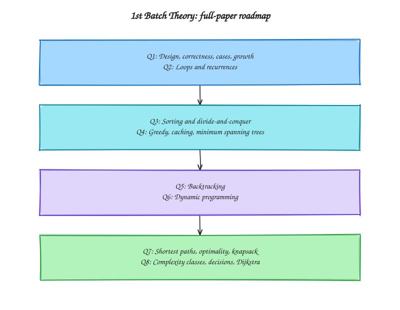

---

## Section A

### Q1. Algorithm Design, Analysis, and Complexity

#### Q1(a)

**Question (transcribed):** What do you mean by the terms Design and Analysis of algorithm? What are the properties of a good algorithm?

**Answer.**


**Design** means choosing the steps (the method or *paradigm*) that solve the problem. Examples: divide and conquer, greedy, dynamic programming.

**Analysis** means finding how much **time** and **space** the algorithm needs as the input size `n` grows. We write the result with Big-O, Big-Omega, and Theta.

> Memory trick: Design = "How do I solve it?" Analysis = "How costly is it?"

**Properties of a good algorithm**

| Property | Simple meaning |
|----------|----------------|
| Input | Takes zero or more clearly defined inputs |
| Output | Gives at least one output |
| Definiteness | Every step is clear, with no confusion |
| Finiteness | Stops after a finite number of steps for every valid input |
| Effectiveness | Every step is simple enough to actually carry out |
| Correctness | Gives the right answer for every valid input |
| Efficiency | Uses little time and little memory |
| Simplicity | Easy to understand and write |
| Generality | Works for all valid inputs, such as an empty or one-item array |

> Memory trick: **I-O-D-F-E** (Input, Output, Definiteness, Finiteness, Effectiveness), then **C-E-S-G** (Correct, Efficient, Simple, General).

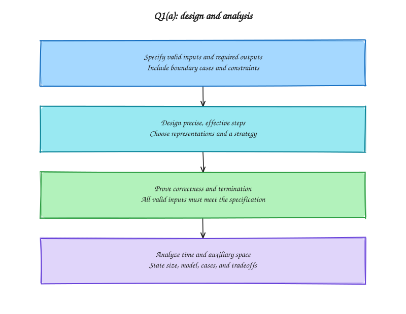

#### Q1(b)

**Question (transcribed):** Distinguish between best-case, worst-case, and average-case analysis for an algorithm. When is each most relevant?

**Answer.**

For inputs of the same size `n`:

- **Best case**: the *least* work the algorithm does.
- **Worst case**: the *most* work the algorithm does.
- **Average case**: the *expected* work, when we assume how likely each input is.

**Example: linear search** for a number in an array of `n` items

| Case | When it happens | Comparisons | Time |
|------|-----------------|-------------|------|
| Best | Item is the first element | 1 | Θ(1) |
| Worst | Item is last or not present | n | Θ(n) |
| Average | Item is equally likely at any position | (n+1)/2 | Θ(n) |

**When each is most relevant**

- **Worst case**: most important. It is a *guarantee* that the algorithm is never slower. Use it for safety-critical and real-time systems.
- **Average case**: use it when inputs are random or typical. Example: quick sort is Θ(n log n) on average.
- **Best case**: least useful. It only shows the luckiest situation.

> Memory trick: Best = lucky, Worst = guarantee, Average = typical.

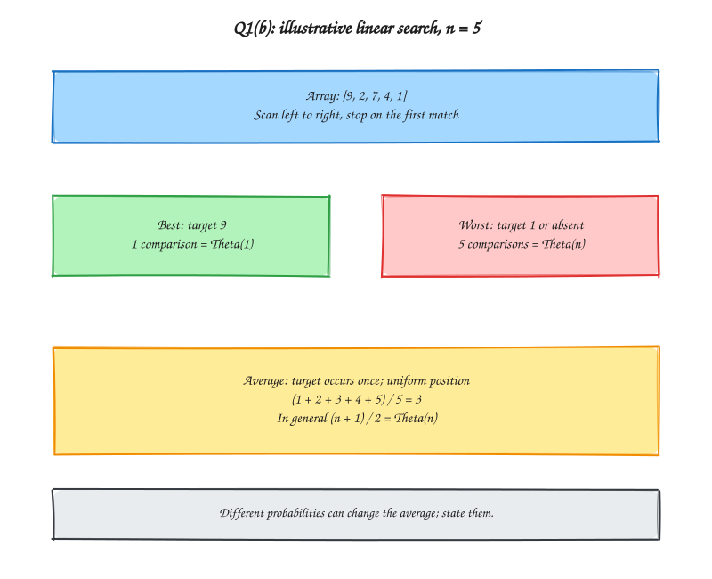

#### Q1(c)

**Question (transcribed):** Given two algorithms, Algorithm A with time complexity O(n^2) and Algorithm B with time complexity O(n log n), which one would you prefer for large input sizes and why? Justify your answer.

**Answer.**

**Prefer Algorithm B.** For large $n$, $n\log n$ grows much more slowly than $n^2$. The ratio $n^2 / (n\log n) = n/\log n$ keeps growing as $n$ grows. Compare them with a table:

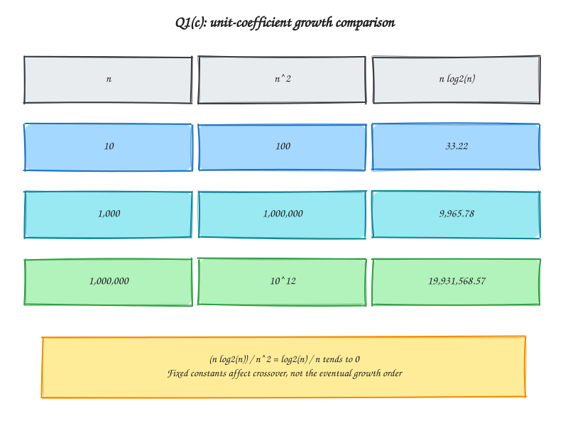

| $n$ | $n^2$ (Algorithm A) | $n \log_2 n$ (Algorithm B) |
|-----|---------------------|----------------------------|
| 10 | 100 | about 33 |
| 1,000 | 1,000,000 | about 9,966 |
| 1,000,000 | $10^{12}$ | about $2 \times 10^7$ |

At $n = 10^6$, Algorithm B does about 50,000 times less work. On a computer doing $10^9$ steps per second, A takes about 1,000 seconds (more than 16 minutes) and B takes about 0.02 seconds.

**Why B is the better choice**

1. Asymptotic analysis compares algorithms when $n$ is large, so only the growth rate matters.
2. $n\log n$ has a lower growth order than $n^2$, so B wins after some input size $n_0$.
3. For very small $n$, A can be faster because of smaller constant factors. This does not matter for large inputs.

> Memory trick: $n^2$ explodes; $n\log n$ only crawls.

---

### Q2. Recurrences and Loop Analysis

#### Q2(a)

**Question (transcribed):** Explain the significance of recurrence relations.

**Answer.**

A **recurrence relation** is an equation that describes a problem in terms of smaller versions of the same problem (along with base cases).

In algorithm analysis, recurrence relations are especially important for **recursive algorithms** and **divide-and-conquer algorithms**, where the running time naturally depends on solving smaller instances of the input.

**Simple Example**

Suppose an algorithm solves a problem of size $n$ by:
- Dividing it into 2 smaller subproblems, each of size $n/2$.
- Spending $n$ additional operations to divide and combine the results.

We express this as the recurrence:

$$T(n) = 2T(n/2) + n$$

Here:
- $T(n)$ = time required for problem size $n$
- $2T(n/2)$ = time for the two smaller subproblems
- $n$ = additional work (divide + combine)

Solving this recurrence gives $T(n) = \Theta(n\log n)$ (or $O(n\log n)$).

**Why Recurrence Relations are Significant**

1. **They describe recursive algorithms mathematically:**  
   They formalize how the running time of a large problem depends directly on smaller subproblems.
2. **They help determine asymptotic time complexity:**  
   By solving the recurrence, we obtain closed-form bounds such as $O(\log n)$, $O(n)$, $O(n\log n)$, or $O(n^2)$.
3. **They are essential for divide-and-conquer algorithms:**  
   Algorithms like Merge Sort and Quick Sort naturally break inputs into parts; recurrences match their structure: $\text{Divide cost} + \text{Conquer cost} + \text{Combine cost}$.
4. **They help compare algorithms before implementation:**  
   Once recurrences are solved into asymptotic complexities, we can compare the efficiency of different recursive strategies for large inputs without running benchmarks.

| Algorithm | Recurrence | Solution |
|-----------|------------|----------|
| Binary search | $T(n) = T(n/2) + 1$ | $\Theta(\log n)$ |
| Merge sort | $T(n) = 2T(n/2) + n$ | $\Theta(n \log n)$ |
| Recursive sum | $T(n) = T(n-1) + 1$ | $\Theta(n)$ |

**Three Methods to Solve a Recurrence**

1. **Substitution method:** Guess the answer, then prove it using mathematical induction.
2. **Recursion tree method:** Draw the recursive calls as a tree, sum the work at each level, and sum across all levels.
3. **Master theorem:** For recurrences of the form $T(n) = aT(n/b) + f(n)$, compare $f(n)$ with $n^{\log_b a}$.

**Exam-Ready Answer**

> Recurrence relations are significant because they express the running time of a recursive algorithm in terms of smaller input sizes. By solving the recurrence, we can determine the algorithm's time complexity and analyze its efficiency, especially for recursive and divide-and-conquer algorithms.
>
> **In one line:**  
> $\text{Recursive algorithm} \longrightarrow \text{Recurrence relation} \longrightarrow \text{Solve it} \longrightarrow \text{Time complexity}$

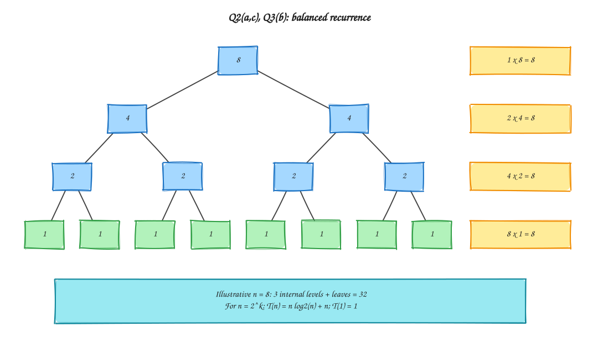

#### Q2(b)

**Question (transcribed):** Determine the time complexity for the following algorithms:

**(i)**

```text
sum = 0;
for (i = 1; i <= n; i = i * 2)
    for (j = 1; j <= n; j++)
        sum += i * j;
```

**(ii)**

```text
sum = 0;
for (i = 1; i <= n; i = i * 2)
    for (j = 1; j <= i; j++)
        sum += i * j;
```

**Answer.**

Each loop body takes constant time, so we only count how many times it runs.

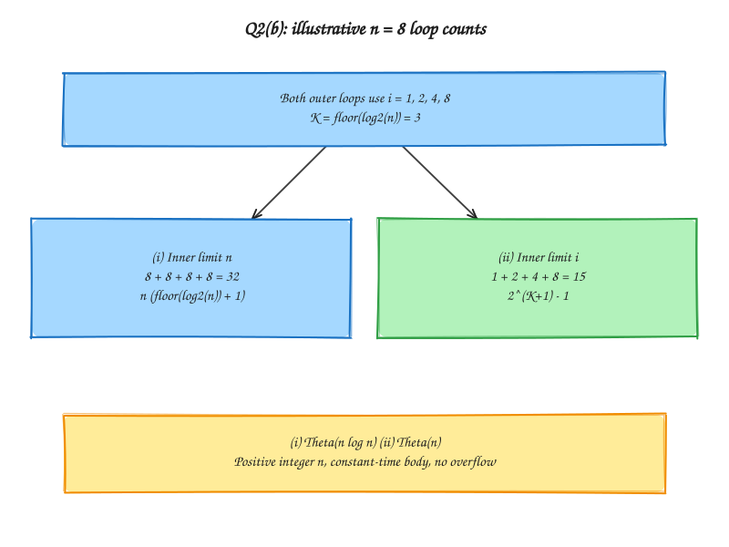

**(i)** The outer loop doubles $i$: $1,2,4,\dots$ up to $n$. It runs $\lfloor\log_2 n\rfloor+1$ times. The inner loop runs $n$ times each time, for a total of $n(\lfloor\log_2 n\rfloor+1)$ iterations. The time is **$\Theta(n\log n)$**. For $n = 8$: total = 32 iterations.

**(ii)** The outer loop again doubles $i$, and the inner loop runs $i$ times. So the total is $1+2+4+\dots$ up to the last power of 2 that is at most $n$. This is a geometric series, and its sum is between $n$ and $2n-1$, so the time is **$\Theta(n)$**. For $n = 8$: total = $1+2+4+8 = 15$.

> Memory trick: inner loop fixed at $n$ gives $n\log n$. Inner loop growing with $i$ adds up to about $2n$, so just $n$.

#### Q2(c)

**Question (transcribed):** Prove that $T(n)=O(n\log n)$ for the recurrence relation:

$$T(n)=\begin{cases}2T(n/2)+n,&n>1,\\n,&n=1.\end{cases}$$

**Answer.**

**Domain:** $n=2^k$ for an integer $k\ge0$. The recursive rule applies when $n>1$.

**Method 1: Substitution**

**Guess:** $T(n)\le 2\,n\log_2 n$ for all $n\ge2$ (so $c=2$).

- **Base case** ($n=2$): $T(2)=2T(1)+2=4$, and $2\cdot2\cdot\log_2 2=4$. So the guess holds. (We start at $n=2$ because $n\log n=0$ at $n=1$.)
- **Inductive step** ($n\ge4$): assume the guess holds for $n/2$.

$$T(n) = 2T(n/2) + n \le 2\cdot 2\,\frac{n}{2}\log_2\frac{n}{2} + n = 2n\log_2 n - 2n + n = 2n\log_2 n - n \le 2n\log_2 n$$

So $T(n)\le 2n\log_2 n$, which proves $T(n)=O(n\log n)$.

**Method 2: Recursion tree**

| Level | Number of nodes | Size of each node | Work per level |
|-------|-----------------|-------------------|----------------|
| 0 | 1 | $n$ | $n$ |
| 1 | 2 | $n/2$ | $2 \cdot n/2 = n$ |
| 2 | 4 | $n/4$ | $4 \cdot n/4 = n$ |
| ... | ... | ... | $n$ |
| $\log_2 n$ | $n$ | 1 | $n$ |


There are $\log_2 n+1$ levels, and each level does $n$ work. The total is $n(\log_2 n+1)=\Theta(n\log n)$.

**Method 3: Master Theorem**

Here $a=2$, $b=2$, and $f(n)=n$. The **watershed function** is $n^{\log_b a}=n^{\log_2 2}=n$. Since $f(n)=\Theta(n^{\log_b a}\log^0 n)$ has the same growth, this is **Case 2** ($k=0$) of the Master Theorem, so $T(n)=\Theta(n^{\log_b a}\log^{k+1}n)=\Theta(n\log n)$.

**Final answer:** $T(n)=\Theta(n\log n)$. For powers of 2, the exact solution is $T(n)=n\log_2 n+n$. Check: $T(4)=12$ and $T(8)=32$.

> Memory trick: every level costs $n$, and there are $\log n$ levels.

---

### Q3. Divide and Conquer, Merge Sort, Quick Sort, Heap Sort

#### Q3(a)

**Question (transcribed):** Explain the main steps of the Divide-and-Conquer algorithmic paradigm.

**Answer.**

1. **Divide**: split the problem into smaller parts.
2. **Conquer**: solve each part. Solve a small enough part directly; this is the **base case**.
3. **Combine**: join the smaller answers to get the final answer.

**Illustrative example: merge sort on $[5, 2, 4, 7]$**

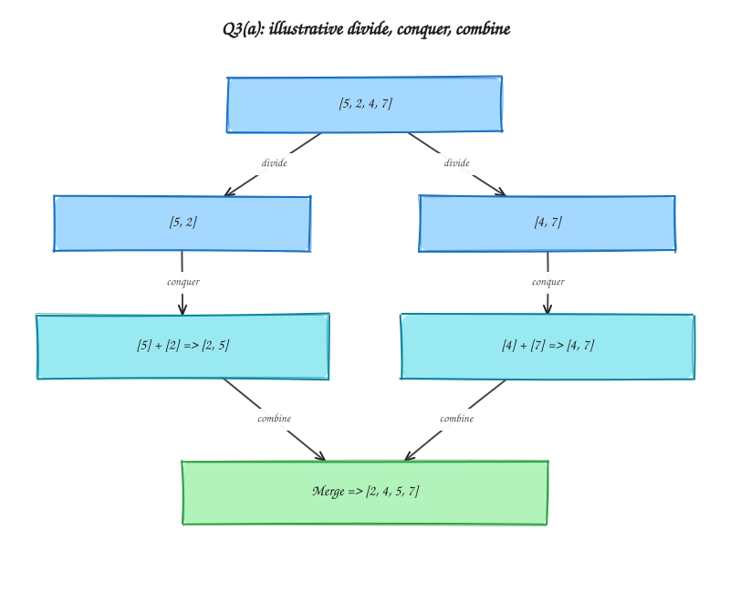

```text
[5, 2, 4, 7]          divide
[5, 2]   [4, 7]       divide
[2, 5]   [4, 7]       conquer (sort each half)
[2, 4, 5, 7]          combine (merge)
```

> Memory trick: Divide, Conquer, Combine = **D-C-C**.

#### Q3(b)

**Question (transcribed):** Analyze the recurrence relation for Merge Sort: T(n) = 2T(n/2) + O(n). What is its time complexity?

**Answer.**

**How merge sort works**

- **Divide**: split the array into 2 halves. Cost O(1).
- **Conquer**: sort each half recursively. Cost 2T(n/2).
- **Combine**: merge the two sorted halves. Cost O(n).

So **T(n) = 2T(n/2) + O(n)**, with T(1) = O(1).

**Solve by recursion tree**

- Each level does about n work (the merges).
- The array is halved each time, so there are log n levels.
- Total work = n × log n.

**Solve by Master theorem**

a = 2, b = 2, f(n) = n, and the watershed function is n^(log₂ 2) = n. Since f(n) matches it (Case 2 with k = 0), T(n) = Θ(n log n).

**Answer: Θ(n log n)** in the best, average, and worst case. Merge sort needs O(n) extra space for merging, so it is **not in-place**. It is stable.

> Memory trick: Two halves, one merge, and log n levels give n log n.


#### Q3(c)

**Question (transcribed):** What is in-place sorting? Is Quicksort an in-place sorting algorithm? Justify.

**Answer.**

**In-place sorting** means the algorithm sorts elements inside the original array itself without allocating another array of size $n$, using only a small amount of additional memory ($O(1)$ auxiliary workspace, or at most $O(\log n)$ stack).

**Is Quicksort in-place? Yes, conventionally.**

**Justification:**

1. **Partitioning needs $O(1)$ auxiliary space:** Quicksort rearranges elements by swapping them within the same array around a pivot. It does not need a second array of size $n$ to hold items.
2. **Recursion stack:** Because Quicksort is recursive, function calls use stack space—typically $O(\log n)$ (worst-case naive recursion can use $O(n)$, which can be capped at $O(\log n)$ by recursing on the smaller subarray first).
3. **Conclusion:** Because it sorts by swapping in-place and does not require an additional $O(n)$-sized array, Quicksort is conventionally classified as an **in-place** sorting algorithm.

| Property | Quick sort | Merge sort |
|---|---|---|
| Extra array needed? | No | Yes (size $n$) |
| Partition / merge space | $O(1)$ | $O(n)$ |
| In-place? | Yes (conventionally) | No (standard array) |
| Stable? | No | Yes |

> Memory trick: Quicksort swaps within the array $\rightarrow$ In-place. Merge Sort copies to an extra array $\rightarrow$ Not in-place.

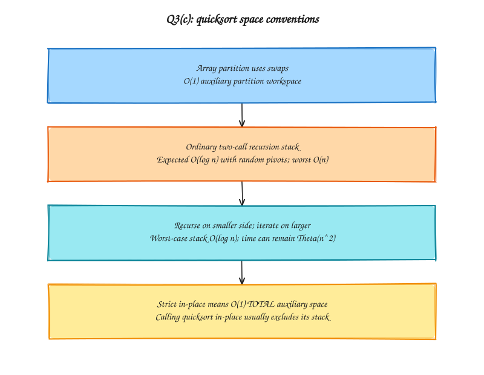

#### Q3(d)

**Question (transcribed):** Trace Heap Sort on the array A = [7, 2, 5, 3, 4, 6, 1]. Show the heap construction and sorting phases step by step.

**Answer.**

**Given input:** $A=[7,2,5,3,4,6,1]$. Indices start at 0. At index $i$, the children are at $2i+1$ and $2i+2$. First build a **max-heap** (every parent is at least as large as its children). Then, on each round, move the largest item to the end.

**Step 1: Build the max-heap** (restore heap order, or heapify, from index 2 down to 0)

- $i=2$ (value 5): the children are 6 and 1. Swap 5 with the larger child, 6. Array: $[7, 2, 6, 3, 4, 5, 1]$
- $i=1$ (value 2): the children are 3 and 4. Swap 2 with the larger child, 4. Array: $[7, 4, 6, 3, 2, 5, 1]$
- $i=0$ (value 7): it is already larger than both children, 4 and 6, so no swap is needed.

Heap as a tree:

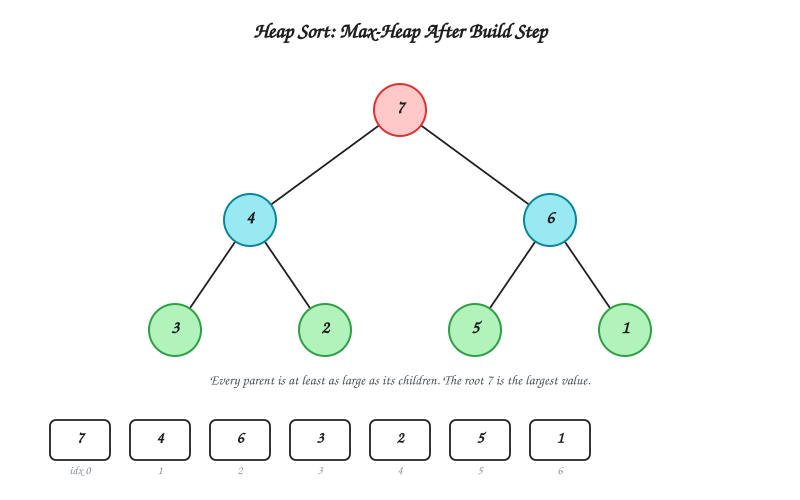

**Step 2: Sort (repeat until size is 1)**

Each round: swap the root (the largest item) with the last item in the heap. Make the heap one item shorter, then fix the heap from the root (heapify).

| Round | Swap root with last heap item | Array after the round |
|-------|-------------------------------|-----------------------|
| 1 | swap 7 and 1, then heapify | $[6, 4, 5, 3, 2, 1, 7]$ |
| 2 | swap 6 and 1, then heapify | $[5, 4, 1, 3, 2, 6, 7]$ |
| 3 | swap 5 and 2, then heapify | $[4, 3, 1, 2, 5, 6, 7]$ |
| 4 | swap 4 and 2, then heapify | $[3, 2, 1, 4, 5, 6, 7]$ |
| 5 | swap 3 and 1, then heapify | $[2, 1, 3, 4, 5, 6, 7]$ |
| 6 | swap 2 and 1 | $[1, 2, 3, 4, 5, 6, 7]$ |

**Final sorted array:** $[1, 2, 3, 4, 5, 6, 7]$

**Complexity:** building the heap takes $\Theta(n)$. The next $n-1$ rounds take $O(\log n)$ each, so the total time is $\Theta(n\log n)$. It is in-place and **not stable**.

> Memory trick: build a max-heap, then keep moving the biggest item to the back.

---

### Q4. Greedy Algorithms, Memoization vs Tabulation, and MST

#### Q4(a)

**Question (transcribed):** At each step, Greedy Algorithm chooses local optimal solution. With suitable example show that, choosing local optimal solution at each step may not lead to the global optimal solution.

**Answer.**

A **greedy algorithm** builds a solution by repeatedly choosing the option that looks best at the current moment. Once a choice is made, the algorithm does not go back and change it (see [Chapter 7](../../../Chapter%207%20-%20Greedy%20Algorithms/README.md)).

**Greedy parts for coin change**

| Greedy part | Coin-change choice |
|-------------|--------------------|
| Candidate set | Coins of value 4, 3, and 1 (unlimited supply) |
| Selection function | Largest coin that does not exceed the remaining amount |
| Feasibility function | The coin must not exceed the remaining amount |
| Objective function | Use as few coins as possible |
| Solution function | The remaining amount becomes 0 |

**Illustrative counterexample.** Use unlimited coins with denominations $\{4,3,1\}$. Make the target amount $A=6$ using as few coins as possible.

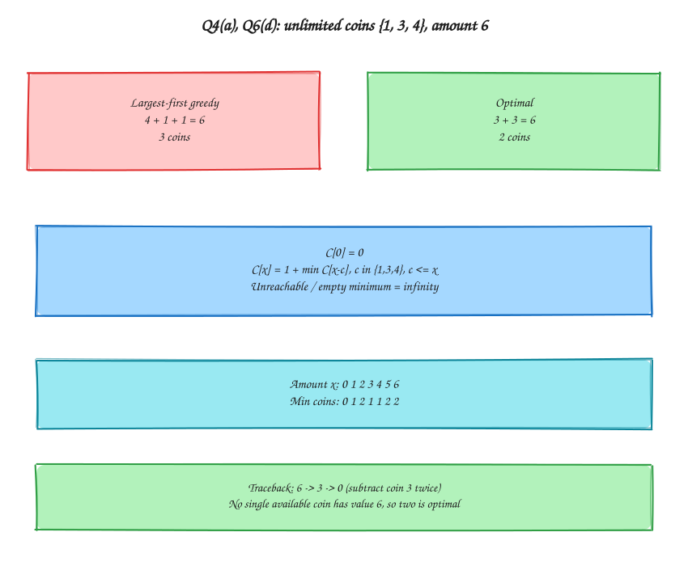

| Step | Remaining amount | Largest usable coin | New remaining amount |
|:----:|:----------------:|:-------------------:|:--------------------:|
| 1 | 6 | 4 | 2 |
| 2 | 2 | 1 | 1 |
| 3 | 1 | 1 | 0 |

| Method | Chosen coins | Number of coins |
|--------|--------------|:---------------:|
| Greedy | $4+1+1$ | **3 coins** |
| Optimal | $3+3$ | 2 coins |

Greedy took the big coin 4 first because it looked best, but the leftover amount 2 then needed two more coins. The locally best choice is not safe here, so the **greedy-choice property** fails for this coin system.

**When does greedy work?** Only when the problem has both properties below, and each must be proved:

| Property or proof idea | Meaning | Example |
|------------------------|---------|---------|
| Greedy-choice property | A globally optimal solution can start with the locally best choice | Activity selection, fractional knapsack |
| Optimal substructure | After the safe choice, the rest is the same kind of smaller problem | MST, Huffman coding |
| Exchange argument (proof idea) | Swap part of an optimal solution for the greedy choice without making it worse | Fractional knapsack |
| Cut property (proof idea) | The lightest edge crossing a cut is safe for an MST | Prim, Kruskal |

> Memory trick: greedy never looks back, so it can get trapped.

#### Q4(b)

**Question (transcribed):** Differentiate between memoization and tabulation.

**Answer.**

Both are **dynamic programming** methods. They save answers to smaller problems so the same problem is never solved twice (see [Chapter 8](../../../Chapter%208%20-%20Dynamic%20Programming/README.md)).

- **Memoization (top-down)**: start from the big problem, use recursion, and save each answer in a cache (a store for saved answers) the first time it is found.
- **Tabulation (bottom-up)**: start from the smallest problem and use a loop to fill a table in dependency order up to the answer.

| Feature | Memoization (Top-Down) | Tabulation (Bottom-Up) |
|---------|------------------------|------------------------|
| Approach | Start from the big problem | Start from the smallest problem |
| Technique | Recursion + cache | Iteration + table |
| Solves | Only needed subproblems | All subproblems in the table |
| Uses recursion | Yes | No |
| Stack overflow risk | Yes | No |
| Easier to write | Usually | Sometimes harder |

Memoization pattern:

```text
Solve(state):
    if state is a base case:
        return base value
    if state is already stored:
        return stored value
    compute answer from smaller states
    store answer
    return answer
```

Tabulation pattern:

```text
Create the DP table
Fill base cases
For each state in dependency order:
    compute table[state] from already-filled states
Return the required final state
```

**Illustrative example: Fibonacci.** The DP parts are: state $F(n)$; base cases $F(0)=0$ and $F(1)=1$; recurrence $F(n)=F(n-1)+F(n-2)$ for integers $n\ge2$; table order $n=2,3,\dots$; final answer $F(n)$. Both functions below accept nonnegative integers.

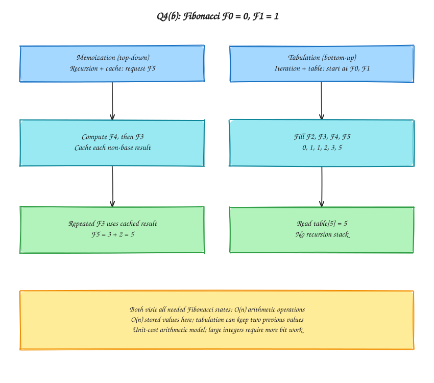

```python
# Memoization (top-down)
memo = {}
def fib_memo(n):
    if n <= 1:
        return n
    if n in memo:
        return memo[n]
    memo[n] = fib_memo(n - 1) + fib_memo(n - 2)
    return memo[n]

# Tabulation (bottom-up)
def fib_tab(n):
    if n <= 1:
        return n
    table = [0] * (n + 1)
    table[1] = 1
    for i in range(2, n + 1):
        table[i] = table[i - 1] + table[i - 2]
    return table[n]
```

For $F(5)$, memoization starts at $F(5)$ and asks for smaller values. After it computes $F(3)=2$, a later request for $F(3)$ returns the cached value. Tabulation fills upward from the base cases:

| $n$ | 0 | 1 | 2 | 3 | 4 | 5 |
|:---:|:-:|:-:|:-:|:-:|:-:|:-:|
| $F(n)$ | 0 | 1 | 1 | 2 | 3 | **5** |

Both versions take $O(n)$ time (plain recursion takes $O(2^n)$). Tabulation can keep only the last two values and use $O(1)$ memory.

> Memory trick: memoization = recursion + notebook. Tabulation = loop + table.

#### Q4(c)

**Question (transcribed):** Consider the following graph with weighted edges: Vertices: A, B, C, D, E; Edges: A-B (2), A-C (3), B-C (1), B-D (4), C-D (5), C-E (6), D-E (7). (i) Find the Minimum Spanning Tree using Prim's Algorithm. (ii) Find the Minimum Spanning Tree using Kruskal's Algorithm.

**Answer.**

A **minimum spanning tree (MST)** connects every vertex, has no cycles, and has the smallest possible total edge weight. It has $|V|-1$ edges. Prim and Kruskal are both greedy: each repeatedly takes a locally cheapest safe edge, and the **cut property** makes that choice safe (see [Chapter 11](../../../Chapter%2011%20-%20Graph%20Algorithms/README.md)).

**Read the graph.** It is undirected and weighted, with 5 vertices $A,B,C,D,E$ and 7 edges.

| Edge | Weight |
|------|--------|
| A-B | 2 |
| A-C | 3 |
| B-C | 1 |
| B-D | 4 |
| C-D | 5 |
| C-E | 6 |
| D-E | 7 |

**Adjacency list** (neighbour, weight):

```text
A: B(2), C(3)
B: A(2), C(1), D(4)
C: A(3), B(1), D(5), E(6)
D: B(4), C(5), E(7)
E: C(6), D(7)
```

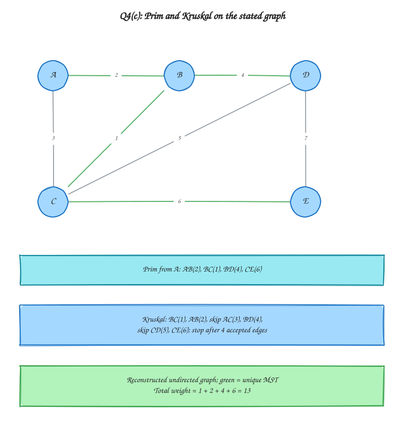

**(i) Prim's algorithm (start from A).** Grow one tree. At each step, only edges with exactly one end in the tree are eligible.

| Step | Tree vertices before selection | Minimum crossing choice | Edge added | Running weight |
|:----:|:-------------------------------|:------------------------|:----------:|:--------------:|
| 1 | $\{A\}$ | A-B (2); other crossing edge: A-C (3) | A-B | 2 |
| 2 | $\{A,B\}$ | B-C (1); others: A-C (3), B-D (4) | B-C | 3 |
| 3 | $\{A,B,C\}$ | B-D (4); others: C-D (5), C-E (6) | B-D | 7 |
| 4 | $\{A,B,C,D\}$ | C-E (6); other: D-E (7) | C-E | **13** |

**(ii) Kruskal's algorithm.** Start with five one-vertex sets. Sort the edges by weight. Accept an edge only if `FIND` gives different roots for its two ends, then `UNION` the sets. Stop after $|V|-1=4$ accepted edges.

| Scan | Edge | Weight | Decision | Selected forest after decision |
|:----:|:----:|:------:|:---------|:-------------------------------|
| 1 | B-C | 1 | Take | $\{B,C\}$, $\{A\}$, $\{D\}$, $\{E\}$ |
| 2 | A-B | 2 | Take | $\{A,B,C\}$, $\{D\}$, $\{E\}$ |
| 3 | A-C | 3 | Skip (same set; cycle A-B-C) | unchanged |
| 4 | B-D | 4 | Take | $\{A,B,C,D\}$, $\{E\}$ |
| 5 | C-D | 5 | Skip (same set; cycle) | unchanged |
| 6 | C-E | 6 | Take; 4 edges, so stop | $\{A,B,C,D,E\}$ |
| 7 | D-E | 7 | Not needed | MST already complete |

**MST edges:** B-C, A-B, B-D, C-E

**Total MST weight:** $1+2+4+6=13$

Both algorithms give this MST. Since all edge weights are different, it is the only MST. Prim takes $\Theta(V^2)$ time with a matrix, or $\Theta((V+E)\log V)$ with an adjacency list and binary heap. Kruskal takes $\Theta(E\log E)$ time, because sorting the edges dominates.

> Memory trick: Prim = grow one tree. Kruskal = sort the edges and avoid cycles.

---

## Section B

### Q5. Backtracking

#### Q5(a)

**Question (transcribed):** Explain the concept of Backtracking.

**Answer.**

**Backtracking** builds the solution **one choice at a time**. After each choice it checks the constraints.

- If the choice is still **promising**, go deeper.
- If it is a **dead end**, **undo** (go back) and try the next choice.

It searches the **state-space tree** in **depth-first** order. **Pruning** cuts away branches that cannot give a valid solution, which saves time.

**Examples:** N-Queen, subset sum, Hamiltonian circuit, graph colouring.

> Memory trick: Try, check, undo, try again.

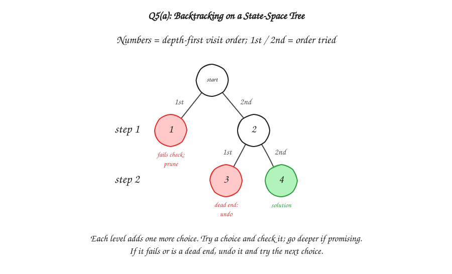

**Exam sketch:** draw a root circle, two edges per node, and number the circles in the order they are visited. Colour or tick the pruned node, the dead end, and the solution.

#### Q5(b)

**Question (transcribed):** Describe how a backtracking algorithm would typically solve the N-Queen problem. How would it determine where to place the k-th queen, and what are the conditions that would lead to backtracking?

**Answer.**

Place $N$ queens on an $N\times N$ board so that no two queens share a row, column, or diagonal.

**Illustrative instance:** Place 4 queens on a $4\times4$ board. Rows and columns start at 0.

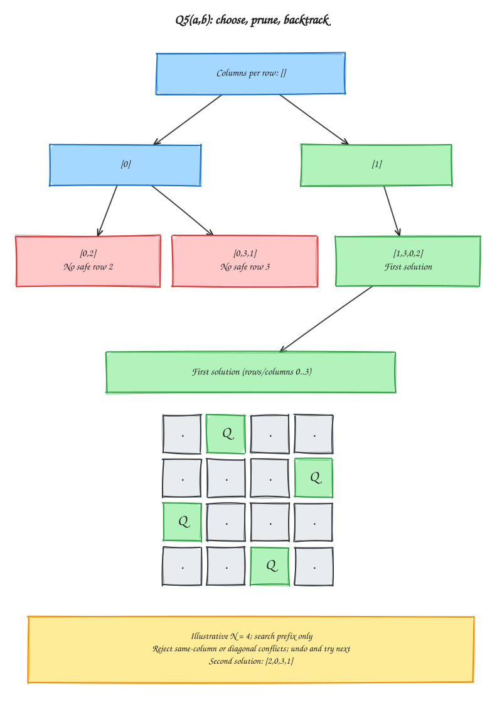

**Exam sketch:** draw the root, then one level per row. Write the columns chosen so far inside each circle and the column tried on each edge. Mark a dead end with a cross, and stop at the first full row of four.

**Idea:** put one queen in each row. To place the $k$-th queen in row $k$:

1. Try columns $0,1,\dots,N-1$ in order.
2. A column is safe if no earlier queen is in the same column or diagonal. (Two queens are on the same diagonal when the row difference equals the column difference.)
3. Put the queen in a safe column and continue to row $k+1$.
4. If no column is safe, **backtrack**: return to row $k-1$ and try its next column.

**Pseudocode**

```text
SOLVE(row):
    if row == N:
        print the board          // found a solution
        return

    for col = 0 to N-1:
        if IS-SAFE(row, col):
            board[row] = col     // place queen
            SOLVE(row + 1)
            // if we get here, backtrack: the loop tries the next column

IS-SAFE(row, col):
    for r = 0 to row-1:
        if board[r] == col:                    // same column
            return false
        if |board[r] - col| == row - r:        // same diagonal
            return false
    return true
```

**When to backtrack**

- A queen is already in the same column.
- A queen is already on the same diagonal.
- No column is safe in row $k$, so return to row $k-1$.

**Trace for 4 queens** (rows and columns start at 0, shown as (row, col))

1. Place (0, 0).
2. Row 1: columns 0 and 1 conflict (column and diagonal). Place (1, 2).
3. Row 2: every column conflicts. **Backtrack** to row 1.
4. Row 1: try column 3. Place (1, 3).
5. Row 2: column 0 conflicts. Place (2, 1).
6. Row 3: every column conflicts. **Backtrack** to row 2.
7. Row 2: columns 2 and 3 conflict. **Backtrack** to row 1.
8. Row 1 has no more options. **Backtrack** to row 0.
9. Row 0: try column 1. Place (0, 1). Continue: (1, 3), (2, 0), (3, 2).

**First solution:**

```text
. Q . .
. . . Q
Q . . .
. . Q .
```

Call `SOLVE(0)`. The array `board` stores each queen's column. For $N=4$, there are exactly two solutions: $[1,3,0,2]$ and $[2,0,3,1]$. The first is shown above.

> Memory trick: one queen per row, check column and diagonal, and if no place is safe, go back.

#### Q5(c)

**Question (transcribed):** Find a subset of the given set A = {3, 5, 6, 7} whose sum is d = 15. Show a partial trace of the backtracking algorithm and highlight when it explores a path and when it backtracks.

**Answer.**

**Given input:** $A=\{3,5,6,7\}$ contains four different positive numbers, each used at most once. Find subsets that sum to $d=15$. Check the numbers in order, trying **take** before **skip**. The trace and diagram show the search only through its first solution.

- If the sum is greater than $d$, **prune** the branch. This is safe because all remaining numbers are positive.
- If the sum equals $d$, we have a solution.
- If no numbers remain and the sum is not $d$, we have reached a **dead end**.

**Trace**

1. Take 3: sum = 3.
2. Take 5: sum = 8.
3. Take 6: sum = 14.
4. Take 7: sum = 21. This is more than 15, so **prune**.
5. Skip 7: sum = 14. No items left, so **dead end**. Backtrack.
6. Skip 6: sum = 8.
7. Take 7: sum = 15. **Solution found.**

The same trace as a tree:

```text
start (0)
 └─ take 3 (3)
     └─ take 5 (8)
         ├─ take 6 (14)
         │    ├─ take 7 (21)  X more than 15: PRUNE, backtrack
         │    └─ skip 7 (14)  X no numbers left: DEAD END, backtrack
         └─ skip 6 (8)
              └─ take 7 (15)  OK SOLUTION FOUND
```

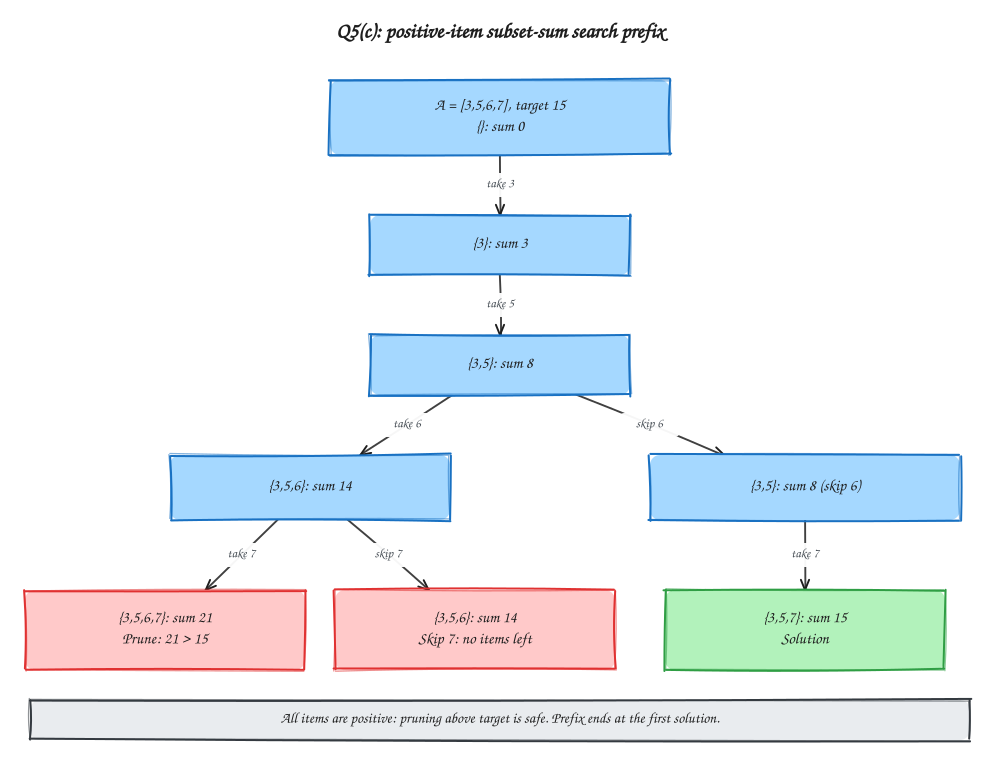

**Answer: $\{3,5,7\}$**, because $3+5+7=15$. It is the only solution: every other subset has a sum different from 15.

```text
SUBSETS(i, total, chosen):
    if total == d: output chosen; return
    if total > d or i == length(A): return
    SUBSETS(i + 1, total + A[i], chosen followed by A[i])
    SUBSETS(i + 1, total, chosen)
```

Call `SUBSETS(0, 0, [])`. At each number, the algorithm tries **take** and **skip**. It stops a branch when it finds the target, goes over it, or runs out of numbers.

> Memory trick: take or skip. Too big means prune. Nothing left means dead end.

#### Q5(d)

**Question (transcribed):** Trace the initial steps of the backtracking algorithm, starting from vertex a, to find a Hamiltonian Circuit. Show at least two different paths explored (one that might lead to a solution, and one that leads to backtracking).

**Answer.**

A **Hamiltonian circuit** visits every vertex once, then returns to its starting vertex.

**Graph transcribed from the paper's figure:** an undirected graph on $V=\{a,b,c,d,e,f\}$. The adjacency list below gives every edge in the figure.

| Vertex | Neighbours |
|--------|------------|
| a | b, c, d |
| b | a, c, f |
| c | a, b, d, e |
| d | a, c, e |
| e | c, d, f |
| f | b, e |

**Idea:** start at $a$ and try unvisited neighbours in alphabetical order. If the path gets stuck, backtrack and try another neighbour.

**Trace**

1. Try $a \to b \to c \to d \to e \to f$. All 6 vertices are visited, but $f$ is not joined to $a$. **Dead end.**
2. Return to $c$ and try $e$: $a \to b \to c \to e \to d$. The only unvisited vertex is $f$, but $d$ has no unvisited neighbour. **Dead end.**
3. Backtrack from $d$ to $e$, then try $f$: $a \to b \to c \to e \to f$. The only unvisited vertex is $d$, but $f$ has no unvisited neighbour. **Dead end.**
4. Return to $b$ and try $f$: $a \to b \to f \to e \to c \to d$. All 6 vertices are visited, and $d$ is joined to $a$. **Circuit found.**

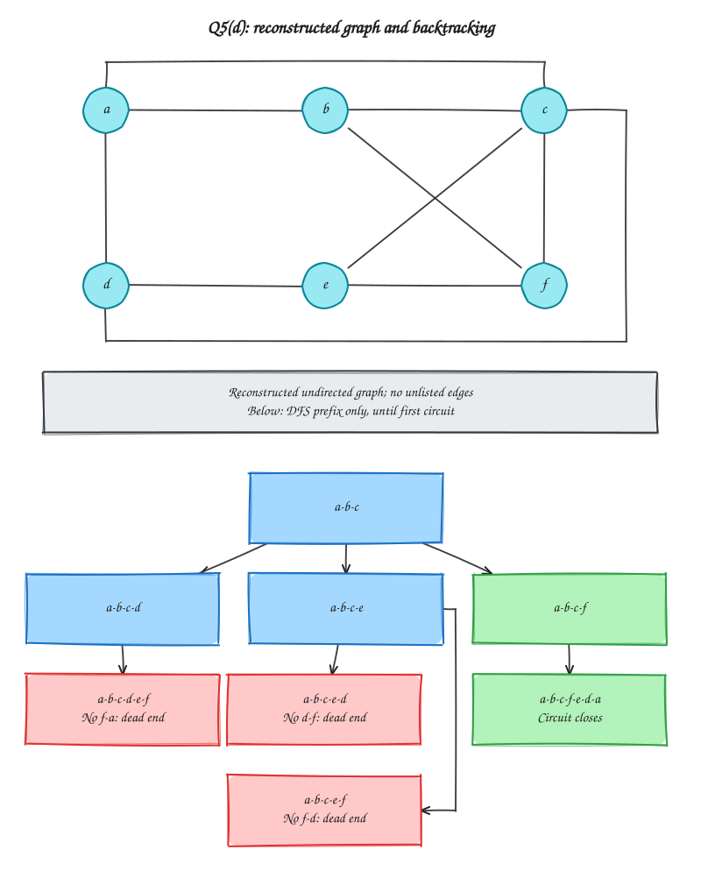

**Answer:** $a-b-f-e-c-d-a$. Another valid circuit is $a-b-f-e-d-c-a$. Every pair of neighbours in each circuit, including the last vertex and $a$, appears in the adjacency list.

```text
EXTEND(path, used):
    if length(path) == |V|:
        if edge(last(path), a): output path followed by a
        return
    for v in neighbours(last(path)) in alphabetical order:
        if v not in used:
            EXTEND(path followed by v, used union {v})
```

Call `EXTEND([a], {a})`. Stop at the first circuit for this trace, or continue to find more. Add only unused vertices, and check that the final vertex connects back to $a$.

> Memory trick: visit every vertex once, and the last vertex must connect back to $a$.

---

### Q6. Dynamic Programming

#### Q6(a)

**Question (transcribed):** What are the two key properties that a problem must possess for Dynamic Programming to be applicable?

**Answer.**

Dynamic programming stores each distinct subproblem once and reuses it. A problem needs both properties below (see [Chapter 8](../../../Chapter%208%20-%20Dynamic%20Programming/README.md)).

1. **Optimal substructure**: an optimal answer is built from optimal answers to smaller subproblems, in the form $DP[state]=\mathrm{best}_{choice}\{\text{value of choice}+DP[\text{next state}]\}$.

   *Example:* for amount 6 with coins $1,3,4$, try coin 3 first. The remaining amount is 3, so the candidate is $1+dp[3]=2$ coins. If $dp[3]$ were not optimal, replacing it with a better solution would improve the answer for 6.

2. **Overlapping subproblems**: the same smaller states are needed again and again. DP solves each once, stores it, and reuses it.

   *Example:* $F(5)=F(4)+F(3)$ and $F(4)=F(3)+F(2)$ both need $F(3)$, so calculate and store $F(3)$ once.

A DP solution then has five parts: **state**, **recurrence**, **base case**, **table order**, and **final answer**. 0/1 knapsack has both properties (see Q6(b)).

> Memory trick: **O-O** = Optimal substructure + Overlapping sub-problems.

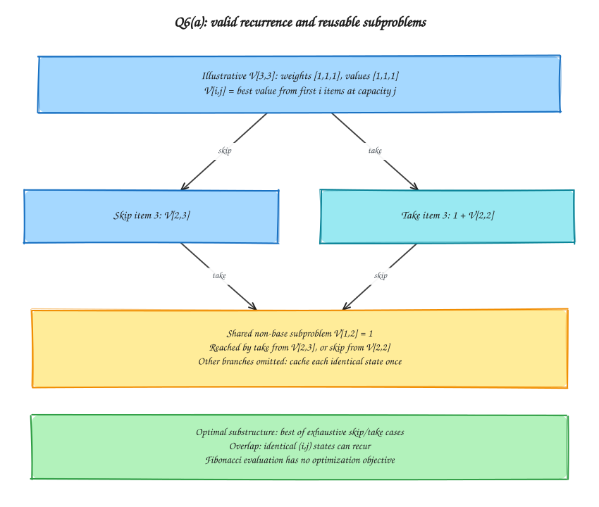

#### Q6(b)

**Question (transcribed):** Define the DP[i][w] state for the 0/1 Knapsack problem. Write down the dynamic programming recurrence relation for the knapsack problem.

**Answer.**

**Problem:** there are $n$ items. Item $i$ has weight $w_i$ and value $v_i$ (the question calls the value *profit*). The capacity is $W$. Take each item **whole, at most once**, to get the maximum total value without exceeding $W$.

**State:** $V[i,j]$ is the maximum value using the **first $i$ items** with capacity $j$. This is the question's $DP[i][w]$, with $j=w$.

For item $i$ there are two choices:

- **Skip item $i$:** the value is $V[i-1,j]$.
- **Take item $i$** (only if $w_i\le j$): the value is $v_i+V[i-1,j-w_i]$.

$$
V[i,j]=
\begin{cases}
V[i-1,j], & \text{if } w_i>j\\
\max\big(V[i-1,j],\ v_i+V[i-1,j-w_i]\big), & \text{if } w_i\le j
\end{cases}
$$

| DP part | Choice for 0/1 knapsack |
|---------|-------------------------|
| State | $V[i,j]$: best value from the first $i$ items at capacity $j$ |
| Base case | $V[0,j]=0$ (no items) and $V[i,0]=0$ (no capacity) |
| Recurrence | The two cases above |
| Table order | Rows $i=1,\dots,n$; in each row, columns $j=1,\dots,W$ |
| Final answer | $V[n,W]$ |

**Table arrows:** $\uparrow$ means item $i$ is skipped (value copied from the row above). $\nwarrow$ means item $i$ is taken (value comes from the row above at capacity $j-w_i$). **Traceback:** start at $V[n,W]$; if $V[i,j]\ne V[i-1,j]$, item $i$ is selected and $j$ becomes $j-w_i$.

**Complexity:** $\Theta(nW)$ time and $\Theta(nW)$ space ($\Theta(W)$ if one row is reused).

> Memory trick: For each item, choose skip or take, and keep the bigger one.

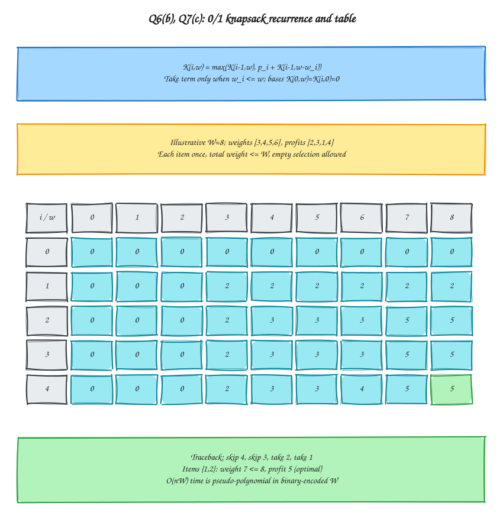

#### Q6(c)

**Question (transcribed):** Given the following 4 x 3 grid with coins (1) or no coins (0) at each cell, construct the DP table and trace the path that yields the maximum number of coins collected from (0,0) to (3,2). What is the maximum number of coins?

**Answer.**

**Grid from the paper:** the question does not say which moves are allowed, so assume we can move only **right or down** from $(0,0)$ to $(3,2)$. No cells are blocked. Collect the 0 or 1 coin in each visited cell, including the start and end cells.

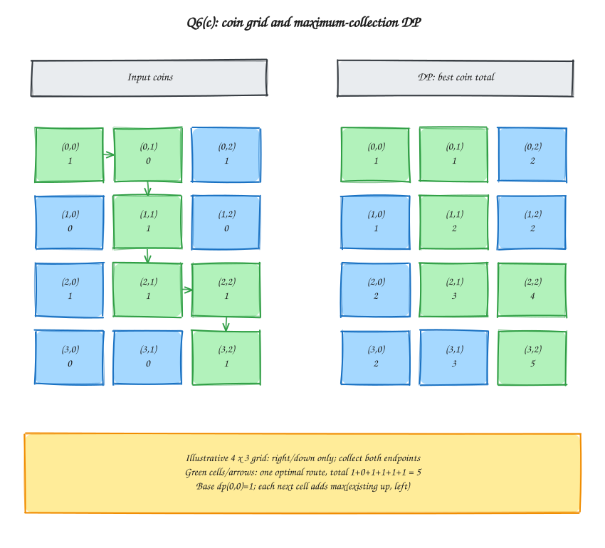

| | col 0 | col 1 | col 2 |
|---|---|---|---|
| row 0 | 1 | 0 | 1 |
| row 1 | 0 | 1 | 0 |
| row 2 | 1 | 1 | 1 |
| row 3 | 0 | 0 | 1 |

| DP part | Choice for the coin grid |
|---------|--------------------------|
| State | $dp[r,c]$: most coins collected on a right/down path from $(0,0)$ to $(r,c)$ |
| Base case | $dp[0,0]=\text{grid}[0][0]$; first row and first column have only one possible previous cell |
| Recurrence | $dp[r,c]=\text{grid}[r][c]+\max\big(dp[r-1,c],\ dp[r,c-1]\big)$, using only previous cells that exist |
| Table order | Row by row, left to right |
| Final answer | $dp[3,2]$ |

**Arrow legend:** $\uparrow$ means the best previous cell is above. $\leftarrow$ means it is to the left. On a tie, $\uparrow$ is chosen (the same up-first tie rule as the LCS algorithm in Chapter 8). The start cell has no arrow.

| | col 0 | col 1 | col 2 |
|---|---|---|---|
| row 0 | 1 | 1 ($\leftarrow$) | 2 ($\leftarrow$) |
| row 1 | 1 ($\uparrow$) | 2 ($\uparrow$) | 2 ($\uparrow$) |
| row 2 | 2 ($\uparrow$) | 3 ($\uparrow$) | 4 ($\leftarrow$) |
| row 3 | 2 ($\uparrow$) | 3 ($\uparrow$) | **5** ($\uparrow$) |

Key calculations:

- $dp[1,1]=1+\max(dp[0,1],dp[1,0])=1+\max(1,1)=2$ (tie, so $\uparrow$).
- $dp[2,2]=1+\max(dp[1,2],dp[2,1])=1+\max(2,3)=4$ (from the left).
- $dp[3,2]=1+\max(dp[2,2],dp[3,1])=1+\max(4,3)=5$.

**Traceback** from $(3,2)$, following the arrows:

1. $(3,2)$: $\uparrow$ to $(2,2)$.
2. $(2,2)$: $\leftarrow$ to $(2,1)$.
3. $(2,1)$: $\uparrow$ to $(1,1)$.
4. $(1,1)$: $\uparrow$ to $(0,1)$.
5. $(0,1)$: $\leftarrow$ to $(0,0)$. Stop.

**Answer: 5 coins.** The traceback gives the path $(0,0)\to(0,1)\to(1,1)\to(2,1)\to(2,2)\to(3,2)$. It collects $1+0+1+1+1+1=5$ coins. If ties at $(1,1)$ are broken to the left instead, the path $(0,0)\to(1,0)\to(2,0)\to(2,1)\to(2,2)\to(3,2)$ also collects 5 coins. For an $R\times C$ grid, time and space are $\Theta(RC)$.

> Memory trick: best here = my coin + the better of (from above, from left).

#### Q6(d)

**Question (transcribed):** Solve the change-making problem by DP for the amount n = 6 and the denominations 1, 3, and 4.

**Answer.**

**Given instance:** use any number of coins with denominations $D=\{1,3,4\}$ to make exactly 6, using as few coins as possible.

| DP part | Choice for this example |
|---------|-------------------------|
| State | $dp[x]$: minimum coins needed to make amount $x$ |
| Base case | $dp[0]=0$ |
| Recurrence | $dp[x]=1+\min_{c\in D,\ c\le x}dp[x-c]$, i.e. $1+\min(dp[x-1],dp[x-3],dp[x-4])$ for valid previous amounts |
| Table order | Fill amounts from 1 through 6 |
| Final answer | $dp[6]=2$, using $3+3$ |

If no coin can make an amount, its value is $\infty$ (unreachable). Each choice adds one coin to the best answer for the amount left over.


| $x$ | 0 | 1 | 2 | 3 | 4 | 5 | 6 |
|---|---|---|---|---|---|---|---|
| $dp[x]$ | 0 | 1 | 2 | 1 | 1 | 2 | 2 |
| Last coin used | - | 1 | 1 | 3 | 4 | 1 | 3 |

Key calculations:

- $dp[3]=1+\min(dp[2],dp[0])=1+\min(2,0)=1$.
- $dp[4]=1+\min(dp[3],dp[1],dp[0])=1+\min(1,1,0)=1$.
- $dp[5]=1+\min(dp[4],dp[2],dp[1])=1+\min(1,2,1)=2$.
- $dp[6]=1+\min(dp[5],dp[3],dp[2])=1+\min(2,1,2)=2$.

**Answer: 2 coins**, using $3+3$. Traceback with the last-coin row: $6\to3$ (coin 3), then $3\to0$ (coin 3). Greedy gives $4+1+1$, or 3 coins, as in Q4(a). For amount $M$, time is $\Theta(|D|\cdot M)$ and space is $\Theta(M)$.

> Memory trick: try every coin, take the cheapest option, and add 1.

---

### Q7. Shortest Paths, Optimality, and Knapsack

#### Q7(a)

**Question (transcribed):** Explain why Dijkstra's algorithm fails to find correct shortest paths in graphs with negative-weight edges, whereas Bellman-Ford succeeds.

**Answer.**

Dijkstra is greedy: it repeatedly **finalizes** the unvisited vertex with the smallest tentative distance, and that distance is never revisited. Every time a vertex $u$ is finalized, each edge $(u,v)$ leaving it is relaxed:

$$\text{if } d(u)+c(u,v)<d(v)\implies d(v)=d(u)+c(u,v)$$

This is correct when all edge weights are nonnegative. With a negative edge, a vertex finalized early can later receive a cheaper path (see [Chapter 11](../../../Chapter%2011%20-%20Graph%20Algorithms/README.md)).

**Illustrative directed counterexample:** $V=\{A,B,C\}$ with exactly these edges: $A\to B=1$, $A\to C=4$, and $C\to B=-5$. The source is $A$.

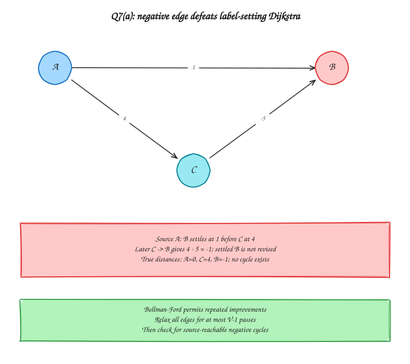

**Step 0 - Initialize.** $d(A)=0$, $d(B)=d(C)=\infty$.

**Step 1 - Finalize $A$ (distance 0).** Relax its edges: $0+1=1<\infty\Rightarrow d(B)=1$, and $0+4=4<\infty\Rightarrow d(C)=4$.

**Step 2 - Smallest tentative distance is $B=1$, so finalize $B$.** Dijkstra keeps $B = 1$.

**Step 3 - Finalize $C$ (distance 4).** The edge $C\to B$ would give $4+(-5)=-1<1$, but $B$ is already finalized, so it is not updated. The true answer is $-1$.

**Bellman-Ford** does not finalize early. It starts with $dist[A]=0$ and $\infty$ elsewhere, then relaxes every edge $|V|-1$ times, using $dist[u]+w(u,v)<dist[v]$. In the selected-vertex table (vertices in order $A,B,C$; each row shows the array when that vertex is selected), round 1 is:

| Selected vertex | A | B | C |
|:---:|:---:|:---:|:---:|
| A | **0** | $\infty$ | $\infty$ |
| B | 0 | **1** | 4 |
| C | 0 | 1 | **4** |
| C → B (wrap) | 0 | **-1** | 4 |

The wrap row relaxes $C\to B$: $4-5=-1<1$, so $B$ improves to $-1$. Round 2 changes nothing, so the distances are $A=0$, $B=-1$, $C=4$.

Why $|V|-1$ rounds? A shortest simple path has at most $|V|-1$ edges. The time is $\Theta(VE)$. **Negative-cycle check:** one extra pass; if any edge can still be relaxed, a negative cycle is reachable from the source.

> Memory trick: Dijkstra decides once. Bellman-Ford keeps checking all edges again and again.

#### Q7(b)

**Question (transcribed):** Consider the directed graph with vertices A, B, C, D, E and the edges A-B (6), A-C (7), B-D (5), B-E (-4), C-B (-3), C-D (8), D-E (-2), and E-A (2). Using Bellman-Ford, find the shortest paths from source vertex A to all other vertices.

**Answer.**

**Read the graph.** It is directed and weighted with $V=\{A,B,C,D,E\}$ and source A. The edges, in the question's order, are A to B = 6, A to C = 7, B to D = 5, B to E = -4, C to B = -3, C to D = 8, D to E = -2, and E to A = 2. The edge $E\to A$ points back to the source.

**Adjacency list** (neighbour, weight $w(u,v)$):

```text
A: B(6), C(7)
B: D(5), E(-4)
C: B(-3), D(8)
D: E(-2)
E: A(2)
```

**Method (selected-vertex relaxation table).** Relax the edges grouped by source vertex, in the fixed order $A,B,C,D,E$. This still relaxes every edge once per round. Each row is labelled by the vertex whose *outgoing* edges are relaxed next, and shows the array $[dist[A],\dots,dist[E]]$ at that moment. The **bold** cell marks the selected vertex. The relaxation test is $dist[u]+w(u,v)<dist[v]$. With $|V|=5$, at most $|V|-1=4$ rounds are needed.

**Round 1** - start from $dist[A]=0$ and $\infty$ elsewhere:

| Selected vertex | A | B | C | D | E |
|:---:|:---:|:---:|:---:|:---:|:---:|
| A | **0** | $\infty$ | $\infty$ | $\infty$ | $\infty$ |
| B | 0 | **6** | 7 | $\infty$ | $\infty$ |
| C | 0 | 6 | **7** | 11 | 2 |
| D | 0 | 4 | 7 | **11** | 2 |
| E | 0 | 4 | 7 | 11 | **2** |
| E → A (wrap) | **0** | 4 | 7 | 11 | 2 |

- Row B: relax $A\to B$ ($0+6=6$) and $A\to C$ ($0+7=7$).
- Row C: relax $B\to D$ ($6+5=11$) and $B\to E$ ($6-4=2$).
- Row D: relax $C\to B$ ($7-3=4$, improves $B$ from 6) and $C\to D$ ($7+8=15$, no change).
- Row E: relax $D\to E$ ($11-2=9$), which does **not** improve $E=2$.
- Wrap row: relax $E\to A$ ($2+2=4$), which does **not** improve $A=0$.

**Round 2** - carried over from $[0,4,7,11,2]$:

| Selected vertex | A | B | C | D | E |
|:---:|:---:|:---:|:---:|:---:|:---:|
| A | **0** | 4 | 7 | 11 | 2 |
| B | 0 | **4** | 7 | 11 | 2 |
| C | 0 | 4 | **7** | 9 | 0 |
| D | 0 | 4 | 7 | **9** | 0 |
| E | 0 | 4 | 7 | 9 | **0** |
| E → A (wrap) | **0** | 4 | 7 | 9 | 0 |

$B\to D$ improves $D$ to 9 ($4+5$), and $B\to E$ improves $E$ to 0 ($4-4$).

**Round 3** - carried over from $[0,4,7,9,0]$:

| Selected vertex | A | B | C | D | E |
|:---:|:---:|:---:|:---:|:---:|:---:|
| A | **0** | 4 | 7 | 9 | 0 |
| B | 0 | **4** | 7 | 9 | 0 |
| C | 0 | 4 | **7** | 9 | 0 |
| D | 0 | 4 | 7 | **9** | 0 |
| E | 0 | 4 | 7 | 9 | **0** |
| E → A (wrap) | **0** | 4 | 7 | 9 | 0 |

Nothing changed in Round 3, so the values have converged. Round 4 and the negative-cycle check pass leave the table unchanged.

**Final distances from A:** A = 0; B = 4 (A to C to B); C = 7 (A to C); D = 9 (A to C to B to D); E = 0 (A to C to B to E).

Walking `parent[v]` backward gives these paths: $parent[C]=A$, $parent[B]=C$, $parent[D]=B$, and $parent[E]=B$.

**Negative cycle:** there is none, because no edge can still be relaxed after the converged round. Every cycle returns to A. The smallest cycle total is 2, for A to C to B to E to A: $7-3-4+2=2$. Bellman-Ford takes $\Theta(VE)$ time and $\Theta(V)$ space.

> Memory trick: relax all edges, repeat, and stop when nothing changes.

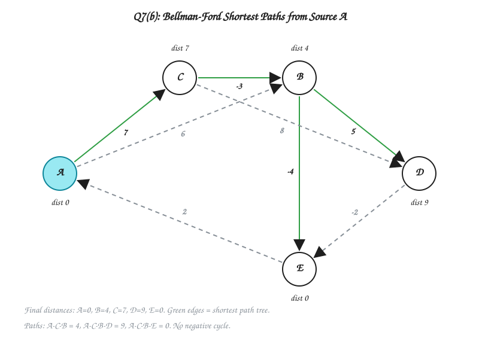

#### Q7(c)

**Question (transcribed):** What is algorithm optimality? Find an optimal solution for the 0/1 knapsack problem using dynamic programming. Maximum weight = 8; item weights = [3, 4, 5, 6]; item profits = [2, 3, 1, 4].

**Answer.**

**Algorithm optimality:** an algorithm is **optimal** when its running time **matches the lower bound** of the problem, so no other algorithm can be faster (apart from constant factors). Example: every comparison sort needs $\Omega(n\log n)$ comparisons (a decision tree has $n!$ leaves), so merge sort and heap sort, which run in $O(n\log n)$, are optimal comparison sorts. An **optimal solution** is different: it is the best valid answer, such as the maximum profit in knapsack.

**The 0/1 knapsack DP finds an optimal solution.** Use $V[i,j]$ = the maximum value (profit) from the first $i$ items at capacity $j$ (see [Chapter 8](../../../Chapter%208%20-%20Dynamic%20Programming/README.md)):

$$
V[i,j]=
\begin{cases}
V[i-1,j], & \text{if } w_i>j\\
\max\big(V[i-1,j],\ v_i+V[i-1,j-w_i]\big), & \text{if } w_i\le j
\end{cases}
\qquad V[0,j]=V[i,0]=0
$$

Both choices (skip and take) are tried, so the best value is always found.


**Given instance:** 0/1 knapsack with capacity $W=8$. The total weight may be at most 8, and taking no items is allowed.

**Arrow legend:** $\uparrow$ means the item is skipped (value copied from the upper row). $\nwarrow$ means the item is taken (value comes from the previous row at reduced capacity). If skipping and taking tie, $\uparrow$ is shown. The base row and base column have no arrows because their values are fixed at 0.

| Item | Weight | Value (profit) | $W=0$ | $W=1$ | $W=2$ | $W=3$ | $W=4$ | $W=5$ | $W=6$ | $W=7$ | $W=8$ |
|:---:|:---:|:---:|:---:|:---:|:---:|:---:|:---:|:---:|:---:|:---:|:---:|
| 0 | - | - | 0 | 0 | 0 | 0 | 0 | 0 | 0 | 0 | 0 |
| 1 | 3 | 2 | 0 | 0 ($\uparrow$) | 0 ($\uparrow$) | 2 ($\nwarrow$) | 2 ($\nwarrow$) | 2 ($\nwarrow$) | 2 ($\nwarrow$) | 2 ($\nwarrow$) | 2 ($\nwarrow$) |
| 2 | 4 | 3 | 0 | 0 ($\uparrow$) | 0 ($\uparrow$) | 2 ($\uparrow$) | 3 ($\nwarrow$) | 3 ($\nwarrow$) | 3 ($\nwarrow$) | 5 ($\nwarrow$) | 5 ($\nwarrow$) |
| 3 | 5 | 1 | 0 | 0 ($\uparrow$) | 0 ($\uparrow$) | 2 ($\uparrow$) | 3 ($\uparrow$) | 3 ($\uparrow$) | 3 ($\uparrow$) | 5 ($\uparrow$) | 5 ($\uparrow$) |
| 4 | 6 | 4 | 0 | 0 ($\uparrow$) | 0 ($\uparrow$) | 2 ($\uparrow$) | 3 ($\uparrow$) | 3 ($\uparrow$) | 4 ($\nwarrow$) | 5 ($\uparrow$) | **5** ($\uparrow$) |

Key calculations:

- $V[2,7]=\max(V[1,7],\ 3+V[1,3])=\max(2,5)=5$.
- $V[3,8]=\max(V[2,8],\ 1+V[2,3])=\max(5,3)=5$.
- $V[4,6]=\max(V[3,6],\ 4+V[3,0])=\max(3,4)=4$.
- $V[4,8]=\max(V[3,8],\ 4+V[3,2])=\max(5,4)=5$.

**Answer: profit 5**, using items 1 and 2 (weight $3+4=7\le8$, profit $2+3=5$).

**Traceback:**

1. Start at $V[4,8]=5$. Since $V[4,8]=V[3,8]$, item 4 is not selected.
2. At $V[3,8]=5=V[2,8]$, item 3 is not selected.
3. At $V[2,8]=5\ne V[1,8]=2$, item 2 is selected. The remaining capacity is $8-4=4$.
4. At $V[1,4]=2\ne V[0,4]=0$, item 1 is selected. The remaining capacity is $4-3=1$.

The time is $\Theta(nW)$.

> Memory trick: optimal algorithm = nobody can be faster. Optimal solution = nobody can have more profit.

---

### Q8. P, NP, Decision vs Optimization, and Dijkstra

#### Q8(a)

**Question (transcribed):** Define the classes P, NP, NP-hard, and NP-complete. Explain the relationships between these classes.

**Answer.**

These classes are about **decision problems** (the answer is yes or no).

| Class | Simple meaning | Example |
|-------|----------------|---------|
| **P** | Can be **solved** in polynomial time | Sorting, shortest path, MST |
| **NP** | A given answer (certificate) can be **checked** in polynomial time | Hamiltonian cycle, TSP (decision), SAT |
| **NP-hard** | **At least as hard as every problem in NP**. Every NP problem reduces to it in polynomial time. It need not be in NP | TSP (optimization version) |
| **NP-complete** | In **NP** and also **NP-hard** | SAT, Hamiltonian cycle, TSP (decision), subset sum |

**Relationships**

- P ⊆ NP: anything we can solve fast, we can also check fast.
- NP-complete = NP ∩ NP-hard.
- NP-hard is bigger than NP-complete, since it also contains problems outside NP.
- **P = NP?** is an **open question**. If any one NP-complete problem is solved in polynomial time, then P = NP.

```text
(assuming P is not equal to NP)

NP      = [ P  |  NP-complete ]
NP-hard = [ NP-complete  |  harder problems that are not in NP ]

NP-complete = the overlap of NP and NP-hard
```

> Memory trick: P = solve fast. NP = check fast. NP-complete = NP and NP-hard.

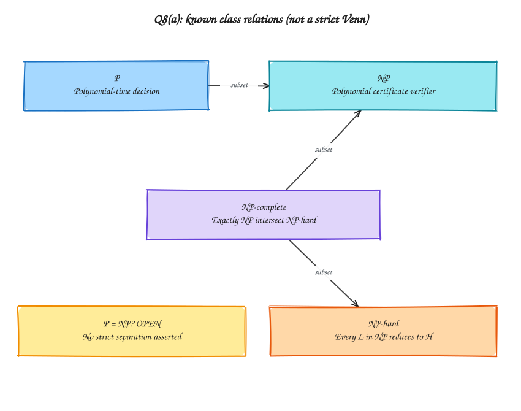

#### Q8(b)

**Question (transcribed):** Differentiate between decision problems and optimization problems in the context of NP-completeness.

**Answer.**

| | Decision problem | Optimization problem |
|--|------------------|----------------------|
| Question | Yes or no? | What is the best value? |
| Answer | **Yes / No** | A **minimum or maximum** value and a solution |
| Example (TSP) | Is there a tour with cost ≤ k? | Find the **cheapest** tour |
| Example (Knapsack) | Is there a subset with profit ≥ P? | Find the **maximum** profit |

**In NP-completeness**

- P, NP, and NP-complete are defined **only for decision problems**. So to study an optimization problem we first turn it into a decision problem by adding a bound k.
- The decision version of TSP is **NP-complete**. The optimization version is **NP-hard**.
- Optimization is **at least as hard as** decision. If we can find the best value, we can answer the yes/no question. If the decision problem is hard, the optimization problem is also hard.

> Memory trick: Decision = "Can we do it with k?" Optimization = "What is the best k?"

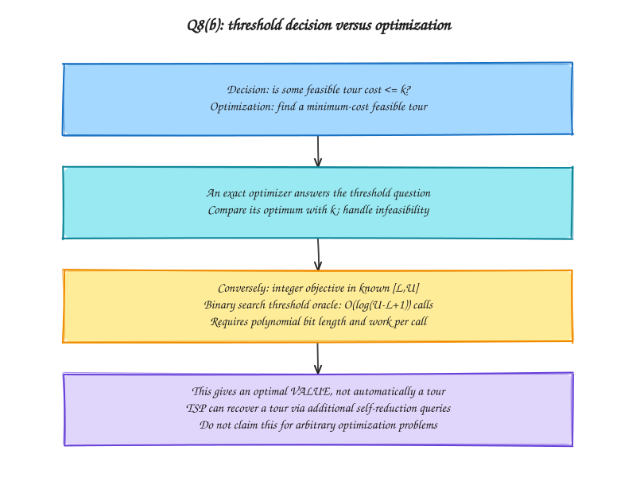

#### Q8(c)

**Question (transcribed):** For the following graph, find the shortest path along with cost from Node A to all other nodes using Dijkstra's Algorithm. Mention the formula for relaxation.

**Answer.**

**Read the graph.** It is undirected with nonnegative edge weights, vertices $A,B,C,D,E,F$, and source $A$. This is transcribed from the paper's figure. Its full edge list is: A-B (2), A-D (8), B-D (5), B-E (6), D-E (3), D-F (2), E-F (1), E-C (9), and F-C (3).

**Adjacency list** (neighbour, cost $c(u,v)$):

```text
A: B(2), D(8)
B: A(2), D(5), E(6)
C: E(9), F(3)
D: A(8), B(5), E(3), F(2)
E: B(6), C(9), D(3), F(1)
F: C(3), D(2), E(1)
```

**Relaxation formula:** every time a vertex $u$ is finalized, relax each edge $(u,v)$ leaving it:

$$\text{if } \big(d(u)+c(u,v)<d(v)\big)\implies d(v)=d(u)+c(u,v)$$

If the distance gets smaller, also set `parent[v] = u` (the previous vertex on the path). Dijkstra's greedy rule: always finalize the unvisited vertex with the smallest tentative distance (see [Chapter 11](../../../Chapter%2011%20-%20Graph%20Algorithms/README.md)).

**Step 0 - Initialize.** $d(A)=0$; every other vertex starts at $\infty$.

**Step 1 - Finalize $A$ (distance 0).** Relax edges out of $A$:

- $0+2=2<\infty\Rightarrow d(B)=2$
- $0+8=8<\infty\Rightarrow d(D)=8$

**Step 2 - Smallest tentative distance is $B=2$, so finalize $B$.** Relax edges out of $B$ (to $D$ and $E$):

- $2+5=7<8\Rightarrow d(D)=7$
- $2+6=8<\infty\Rightarrow d(E)=8$

**Step 3 - Smallest remaining is $D=7$, so finalize $D$.** Relax edges out of $D$ (to $E$ and $F$):

- $7+3=10$, compare with $d(E)=8$. Since $10\not<8$, $E$ stays $8$.
- $7+2=9<\infty\Rightarrow d(F)=9$

**Step 4 - Smallest remaining is $E=8$, so finalize $E$.** Relax edges out of $E$ (to $C$ and $F$):

- $8+9=17<\infty\Rightarrow d(C)=17$
- $8+1=9$, compare with $d(F)=9$. Since $9\not<9$, $F$ stays $9$.

**Step 5 - Smallest remaining is $F=9$, so finalize $F$.** Relax the edge out of $F$ (to $C$):

- $9+3=12<17\Rightarrow d(C)=12$

**Step 6 - Only $C=12$ remains, so finalize $C$.** All vertices are now visited.

Distance table, one row per finalized (visited) vertex, in the order they were finalized. Each row shows the distances when that vertex is selected; bold marks the distance finalized in that step, and `-` marks the vertex finalized in the previous step:

| Visited $\downarrow$ | A | B | C | D | E | F |
| :---: | :---: | :---: | :---: | :---: | :---: | :---: |
| **A** | **0** | $\infty$ | $\infty$ | $\infty$ | $\infty$ | $\infty$ |
| **B** | | **2** | $\infty$ | 8 | $\infty$ | $\infty$ |
| **D** | | - | $\infty$ | **7** | 8 | $\infty$ |
| **E** | | | $\infty$ | - | **8** | 9 |
| **F** | | | 17 | | - | **9** |
| **C** | | | **12** | | | - |

**Final distances:** A = 0, B = 2, D = 7, E = 8, F = 9, C = 12.

**Shortest paths and costs** (walk `parent[v]` backward from each vertex):

- B: A to B, cost $2$.
- D: A to B to D, cost $2+5=7$.
- E: A to B to E, cost $2+6=8$.
- F: A to B to D to F, cost $2+5+2=9$.
- C: A to B to D to F to C, cost $2+5+2+3=12$.

**Shortest path to C:** A to B to D to F to C, with cost $2+5+2+3=12$.

There is a tie for F: A to B to D to F and A to B to E to F both cost 9 ($2+5+2=2+6+1$). So C also has two shortest paths, through D-F or E-F, each with cost 12. Because the relaxation uses a strict `<`, the first parent found is kept. The displayed tree uses B←A, D←B, E←B, F←D, and C←F.

**Complexity:** $\Theta(V^2)$ with an adjacency matrix, or $\Theta((V+E)\log V)$ with an adjacency list and binary heap. Space is $\Theta(V+E)$.

> Memory trick: finalize the nearest vertex, then relax its edges.

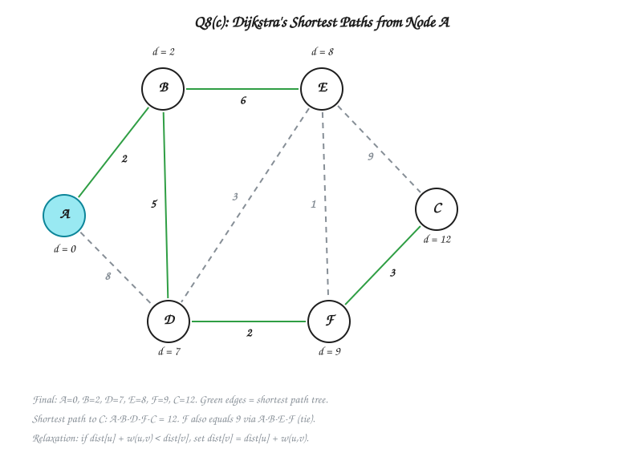

---

## Verification

Run `python tools/verify_b1_theory.py` from the repository root to check the numerical tables, graph/search results, local links, all 27 question diagrams, and all 24 SVG/Excalidraw pairs. These read-only checks supplement the review; they do not prove every prose statement.

## Quick Revision

| Topic | Easy memory line |
|-------|-----------------|
| Design and analysis | Design = choose the method; analysis = study time and memory use |
| Recurrences | Solve by substitution, a recursion tree, or the Master Theorem |
| Merge sort | Split, sort, and merge; time $\Theta(n\log n)$; needs $\Theta(n)$ extra memory |
| Quicksort | Partition in place; usually fast, but worst-case time is $\Theta(n^2)$; not stable |
| Heapsort | Build a max-heap in $\Theta(n)$; worst-case sorting time is $\Theta(n\log n)$; in-place, not stable |
| Greedy | Pick the best-looking next choice; it does not always give the best full answer (coins $4,3,1$ for amount 6) |
| Memoization and tabulation | Memoization = recursion plus cache; tabulation = iteration plus a table filled from small cases up |
| MST | Prim grows one tree; Kruskal sorts edges and adds the lightest edge that does not make a cycle (`FIND`/`UNION`) |
| Backtracking | Choose, check, and undo a choice if it leads to a dead end |
| Subset sum | Try take or skip; if all numbers are positive, prune when the sum exceeds $d$ |
| Hamiltonian circuit | Visit every vertex once and return to the start |
| Dynamic programming | Five parts: state, recurrence, base case, table order, final answer; needs optimal substructure and overlapping subproblems |
| 0/1 knapsack | $V[i,j]=\max(V[i-1,j],\ v_i+V[i-1,j-w_i])$ if the item fits; $\uparrow$ skip, $\nwarrow$ take; time $\Theta(nW)$ |
| Grid coins | $dp[r,c]$ = coins in this cell + the larger of $dp$ above or left |
| Coin change DP | $dp[x]=1+\min dp[x-c]$; greedy can fail |
| Bellman-Ford | Relax edges vertex by vertex ($A,B,C,\dots$) up to $V-1$ rounds; check for a reachable negative cycle |
| Dijkstra and Bellman-Ford | Dijkstra ($d(u)+c(u,v)<d(v)$) needs nonnegative edges; Bellman-Ford can handle negative edges |
| Optimality | Optimal algorithm = time matches the problem's lower bound; optimal solution = best answer |
| P, NP, NP-hard, NP-complete | $P\subseteq NP$; NP-complete = NP and NP-hard; whether $P=NP$ is open |
| Decision and optimization | Decision = yes/no; optimization = find the best answer |
| Dijkstra | Finalize the nearest not-yet-finalized vertex, then relax its edges |

---

[Previous: Chapter 0 - Previous Year Questions](../../README.md) | [Home](../../../README.md) | [Next: 2nd Batch Theory](../../2nd%20Batch/Theory/README.md)
