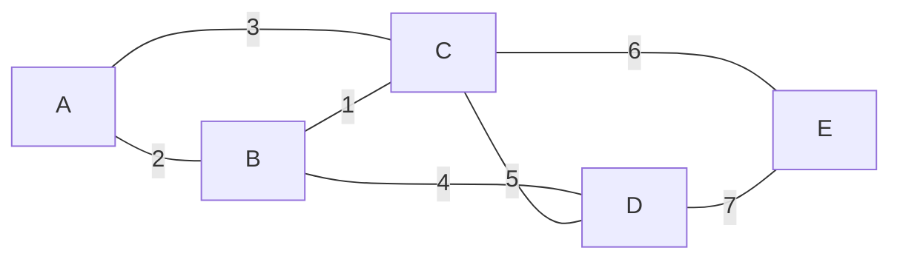

# 1st Batch Theory: Answers

[Previous: Chapter 0 - Previous Year Questions](../../README.md) | [Home](../../../README.md) | [Next: 2nd Batch Theory](../../2nd%20Batch/Theory/README.md)

This page answers the full CSE 2201 theory paper (1st Batch, 2023). It covers **Section A, Q1 to Q4 (all parts)** and **Section B, Q5 to Q8 (all parts)**. The paper asks you to answer any 3 questions from each section.

| Question | Topic | a | b | c | d |
|----------|-------|---|---|---|---|
| Q1 | Algorithm design and analysis basics | 10 | 10 | 15 | - |
| Q2 | Recurrences and loop analysis | 10 | 10 | 15 | - |
| Q3 | Divide and conquer, merge sort, quick sort, heap sort | 5 | 10 | 10 | 10 |
| Q4 | Greedy, memoization vs tabulation, MST | 10 | 10 | 15 | - |
| Q5 | Backtracking: N-Queen, subset sum, Hamiltonian circuit | 5 | 10 | 10 | 10 |
| Q6 | Dynamic programming: knapsack, grid, coin change | 5 | 10 | 10 | 10 |
| Q7 | Bellman-Ford, optimality, 0/1 knapsack | 10 | 10 | 15 | - |
| Q8 | P, NP, decision vs optimization, Dijkstra | 10 | 10 | 15 | - |

### Visual Map: Question Escalator

Each step builds on the one below it. You need the tools (Q1 and Q2) before sorting and paradigms (Q3 and Q4), and both come before backtracking (Q5).


---

## Section A

### Q1. Algorithm Design, Analysis, and Complexity

#### Q1(a) Design and analysis of an algorithm. What makes a good algorithm?

- **Design** means deciding how the algorithm will solve the problem. It is the method or plan (for example: divide the problem, or sort first, or try all choices).
- **Analysis** means predicting how much time and memory the algorithm needs as the input size $n$ grows. We check this without running the code.

A good algorithm has these qualities:

1. **Correct**: it gives the right output for every valid input.
2. **Time efficient**: it runs fast as $n$ grows.
3. **Space efficient**: it uses little extra memory.
4. **Simple**: it is easy to understand, write, and debug.
5. **Handles all valid inputs**: it works for edge cases such as an empty array or one element.

#### Q1(b) Best, worst, and average case. Give examples.

- **Best case**: the input that makes the algorithm do the least work (for input size $n$).
- **Worst case**: the input that makes the algorithm do the most work.
- **Average case**: the expected work over all possible inputs of size $n$.

| Algorithm | Best case | Worst case | Average case |
|-----------|-----------|------------|--------------|
| Linear search | $\Theta(1)$: the item is the first element | $\Theta(n)$: the item is last or not present | $\Theta(n)$ |
| Insertion sort | $\Theta(n)$: input is already sorted | $\Theta(n^2)$: input is reverse sorted | $\Theta(n^2)$: random input |

#### Q1(c) Two algorithms: A takes $n^2$ time, B takes $n \log n$ time. Which one is better? Why?

**Answer: Algorithm B is better** for large $n$, because $n \log n$ grows much slower than $n^2$.

| $n$ | $n^2$ (Algorithm A) | $n \log_2 n$ (Algorithm B) |
|-----|---------------------|----------------------------|
| 10 | 100 | about 33 |
| 1,000 | 1,000,000 | about 9,966 |
| 1,000,000 | $10^{12}$ | about $2 \times 10^7$ |

At $n = 10^6$, Algorithm B does about 50,000 times less work.

> [!NOTE]
> For very small $n$, Algorithm A may still be faster in practice, because its constant factors can be smaller. Asymptotic analysis is about what happens as $n$ becomes large.

---

### Q2. Recurrences and Loop Analysis

#### Q2(a) What is a recurrence? How do we solve one?

A **recurrence** is an equation that describes the running time $T(n)$ of a recursive algorithm in terms of the running time on smaller inputs.

Example: $T(n) = 2T(n/2) + n$.

We solve recurrences in three common ways:

1. **Substitution method**: guess the answer and prove it with induction.
2. **Recursion tree method**: draw the calls as a tree, add the work per level, and sum all levels.
3. **Master Theorem**: a quick formula for recurrences of the form $T(n) = aT(n/b) + f(n)$.

#### Q2(b) Analyze the loops (count the inner work).

Each inner loop iteration does one constant-time operation, so we count iterations.

**(i)**

```
for (i = 1; i <= n; i = i * 2)
    for (j = 1; j <= n; j++)
        sum = sum + i * j;
```

- The outer loop runs for $i = 1, 2, 4, \dots$ up to $n$. That is $\lfloor \log_2 n \rfloor + 1$ times.
- For each outer iteration, the inner loop runs $n$ times.
- Total iterations: $(\lfloor \log_2 n \rfloor + 1) \cdot n$.

**Result: $\Theta(n \log n)$.** For $n = 8$: outer runs 4 times, inner runs 8 times, so total = 32.

**(ii)**

```
for (i = 1; i <= n; i = i * 2)
    for (j = 1; j <= i; j++)
        sum = sum + 1;
```

- The inner loop runs $i$ times, for $i = 1, 2, 4, \dots, 2^K$, where $2^K \le n < 2^{K+1}$.
- Total: $1 + 2 + 4 + \dots + 2^K = 2^{K+1} - 1$.
- Since $n \le 2^{K+1} - 1 \le 2n - 1$, the total is between $n$ and $2n - 1$.

**Result: $\Theta(n)$.** For $n = 8$: $K = 3$, total = $1+2+4+8 = 15$.

#### Q2(c) Solve $T(n) = 2T(n/2) + n$ with $T(1) = 1$. Show the steps.

**Method 1: Substitution (prove $T(n) = O(n \log n)$)**

Guess $T(n) \le c\,n \log_2 n$ for some constant $c$ and all $n \ge 2$.

- **Base case** ($n = 2$): $T(2) = 2T(1) + 2 = 4$. And $c \cdot 2 \cdot \log_2 2 = 2c$. With $c = 2$, $4 \le 4$. ✓
- **Inductive step**: assume the guess is true for $n/2$.

$$T(n) = 2T(n/2) + n \le 2 \cdot c\,\frac{n}{2}\log_2\frac{n}{2} + n = cn\log_2 n - cn + n$$

Since $c \ge 1$, we have $-cn + n \le 0$, so $T(n) \le c\,n \log_2 n$. ✓

So $T(n) = O(n \log n)$.

**Method 2: Recursion tree**

| Level | Number of nodes | Size of each node | Work per level |
|-------|-----------------|-------------------|----------------|
| 0 | 1 | $n$ | $n$ |
| 1 | 2 | $n/2$ | $2 \cdot n/2 = n$ |
| 2 | 4 | $n/4$ | $4 \cdot n/4 = n$ |
| ... | ... | ... | $n$ |
| $\log_2 n$ | $n$ | 1 | $n$ |


There are $\log_2 n + 1$ levels, each doing $n$ work. Total: $n(\log_2 n + 1)$.

**Method 3: Master Theorem**

Here $a = 2$, $b = 2$, $f(n) = n$. Then $n^{\log_b a} = n^{\log_2 2} = n^1 = n$. Since $f(n) = \Theta(n^{\log_b a})$, this is **Case 2**, so $T(n) = \Theta(n \log n)$.

**Final answer:** $T(n) = \Theta(n \log n)$. (Exact solution for powers of 2: $T(n) = n\log_2 n + n$. Check: $T(4) = 12$, $T(8) = 32$.)

---

### Q3. Divide and Conquer, Merge Sort, Quick Sort, Heap Sort

#### Q3(a) Explain the three steps of divide and conquer. Give an example.

1. **Divide**: split the problem into smaller subproblems.
2. **Conquer**: solve each subproblem (recursively). When a subproblem is small enough, solve it directly (the base case).
3. **Combine**: join the subproblem solutions into the final answer.

**Example: merge sort on $[5, 2, 4, 7]$**

```
[5, 2, 4, 7]          divide
[5, 2]   [4, 7]       divide
[2, 5]   [4, 7]       conquer (sort each half)
[2, 4, 5, 7]          combine (merge)
```

#### Q3(b) Write the merge sort recurrence and show that its complexity is $\Theta(n \log n)$.

**Algorithm idea:** split the array into two halves, sort each half recursively, then merge the two sorted halves.

**Recurrence:**

$$T(n) = 2T(n/2) + \Theta(n), \qquad T(1) = \Theta(1)$$

- Divide: $\Theta(1)$ (find the middle).
- Conquer: two recursive calls on $n/2$ each.
- Combine (merge): $\Theta(n)$ to scan both halves.

**Recursion tree:** every level does total work $n$, and there are $\log_2 n + 1$ levels. So $T(n) = \Theta(n \log n)$.

**Master Theorem:** $a = 2$, $b = 2$, $f(n) = n = \Theta(n^{\log_2 2})$, which is **Case 2**. So $T(n) = \Theta(n \log n)$.

**Space:** merge sort needs an extra $\Theta(n)$ auxiliary array for merging, so it is **not in-place**.

#### Q3(c) What is an in-place sorting algorithm? Is quick sort in-place?

An **in-place** algorithm rearranges the elements inside the original array and uses only a small extra amount of memory, $O(1)$ (or $O(\log n)$ for recursion stack).

**Quick sort is in-place.** It partitions the array by swapping elements inside the same array. Its recursion stack uses $O(\log n)$ space on average and $O(n)$ in the worst case.

> [!NOTE]
> Quick sort is **not stable**: equal elements may change their relative order.

#### Q3(d) Heap sort on $A = [7, 2, 5, 3, 4, 6, 1]$. Show the steps.

Indices start at 0. For index $i$, the children are at $2i+1$ and $2i+2$. We build a **max-heap** first, then repeatedly move the largest element to the end.

**Step 1: Build the max-heap** (call heapify from index 2 down to 0)

- $i = 2$ (value 5): children are 6 and 1. Largest child is 6, so swap 5 and 6. Array: $[7, 2, 6, 3, 4, 5, 1]$
- $i = 1$ (value 2): children are 3 and 4. Largest child is 4, so swap 2 and 4. Array: $[7, 4, 6, 3, 2, 5, 1]$
- $i = 0$ (value 7): 7 is already larger than both children (4 and 6). No swap.

Heap as a tree:


**Step 2: Sort (repeat until size is 1)**

Each round: swap the root (largest) with the last element in the heap, shrink the heap by 1, then heapify the root.

| Round | Swap root with | Array after the round |
|-------|----------------|-----------------------|
| 1 | last element | $[6, 4, 5, 3, 2, 1, 7]$ |
| 2 | last heap element | $[5, 4, 1, 3, 2, 6, 7]$ |
| 3 | last heap element | $[4, 3, 1, 2, 5, 6, 7]$ |
| 4 | last heap element | $[3, 2, 1, 4, 5, 6, 7]$ |
| 5 | last heap element | $[2, 1, 3, 4, 5, 6, 7]$ |
| 6 | last heap element | $[1, 2, 3, 4, 5, 6, 7]$ |

**Final sorted array:** $[1, 2, 3, 4, 5, 6, 7]$

**Complexity:** building the heap takes $O(n)$. Each of the $n$ extractions takes $O(\log n)$. Total: $O(n \log n)$. Heap sort is in-place but **not stable**.

---

### Q4. Greedy Algorithms, Memoization vs Tabulation, and MST

#### Q4(a) What is a greedy algorithm? Give a counterexample where it fails.

A **greedy algorithm** builds the solution step by step. At each step it picks the locally best choice and never goes back to change it.

**Counterexample: coin change.** Coins $\{1, 3, 4\}$, amount $6$.

- Greedy picks the largest coin first: $4 + 1 + 1$. That is **3 coins**.
- Optimal is $3 + 3$. That is **2 coins**.

Greedy is not always optimal for every problem. It works for problems with the greedy-choice property (such as Kruskal's and Prim's MST algorithms).

#### Q4(b) Memoization vs tabulation. Explain the difference with an example.

Both are techniques for **dynamic programming**: they store answers to subproblems so that each subproblem is solved only once.

- **Memoization (top-down)**: write the recursive solution, and store each result in a cache the first time it is computed.
- **Tabulation (bottom-up)**: fill a table with answers for the smallest subproblems first, using a loop, then build up to the answer.

**Example: Fibonacci**

```python
# Memoization (top-down)
memo = {}
def fib_memo(n):
    if n <= 1:
        return n
    if n in memo:
        return memo[n]
    memo[n] = fib_memo(n - 1) + fib_memo(n - 2)
    return memo[n]

# Tabulation (bottom-up)
def fib_tab(n):
    if n <= 1:
        return n
    table = [0] * (n + 1)
    table[1] = 1
    for i in range(2, n + 1):
        table[i] = table[i - 1] + table[i - 2]
    return table[n]
```

| Point | Memoization | Tabulation |
|-------|-------------|------------|
| Direction | Top-down (start from the big problem) | Bottom-up (start from the small problems) |
| Implementation | Recursion plus a cache | Loop plus a table |
| Recursion overhead | Yes (can hit recursion limits) | No |
| Subproblems computed | Only the ones actually needed | All subproblems in the table |

#### Q4(c) Find the MST of the graph, using Prim's and Kruskal's algorithms.

**Edges:**

| Edge | Weight |
|------|--------|
| A-B | 2 |
| A-C | 3 |
| B-C | 1 |
| B-D | 4 |
| C-D | 5 |
| C-E | 6 |
| D-E | 7 |



**Prim's algorithm (start from A)**

1. Start with $\{A\}$. Candidate edges: A-B (2), A-C (3). Pick **A-B (2)**.
2. Tree is $\{A, B\}$. Candidates: A-C (3), B-C (1), B-D (4). Pick **B-C (1)**.
3. Tree is $\{A, B, C\}$. Candidates: B-D (4), C-D (5), C-E (6). Pick **B-D (4)**.
4. Tree is $\{A, B, C, D\}$. Candidates: C-E (6), D-E (7). Pick **C-E (6)**.

**Kruskal's algorithm (sort edges by weight)**

| Edge | Weight | Decision |
|------|--------|----------|
| B-C | 1 | Take (no cycle) |
| A-B | 2 | Take (no cycle) |
| A-C | 3 | Skip (A, B, C would form a cycle) |
| B-D | 4 | Take (no cycle) |
| C-D | 5 | Skip (C and D already connected) |
| C-E | 6 | Take (no cycle). We now have 4 edges for 5 vertices, so stop. |
| D-E | 7 | Not needed |

**MST edges:** B-C, A-B, B-D, C-E

**Total MST weight:** $1 + 2 + 4 + 6 = 13$

Both algorithms give the same MST. Since all edge weights are different, this MST is the only one.

---

## Section B

### Q5. Backtracking

#### Q5(a) What is backtracking? Explain briefly.

**Backtracking** solves a problem by building a solution one step at a time. At each step it:

1. Makes a choice.
2. Checks whether the partial solution still satisfies the constraints.
3. If the choice leads to a **dead end**, it **undoes** the choice (backtracks) and tries the next option.

It is a depth-first search over a **state-space tree**. Branches that cannot lead to a valid solution are cut early. This is called **pruning**.

#### Q5(b) Explain the N-Queen problem using backtracking. Place 4 queens on a $4 \times 4$ board.

**Problem:** place $N$ queens on an $N \times N$ board so that no two queens attack each other. Queens attack along the same row, same column, or same diagonal.

**Idea:** place one queen per row. To place the $k$-th queen (in row $k$):

1. Try columns $0, 1, \dots, N-1$ in order.
2. A column is safe if no earlier queen (rows $0$ to $k-1$) is in the same column or on the same diagonal.
3. If a safe column is found, place the queen and move to row $k+1$.
4. If no column is safe, **backtrack**: go back to queen $k-1$ and move it to its next column.

**Pseudocode**

```
SOLVE(row):
    if row == N:
        print the board          // found a solution
        return

    for col = 0 to N-1:
        if IS-SAFE(row, col):
            board[row] = col     // place queen
            SOLVE(row + 1)
            // if we get here, backtrack: the loop tries the next column

IS-SAFE(row, col):
    for r = 0 to row-1:
        if board[r] == col:                    // same column
            return false
        if |board[r] - col| == row - r:        // same diagonal
            return false
    return true
```

**Backtrack conditions**

- **Column conflict**: a queen already sits in the same column.
- **Diagonal conflict**: a queen already sits on the same diagonal.
- **No safe column**: no column in row $k$ is safe, so go back to row $k-1$.

**Trace for 4 queens** (rows and columns start at 0, shown as (row, col))

1. Place (0, 0).
2. Row 1: columns 0 and 1 conflict (column and diagonal). Place (1, 2).
3. Row 2: every column conflicts. **Backtrack** to row 1.
4. Row 1: try column 3. Place (1, 3).
5. Row 2: column 0 conflicts. Place (2, 1).
6. Row 3: every column conflicts. **Backtrack** to row 2.
7. Row 2: columns 2 and 3 conflict. **Backtrack** to row 1.
8. Row 1 has no more options. **Backtrack** to row 0.
9. Row 0: try column 1. Place (0, 1). Continue: (1, 3), (2, 0), (3, 2).

**First solution:**

```
. Q . .
. . . Q
Q . . .
. . Q .
```

For $N = 4$ there are 2 solutions in total. The first one is shown above.

> [!TIP]
> A working C++ version of this idea is in `Chapter 0 - Previous Year Questions/Lab Practice/Backtracking.cpp`.

#### Q5(c) Subset sum with $A = \{3, 5, 6, 7\}$ and $d = 15$. Use backtracking.

**Idea:** go through the items in order. For each item, try **take it** first, then **skip it**.

- If the sum goes above $d$, **prune** that branch.
- If the sum equals $d$, we found a solution.
- If no items are left and the sum is not $d$, it is a **dead end**.

**Trace**

1. Take 3: sum = 3.
2. Take 5: sum = 8.
3. Take 6: sum = 14.
4. Take 7: sum = 21. This is more than 15, so **prune**.
5. Skip 7: sum = 14. No items left, so **dead end**. Backtrack.
6. Skip 6: sum = 8.
7. Take 7: sum = 15. **Solution found.**


**Answer: $\{3, 5, 7\}$**, because $3 + 5 + 7 = 15$. It is the only subset with sum 15. The other subsets do not work: the 2-item sums are at most 13, and the other 3-item sums are 14, 16, and 18.

#### Q5(d) Find a Hamiltonian circuit starting from vertex $a$.

A **Hamiltonian circuit** visits every vertex exactly once and returns to the start.

Neighbours (read from the figure):

| Vertex | Neighbours |
|--------|------------|
| a | b, c, d |
| b | a, c, f |
| c | a, b, d, e, f |
| d | a, c, e |
| e | c, d, f |
| f | b, c, e |

**Idea:** start at $a$. Go to an unvisited neighbour (try them in alphabetical order). If we get stuck, backtrack.

**Trace**

1. $a \to b \to c \to d \to e \to f$. All 6 vertices are visited, but $f$ is not adjacent to $a$. **Dead end.**
2. Back to $c$, try $e$: $a \to b \to c \to e \to d$. From $d$, the only unvisited vertex is $f$, and $d$-$f$ is not an edge. **Dead end.**
3. Back to $c$, try $e$ then $f$: $a \to b \to c \to e \to f$. From $f$, the only unvisited vertex is $d$, and $f$-$d$ is not an edge. **Dead end.**
4. Back to $c$, try $f$: $a \to b \to c \to f \to e \to d$. All 6 vertices are visited, and $d$ is adjacent to $a$. **Circuit found.**


**Answer:** $a - b - c - f - e - d - a$. Another valid circuit is $a - b - f - e - d - c - a$.

---

### Q6. Dynamic Programming

#### Q6(a) Two properties that a problem needs for dynamic programming.

1. **Optimal substructure**: the best answer to the big problem is built from the best answers to smaller subproblems.
2. **Overlapping subproblems**: the same smaller subproblem is needed many times. DP stores its answer, so it is computed only once.

Fibonacci has both properties. Merge sort does not have overlapping subproblems, so it is solved with divide and conquer instead.

#### Q6(b) 0/1 knapsack using DP. Write the recurrence.

**Problem:** $n$ items, each with weight $w_i$ and profit $p_i$. The bag has capacity $W$. Each item is taken whole or not at all (0/1). Maximise the profit.

**Table:** $DP[i][w]$ = maximum profit using the first $i$ items with capacity $w$.

**Recurrence:**

$$DP[i][w] = \begin{cases} DP[i-1][w] & \text{if } w_i > w \\ \max\big(DP[i-1][w],\; p_i + DP[i-1][w - w_i]\big) & \text{if } w_i \le w \end{cases}$$

- If item $i$ does not fit, we cannot take it.
- Otherwise, take the better of two choices: skip item $i$, or take it and add its profit to the best answer for the remaining capacity.

**Base case:** $DP[0][w] = 0$ for all $w$ (no items, no profit).

**Answer:** $DP[n][W]$. Time: $O(nW)$.

#### Q6(c) Coins on a grid: maximum coins from top-left to bottom-right.

Find the maximum number of coins you can collect from $(0,0)$ to $(3,2)$. Moves are assumed to be **right or down** only. Each cell has 1 coin or 0 coins.

| | col 0 | col 1 | col 2 |
|---|---|---|---|
| row 0 | 1 | 0 | 1 |
| row 1 | 0 | 1 | 0 |
| row 2 | 1 | 1 | 1 |
| row 3 | 0 | 0 | 1 |

**DP:** $dp[r][c] = \text{grid}[r][c] + \max(dp[r-1][c],\ dp[r][c-1])$, using only the neighbours that exist.

| | col 0 | col 1 | col 2 |
|---|---|---|---|
| row 0 | 1 | 1 | 2 |
| row 1 | 1 | 2 | 2 |
| row 2 | 2 | 3 | 4 |
| row 3 | 2 | 3 | **5** |

**Answer: 5 coins.** One optimal path: $(0,0) \to (0,1) \to (1,1) \to (2,1) \to (2,2) \to (3,2)$, which collects $1+0+1+1+1+1 = 5$. Another path, $(0,0) \to (1,0) \to (2,0) \to (2,1) \to (2,2) \to (3,2)$, also gives 5, so there is a tie.

#### Q6(d) Coin change with coins $\{1, 3, 4\}$ and $n = 6$. Find the minimum number of coins.

**Recurrence:** $C[x] = 1 + \min_{c \le x} C[x - c]$, with $C[0] = 0$.

| $x$ | 0 | 1 | 2 | 3 | 4 | 5 | 6 |
|---|---|---|---|---|---|---|---|
| $C[x]$ | 0 | 1 | 2 | 1 | 1 | 2 | 2 |

**Answer: 2 coins** ($3 + 3$). Greedy would pick $4 + 1 + 1$ (3 coins), as in Q4(a). This is why DP is needed here.

### Q7. Shortest Paths, Optimality, and Knapsack

#### Q7(a) Why does Dijkstra fail with negative edge weights? How does Bellman-Ford handle them?

**Dijkstra** takes the closest unvisited vertex and never looks at it again. This is only safe if no later path can make that distance smaller. A negative edge breaks this rule.

**Example:** edges $A \to B = 1$, $A \to C = 4$, $C \to B = -5$.

- Dijkstra takes $B$ first (distance 1) and fixes it.
- Then $C$ (distance 4) gives $4 + (-5) = -1$ for $B$. This is shorter, but $B$ is already fixed, so Dijkstra keeps $B = 1$. The true answer is $-1$.

**Bellman-Ford** does not fix vertices early. It relaxes **all** edges, $V - 1$ times. Every shortest path has at most $V - 1$ edges, so after $V - 1$ rounds all distances are correct. It works with negative edges. Time: $O(VE)$.

**Negative cycle check:** run one more round. If any distance still gets smaller, there is a negative cycle.

#### Q7(b) Apply Bellman-Ford from A on the directed graph.

**Edges (read from the figure):** A to B = 6, A to C = 7, B to D = 5, B to E = -4, C to B = -3, C to D = 8, D to E = -2, E to A = 2.

Each pass goes through the edges in the order above. For example, in pass 1, B first becomes 6 (from A), then C to B gives $7 + (-3) = 4$, so B becomes 4.

| Pass | A | B | C | D | E |
|------|---|---|---|---|---|
| Start | 0 | $\infty$ | $\infty$ | $\infty$ | $\infty$ |
| 1 | 0 | 4 | 7 | 11 | 2 |
| 2 | 0 | 4 | 7 | 9 | 0 |
| 3 | 0 | 4 | 7 | 9 | 0 |

Pass 3 changes nothing, so we stop early.

**Final distances from A:** A = 0, B = 4 (A to C to B), C = 7 (A to C), D = 9 (A to C to B to D), E = 0 (A to C to B to E).

**Negative cycle:** none. Every cycle goes through A, since E to A is the only edge back. The smallest cycle total is 2 (A to C to B to E to A: $7 - 3 - 4 + 2 = 2$), which is positive.


#### Q7(c) What is algorithm optimality? Is the 0/1 knapsack DP optimal? Solve the example.

**Optimality:** an algorithm is **optimal** if it always gives the best answer (maximum or minimum, as the problem asks) for every valid input.

**Is 0/1 knapsack DP optimal?** Yes. For each item, the DP checks both choices (skip or take). It uses the optimal answers of smaller subproblems (optimal substructure), so the best choice is never missed.

**Example:** capacity $W = 8$.

| Item | 1 | 2 | 3 | 4 |
|------|---|---|---|---|
| Weight | 3 | 4 | 5 | 6 |
| Profit | 2 | 3 | 1 | 4 |

**DP table** (rows: first $i$ items; columns: capacity $w = 0$ to $8$):

| $i$ \ $w$ | 0 | 1 | 2 | 3 | 4 | 5 | 6 | 7 | 8 |
|---|---|---|---|---|---|---|---|---|---|
| 0 | 0 | 0 | 0 | 0 | 0 | 0 | 0 | 0 | 0 |
| 1 | 0 | 0 | 0 | 2 | 2 | 2 | 2 | 2 | 2 |
| 2 | 0 | 0 | 0 | 2 | 3 | 3 | 3 | 5 | 5 |
| 3 | 0 | 0 | 0 | 2 | 3 | 3 | 3 | 5 | 5 |
| 4 | 0 | 0 | 0 | 2 | 3 | 3 | 4 | 5 | 5 |

**Answer: profit 5**, using items 1 and 2 (weight $3 + 4 = 7 \le 8$, profit $2 + 3 = 5$).

**Traceback:** $DP[4][8] = DP[3][8] = 5$, so item 4 is not taken. Likewise item 3 is not taken. $DP[2][8] = 5 \ne DP[1][8] = 2$, so item 2 is taken, and the capacity becomes $8 - 4 = 4$. $DP[1][4] = 2 \ne DP[0][4] = 0$, so item 1 is taken.

### Q8. P, NP, Decision vs Optimization, and Dijkstra

#### Q8(a) Define P, NP, NP-hard, and NP-complete. Show their relation.

- **P**: problems that can be **solved** in polynomial time. Example: sorting, shortest path.
- **NP**: problems where a **yes** answer can be **verified** in polynomial time, if we are given a proposed solution. Example: given a tour, check its cost quickly. (NP does not mean "not polynomial".)
- **NP-hard**: at least as hard as every problem in NP. Every NP problem can be reduced to it in polynomial time. It does not need to be in NP.
- **NP-complete**: problems that are both in NP and NP-hard.

**Relation:** every P problem is also in NP, so $P \subseteq NP$. NP-complete problems are the hardest problems inside NP. Whether $P = NP$ is still an **open question**.


#### Q8(b) Decision problem vs optimization problem. Why does this matter?

- **Decision problem**: the answer is yes or no. Example: "Is there a tour with cost at most $k$?"
- **Optimization problem**: find the best solution. Example: "Find the cheapest tour."

NP-completeness is defined for decision problems. If the decision version can be solved in polynomial time, the optimization version can also be solved in polynomial time. We do this by binary search on $k$, which takes only about $\log$ (cost range) calls. So the two versions are about equally hard.

#### Q8(c) Run Dijkstra's algorithm from A.

**Edges (read from the figure, treated as undirected):** A-B 2, A-D 8, B-E 6, B-D 5, E-D 3, E-F 1, E-C 9, F-C 3, D-F 2.

**Relaxation rule:** if $dist[u] + w(u,v) < dist[v]$, then set $dist[v] = dist[u] + w(u,v)$.

| Step | Visit | Distances updated |
|------|-------|-------------------|
| 1 | A (0) | B = 2, D = 8 |
| 2 | B (2) | E = 8, D = 7 |
| 3 | D (7) | F = 9 |
| 4 | E (8) | C = 17. (F: 8 + 1 = 9, no change) |
| 5 | F (9) | C = 12 |
| 6 | C (12) | none |

**Final distances:** A = 0, B = 2, D = 7, E = 8, F = 9, C = 12.

**Shortest path to C:** A to B to D to F to C = $2 + 5 + 2 + 3 = 12$.

F also has distance 9 through A to B to E to F ($2 + 6 + 1 = 9$), a tie. Either path is valid.


---

## Quick Revision

| Topic | One-line memory |
|-------|-----------------|
| Design vs analysis | Design = make the method; analysis = predict time and space |
| Recurrence methods | Substitution, recursion tree, Master Theorem |
| Merge sort | $T(n) = 2T(n/2) + n$, so $\Theta(n \log n)$, not in-place |
| Quick sort | In-place, not stable, average $\Theta(n \log n)$ |
| Heap sort | Build max-heap in $O(n)$, then extract $n$ times, $O(n \log n)$ |
| Greedy | Local best choice, no going back, not always optimal |
| Memo vs tab | Memo = top-down with cache; tab = bottom-up with table |
| MST | Prim grows one tree; Kruskal adds the smallest safe edge |
| Backtracking | Choose, check, undo on dead end |
| Subset sum | Take or skip each item; prune if sum > $d$ |
| Hamiltonian circuit | Visit every vertex once, return to start, backtrack on dead end |
| DP properties | Optimal substructure + overlapping subproblems |
| 0/1 knapsack | $DP[i][w] = \max(\text{skip}, p_i + \text{take})$ |
| Grid max coins | Cell value + max(up, left) |
| Coin change DP | $C[x] = 1 + \min C[x - c]$; greedy can fail |
| Bellman-Ford | $V - 1$ passes over all edges; handles negative edges |
| Dijkstra vs Bellman-Ford | Dijkstra fails with negative edges; Bellman-Ford works |
| Optimality | Always returns the best answer for every valid input |
| P, NP, NP-hard, NP-complete | P = solve fast; NP = verify fast; NP-complete = NP and NP-hard |
| Decision vs optimization | Yes/no question vs find the best answer |
| Dijkstra | Repeatedly take the closest vertex and relax its edges |

---

[Previous: Chapter 0 - Previous Year Questions](../../README.md) | [Home](../../../README.md) | [Next: 2nd Batch Theory](../../2nd%20Batch/Theory/README.md)
