# 2nd Batch Theory: Answers

[Previous: 1st Batch Theory](../../1st%20Batch/Theory/README.md) | [Chapter 0 - Previous Year Questions](../../README.md) | [Home](../../../README.md) | [Next: 2nd Batch Lab Final](../Lab%20Final/README.md)

This guide answers all 24 subquestions in the supplied CSE 2201 final-examination paper for 2024. The paper says to answer any 3 questions from each section. Question wording, year, marks, and printed data were checked against the supplied scan; line breaks are normalized.

> [!IMPORTANT]
> **Source:** the supplied scan identifies the paper as the 2024 CSE 2201 final examination. Question wording and all printed numerical data were checked against it. Q7(a), Q7(b), and Q8(b) do not give specific graph, item, or job data, so their worked examples are clearly labeled as examples chosen for the answers.

Every subquestion includes a relevant SVG preview with an editable Excalidraw source in the [diagram index](diagrams/README.md).

**Language:** Answers use short explanations and show the working. Necessary course terms are kept and explained in simple words.

| Question | Topic | (a) marks | (b) marks | (c) marks |
|----------|-------|-----------|-----------|-----------|
| Q1 | Algorithm design, time and space, asymptotic bounds | 6 | 9 | 20 |
| Q2 | NP classes, BFS shortest path, activity DAG | 7 | 10 | 18 |
| Q3 | Searching vs traversing, linear and binary search, Strassen | 5 | 20 | 10 |
| Q4 | Insertion vs bubble sort, quick sort, merge sort | 10 | 10 | 15 |
| Q5 | Greedy algorithms, fractional knapsack, MST | 8 | 12 | 15 |
| Q6 | Dynamic programming, Floyd-Warshall, LCS | 11 | 12 | 12 |
| Q7 | Backtracking: graph colouring, LC-search, N-Queens | 10 | 10 | 15 |
| Q8 | Decision vs optimization, branch and bound, TSP | 8 | 12 | 15 |

### Visual Map: Full-Paper Topic Roadmap

The roadmap groups questions by section; it is **not a prerequisite chain**. Q1's analysis techniques apply throughout. Q3 covers searching, traversal, and **Strassen's matrix multiplication**, while sorting is Q4. Greedy, dynamic programming, and backtracking are distinct strategies—not successive stages built on greedy. Specific connections include fractional knapsack's relaxation as a bound in Q7(b), dynamic programming for TSP in Q8(c), and complexity classes in Q2(a) alongside decision versus optimization in Q8(a). Q7(b) is best-first branch and bound, distinct from Q7(a)/(c)'s depth-first backtracking.


---

## Section A

### Q1. Algorithm Design, Complexity, and Asymptotic Bounds

#### Q1(a)

**Question (transcribed):** Define time complexity and space complexity. Provide examples demonstrating when space complexity becomes a critical factor in algorithm design.

**Answer.**

- **Time complexity** describes how the number of steps grows as the input size $n$ grows. One loop over $n$ items takes $\Theta(n)$ time.
- **Space complexity** describes how memory use grows with $n$. **Total space** includes the input. **Auxiliary space** means the extra memory used, including temporary arrays and the recursion stack. For sorting, array merge sort uses $\Theta(n)$ auxiliary space; iterative insertion sort uses $\Theta(1)$.

We use asymptotic notation to describe this growth (see [Chapter 2](../../../Chapter%202%20-%20Complexity%20Analysis%20and%20Asymptotic%20Notation/README.md)).

**Space matters when memory is limited:**

1. The data is very large. A second copy may not fit in memory.
2. The device has little memory, such as a phone or sensor.
3. Many programs share the same memory.

For example, if $10^9$ numbers fit in RAM but a second array does not, iterative heap sort can sort them with $\Theta(1)$ auxiliary space. If the input itself does not fit in RAM, use an external-memory method such as external merge sort.

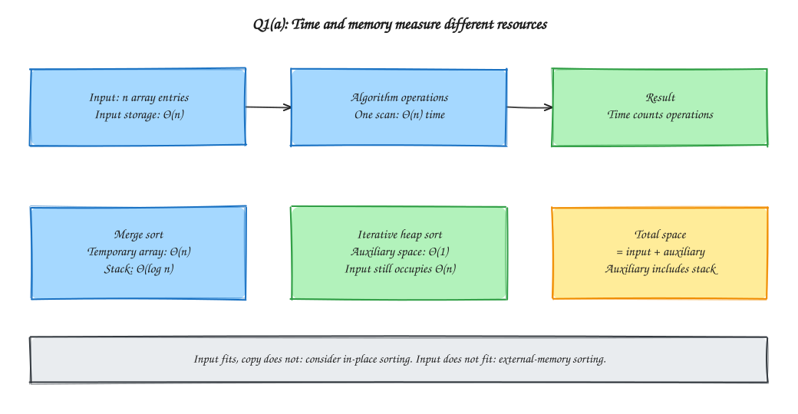

#### Q1(b)

**Question (transcribed):** Define algorithm design paradigm. Briefly describe divide-and-conquer and greedy paradigms with suitable examples.

**Answer.**

An **algorithm design paradigm** is a general strategy for solving problems. Examples are divide and conquer, greedy, dynamic programming, backtracking, and branch and bound (see [Chapter 1](../../../Chapter%201%20-%20Introduction%20and%20Algorithm%20Foundations/README.md)).

**Divide and conquer (D&C)**

1. **Divide** the problem into smaller parts.
2. **Conquer** each part by solving it (recursively, or directly if it is small).
3. **Combine** the answers into the final answer.

Examples are merge sort and quick sort. Binary search also reduces the problem by half, but solves only one half; this is often called decrease-and-conquer (see [Chapter 6](../../../Chapter%206%20-%20Divide%20and%20Conquer/README.md)).

**Greedy**

A **greedy algorithm** picks the option that looks best at each step and does not change earlier choices. It works when each such choice can lead to an optimal final answer.

Example: in **activity selection**, choose the compatible activity that finishes first, then repeat. This gives the largest number of non-overlapping activities on one resource. An activity starting when the previous one finishes is allowed (see [Chapter 7](../../../Chapter%207%20-%20Greedy%20Algorithms/README.md)).

| | Divide and conquer | Greedy |
|--|--------------------|--------|
| Subproblems | Usually independent, solved recursively | One choice at a time, no recursion needed |
| Going back? | Not needed, since parts are solved fully | Never changes a choice |
| Example | Merge sort | Activity selection, Kruskal's MST |

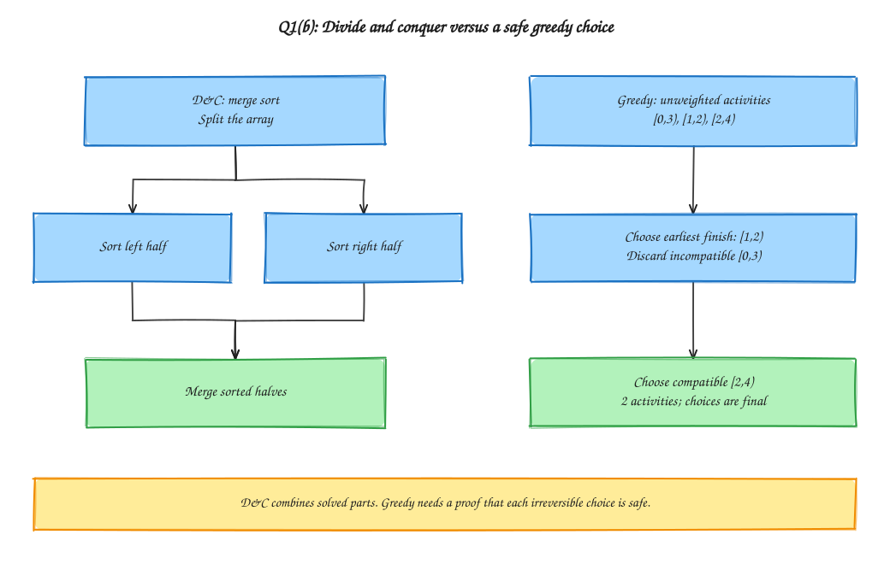

#### Q1(c)

**Question (transcribed):** Evaluate asymptotic bounds for: (i) T(n) = 2T(n/2) + n; (ii) T(n) = T(n - 1) + 1; (iii) T(n) = 4T(n/2) + n^2; (iv) T(n) = T(n/3) + log n.

**Answer.**

Assume $T(n)=\Theta(1)$ for $n\le1$. Use powers of 2 or 3 for the divide recurrences; floors and ceilings do not change the answers.

The **Master theorem** solves recurrences of the form $T(n)=aT(n/b)+f(n)$, where $a\ge1$ and $b>1$ are constants. Compare the extra work $f(n)$ with $n^{\log_b a}$ (see [Chapter 3](../../../Chapter%203%20-%20Recurrences%20Correctness%20and%20Loop%20Invariants/README.md)). Let $p=\log_b a$:

- If $f(n)$ is polynomially smaller than $n^p$, then $T(n)=\Theta(n^p)$.
- If $f(n)=\Theta(n^p\log^k n)$ for $k\ge0$, then $T(n)=\Theta(n^p\log^{k+1}n)$.
- If $f(n)$ is polynomially larger than $n^p$ and $af(n/b)\le cf(n)$ for some fixed $c<1$ when $n$ is large, then $T(n)=\Theta(f(n))$. This last inequality is the regularity condition.

For the first and third cases, “polynomially” means there is a fixed power gap.

**(i) $T(n) = 2T(n/2) + n$**

- $a = 2$, $b = 2$, $n^{\log_2 2} = n$, and $f(n) = n$. They are equal, so this is **Case 2**.
- **Answer: $T(n) = \Theta(n \log n)$.**
- Check with a recursion tree: each of the $\log_2 n$ levels does $n$ work.

**(ii) $T(n) = T(n-1) + 1$**

- This does not divide the input, so use expansion instead of the Master theorem:

$$T(n) = T(n-1) + 1 = T(n-2) + 2 = \dots = T(1) + (n-1)$$

- **Answer: $T(n) = \Theta(n)$.**

**(iii) $T(n) = 4T(n/2) + n^2$**

- $a = 4$, $b = 2$, $n^{\log_2 4} = n^2$, and $f(n) = n^2$. They are equal, so this is **Case 2**.
- **Answer: $T(n) = \Theta(n^2 \log n)$.**
- Check: level $i$ has $4^i$ nodes, each of size $n/2^i$, so each level does $4^i \cdot (n/2^i)^2 = n^2$ work. There are $\log_2 n$ levels.

**(iv) $T(n) = T(n/3) + \log n$**

- Here $a=1$, $b=3$, so $n^{\log_3 1}=1$. The extra work is $\log n$. It is not separated from 1 by a polynomial factor, so use the extended Case 2 form.
- Here $f(n)=\Theta(\log n)$, so the result is $\Theta(\log^2 n)$.
- Check by expansion: level $i$ costs $\log n-i\log 3$. There are about $\log_3 n$ levels. Their total is about $\frac{(\log n)^2}{2\log 3}$.
- **Answer: $T(n)=\Theta(\log^2 n)$.**

| Recurrence | $a$, $b$ | Method | Result |
|------------|----------|--------|--------|
| $2T(n/2) + n$ | 2, 2 | Master, Case 2 | $\Theta(n \log n)$ |
| $T(n-1) + 1$ | - | Expansion | $\Theta(n)$ |
| $4T(n/2) + n^2$ | 4, 2 | Master, Case 2 | $\Theta(n^2 \log n)$ |
| $T(n/3) + \log n$ | 1, 3 | Extended Case 2 | $\Theta(\log^2 n)$ |

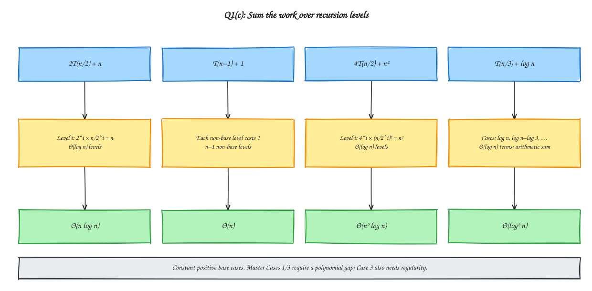

---

### Q2. NP Classes, BFS, and Activity Graph

#### Q2(a)

**Question (transcribed):** Define the complexity classes NP, NP-hard, and NP-complete.

**Answer.**

Measure input length by the number of symbols used to write the input. A **polynomial-time** algorithm takes at most a polynomial number of steps in that length.

- **P:** yes/no problems that can be solved in polynomial time.
- **NP:** yes/no problems where every yes-instance has a **polynomial-length certificate** (proof or witness) that can be checked in polynomial time. Every problem in P is also in NP. NP does not mean “no fast solution is known.” For example, a proposed TSP tour can be checked to see whether its cost is at most $k$.
- **NP-hard:** every problem in NP can be reduced to it in polynomial time. For a decision problem, the reduction keeps the yes/no answer the same. An NP-hard problem does not have to be in NP; it can also be an optimization problem.
- **NP-complete:** problems that are both in NP and NP-hard. Examples include TSP decision, SAT, Hamiltonian cycle, and subset sum decision. For graph colouring, deciding whether a graph can be coloured with a fixed $k\ge3$ colours is NP-complete; 2-colouring is in P.

Whether P equals NP is still an open question (see [Chapter 15](../../../Chapter%2015%20-%20Lower%20Bound%20Theory%20and%20NP%20Completeness/README.md)).

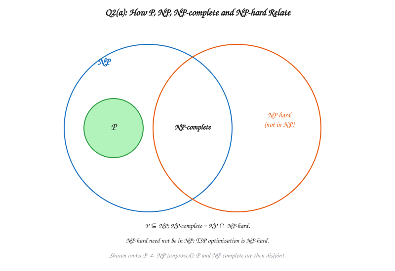

#### Q2(b)

**Question (transcribed):** Explain how BFS is used to find the shortest path in an unweighted graph. Demonstrate the process with a diagram and step-by-step explanation.

**Answer.**

In an **unweighted** graph, every edge counts as one step. Breadth-first search (**BFS**) visits vertices level by level, using a queue (a first-in, first-out list). The first time BFS visits a vertex, it has found a shortest path to it.

**Steps**

1. Put source $S$ in the queue. Set $d(S)=0$ and mark it visited.
2. While the queue is not empty:
   - Remove its first vertex $u$.
   - For each unvisited neighbour $v$ of $u$, mark it visited, set $d(v)=d(u)+1$, set `parent[v]=u`, and add it to the queue.
3. To get a path to a target, follow `parent` links back to $S$, then reverse the list.

With adjacency lists, BFS takes $O(V+E)$ time and $O(V)$ extra space. With an adjacency matrix, it takes $O(V^2)$ time. If the target cannot be reached, its distance stays $\infty$ and it has no parent path (see [Chapter 4](../../../Chapter%204%20-%20Searching%20and%20Basic%20Traversal/README.md) and [Chapter 11](../../../Chapter%2011%20-%20Graph%20Algorithms/README.md)).

**Illustrative givens.** Undirected graph $V=\{S,A,B,C,D,E\}$ with edges S-A, S-B, A-C, B-C, B-D, C-E, D-E; source $S$, target $E$. Visit each vertex's neighbours alphabetically, marking them **when enqueued**, not when dequeued.

| Step | Pop from queue | Newly discovered (distance) | Queue after step |
|------|----------------|-----------------------------|------------------|
| 0 | - | S (0) | S |
| 1 | S | A (1), B (1) | A, B |
| 2 | A | C (2) | B, C |
| 3 | B | D (2); C is already visited | C, D |
| 4 | C | E (3) | D, E |
| 5 | D | E is already visited | E |
| 6 | E | None | Empty |

Shortest path from $S$ to $E$: follow parents $E \leftarrow C \leftarrow A \leftarrow S$, so **S-A-C-E** (3 edges). S-B-D-E is also 3 edges.

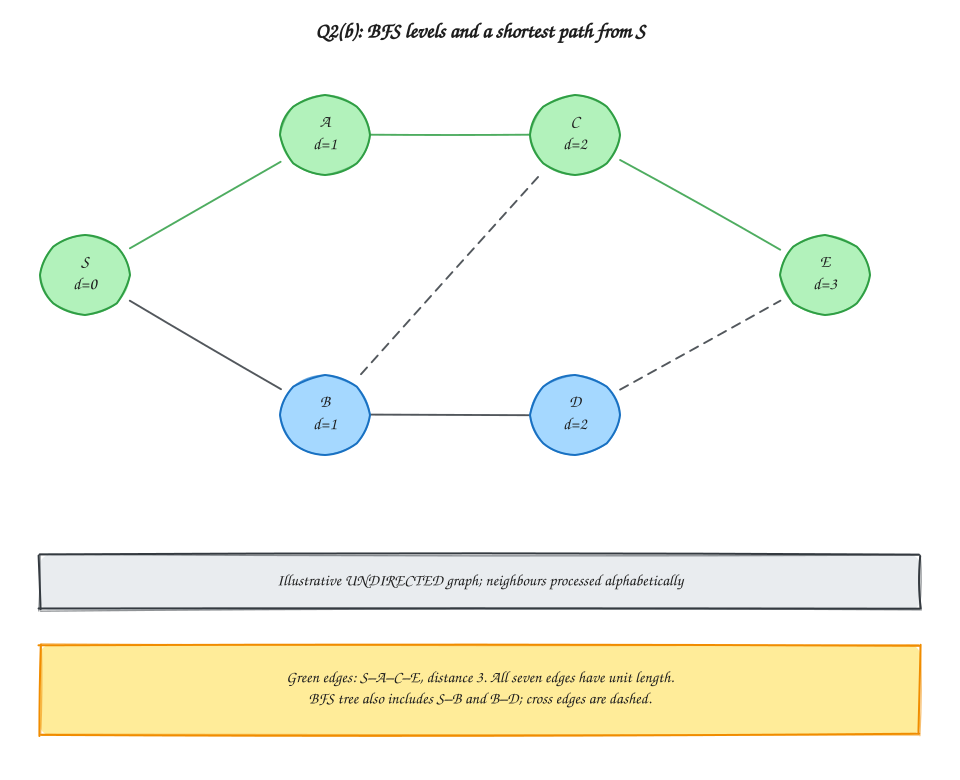

#### Q2(c)

**Question (transcribed):** A student performs several activities during a day. Some activities must be completed before others can begin.

**Activities:** Wake up; Brush teeth; Take breakfast; Go to class; Study in library; Do homework; Sleep.

**Dependencies:** Wake up must be completed before brushing teeth. Brushing teeth must be completed before taking breakfast. Taking breakfast must be completed before going to class. Going to class must be completed before studying in the library. Studying in the library must be completed before doing homework. Doing homework must be completed before sleeping.

Based on the above situation answer the following questions: (i) Represent the above activities and dependencies using a directed graph. (ii) Apply topological sorting to determine a valid order of activities. (iii) Is more than one valid topological order possible? Explain briefly. (iv) What will happen if sleeping is done before completing homework?

**Answer.**

**Givens from the paper.** The activities are Wake up, Brush teeth, Take breakfast, Go to class, Study in library, Do homework, and Sleep. The paper gives the six dependencies listed below. We use them to draw the graph and answer all four parts.

**(i) Directed graph.** Each activity is a vertex. Each arrow means "must finish before":

Wake up → Brush teeth → Take breakfast → Go to class → Study in library → Do homework → Sleep

This is a **DAG** (directed acyclic graph): the arrows all point forward, so there is no cycle.

**(ii) Topological order.** A topological order puts each activity before every activity it points to. The order is:

1. Wake up
2. Brush teeth
3. Take breakfast
4. Go to class
5. Study in library
6. Do homework
7. Sleep

Kahn's algorithm finds this order by repeatedly removing an activity with no incoming arrows. Here, only Wake up has no incoming arrow at first, and each step unlocks the next (see [Chapter 11](../../../Chapter%2011%20-%20Graph%20Algorithms/README.md)).

**(iii) Is more than one order possible?** No. The graph is one chain, so each activity must follow the one before it.

**(iv) What if Sleep comes before Homework?** This breaks the given dependency Do homework → Sleep. So it is not a valid order for the given graph.

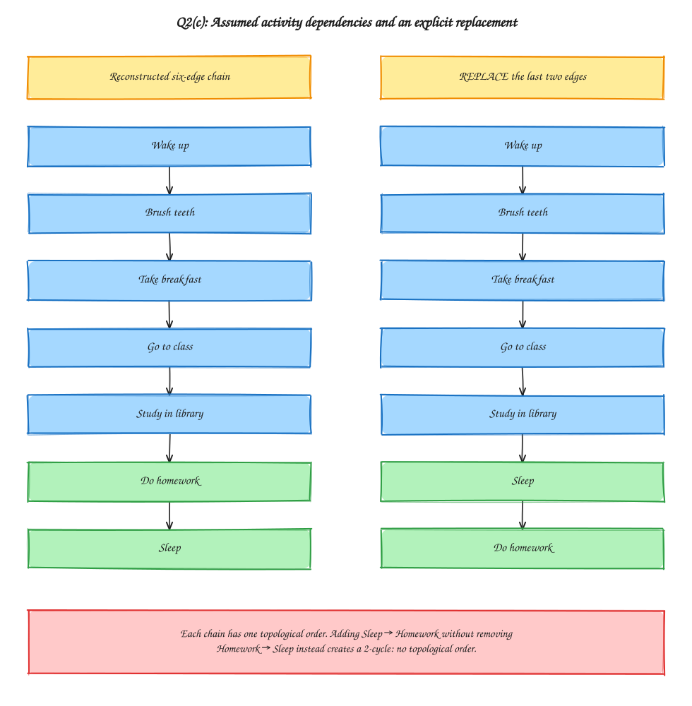

---

### Q3. Searching, Traversing, and Matrix Multiplication

#### Q3(a)

**Question (transcribed):** Explain the difference between searching and traversing by highlighting their purposes, typical operations, and examples.

**Answer.**

| | Searching | Traversing |
|--|-----------|------------|
| Purpose | Find whether an item exists, and where it is | Visit every item (or vertex) once, in a systematic order |
| Main operation | Compare the target with items, stop when found | Visit each item and do some work on it |
| Stops early? | Yes, when found | Usually no, it visits all items |
| Examples | Linear search, binary search, search in a BST or hash table | BFS, DFS, in-order traversal of a tree |

BFS or DFS can also search for a target by stopping when they find it. From one start vertex, a graph traversal visits only vertices it can reach. To visit a disconnected graph fully, start again at each unvisited vertex. The difference is the goal: find one item or visit them all.

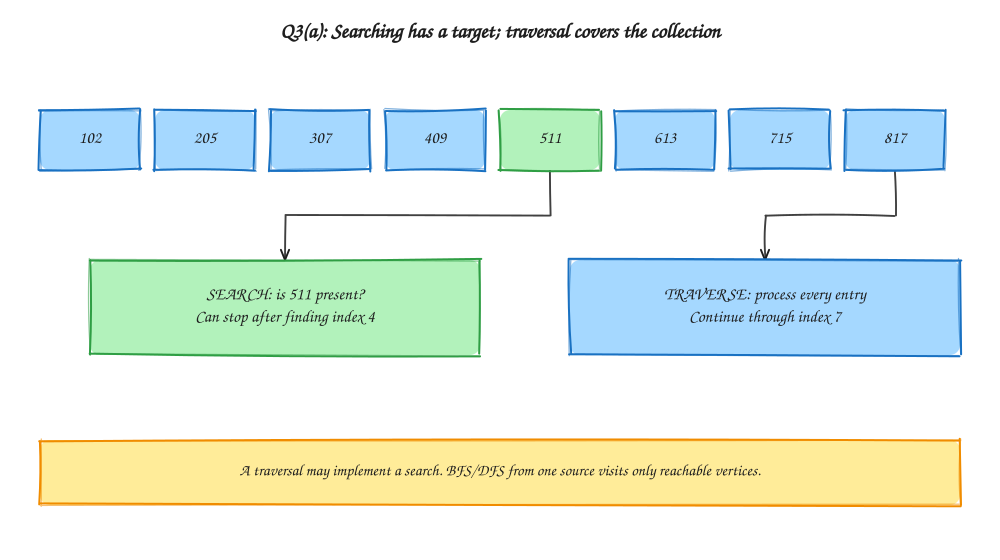

Both are covered in [Chapter 4](../../../Chapter%204%20-%20Searching%20and%20Basic%20Traversal/README.md). A simple way to remember it: searching asks "Is 511 here?", traversing asks "Show me every item."

#### Q3(b)

**Question (transcribed):** A sorted list of student IDs is [102, 205, 307, 409, 511, 613, 715, 817]. Compare linear search and binary search to find ID 511 by: (i) showing all comparisons made in each method; (ii) counting the total number of comparisons for each search; (iii) analyzing the best-, average-, and worst-case time complexities; (iv) explaining which method is more efficient for this search and why.

**Answer.**

**Givens from the paper.** The sorted array is `[102, 205, 307, 409, 511, 613, 715, 817]`, and the target is $511$. Use zero-based indices and $mid=\lfloor(lo+hi)/2\rfloor$. Count one key comparison for each inspected value (less than, equal to, or greater than the target). Do not count loop or index checks.

**Linear search** checks each item from the start until it finds 511:

| Step | Index | Value | Equal to 511? |
|------|-------|-------|---------------|
| 1 | 0 | 102 | No |
| 2 | 1 | 205 | No |
| 3 | 2 | 307 | No |
| 4 | 3 | 409 | No |
| 5 | 4 | 511 | **Yes, found** |

Linear search needs **5 comparisons** and finds 511 at index 4.

**Binary search** checks the middle item and keeps the half that may contain 511. The array must be sorted.

| Step | lo | hi | mid | Value at mid | Action |
|------|----|----|-----|--------------|--------|
| 1 | 0 | 7 | 3 | 409 | $409 < 511$, so $lo = 4$ |
| 2 | 4 | 7 | 5 | 613 | $613 > 511$, so $hi = 4$ |
| 3 | 4 | 4 | 4 | 511 | **Found** |

Binary search needs **3 comparisons**: it checks 409, 613, and 511. If the code checks equality and then less-than separately, binary search uses **5 individual key predicates** (yes/no tests: 2 + 2 + 1). Linear search makes 5 equality tests. State what counts as one comparison.

**Best, average, and worst cases**

| Search | Best case | Average case | Worst case |
|--------|-----------|--------------|------------|
| Linear | $\Theta(1)$: target is the first item | $\Theta(n)$: $(n+1)/2$ checks for a uniformly located successful target | $\Theta(n)$: target is last or missing |
| Binary | $\Theta(1)$: target is the middle item | $\Theta(\log n)$ | $\Theta(\log n)$ |

The average assumes the target is equally likely to be in any position and is present. For these 8 items, the averages are $36/8=4.5$ checks for linear search and $21/8=2.625$ checks for binary search. Binary search worst case is **4** checks here (for target 817), not 3. For 511, the counts are 5 and 3.

**Which is better?** For 511, binary search makes 3 checks instead of 5. For a large sorted array, it is usually faster because each check cuts the remaining range in half. It needs sorted data that can be accessed by index. For one search in unsorted data, linear search avoids sorting first. Both iterative methods use $O(1)$ extra space.

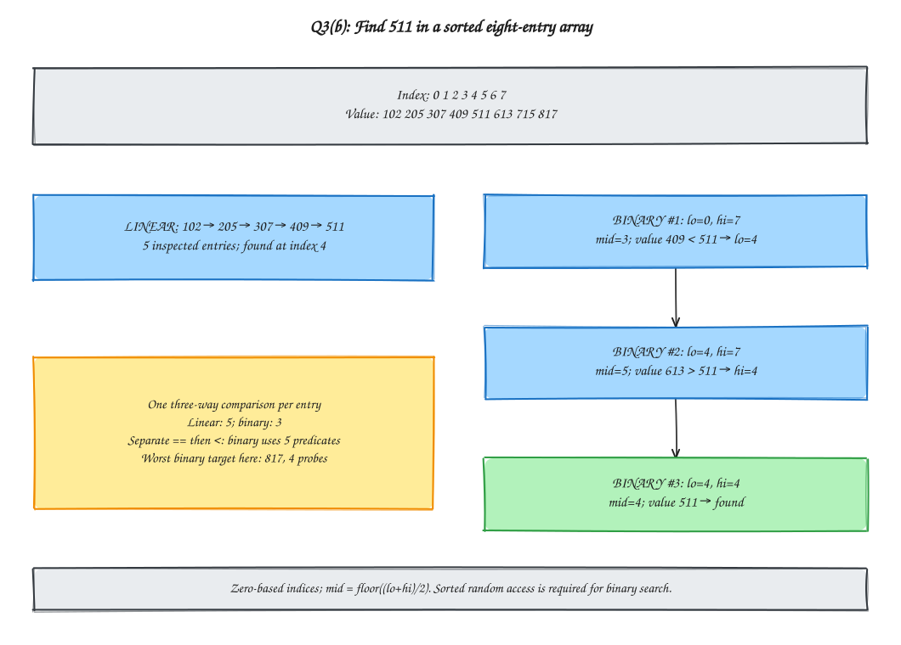

#### Q3(c)

**Question (transcribed):** Explain Strassen's matrix multiplication algorithm. Multiply the following two 2×2 matrices using Strassen's method: A = [[1, 3], [7, 5]], B = [[6, 8], [4, 2]].

**Answer.**

Strassen's algorithm splits each matrix into four blocks. Ordinary multiplication uses 8 block products. Strassen uses **7** products, then combines them with additions and subtractions. For large matrices, this takes $T(n)=7T(n/2)+\Theta(n^2)$ time, or $\Theta(n^{\log_2 7})\approx\Theta(n^{2.81})$.

For the given matrices, each block is one number: $A_{11}=1$, $A_{12}=3$, $A_{21}=7$, $A_{22}=5$, and $B_{11}=6$, $B_{12}=8$, $B_{21}=4$, $B_{22}=2$. Use these Strassen formulas:

| Product | Formula | Value |
|---------|---------|-------|
| $P_1$ | $A_{11}(B_{12} - B_{22}) = 1 \cdot (8 - 2)$ | 6 |
| $P_2$ | $(A_{11} + A_{12}) B_{22} = (1 + 3) \cdot 2$ | 8 |
| $P_3$ | $(A_{21} + A_{22}) B_{11} = (7 + 5) \cdot 6$ | 72 |
| $P_4$ | $A_{22}(B_{21} - B_{11}) = 5 \cdot (4 - 6)$ | -10 |
| $P_5$ | $(A_{11} + A_{22})(B_{11} + B_{22}) = (1 + 5)(6 + 2)$ | 48 |
| $P_6$ | $(A_{12} - A_{22})(B_{21} + B_{22}) = (3 - 5)(4 + 2)$ | -12 |
| $P_7$ | $(A_{11} - A_{21})(B_{11} + B_{12}) = (1 - 7)(6 + 8)$ | -84 |

Combine the products:

- $C_{11} = P_5 + P_4 - P_2 + P_6 = 48 - 10 - 8 - 12 = \mathbf{18}$
- $C_{12} = P_1 + P_2 = 6 + 8 = \mathbf{14}$
- $C_{21} = P_3 + P_4 = 72 - 10 = \mathbf{62}$
- $C_{22} = P_5 + P_1 - P_3 - P_7 = 48 + 6 - 72 + 84 = \mathbf{66}$

$$C = \begin{bmatrix}18 & 14 \\ 62 & 66\end{bmatrix}$$

**Check** with normal multiplication: row 1 of $A$ times column 1 of $B$ is $1 \cdot 6 + 3 \cdot 4 = 18$. The other three entries also match.

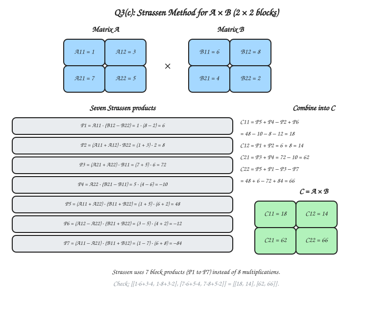

---

### Q4. Sorting: Insertion, Bubble, Quick Sort, and Merge Sort

#### Q4(a)

**Question (transcribed):** Why is insertion sort more efficient than bubble sort for nearly sorted arrays? Justify your answer with an example.

**Answer.**

Insertion sort builds a sorted part from left to right. It moves each new item left only as far as needed. In a nearly sorted array, most items move very little, so insertion sort is fast (see [Chapter 5](../../../Chapter%205%20-%20Sorting%20Algorithms/README.md)).

Bubble sort compares and swaps neighbouring items in repeated passes. A small item at the **end** moves only **one place left per pass**, so it may take many passes to reach the start.

**Example:** $[2, 3, 4, 5, 6, 7, \mathbf{1}]$. Only the 1 is out of place.

*Insertion sort (6 shifts)*

- Items 3, 4, 5, 6, 7 each compare once with the item before them and stop. That is 5 comparisons.
- Item 1 slides left past 7, 6, 5, 4, 3, 2. That is 6 comparisons and 6 shifts.
- Total: **11 comparisons**, **6 shifts**.

*Bubble sort (with an early-exit flag)*

| Pass | Comparisons | Swap made | Array after pass |
|------|-------------|-----------|------------------|
| 1 | 6 | (7, 1) | $[2,3,4,5,6,1,7]$ |
| 2 | 5 | (6, 1) | $[2,3,4,5,1,6,7]$ |
| 3 | 4 | (5, 1) | $[2,3,4,1,5,6,7]$ |
| 4 | 3 | (4, 1) | $[2,3,1,4,5,6,7]$ |
| 5 | 2 | (3, 1) | $[2,1,3,4,5,6,7]$ |
| 6 | 1 | (2, 1) | $[1,2,3,4,5,6,7]$ |

Total: **21 comparisons**, **6 swaps**. The early-exit flag does not help here, because a swap happens in every pass.

**Conclusion:** On this input, insertion sort makes about 11 comparisons, while bubble sort makes about 21. An **inversion** is a pair of items in the wrong order. If there are $I$ inversions, insertion sort takes $\Theta(n+I)$ time; here, $I=6$. Bubble sort still needs 6 passes for this input, even with early exit. An already sorted array takes $\Theta(n)$ time with early exit. These counts include comparisons between values, but not loop checks or the final insertion write.

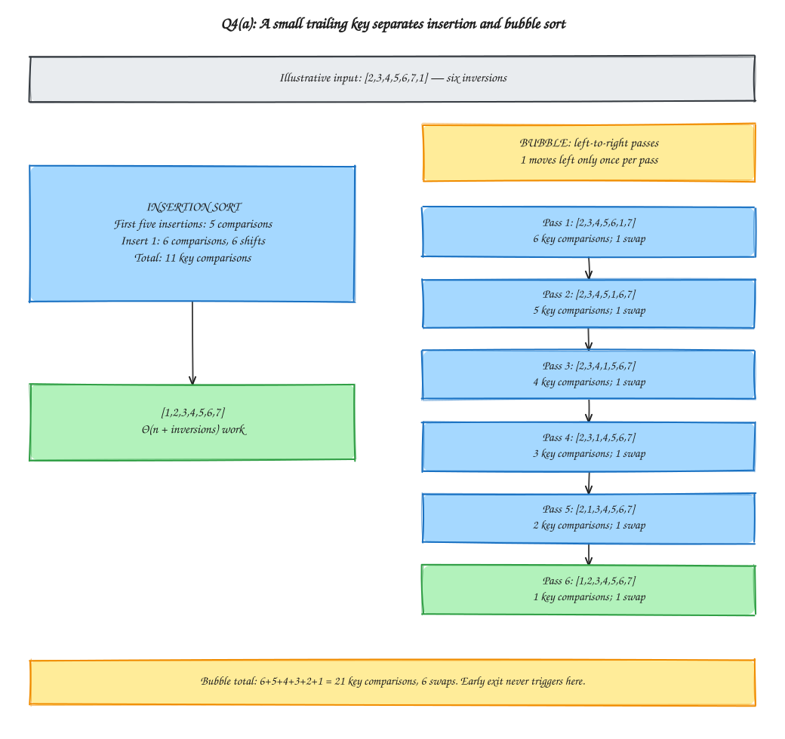

#### Q4(b)

**Question (transcribed):** A company stores the employee IDs [1023, 1010, 1055, 1005, 1040] in an unsorted array. The HR software needs the IDs in ascending order to generate reports efficiently. (i) Explain how quick sort can be applied to sort these IDs. (ii) Show the pivot selection and partitioning steps. (iii) Give the final sorted array.

**Answer.**

Use the **last element as the pivot**. During partitioning, move values smaller than the pivot to its left. Index $i$ marks the end of that smaller-values part. This is Lomuto partitioning (see [Chapter 5](../../../Chapter%205%20-%20Sorting%20Algorithms/README.md)).

**Pass 1:** pivot = 1040, $i = -1$

| $j$ | Value | Less than 1040? | Action | Array |
|-----|-------|-----------------|--------|-------|
| 0 | 1023 | Yes | $i = 0$, swap with itself | 1023, 1010, 1055, 1005, 1040 |
| 1 | 1010 | Yes | $i = 1$, swap with itself | 1023, 1010, 1055, 1005, 1040 |
| 2 | 1055 | No | nothing | same |
| 3 | 1005 | Yes | $i = 2$, swap $a[2]$ and $a[3]$ | 1023, 1010, 1005, 1055, 1040 |

Finally, swap the pivot with $a[i+1]=a[3]$: **1023, 1010, 1005, 1040, 1055**. Pivot 1040 is now in its final sorted position.

- Left part: $[1023, 1010, 1005]$
- Right part: $[1055]$ (one item, already sorted)

**Pass 2 (left part):** pivot = 1005. Both 1023 and 1010 are larger, so $i$ stays at $-1$. Swap the pivot with $a[0]$: **1005, 1010, 1023**. Left part is empty; Right part is $[1010, 1023]$.

**Pass 3 (right part of pass 2):** pivot = 1023. Since 1010 is smaller, it stays to the left. Result: **1010, 1023**. The left side is $[1010]$ and the right side is empty. The three partitions make **7 key–pivot comparisons** in total (4 + 2 + 1).

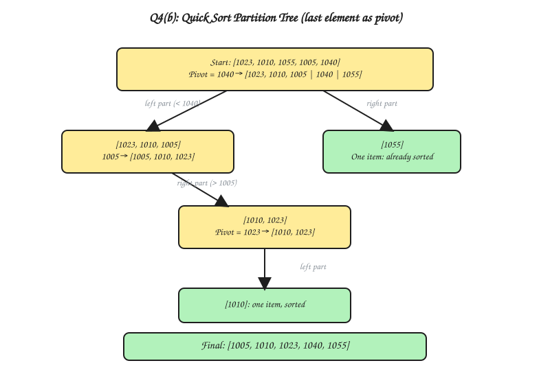

**Final sorted array: $[1005, 1010, 1023, 1040, 1055]$**

#### Q4(c)

**Question (transcribed):** Explain the divide-and-conquer technique in algorithm design. Illustrate your answer by applying it to merge sort to sort the array [38, 27, 43, 3, 9, 82, 10], showing the divide, conquer, and combine steps.

**Answer.**

**Divide and conquer** solves a problem in three steps: divide it into smaller parts, solve those parts, and combine their answers. For an odd-length list, put the extra item in the **left** half:

**Divide**

- $[38, 27, 43, 3, 9, 82, 10]$ splits into $[38, 27, 43, 3]$ and $[9, 82, 10]$.
- $[38, 27, 43, 3]$ splits into $[38, 27]$ and $[43, 3]$, then into single items.
- $[9, 82, 10]$ splits into $[9, 82]$ and $[10]$, then $[9, 82]$ into $[9]$ and $[82]$.

**Conquer and combine** (merge two sorted lists into one sorted list):

| Merge | Left | Right | Result |
|-------|------|-------|--------|
| 1 | [38] | [27] | [27, 38] |
| 2 | [43] | [3] | [3, 43] |
| 3 | [27, 38] | [3, 43] | [3, 27, 38, 43] |
| 4 | [9] | [82] | [9, 82] |
| 5 | [9, 82] | [10] | [9, 10, 82] |
| 6 | [3, 27, 38, 43] | [9, 10, 82] | **[3, 9, 10, 27, 38, 43, 82]** |

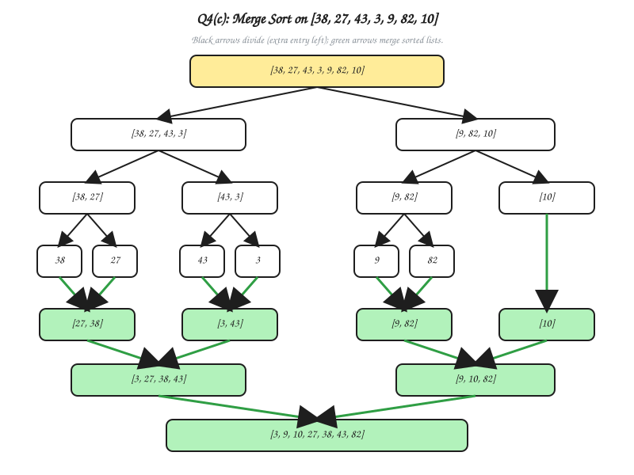

Merge sort takes $\Theta(n\log n)$ time (see Q1(c)(i)) and uses an extra $\Theta(n)$ array for merging.

---

## Section B

### Q5. Greedy Algorithms and Minimum Spanning Tree

#### Q5(a)

**Question (transcribed):** What is a greedy algorithm? State the conditions under which a greedy approach produces an optimal solution.

**Answer.**

A **greedy algorithm** builds an answer one step at a time. It chooses what looks best now and does not undo earlier choices (see [Chapter 7](../../../Chapter%207%20-%20Greedy%20Algorithms/README.md)).

A greedy method gives an optimal answer when both conditions hold:

1. **Greedy choice property:** the best-looking next choice can be part of an optimal answer.
2. **Optimal substructure:** after that choice, an optimal answer to the smaller problem completes an optimal answer to the full problem.

An **exchange argument** proves a greedy choice is safe: replace a choice in an optimal answer with the greedy choice and show the answer is no worse.

**Example where greedy fails:** with unlimited coins $\{1,3,4\}$, make 6 using as few coins as possible. Taking the largest coin first gives $4+1+1$ (3 coins), but $3+3$ uses only 2. So the choice rule must be proved safe; having optimal substructure alone is not enough.

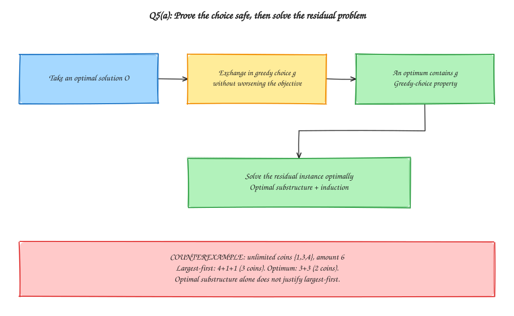

#### Q5(b)

**Question (transcribed):** A thief has a knapsack with capacity 50. He can take fractions of items. The available items have the following weights and profits: Item 1 (weight 10, profit 60), Item 2 (weight 20, profit 100), Item 3 (weight 30, profit 120). Solve the fractional knapsack problem to maximize profit. Show (i) the profit-to-weight ratio for each item; (ii) the items or fractions to include in the knapsack; (iii) the maximum total profit obtained.

**Answer.**

In the **fractional knapsack**, we may take part of an item. Take items from the highest to lowest **profit-to-weight ratio** (profit earned per unit of weight).

| Item | Weight | Profit | Ratio $p/w$ | Rank |
|------|--------|--------|-------------|------|
| 1 | 10 | 60 | 6 | 1st |
| 2 | 20 | 100 | 5 | 2nd |
| 3 | 30 | 120 | 4 | 3rd |

Take items in that order until the capacity 50 is full:

| Step | Take | Weight used | Profit so far |
|------|------|-------------|---------------|
| 1 | All of item 1 | 10 | 60 |
| 2 | All of item 2 | 30 | 160 |
| 3 | $\frac{20}{30}$ of item 3 (only 20 weight is left) | 50 | 160 + $\frac{2}{3}$ × 120 = **240** |

**Maximum profit: 240**, by taking fractions $(1,1,2/3)$ of items 1, 2, and 3. This is optimal because replacing lower-ratio weight with the same amount of higher-ratio weight cannot reduce profit. Sorting takes $O(n\log n)$ time; filling the knapsack takes $O(n)$ time. The 0/1 optimum is 220 (items 2 and 3), when items cannot be split.

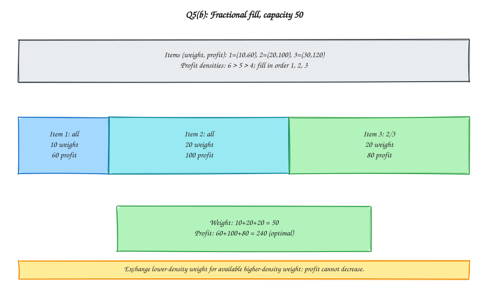

See [Chapter 7](../../../Chapter%207%20-%20Greedy%20Algorithms/README.md) for the proof.

#### Q5(c)

**Question (transcribed):** Define minimum spanning tree (MST). Using the given graph, find the MST by using the Kruskal algorithm and show the step-by-step process by indicating the edges selected and the total minimum cost.

**Answer.**

A **minimum spanning tree (MST)** connects every vertex, has no cycle, and has the smallest possible total edge weight. A tree on 6 vertices has 5 edges.

**Graph transcribed from the paper:** the undirected graph has $V=\{1,2,3,4,5,6\}$ and these edges, from lowest to highest weight:

$$(5,1)=1,\ (4,1)=1,\ (1,2)=2,\ (4,2)=3,\ (3,2)=3,\ (4,3)=5,\ (2,6)=7,\ (3,6)=8,\ (5,4)=9.$$

Kruskal's algorithm checks edges from lightest to heaviest. Take an edge if it does not make a cycle; otherwise skip it.

| Step | Edge | Weight | Decision | Total so far |
|------|------|--------|----------|--------------|
| 1 | (5,1) | 1 | Take | 1 |
| 2 | (4,1) | 1 | Take | 2 |
| 3 | (1,2) | 2 | Take | 4 |
| 4 | (4,2) | 3 | Skip: path 4–1–2 already connects them | 4 |
| 5 | (3,2) | 3 | Take | 7 |
| 6 | (4,3) | 5 | Skip: path 4–1–2–3 already connects them | 7 |
| 7 | (2,6) | 7 | Take; we now have 5 edges, so stop | **14** |

**MST edges:** $(5,1),(4,1),(1,2),(3,2),(2,6)$.
**Minimum cost:** $1+1+2+3+7=14$.

These edges connect all six vertices without a cycle. The MST is unique. The diagram highlights the selected edges.

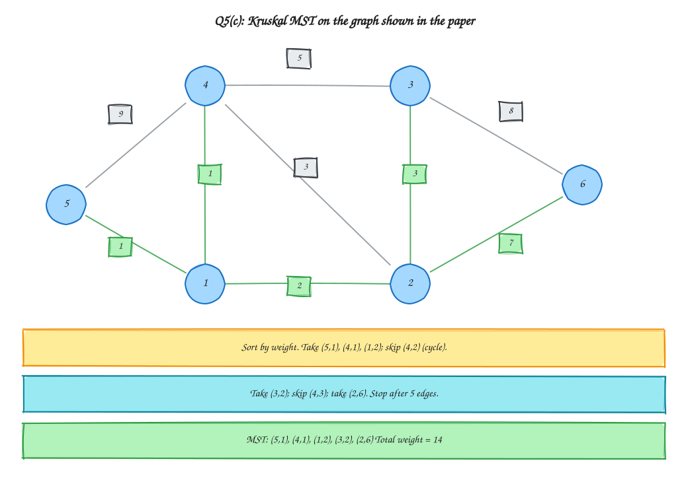

#### Q6(a)

**Question (transcribed):** Define dynamic programming. Discuss overlapping subproblems using Fibonacci.

**Answer.**

**Dynamic programming (DP)** solves smaller problems once, stores their answers, and reuses them. It is useful when the same subproblems appear repeatedly (**overlapping subproblems**) and the full answer can be built from smaller answers (**optimal substructure**) (see [Chapter 8](../../../Chapter%208%20-%20Dynamic%20Programming/README.md)).

**Fibonacci:** $F(0)=0$, $F(1)=1$, and $F(n)=F(n-1)+F(n-2)$ for $n\ge2$. The recursion stops at 0 or 1.

In the simple recursive method for $F(5)$:

- $F(3)$ is called **twice**.
- $F(2)$ is called **three times**.
- $F(1)$ is called five times, and $F(0)$ three times.
- $F(5)$ and $F(4)$ are each called once.

The naive recursion for $F(5)$ makes **15** calls in total. As $n$ grows, many values are recalculated, so the number of calls grows exponentially. These repeated calculations are the **overlapping subproblems**.

With DP, each $F(i)$ is computed once and stored:

```
if n == 0: return 0
F[0] = 0, F[1] = 1
for i = 2 to n:
    F[i] = F[i-1] + F[i-2]
return F[n]
```

The table for $F(5)$ is $[0,1,1,2,3,5]$. Counting each addition as one step, tabulation takes $\Theta(n)$ time and $\Theta(n)$ extra space. If we keep only the previous two values, the extra space is $\Theta(1)$.

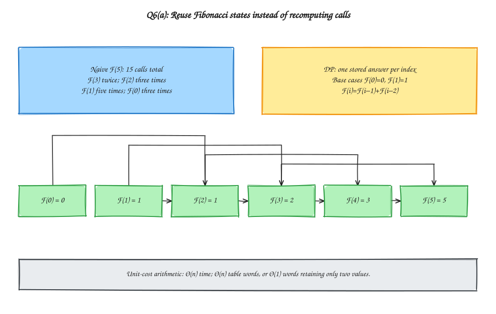

#### Q6(b)

**Question (transcribed):** Explain how the Floyd-Warshall algorithm computes all-pairs shortest paths in a weighted graph. Using the adjacency matrix [[0, 5, ∞, 10], [∞, 0, 3, ∞], [∞, ∞, 0, 1], [∞, ∞, ∞, 0]], perform the algorithm step by step, updating the distance matrix for each intermediate vertex. Show all intermediate matrices in sequence and present the final shortest-path matrix with explanations.

**Answer.**

**Givens:** a directed graph with vertices 1–4 and the four weighted edges below. $\infty$ means there is no direct edge; each diagonal 0 is the distance from a vertex to itself. Assume there is no negative-weight cycle. Process intermediate vertices in order 1, 2, 3, 4.

Floyd-Warshall finds shortest distances between **every pair** of vertices. Let $D_k(i,j)$ be the shortest distance from $i$ to $j$ when only vertices $1..k$ may be used in the middle of the path. For each vertex $k$, compare the current path with the path through $k$:

$$D_k(i,j)=\min\big(D_{k-1}(i,j),\;D_{k-1}(i,k)+D_{k-1}(k,j)\big)$$

The graph has edges $1\to2$ (5), $1\to4$ (10), $2\to3$ (3), and $3\to4$ (1) (see [Chapter 11](../../../Chapter%2011%20-%20Graph%20Algorithms/README.md)).

**$D_0$ (direct edges only)**

| | 1 | 2 | 3 | 4 |
|--|---|---|---|---|
| 1 | 0 | 5 | ∞ | 10 |
| 2 | ∞ | 0 | 3 | ∞ |
| 3 | ∞ | ∞ | 0 | 1 |
| 4 | ∞ | ∞ | ∞ | 0 |

**$k = 1$:** no edge comes into vertex 1, so nothing changes. $D_1 = D_0$.

**$k = 2$:** check $i \to 2 \to j$.

- $d(1,3)$: $\min(\infty, 5 + 3) = 8$. **Changed.**
- $d(4,\cdot)$ and others: no changes.

| | 1 | 2 | 3 | 4 |
|--|---|---|---|---|
| 1 | 0 | 5 | **8** | 10 |
| 2 | ∞ | 0 | 3 | ∞ |
| 3 | ∞ | ∞ | 0 | 1 |
| 4 | ∞ | ∞ | ∞ | 0 |

**$k = 3$:** check $i \to 3 \to j$.

- $d(1,4)$: $\min(10, 8 + 1) = 9$. **Changed.**
- $d(2,4)$: $\min(\infty, 3 + 1) = 4$. **Changed.**

| | 1 | 2 | 3 | 4 |
|--|---|---|---|---|
| 1 | 0 | 5 | 8 | **9** |
| 2 | ∞ | 0 | 3 | **4** |
| 3 | ∞ | ∞ | 0 | 1 |
| 4 | ∞ | ∞ | ∞ | 0 |

**$k = 4$:** no edge leaves vertex 4, so nothing changes. $D_4 = D_3$.

**Final matrix $D_4$:**

| | 1 | 2 | 3 | 4 |
|--|---|---|---|---|
| 1 | 0 | 5 | 8 | 9 |
| 2 | ∞ | 0 | 3 | 4 |
| 3 | ∞ | ∞ | 0 | 1 |
| 4 | ∞ | ∞ | ∞ | 0 |

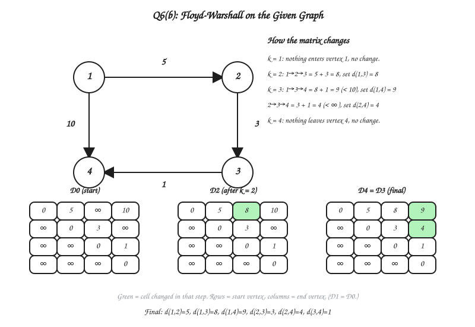

The algorithm takes $\Theta(n^3)$ time and $\Theta(n^2)$ space. The shortest path from 1 to 4 is **1→2→3→4**, with cost 9. If a graph has a negative-weight cycle, some shortest-path distances are not defined.

#### Q6(c)

**Question (transcribed):** Explain how dynamic programming is used to compute the longest common subsequence (LCS) of two strings. For X = AGGTAB and Y = GXTXAYB, build the full DP table row by row. After completing the table, demonstrate how to trace back through it to find the final LCS, and clearly state both the LCS and its length.

**Answer.**

A **subsequence** keeps letters in their original order but may skip letters. Let $L[i][j]$ be the length of the longest common subsequence (**LCS**) in the first $i$ letters of $X$ and the first $j$ letters of $Y$.

- Set $L[0][j]=L[i][0]=0$, because an empty string has no common letters.
- If $X_i=Y_j$, set $L[i][j]=L[i-1][j-1]+1$.
- If they differ, set $L[i][j]=\max(L[i-1][j],L[i][j-1])$.

**DP table** (row = letter of $X$, column = letter of $Y$):

| | | G | X | T | X | A | Y | B |
|--|---|---|---|---|---|---|---|---|
| | 0 | 0 | 0 | 0 | 0 | 0 | 0 | 0 |
| A | 0 | 0 | 0 | 0 | 0 | **1** | 1 | 1 |
| G | 0 | **1** | 1 | 1 | 1 | 1 | 1 | 1 |
| G | 0 | **1** | 1 | 1 | 1 | 1 | 1 | 1 |
| T | 0 | 1 | 1 | **2** | 2 | 2 | 2 | 2 |
| A | 0 | 1 | 1 | 2 | 2 | **3** | 3 | 3 |
| B | 0 | 1 | 1 | 2 | 2 | 3 | 3 | **4** |

(Bold cells show matching letters.)

**Traceback:** start at the bottom-right cell and follow the table rules backwards.

1. $(6,7)$: $B = B$. Take **B**, move diagonally to $(5,6)$.
2. $(5,6)$: $A \ne Y$. Value above is 2, value to the left is 3. Move left to $(5,5)$.
3. $(5,5)$: $A = A$. Take **A**, move diagonally to $(4,4)$.
4. $(4,4)$: $T \ne X$. Move left to $(4,3)$ (value 2).
5. $(4,3)$: $T = T$. Take **T**, move diagonally to $(3,2)$.
6. $(3,2)$: $G \ne X$. Move up to $(2,2)$.
7. $(2,2)$: $G \ne X$. Move left to $(2,1)$.
8. $(2,1)$: $G = G$. Take **G**, move diagonally to $(1,0)$. Stop.

Reading the taken letters backwards gives **G, T, A, B**.

**LCS = GTAB, length = 4.** At $(3,2)$, moving up or left is tied; choose up to get this traceback. Other tie choices may place the same letters in different positions. Filling the table takes $\Theta(|X||Y|)$ time and space. Tracing back takes $O(|X|+|Y|)$ time.

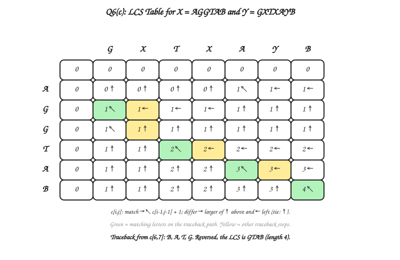

---

### Q7. Backtracking: Graph Colouring, LC-Search, and N-Queens

#### Q7(a)

**Question (transcribed):** Apply backtracking to graph colouring for a graph of 5 vertices. Show the order of colour assignment and the backtracking steps.

**Answer.**

> [!NOTE]
> **Worked example:** the paper gives no particular graph or number of colours. For a clear example, use the five-vertex graph below and three colours (Red = 1, Green = 2, Blue = 3).

**Sample graph:** edges 1-2, 1-3, 2-3, 3-4, 4-5, 3-5, 2-5.

**Method:** the sample graph is undirected and has exactly the seven listed edges. Start with every vertex uncoloured. Visit vertices 1 through 5, trying Red, Green, then Blue. A colour is allowed if no already-coloured neighbour has it. If no colour works, **backtrack**: undo the previous colour and try the next one (see [Chapter 9](../../../Chapter%209%20-%20Backtracking/README.md)).

```
colour_vertex(v):
    if v > n: return true              (all vertices coloured)
    for c in 1..3:
        if every already-coloured neighbour has a colour different from c:
            colours[v] = c
            if colour_vertex(v + 1): return true
            colours[v] = none          (undo before trying another colour)
    return false
```

**Trace**

| Step | Vertex | Colour tried | Why | Result |
|------|--------|--------------|-----|--------|
| 1 | v1 | Red | First colour | Coloured |
| 2 | v2 | Green | Red is used by neighbour v1 | Coloured |
| 3 | v3 | Blue | Red (v1) and Green (v2) are used | Coloured |
| 4 | v4 | Red | Only already-coloured neighbour is v3 (Blue) | Coloured |
| 5 | v5 | none | Neighbours v2 (Green), v3 (Blue), v4 (Red) use all 3 colours | **Dead end** |
| 6 | v4 | Green | Backtrack: next colour for v4 | Coloured |
| 7 | v5 | Red | Neighbours v2 (Green), v3 (Blue), v4 (Green) | **Solution** |

**Final colouring:** v1 Red, v2 Green, v3 Blue, v4 Green, v5 Red. Every edge joins vertices with different colours. The triangle 1–2–3 needs at least three colours. This valid 3-colouring proves that the chromatic number is **3** (the fewest colours needed). With $m$ colours, the search may try $O(m^n)$ assignments ($O(nm^n)$ time if each check scans all vertices) and uses $O(n)$ extra search space.

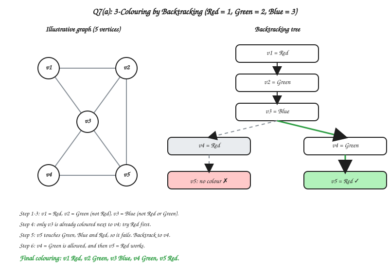

#### Q7(b)

**Question (transcribed):** Demonstrate LC-search on a 0/1 knapsack instance with at least four items. Draw the state-space tree.

**Answer.**

> [!NOTE]
> **Reconstructed example:** the original items are unavailable. The four items below specify the worked problem completely; their profits and weights are not authenticated exam givens.

**Instance:** capacity $W = 10$. Items (weight, profit): **A** (4, 40), **C** (3, 18), **B** (6, 30), **D** (5, 20). Sorted by profit per weight: A (10), C (6), B (5), D (4).

**LC-search** means least-cost search. It uses a **priority queue** to choose the next live node (an unfinished choice that may still be explored). Here we want the largest profit, so expand the node with the **largest upper bound** first. This is best-first **branch and bound**, not depth-first backtracking.

The **upper bound** estimates the most profit a node could still reach. Find it by pretending we can take fractions of the remaining items:

$$ub=\text{profit so far}+\text{profit from the best fractional fill of remaining items}$$

A **fractional fill** allows part of an item. **Prune** (stop exploring) a node if it is overweight or its upper bound is no greater than the best valid profit found so far. That best profit is called the **incumbent**.

Add the take-child before the skip-child. If two nodes have the same bound, expand the one added first; this is **first-in, first-out (FIFO)**. The incumbents are 40, 58, and then 70.

**Expansion**

| Node | Decisions | Weight | Profit | $ub$ | Status |
|------|-----------|--------|--------|------|--------|
| Root | none | 0 | 0 | 73 | Expand first |
| A=1 | take A | 4 | 40 | 73 | Expand |
| A=0 | skip A | 0 | 0 | 52 | Pruned later (52 ≤ 70) |
| A=1, C=1 | take A, C | 7 | 58 | 73 | Expand |
| A=1, C=0 | take A, skip C | 4 | 40 | 70 | Expand before the later-inserted equal-bound node |
| A=1, C=1, B=1 | take A, C, B | 13 | 88 | — | **Infeasible** (13 > 10) |
| A=1, C=1, B=0 | take A, C | 7 | 58 | 70 | Pruned (70 ≤ 70) |
| A=1, C=0, B=1 | take A, B | 10 | 70 | 70 | **Solution: best = 70** |
| A=1, C=0, B=0 | take A | 4 | 40 | 60 | Pruned (60 ≤ 70) |

**Bound arithmetic:** root and A=1: $40+18+(3/6)30=73$; A=0: $18+30+(1/5)20=52$; A=1,C=1: $58+(3/6)30=73$; A=1,C=0: $40+30=70$; A=1,C=1,B=0: $58+(3/5)20=70$; A=1,C=0,B=0: $40+20=60$.

**Expanded nodes, in order:** root → A=1 → A=1,C=1 → A=1,C=0. From the last node, taking B gives the valid choice A+B, with weight 10 and profit 70. The other node with bound 70 was added later, so FIFO puts it after this node. All remaining bounds are at most 70, so they cannot give a higher profit. The table lists nine generated nodes; only four are expanded.

**Answer:** take **A and B**. Their total weight is 10 and their profit is 70. No other choice gives a higher profit within capacity 10.

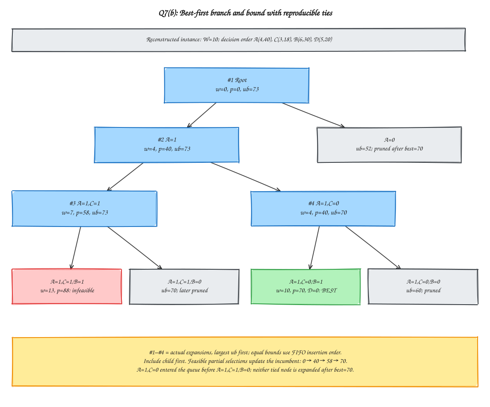

#### Q7(c)

**Question (transcribed):** Solve the N-Queens problem for N = 5 using backtracking. Show partial board configurations and backtracking steps.

**Answer.**

Place one queen in each row. Queens must not share a **column** or a **diagonal**. For queens at $(r_i,c_i)$ and $(r_j,c_j)$, they share a diagonal when $|r_i-r_j|=|c_i-c_j|$. If a row has no safe column, return to the previous row and move that queen (see [Chapter 9](../../../Chapter%209%20-%20Backtracking/README.md)).

**Trace of the first solution:** process rows 1–5 and try columns 1–5 in order. Reject a column if it conflicts with an earlier queen. The list records the queen's column in each row.

| Row | Columns tried | Result | Partial board (queen columns so far) |
|-----|---------------|--------|--------------------------------------|
| 1 | 1 | Safe, placed | [1] |
| 2 | 1 (same column), 2 (diagonal with (1,1)), 3 | Safe at column 3 | [1, 3] |
| 3 | 1 (column), 2 (diagonal with (2,3)), 3 (column), 4 (diagonal with (2,3)), 5 | Safe at column 5 | [1, 3, 5] |
| 4 | 1 (column), 2 | Safe at column 2 | [1, 3, 5, 2] |
| 5 | 1, 2, 3 (columns), 4 | Safe at column 4 | [1, 3, 5, 2, 4] ✓ |

**A later dead end when finding all solutions:** Continue searching with row 1 in column 1, undoing a queen before each new try. Eventually row 2 reaches column 5, giving [1, 5]:

- In row 3, only column 2 is safe, so the board is [1, 5, 2].
- In row 4, column 3 is diagonal to (3,2), and column 4 is diagonal to (1,1). **No column is safe.** Row 3 has no other choice, and row 2 has no more columns to try: columns 3 and 4 were already explored. So the search returns to row 1 and tries column 2.

**Final board for the first solution [1, 3, 5, 2, 4]**

```
Q . . . .
. . Q . .
. . . . Q
. Q . . .
. . . Q .
```

The table gives the first solution. The later branch shows how the algorithm backtracks when a row has no safe column. The search can continue to find other solutions.

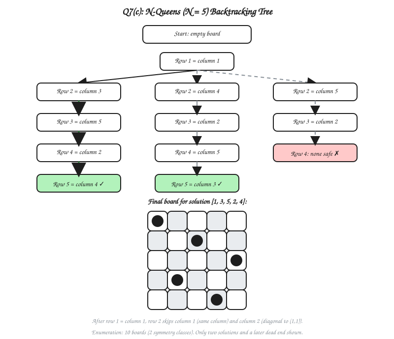

---

### Q8. Decision vs Optimization, Branch and Bound, and TSP

#### Q8(a)

**Question (transcribed):** Differentiate between decision problem and optimization problem in computational complexity.

**Answer.**

| | Decision problem | Optimization problem |
|--|------------------|----------------------|
| Question | Is there a solution that meets a condition? Answer yes or no. | What is the best value (minimum or maximum)? |
| Example (0/1 knapsack) | Is there a subset with weight at most $W$ and profit at least $P$? | What is the greatest profit among subsets with weight at most $W$? |
| Example (TSP) | Is there a tour with cost at most $k$? | What is the cheapest tour? |
| Output | Yes or no | A best value and a solution |

P and NP are classes of **decision problems** (yes-or-no problems). TSP decision is NP-complete; finding the cheapest TSP tour is NP-hard (see [Chapter 15](../../../Chapter%2015%20-%20Lower%20Bound%20Theory%20and%20NP%20Completeness/README.md)).

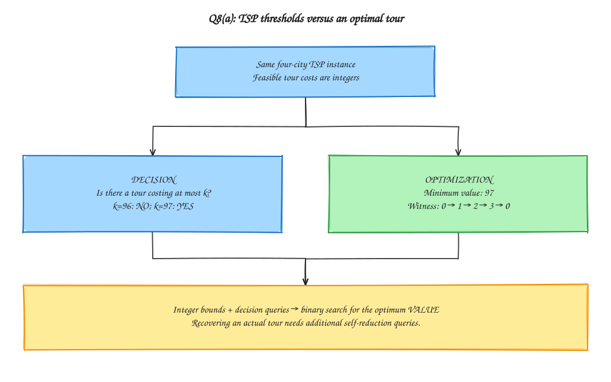

#### Q8(b)

**Question (transcribed):** Explain admissible heuristic and bounding function in branch-and-bound. Solve a branch-and-bound job sequencing problem.

**Answer.**

**Branch and bound (B&B)** searches a tree of choices. It uses a **bounding function** to skip a branch that cannot beat the best answer found so far (see [Chapter 10](../../../Chapter%2010%20-%20Branch%20and%20Bound/README.md)).

- **Bounding function:** gives a safe limit on how good a branch could be. For maximization, it is an **upper bound** on profit. For minimization, it is a **lower bound** on cost.
- **Admissible heuristic:** an estimate that cannot rule out the true best answer. For minimization, it never overestimates the remaining cost, so $g+h$ is a lower bound. For maximization, use an upper bound that never underestimates the best possible profit. Prune when $ub\le$ the best profit so far, or when $lb\ge$ the best cost so far. Equal bounds may hide another tied best solution, but not a better one.

**Job sequencing with deadlines (maximize profit).** Use one machine. All jobs are ready at time 0. Each job takes one time slot, has a positive integer deadline and positive profit, and cannot be paused. Slot $t$ runs from time $t-1$ to $t$, so a job must finish by its deadline. A set of jobs is feasible if, for every $t\ge1$, at most $t$ selected jobs have deadlines $\le t$. To check, sort jobs by deadline and make sure the $i$th job's deadline is at least $i$.

> [!NOTE]
> **Worked example:** the paper asks for a job-sequencing example but gives no job list. The following four jobs are an example chosen to demonstrate the method.

**Instance:** J1 (profit 100, deadline 2), J4 (profit 27, deadline 1), J3 (profit 15, deadline 2), J2 (profit 10, deadline 1). Jobs are considered in order of profit.

**Bound:** $ub$ = profit already selected + profits of all undecided jobs. This is a safe upper bound because it ignores deadline limits on the undecided jobs. Use **depth-first B&B**: explore the include child first, then the exclude child. Start with best profit 0. In this trace, update the best profit only at complete feasible leaves. (If updated at every feasible partial choice, profit 127 would be found earlier.)

| Node | Decision | Profit | $ub$ | Status |
|------|----------|--------|------|--------|
| Root | none | 0 | 152 | Branch |
| J1 = 1 | take J1 | 100 | 152 | Branch |
| J1 = 1, J4 = 1 | take J1, J4 | 127 | 152 | Branch (feasible: J4 in slot 1, J1 in slot 2) |
| J1=1, J4=1, J3=1 | take J3 too | — | — | **Infeasible**: 3 jobs with deadline ≤ 2 |
| J1=1, J4=1, J3=0 | skip J3 | 127 | 137 | Branch |
| J1=1, J4=1, J3=0, J2=1 | take J2 too | — | — | **Infeasible**: 2 jobs with deadline ≤ 1 |
| J1=1, J4=1, J3=0, J2=0 | leaf | 127 | 127 | **Best = 127** |
| J1 = 1, J4 = 0 | skip J4 | 100 | 125 | **Pruned** (125 ≤ 127) |
| J1 = 0 | skip J1 | 0 | 52 | **Pruned** (52 ≤ 127) |

**Answer:** take **J1 and J4**. Maximum profit = **127**. Schedule J4 in slot 1 and J1 in slot 2. The bounds are $152=100+27+15+10$, $137=127+10$, $125=100+15+10$, and $52=27+15+10$. The two unvisited branches have bounds 125 and 52, both below 127. The other include branches are infeasible. So no branch can give a larger profit.

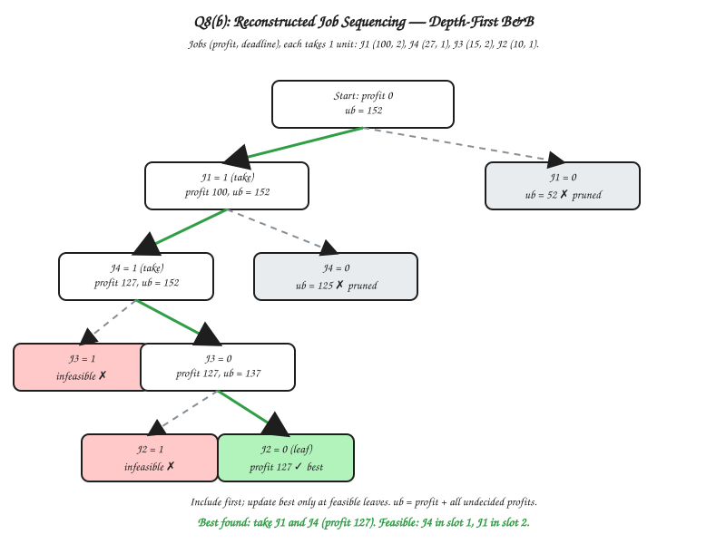

#### Q8(c)

**Question (transcribed):** Explain how the dynamic-programming method is used to solve the traveling salesperson problem. Using the cost matrix [[0, 20, 42, 35], [20, 0, 30, 34], [42, 30, 0, 12], [35, 34, 12, 0]] with start city 0, evaluate all relevant subsets of intermediate cities of size 1 and 2, show the partial DP table computed from these subsets, and determine the minimum tour cost based on these computed values.

**Answer.**

The travelling salesperson problem (**TSP**) asks for the cheapest tour that visits every city once and returns to the start. Let $g(i,S)$ be the least cost to start at city $i$, visit every city in set $S$, and return to city 0. Try each possible next city $j$:

$$g(i,S)=\min_{j\in S}\big(c_{ij}+g(j,S\setminus\{j\})\big),\qquad g(i,\varnothing)=c_{i0}.$$

The given cost matrix is for cities 0, 1, 2, and 3:

| From/to | 0 | 1 | 2 | 3 |
|---------|---|---|---|---|
| 0 | 0 | 20 | 42 | 35 |
| 1 | 20 | 0 | 30 | 34 |
| 2 | 42 | 30 | 0 | 12 |
| 3 | 35 | 34 | 12 | 0 |

For an empty set of remaining cities, return directly to city 0. Thus:

- $g(1,\varnothing)=c_{10}=20$
- $g(2,\varnothing)=c_{20}=42$
- $g(3,\varnothing)=c_{30}=35$

**Subsets of size 1**

| State | Calculation | Value |
|-------|-------------|-------|
| $g(1,\{2\})$ | $30+42$ | 72 |
| $g(1,\{3\})$ | $34+35$ | 69 |
| $g(2,\{1\})$ | $30+20$ | 50 |
| $g(2,\{3\})$ | $12+35$ | 47 |
| $g(3,\{1\})$ | $34+20$ | 54 |
| $g(3,\{2\})$ | $12+42$ | 54 |

**Subsets of size 2**

| State | Calculation | Value |
|-------|-------------|-------|
| $g(1,\{2,3\})$ | $\min(30+47,\ 34+54)$ | **77** |
| $g(2,\{1,3\})$ | $\min(30+69,\ 12+54)$ | **66** |
| $g(3,\{1,2\})$ | $\min(34+72,\ 12+50)$ | **62** |

Finally, choose the first city after 0:

$$g(0,\{1,2,3\})=\min(20+77,\ 42+66,\ 35+62)=\min(97,108,97)=97.$$

**Minimum tour cost: 97.** One optimal tour is $0\to1\to2\to3\to0$, with cost $20+30+12+35=97$. Subset DP takes $O(n^2 2^n)$ time and $O(n2^n)$ space.

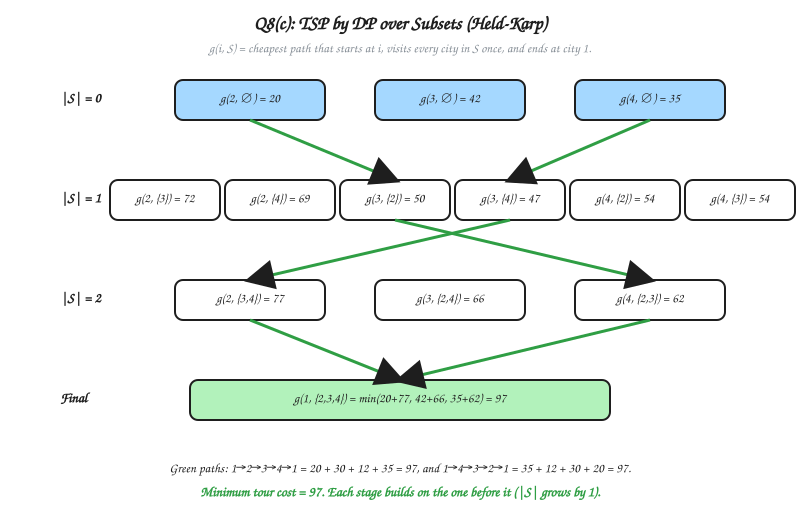

---

## Verification

Run `python tools/verify_b2_theory.py` from the repository root to check the numerical tables, search traces and bounds, exhaustive small-instance optima, local links, all 24 question diagrams, and all 25 SVG/Excalidraw pairs (including the roadmap). These read-only checks supplement the review; they do not prove every prose statement.

## Quick Revision

| Topic | One-line memory |
|-------|-----------------|
| Time vs space | Time counts operations; total space includes input, auxiliary space excludes input but includes the stack |
| Master theorem | Compare with $n^{\log_b a}$; Cases 1/3 need a polynomial gap, Case 3 also needs regularity |
| $T(n/3) + \log n$ | $\Theta(\log^2 n)$ (extended Case 2) |
| P, NP, NP-hard, NP-complete | P = solve fast; NP = verify fast; NP-complete = NP and NP-hard |
| BFS shortest path | Level by level with a queue; first visit = shortest distance (unweighted) |
| Topological order | Every arrow goes forward; remove vertices with no incoming arrows |
| Linear vs binary search | 5 vs 3 three-way probes for 511; binary needs sorted random access; eight-item worst case is 4 |
| Strassen | 7 block products instead of 8; $T(n) = 7T(n/2) + \Theta(n^2)$ |
| Insertion vs bubble | Insertion takes $\Theta(n+I)$ for $I$ inversions; left-to-right bubble can still be quadratic |
| Quick sort | Partition around the pivot; last-element pivot gives $[1005, 1010, 1023, 1040, 1055]$ |
| Merge sort | Split in half, merge sorted halves, $\Theta(n \log n)$, needs extra space |
| Greedy | Best local choice; needs greedy choice + optimal substructure |
| Fractional knapsack | Sort by profit/weight; take a fraction of the last item; profit 240 |
| Kruskal | Sort edges, skip cycles, stop at $V - 1$ edges; total 14 (confirm weights) |
| DP | Overlapping subproblems + optimal substructure; Fibonacci in $O(n)$ |
| Floyd-Warshall | Try each vertex as a middle vertex; $O(n^3)$; $d(1,4) = 9$ |
| LCS | Match: diagonal + 1; else max(up, left); LCS = GTAB, length 4 |
| Graph colouring | Colour in order, check neighbours, backtrack on dead end |
| LC-search | Expand the node with the best bound first; prune when $ub \le$ best |
| N-Queens | Row by row; check column and diagonals; 10 solutions for $N = 5$ |
| Decision vs optimization | Yes/no question vs find the best value |
| Branch and bound | Bounds skip branches; an admissible estimate does not rule out a better answer |
| TSP DP | $g(i,S) = \min_j [c_{ij} + g(j, S \setminus j)]$; minimum tour 97 |

---

[Previous: 1st Batch Theory](../../1st%20Batch/Theory/README.md) | [Chapter 0 - Previous Year Questions](../../README.md) | [Home](../../../README.md) | [Next: 2nd Batch Lab Final](../Lab%20Final/README.md)
