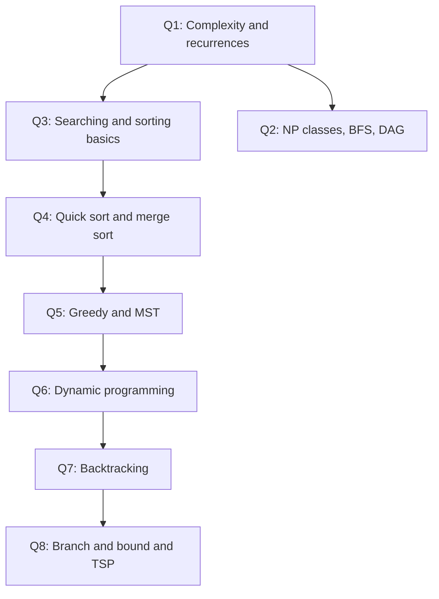

# 2nd Batch Theory: Answers

[Previous: 1st Batch Theory](../../1st%20Batch/Theory/README.md) | [Chapter 0 - Previous Year Questions](../../README.md) | [Home](../../../README.md) | [Next: 2nd Batch Lab Final](../Lab%20Final/README.md)

This page answers the CSE 2201 theory paper (2nd Batch). It covers **Section A, Q1 to Q4 (all parts)** and **Section B, Q5 to Q8 (all parts)**. The paper asks you to answer any 3 questions from each section, so every part is answered here so you can choose.

| Question | Topic | a | b | c | d |
|----------|-------|---|---|---|---|
| Q1 | Algorithm design, time and space, asymptotic bounds | 6 | 9 | 20 | - |
| Q2 | NP classes, BFS shortest path, activity DAG | 7 | 10 | 18 | - |
| Q3 | Searching vs traversing, linear and binary search, Strassen | 5 | 20 | 10 | - |
| Q4 | Insertion vs bubble sort, quick sort, merge sort | 10 | 10 | 15 | - |
| Q5 | Greedy algorithms, fractional knapsack, MST | 8 | 12 | 15 | - |
| Q6 | Dynamic programming, Floyd-Warshall, LCS | 11 | 12 | 12 | - |
| Q7 | Backtracking: graph colouring, LC-search, N-Queens | 10 | 10 | 15 | - |
| Q8 | Decision vs optimization, branch and bound, TSP | 8 | 12 | 15 | - |

### Visual Map: How the Topics Connect

The first questions give you the tools (complexity and recurrences). Sorting and greedy use them. Dynamic programming and backtracking are the last big ideas, and branch and bound and TSP build on both.



---

## Section A

### Q1. Algorithm Design, Complexity, and Asymptotic Bounds

#### Q1(a) Define time complexity and space complexity. When is space critical?

- **Time complexity** is how the number of steps grows as the input size $n$ grows. Example: a single loop over $n$ items takes $\Theta(n)$ time.
- **Space complexity** is how much extra memory the algorithm needs as $n$ grows. Example: merge sort needs an extra array of size $n$, so its space is $\Theta(n)$. Insertion sort needs only $\Theta(1)$ extra space.

Both are written with asymptotic notation (see [Chapter 2](../../../Chapter%202%20-%20Complexity%20Analysis%20and%20Asymptotic%20Notation/README.md)).

**Space becomes critical when memory is the real limit:**

1. The data is very large (for example, a billion numbers that barely fit in RAM). An algorithm that needs a second copy of the data may not fit.
2. The device is small (phones, embedded boards, sensors).
3. Many programs run at the same time and share the same memory.

Example: sorting $10^9$ numbers on a small device. Merge sort needs about another $10^9$ slots, so heap sort (which sorts in place) is the safer choice, even though it is a little slower in practice.

#### Q1(b) Define an algorithm design paradigm. Describe divide and conquer and greedy, with examples.

A **design paradigm** is a general strategy that solves many different problems. Common paradigms are divide and conquer, greedy, dynamic programming, backtracking, and branch and bound. (See [Chapter 1](../../../Chapter%201%20-%20Introduction%20and%20Algorithm%20Foundations/README.md) for the full list.)

**Divide and conquer (D&C)**

1. **Divide** the problem into smaller parts.
2. **Conquer** each part by solving it (recursively, or directly if it is small).
3. **Combine** the answers into the final answer.

Examples: merge sort, quick sort, binary search (see [Chapter 6](../../../Chapter%206%20-%20Divide%20and%20Conquer/README.md)).

**Greedy**

At every step, pick the option that looks best right now, and never go back. This works when the best local choice is always part of some best overall answer.

Example: **activity selection**. Among activities that do not overlap, always pick the one that **finishes earliest**. This gives the largest possible number of activities (see [Chapter 7](../../../Chapter%207%20-%20Greedy%20Algorithms/README.md)).

| | Divide and conquer | Greedy |
|--|--------------------|--------|
| Subproblems | Usually independent, solved recursively | One choice at a time, no recursion needed |
| Going back? | Not needed, since parts are solved fully | Never changes a choice |
| Example | Merge sort | Activity selection, Kruskal's MST |

#### Q1(c) Find the asymptotic bounds of four recurrences.

Method used: the **Master theorem** for $T(n) = aT(n/b) + f(n)$ (see [Chapter 3](../../../Chapter%203%20-%20Recurrences%20Correctness%20and%20Loop%20Invariants/README.md)). Compare $f(n)$ with $n^{\log_b a}$:

- If $f(n)$ is smaller, $T(n) = \Theta(n^{\log_b a})$.
- If they are equal, $T(n) = \Theta(n^{\log_b a} \log n)$.
- If $f(n)$ is larger (and regular), $T(n) = \Theta(f(n))$.

**(i) $T(n) = 2T(n/2) + n$**

- $a = 2$, $b = 2$, $n^{\log_2 2} = n$, and $f(n) = n$. They are equal, so this is **Case 2**.
- **Answer: $T(n) = \Theta(n \log n)$.**
- Check with a recursion tree: each of the $\log_2 n$ levels does $n$ work.

**(ii) $T(n) = T(n-1) + 1$**

- This is not a divide recurrence, so the Master theorem does not apply. Expand it instead:

$$T(n) = T(n-1) + 1 = T(n-2) + 2 = \dots = T(1) + (n-1)$$

- **Answer: $T(n) = \Theta(n)$.**

**(iii) $T(n) = 4T(n/2) + n^2$**

- $a = 4$, $b = 2$, $n^{\log_2 4} = n^2$, and $f(n) = n^2$. They are equal, so this is **Case 2**.
- **Answer: $T(n) = \Theta(n^2 \log n)$.**
- Check: level $i$ has $4^i$ nodes, each of size $n/2^i$, so each level does $4^i \cdot (n/2^i)^2 = n^2$ work. There are $\log_2 n$ levels.

**(iv) $T(n) = T(n/3) + \log n$**

- Here $a = 1$, $b = 3$, so $n^{\log_3 1} = 1$. The basic Master theorem does not fit because $f(n) = \log n$ is not a plain power of $n$.
- Use the **extended** Case 2 form: if $f(n) = \Theta(\log^k n)$ with $k \ge 0$, then $T(n) = \Theta(\log^{k+1} n)$. Here $k = 1$.
- Check by expansion. Level $i$ costs $\log(n / 3^i) = \log n - i\log 3$. There are about $\log_3 n$ levels. Adding them gives about $\frac{(\log n)^2}{2\log 3}$.
- **Answer: $T(n) = \Theta(\log^2 n)$.**

| Recurrence | $a$, $b$ | Method | Result |
|------------|----------|--------|--------|
| $2T(n/2) + n$ | 2, 2 | Master, Case 2 | $\Theta(n \log n)$ |
| $T(n-1) + 1$ | - | Expansion | $\Theta(n)$ |
| $4T(n/2) + n^2$ | 4, 2 | Master, Case 2 | $\Theta(n^2 \log n)$ |
| $T(n/3) + \log n$ | 1, 3 | Extended Case 2 | $\Theta(\log^2 n)$ |

---

### Q2. NP Classes, BFS, and Activity Graph

#### Q2(a) Define NP, NP-hard, and NP-complete.

- **P**: problems that can be **solved** in polynomial time, such as $n^2$ or $n^3$ steps.
- **NP**: problems where a **"yes" answer can be checked** in polynomial time, if someone gives you the answer (a certificate). We do not know a fast way to *find* the answer. Example: given a tour, check if its cost is at most $k$.
- **NP-hard**: at least as hard as every problem in NP. It does **not** have to be in NP. Example: the optimization version of TSP ("find the shortest tour").
- **NP-complete**: a problem that is **both** in NP and NP-hard. These are the hardest problems inside NP. Examples: the decision version of TSP, SAT, Hamiltonian cycle, subset sum, and graph colouring.

Every P problem is also in NP, because a checker can simply solve the problem itself. Whether P = NP is still an open question (see [Chapter 15](../../../Chapter%2015%20-%20Lower%20Bound%20Theory%20and%20NP%20Completeness/README.md)).


#### Q2(b) Explain how BFS finds the shortest path in an unweighted graph. Show a diagram and the steps.

In an **unweighted** graph every edge counts as 1 step. BFS explores the graph in levels: first all vertices 1 edge away, then 2 edges away, and so on. The first time BFS reaches a vertex, it has found the shortest path to that vertex.

**Steps**

1. Put the source $S$ in a queue. Set $d(S) = 0$ and mark it visited.
2. While the queue is not empty:
   - Remove the front vertex $u$.
   - For each neighbour $v$ of $u$ that is **not visited**: mark $v$ visited, set $d(v) = d(u) + 1$, set `parent[v] = u`, and add $v$ to the queue.
3. To print the path to a target, follow `parent` back from the target to $S$, then reverse it.

Time: $O(V + E)$. (BFS is covered in [Chapter 4](../../../Chapter%204%20-%20Searching%20and%20Basic%20Traversal/README.md) and [Chapter 11](../../../Chapter%2011%20-%20Graph%20Algorithms/README.md).)

**Example.** Graph with source $S$, edges S-A, S-B, A-C, B-C, B-D, C-E, D-E.

| Step | Pop from queue | Newly discovered (distance) | Queue after step |
|------|----------------|-----------------------------|------------------|
| 0 | - | S (0) | S |
| 1 | S | A (1), B (1) | A, B |
| 2 | A | C (2) | B, C |
| 3 | B | D (2); C is already visited | C, D |
| 4 | C | E (3) | D, E |
| 5 | D | E is already visited | E |

Shortest path from $S$ to $E$: follow parents $E \leftarrow C \leftarrow A \leftarrow S$, so **S-A-C-E** (3 edges). S-B-D-E is also 3 edges.


#### Q2(c) Activity DAG: directed graph, topological order, and variations.

The activities are: Wake up, Brush teeth, Take breakfast, Go to class, Study in library, Do homework, Sleep. The question lists them in order, so I take each activity to depend on the one before it. (If the real dependencies are different, the answers below change accordingly.)

**(i) Directed graph.** Each activity is a vertex. Each arrow means "must finish before":

Wake up → Brush teeth → Take breakfast → Go to class → Study in library → Do homework → Sleep

This is a **DAG** (directed acyclic graph): the arrows all point forward, so there is no cycle.

**(ii) Topological order.** A topological order lists all vertices so that every arrow goes from an earlier item to a later one. Here:

1. Wake up
2. Brush teeth
3. Take breakfast
4. Go to class
5. Study in library
6. Do homework
7. Sleep

Method: Kahn's algorithm removes vertices with no incoming arrows one by one (see [Chapter 11](../../../Chapter%2011%20-%20Graph%20Algorithms/README.md)). Only "Wake up" has no incoming arrow at first, and each removal unlocks the next.

**(iii) Is more than one order possible?** For these arrows, **no**. Each activity has exactly one parent, so the order is forced. If the rules were looser (for example, brushing teeth and breakfast could happen in either order), there would be more than one valid order, such as 1 Wake up, 2 Take breakfast, 3 Brush teeth, and so on.

**(iv) What if Sleep comes before Homework?** The arrows change to ... Study in library → Sleep → Do homework. The new topological order is:

1. Wake up, 2. Brush teeth, 3. Take breakfast, 4. Go to class, 5. Study in library, 6. **Sleep**, 7. **Do homework**

The graph is still a DAG, so a topological order still exists. It would only fail if the change created a **cycle**, for example an arrow from Sleep back to Wake up. Then no order could satisfy all arrows.


---

### Q3. Searching, Traversing, and Matrix Multiplication

#### Q3(a) Searching vs traversing: purpose, operations, and examples.

| | Searching | Traversing |
|--|-----------|------------|
| Purpose | Find whether an item exists, and where it is | Visit every item (or vertex) once, in a systematic order |
| Main operation | Compare the target with items, stop when found | Visit each item and do some work on it |
| Stops early? | Yes, when found | Usually no, it visits all items |
| Examples | Linear search, binary search, search in a BST or hash table | BFS, DFS, in-order traversal of a tree |

Both are covered in [Chapter 4](../../../Chapter%204%20-%20Searching%20and%20Basic%20Traversal/README.md). A simple way to remember it: searching asks "Is 511 here?", traversing asks "Show me every item."

#### Q3(b) Find 511 in the sorted IDs with linear and binary search. Count comparisons, and compare best, average, and worst cases.

Array (sorted): `[102, 205, 307, 409, 511, 613, 715, 817]`, so $n = 8$, target $511$.

**Linear search** checks items from the start:

| Step | Index | Value | Equal to 511? |
|------|-------|-------|---------------|
| 1 | 0 | 102 | No |
| 2 | 1 | 205 | No |
| 3 | 2 | 307 | No |
| 4 | 3 | 409 | No |
| 5 | 4 | 511 | **Yes, found** |

Linear search needs **5 comparisons** and finds 511 at index 4.

**Binary search** checks the middle of the remaining range (the array must be sorted):

| Step | lo | hi | mid | Value at mid | Action |
|------|----|----|-----|--------------|--------|
| 1 | 0 | 7 | 3 | 409 | $409 < 511$, so $lo = 4$ |
| 2 | 4 | 7 | 5 | 613 | $613 > 511$, so $hi = 4$ |
| 3 | 4 | 4 | 4 | 511 | **Found** |

Binary search needs **3 comparisons**.

**Best, average, and worst cases**

| Search | Best case | Average case | Worst case |
|--------|-----------|--------------|------------|
| Linear | $\Theta(1)$: target is the first item | $\Theta(n)$: about $n/2$ checks | $\Theta(n)$: target is last or missing |
| Binary | $\Theta(1)$: target is the middle item | $\Theta(\log n)$ | $\Theta(\log n)$ |

For 511: linear takes 5 comparisons, binary takes 3.

**Which is better?** Binary search is better here, because it halves the range each time and needs about $\log_2 8 = 3$ checks. Its big cost is that the data must already be sorted. Linear search is still the right choice for unsorted data, or when you search only once.

#### Q3(c) Apply Strassen's method to $A = \begin{bmatrix}1 & 3 \\ 7 & 5\end{bmatrix}$ and $B = \begin{bmatrix}6 & 8 \\ 4 & 2\end{bmatrix}$.

Strassen's idea: split each $2 \times 2$ matrix into four blocks. Normal multiplication uses 8 block products. Strassen uses **7** products and then some extra additions. This saves time for large matrices, because the recurrence becomes $T(n) = 7T(n/2) + \Theta(n^2)$, which gives $\Theta(n^{\log_2 7}) \approx \Theta(n^{2.81})$.

This method is not covered in the repo's chapters, so the steps below come from the standard Strassen formulas. Here each block is a single number: $A_{11} = 1$, $A_{12} = 3$, $A_{21} = 7$, $A_{22} = 5$, and $B_{11} = 6$, $B_{12} = 8$, $B_{21} = 4$, $B_{22} = 2$.

| Product | Formula | Value |
|---------|---------|-------|
| $P_1$ | $A_{11}(B_{12} - B_{22}) = 1 \cdot (8 - 2)$ | 6 |
| $P_2$ | $(A_{11} + A_{12}) B_{22} = (1 + 3) \cdot 2$ | 8 |
| $P_3$ | $(A_{21} + A_{22}) B_{11} = (7 + 5) \cdot 6$ | 72 |
| $P_4$ | $A_{22}(B_{21} - B_{11}) = 5 \cdot (4 - 6)$ | -10 |
| $P_5$ | $(A_{11} + A_{22})(B_{11} + B_{22}) = (1 + 5)(6 + 2)$ | 48 |
| $P_6$ | $(A_{12} - A_{22})(B_{21} + B_{22}) = (3 - 5)(4 + 2)$ | -12 |
| $P_7$ | $(A_{11} - A_{21})(B_{11} + B_{12}) = (1 - 7)(6 + 8)$ | -84 |

Combine the products:

- $C_{11} = P_5 + P_4 - P_2 + P_6 = 48 - 10 - 8 - 12 = \mathbf{18}$
- $C_{12} = P_1 + P_2 = 6 + 8 = \mathbf{14}$
- $C_{21} = P_3 + P_4 = 72 - 10 = \mathbf{62}$
- $C_{22} = P_5 + P_1 - P_3 - P_7 = 48 + 6 - 72 + 84 = \mathbf{66}$

$$C = \begin{bmatrix}18 & 14 \\ 62 & 66\end{bmatrix}$$

**Check** with normal multiplication: row 1 of $A$ times column 1 of $B$ is $1 \cdot 6 + 3 \cdot 4 = 18$. The other three entries also match.


---

### Q4. Sorting: Insertion, Bubble, Quick Sort, and Merge Sort

#### Q4(a) Why is insertion sort better than bubble sort on a nearly sorted array? Give an example.

Insertion sort takes each new item and slides it left into place. On a nearly sorted array, most items are already in the right place, so each one moves only a short distance. The work is close to $n$ plus the number of out-of-order pairs. (See [Chapter 5](../../../Chapter%205%20-%20Sorting%20Algorithms/README.md).)

Bubble sort swaps neighbours in repeated passes. A small item at the **end** of the array moves only **one place left per pass**, so it needs many passes even when the rest is sorted.

**Example:** $[2, 3, 4, 5, 6, 7, \mathbf{1}]$. Only the 1 is out of place.

*Insertion sort (6 shifts)*

- Items 3, 4, 5, 6, 7 each compare once with the item before them and stop. That is 5 comparisons.
- Item 1 slides left past 7, 6, 5, 4, 3, 2. That is 6 comparisons and 6 shifts.
- Total: **11 comparisons**, **6 shifts**.

*Bubble sort (with an early-exit flag)*

| Pass | Comparisons | Swap made | Array after pass |
|------|-------------|-----------|------------------|
| 1 | 6 | (7, 1) | $[2,3,4,5,6,1,7]$ |
| 2 | 5 | (6, 1) | $[2,3,4,5,1,6,7]$ |
| 3 | 4 | (5, 1) | $[2,3,4,1,5,6,7]$ |
| 4 | 3 | (4, 1) | $[2,3,1,4,5,6,7]$ |
| 5 | 2 | (3, 1) | $[2,1,3,4,5,6,7]$ |
| 6 | 1 | (2, 1) | $[1,2,3,4,5,6,7]$ |

Total: **21 comparisons**, **6 swaps**. The early-exit flag does not help here, because a swap happens in every pass.

**Conclusion:** insertion sort does about 11 comparisons and bubble sort about 21 on the same input. On a nearly sorted array, insertion sort is close to linear time, while bubble sort still has to make many passes.

#### Q4(b) Quick sort on $[1023, 1010, 1055, 1005, 1040]$. Show the pivot, the partitions, and the final array.

We use the **last element as the pivot** (Lomuto partition, see [Chapter 5](../../../Chapter%205%20-%20Sorting%20Algorithms/README.md)). The index $i$ marks the end of the "smaller than pivot" part.

**Pass 1:** pivot = 1040, $i = -1$

| $j$ | Value | Less than 1040? | Action | Array |
|-----|-------|-----------------|--------|-------|
| 0 | 1023 | Yes | $i = 0$, swap with itself | 1023, 1010, 1055, 1005, 1040 |
| 1 | 1010 | Yes | $i = 1$, swap with itself | 1023, 1010, 1055, 1005, 1040 |
| 2 | 1055 | No | nothing | same |
| 3 | 1005 | Yes | $i = 2$, swap $a[2]$ and $a[3]$ | 1023, 1010, 1005, 1055, 1040 |

Finally, swap the pivot with $a[i+1] = a[3]$: **1023, 1010, 1005, 1040, 1055**. The pivot 1040 is now in its final place.

- Left part: $[1023, 1010, 1005]$
- Right part: $[1055]$ (one item, already sorted)

**Pass 2 (left part):** pivot = 1005. Both 1023 and 1010 are greater than 1005, so $i$ stays at $-1$. Swap the pivot with $a[0]$: **1005, 1010, 1023**. Left part is empty. Right part is $[1010, 1023]$.

**Pass 3 (right part of pass 2):** pivot = 1023. 1010 is less than 1023, so it stays. Result: **1010, 1023**. Each side now has one item.


**Final sorted array: $[1005, 1010, 1023, 1040, 1055]$**

#### Q4(c) Divide and conquer (merge sort style) on $[38, 27, 43, 3, 9, 82, 10]$. Show divide, conquer, and combine.

**Divide** (split in the middle each time):

- $[38, 27, 43, 3, 9, 82, 10]$ splits into $[38, 27, 43, 3]$ and $[9, 82, 10]$.
- $[38, 27, 43, 3]$ splits into $[38, 27]$ and $[43, 3]$, then into single items.
- $[9, 82, 10]$ splits into $[9, 82]$ and $[10]$, then $[9, 82]$ into $[9]$ and $[82]$.

**Conquer and combine** (merge two sorted lists into one sorted list):

| Merge | Left | Right | Result |
|-------|------|-------|--------|
| 1 | [38] | [27] | [27, 38] |
| 2 | [43] | [3] | [3, 43] |
| 3 | [27, 38] | [3, 43] | [3, 27, 38, 43] |
| 4 | [9] | [82] | [9, 82] |
| 5 | [9, 82] | [10] | [9, 10, 82] |
| 6 | [3, 27, 38, 43] | [9, 10, 82] | **[3, 9, 10, 27, 38, 43, 82]** |


Merge sort runs in $\Theta(n \log n)$ time (see Q1(c)(i)) and needs an extra $\Theta(n)$ array for merging.

---

## Section B

### Q5. Greedy Algorithms and Minimum Spanning Tree

#### Q5(a) What is a greedy algorithm? State the conditions for it to give an optimal answer.

A **greedy algorithm** builds the answer one step at a time. At each step it takes the choice that looks best **right now**, and it never undoes a choice. It is fast and simple, but it is only correct for some problems (see [Chapter 7](../../../Chapter%207%20-%20Greedy%20Algorithms/README.md)).

Greedy gives an optimal answer when two conditions hold:

1. **Greedy choice property:** a locally best choice can always be part of some optimal solution. So making it does not rule out the best answer.
2. **Optimal substructure:** after the greedy choice, the rest of the problem is the same kind of problem. An optimal answer for the rest, combined with the choice, gives an optimal answer overall.

Proofs usually use an **exchange argument**: take any optimal solution, swap in the greedy choice, and show the answer does not get worse.

**Counterexample (greedy fails):** coins $\{1, 3, 4\}$ and amount $6$. Greedy takes $4 + 1 + 1$ (3 coins), but $3 + 3$ uses only 2 coins. Here the greedy choice property does not hold.

#### Q5(b) Fractional knapsack with $W = 50$. Items $(w, p)$: $(10, 60)$, $(20, 100)$, $(30, 120)$. Find the ratios, the selection, and the maximum profit.

In the **fractional** knapsack we may take part of an item. The best rule is to take items in order of **profit per unit weight** (ratio).

| Item | Weight | Profit | Ratio $p/w$ | Rank |
|------|--------|--------|-------------|------|
| 1 | 10 | 60 | 6 | 1st |
| 2 | 20 | 100 | 5 | 2nd |
| 3 | 30 | 120 | 4 | 3rd |

Selection (capacity 50):

| Step | Take | Weight used | Profit so far |
|------|------|-------------|---------------|
| 1 | All of item 1 | 10 | 60 |
| 2 | All of item 2 | 30 | 160 |
| 3 | $\frac{20}{30}$ of item 3 (only 20 weight is left) | 50 | 160 + $\frac{2}{3}$ × 120 = **240** |

**Maximum profit: 240.** (The 0/1 version, where items cannot be split, would give only 220 here, so splitting helps.) See [Chapter 7](../../../Chapter%207%20-%20Greedy%20Algorithms/README.md) for the proof.

#### Q5(c) Define a minimum spanning tree (MST). Apply Kruskal's algorithm to the given graph. Show the steps and the total cost.

**MST:** for a connected, weighted, undirected graph with $V$ vertices, an MST is a set of $V - 1$ edges that connects all vertices, has **no cycle**, and has the **smallest total weight**.

**Kruskal's algorithm:**

1. Sort all edges by weight.
2. Go through the edges in order. Take an edge if it connects two different components (no cycle). Skip it if both ends are already connected.
3. Stop when $V - 1$ edges are taken.

> [!NOTE]
> The edge weights below were read from a low-resolution scan of the paper. Please check them against the original paper before relying on the numbers. The method is the same for any weights.

Sorted edges: (1,5)=1, (1,4)=1, (2,1)=2, (3,2)=3, (3,1)=3, (3,4)=5, (4,5)=6, (0,2)=7, (0,3)=9.

| Step | Edge | Weight | Same component already? | Action | Total cost |
|------|------|--------|-------------------------|--------|------------|
| 1 | (1,5) | 1 | No | Take | 1 |
| 2 | (1,4) | 1 | No | Take | 2 |
| 3 | (2,1) | 2 | No | Take | 4 |
| 4 | (3,2) | 3 | No | Take | 7 |
| 5 | (3,1) | 3 | Yes (3-2-1) | Skip (cycle) | 7 |
| 6 | (3,4) | 5 | Yes (3-2-1-4) | Skip (cycle) | 7 |
| 7 | (4,5) | 6 | Yes (4-1-5) | Skip (cycle) | 7 |
| 8 | (0,2) | 7 | No | Take | **14** |

After step 8 we have $6 - 1 = 5$ edges, so we stop. (Edge (0,3) is not needed.)


**Total MST cost = 1 + 1 + 2 + 3 + 7 = 14**

---

### Q6. Dynamic Programming: Fibonacci, Floyd-Warshall, and LCS

#### Q6(a) Define dynamic programming. Explain overlapping subproblems with Fibonacci.

**Dynamic programming (DP)** solves a problem by splitting it into smaller subproblems, solving each one **once**, storing the answer, and reusing it. DP works when:

1. **Overlapping subproblems:** the same smaller problem appears many times.
2. **Optimal substructure:** the best answer uses best answers to subproblems (see [Chapter 8](../../../Chapter%208%20-%20Dynamic%20Programming/README.md)).

**Fibonacci:** $F(n) = F(n-1) + F(n-2)$.

The naive recursion for $F(5)$ calls:

- $F(3)$ **twice**
- $F(2)$ **three times**
- $F(1)$ and $F(0)$ many times

In total, $F(5)$ makes **15** calls, and the number grows exponentially with $n$. Those repeated calls are the **overlapping subproblems**.

With DP, each $F(i)$ is computed once and stored:

```
F[0] = 0, F[1] = 1
for i = 2 to n:
    F[i] = F[i-1] + F[i-2]
```

This takes $O(n)$ time and $O(n)$ space.

#### Q6(b) Floyd-Warshall on the given $D_0$. Show the intermediate matrices and the final matrix.

Floyd-Warshall finds the shortest distance between **every pair** of vertices. Let $D_k(i,j)$ be the shortest distance from $i$ to $j$ using only vertices $1..k$ as middle vertices. Then:

$$D_k(i,j) = \min\big(D_{k-1}(i,j),\; D_{k-1}(i,k) + D_{k-1}(k,j)\big)$$

So for each middle vertex $k$, we check whether going through $k$ is shorter (see [Chapter 11](../../../Chapter%2011%20-%20Graph%20Algorithms/README.md)). The graph has edges $1\to2$ (5), $1\to4$ (10), $2\to3$ (3), and $3\to4$ (1).

**$D_0$ (direct edges only)**

| | 1 | 2 | 3 | 4 |
|--|---|---|---|---|
| 1 | 0 | 5 | ∞ | 10 |
| 2 | ∞ | 0 | 3 | ∞ |
| 3 | ∞ | ∞ | 0 | 1 |
| 4 | ∞ | ∞ | ∞ | 0 |

**$k = 1$:** no edge comes into vertex 1, so nothing changes. $D_1 = D_0$.

**$k = 2$:** check $i \to 2 \to j$.

- $d(1,3)$: $\min(\infty, 5 + 3) = 8$. **Changed.**
- $d(4,\cdot)$ and others: no changes.

| | 1 | 2 | 3 | 4 |
|--|---|---|---|---|
| 1 | 0 | 5 | **8** | 10 |
| 2 | ∞ | 0 | 3 | ∞ |
| 3 | ∞ | ∞ | 0 | 1 |
| 4 | ∞ | ∞ | ∞ | 0 |

**$k = 3$:** check $i \to 3 \to j$.

- $d(1,4)$: $\min(10, 8 + 1) = 9$. **Changed.**
- $d(2,4)$: $\min(\infty, 3 + 1) = 4$. **Changed.**

| | 1 | 2 | 3 | 4 |
|--|---|---|---|---|
| 1 | 0 | 5 | 8 | **9** |
| 2 | ∞ | 0 | 3 | **4** |
| 3 | ∞ | ∞ | 0 | 1 |
| 4 | ∞ | ∞ | ∞ | 0 |

**$k = 4$:** no edge leaves vertex 4, so nothing changes. $D_4 = D_3$.

**Final matrix $D_4$:**

| | 1 | 2 | 3 | 4 |
|--|---|---|---|---|
| 1 | 0 | 5 | 8 | 9 |
| 2 | ∞ | 0 | 3 | 4 |
| 3 | ∞ | ∞ | 0 | 1 |
| 4 | ∞ | ∞ | ∞ | 0 |


The time is $O(n^3)$ for $n$ vertices.

#### Q6(c) LCS of $X = $ AGGTAB and $Y = $ GXTXAYB. Give the full DP table, the traceback, the LCS, and its length.

Rule (let $L[i][j]$ be the LCS length of the first $i$ letters of $X$ and the first $j$ letters of $Y$):

- If $X_i = Y_j$: $L[i][j] = L[i-1][j-1] + 1$.
- Otherwise: $L[i][j] = \max(L[i-1][j],\ L[i][j-1])$.

**DP table** (row = letter of $X$, column = letter of $Y$):

| | | G | X | T | X | A | Y | B |
|--|---|---|---|---|---|---|---|---|
| | 0 | 0 | 0 | 0 | 0 | 0 | 0 | 0 |
| A | 0 | 0 | 0 | 0 | 0 | **1** | 1 | 1 |
| G | 0 | **1** | 1 | 1 | 1 | 1 | 1 | 1 |
| G | 0 | **1** | 1 | 1 | 1 | 1 | 1 | 1 |
| T | 0 | 1 | 1 | **2** | 2 | 2 | 2 | 2 |
| A | 0 | 1 | 1 | 2 | 2 | **3** | 3 | 3 |
| B | 0 | 1 | 1 | 2 | 2 | 3 | 3 | **4** |

(Bold cells are where letters match and the diagonal rule was used.)

**Traceback** (start at the bottom-right cell and move back):

1. $(6,7)$: $B = B$. Take **B**, move diagonally to $(5,6)$.
2. $(5,6)$: $A \ne Y$. Value above is 2, value to the left is 3. Move left to $(5,5)$.
3. $(5,5)$: $A = A$. Take **A**, move diagonally to $(4,4)$.
4. $(4,4)$: $T \ne X$. Move left to $(4,3)$ (value 2).
5. $(4,3)$: $T = T$. Take **T**, move diagonally to $(3,2)$.
6. $(3,2)$: $G \ne X$. Move up to $(2,2)$.
7. $(2,2)$: $G \ne X$. Move left to $(2,1)$.
8. $(2,1)$: $G = G$. Take **G**, move diagonally to $(1,0)$. Stop.

Reading the taken letters backwards gives **G, T, A, B**.

**LCS = GTAB, length = 4**


---

### Q7. Backtracking: Graph Colouring, LC-Search, and N-Queens

#### Q7(a) Graph colouring by backtracking on a 5-vertex graph. Show the vertex order and the backtracking steps.

> [!NOTE]
> The exact graph is not reproduced in my reference notes, so this answer uses a sample 5-vertex graph and 3 colours (Red = 1, Green = 2, Blue = 3). The same steps work for any graph.

**Sample graph:** edges 1-2, 1-3, 2-3, 3-4, 4-5, 3-5, 2-5.

**Method:** colour vertices in order 1, 2, 3, 4, 5. For each vertex, try each colour that differs from the colours of already-coloured neighbours. If no colour works, **backtrack** to the previous vertex and try its next colour (see [Chapter 9](../../../Chapter%209%20-%20Backtracking/README.md)).

```
colour(v):
    if v > n: return true              (all vertices coloured)
    for c in 1..3:
        if no neighbour of v already has colour c:
            colour[v] = c
            if colour(v + 1): return true
    colour[v] = none                   (backtrack)
    return false
```

**Trace**

| Step | Vertex | Colour tried | Why | Result |
|------|--------|--------------|-----|--------|
| 1 | v1 | Red | First colour | Coloured |
| 2 | v2 | Green | Red is used by neighbour v1 | Coloured |
| 3 | v3 | Blue | Red (v1) and Green (v2) are used | Coloured |
| 4 | v4 | Red | Only neighbour is v3 (Blue) | Coloured |
| 5 | v5 | none | Neighbours v2 (Green), v3 (Blue), v4 (Red) use all 3 colours | **Dead end** |
| 6 | v4 | Green | Backtrack: next colour for v4 | Coloured |
| 7 | v5 | Red | Neighbours v2 (Green), v3 (Blue), v4 (Green) | **Solution** |

**Final colouring:** v1 Red, v2 Green, v3 Blue, v4 Green, v5 Red.


#### Q7(b) LC-search on the 0/1 knapsack problem with at least 4 items. Draw the state-space tree.

> [!NOTE]
> The exact items are not reproduced in my reference notes, so this answer uses the instance below. The method is the same for any items.

**Instance:** capacity $W = 10$. Items (weight, profit): **A** (4, 40), **C** (3, 18), **B** (6, 30), **D** (5, 20). Sorted by profit per weight: A (10), C (6), B (5), D (4).

**LC-search** (least cost, here "largest bound first") works like a best-first search. Live nodes wait in a priority queue. The node with the **best upper bound** is expanded next. Each node has a bound $ub$:

$$ub = \text{profit so far} + \text{best fractional fill of the remaining items}$$

A node is **pruned** when $ub$ is not better than the best complete solution found so far.

**Expansion**

| Node | Decisions | Weight | Profit | $ub$ | Status |
|------|-----------|--------|--------|------|--------|
| Root | none | 0 | 0 | 73 | Expand first |
| A=1 | take A | 4 | 40 | 73 | Expand |
| A=0 | skip A | 0 | 0 | 52 | Pruned later (52 ≤ 70) |
| A=1, C=1 | take A, C | 7 | 58 | 73 | Expand |
| A=1, C=0 | take A | 4 | 40 | 70 | Expand |
| A=1, C=1, B=1 | take A, C, B | 13 | - | - | **Infeasible** (13 > 10) |
| A=1, C=1, B=0 | take A, C | 7 | 58 | 70 | Pruned (70 ≤ 70) |
| A=1, C=0, B=1 | take A, B | 10 | 70 | 70 | **Solution: best = 70** |
| A=1, C=0, B=0 | take A | 4 | 40 | 60 | Pruned (60 ≤ 70) |

After the solution with profit 70 is found, every live node has $ub \le 70$, so none can beat it and the search stops.

**Answer:** take **A and B**. Profit = 70, weight = 10. (Checking all subsets confirms that no other set gives more profit within capacity 10.)


#### Q7(c) N-Queens with N = 5 by backtracking. Show the partial boards.

Place one queen in each row. Two queens attack each other if they share a **column** or a **diagonal** (same difference between row and column). If a row has no safe column, go back to the previous row and move its queen (see [Chapter 9](../../../Chapter%209%20-%20Backtracking/README.md)).

**Trace for the first solution**

| Row | Columns tried | Result | Partial board (queen columns so far) |
|-----|---------------|--------|--------------------------------------|
| 1 | 1 | Safe, placed | [1] |
| 2 | 1 (same column), 2 (diagonal with (1,1)), 3 | Safe at column 3 | [1, 3] |
| 3 | 1 (column), 2 (diagonal with (2,3)), 3 (column), 4 (diagonal with (2,3)), 5 | Safe at column 5 | [1, 3, 5] |
| 4 | 1 (column), 2 | Safe at column 2 | [1, 3, 5, 2] |
| 5 | 1, 2, 3 (columns), 4 | Safe at column 4 | [1, 3, 5, 2, 4] ✓ |

**A dead end (backtracking).** Try row 2 at column 5 instead, with the board [1, 5]:

- Row 3: only column 2 is safe, so the board is [1, 5, 2].
- Row 4: column 3 is on a diagonal with (3,2), and column 4 is on a diagonal with (1,1). **No safe column.** Row 3 has no other option, and row 2 has no columns left to try (columns 3 and 4 were already explored and gave solutions). So the search goes back to row 1 and tries column 2.

**Final board for the first solution [1, 3, 5, 2, 4]**

```
Q . . . .
. . Q . .
. . . . Q
. Q . . .
. . . Q .
```

The search finds **10 solutions** for $N = 5$. The second one is [1, 4, 2, 5, 3].


---

### Q8. Decision vs Optimization, Branch and Bound, and TSP

#### Q8(a) Decision problems vs optimization problems.

| | Decision problem | Optimization problem |
|--|------------------|----------------------|
| Question | Is there a solution with a property? Answer yes or no. | What is the best value (minimum or maximum)? |
| Example (knapsack) | Can we reach profit at least $P$? | What is the maximum profit? |
| Example (TSP) | Is there a tour with cost at most $k$? | What is the cheapest tour? |
| Output | Yes or no | A value and a solution |

The two are closely related. If we can solve the optimization problem, we can answer the decision problem by comparing the optimum with $k$ or $P$. In the other direction, asking the decision question many times (for example, with binary search over $k$) finds the optimum value. This is why NP-completeness is defined using **decision** problems (see [Chapter 15](../../../Chapter%2015%20-%20Lower%20Bound%20Theory%20and%20NP%20Completeness/README.md)). The decision version of an NP-complete problem is in NP, and the optimization version is NP-hard.

#### Q8(b) Admissible heuristic and bounding function in branch and bound. Solve a job-sequencing instance.

**Branch and bound (B&B)** explores the state-space tree like backtracking. It also uses a **bounding function** to skip branches that cannot give a better answer than the best one found so far (see [Chapter 10](../../../Chapter%2010%20-%20Branch%20and%20Bound/README.md)).

- **Bounding function:** gives an estimate for a node, which is the best value any solution below that node could reach. For a maximization problem this is an **upper bound**.
- **Admissible heuristic:** a bound that is **optimistic**. It never says a subtree is worse than it really is. For maximization, the bound is never lower than the true best value below the node. So it never prunes the branch that holds the optimal answer.

**Job sequencing with deadlines (maximize profit).** Each job takes 1 time unit and must finish by its deadline. A set of jobs is feasible if, for each time $t$, at most $t$ chosen jobs have deadline $\le t$.

> [!NOTE]
> The exact paper instance is not in my reference notes, so this answer uses the example below.

**Instance:** J1 (profit 100, deadline 2), J4 (profit 27, deadline 1), J3 (profit 15, deadline 2), J2 (profit 10, deadline 1). Jobs are considered in order of profit.

**Bound:** $ub$ = profit so far + total profit of all jobs not decided yet. This is admissible, because it can never be lower than the best reachable profit.

| Node | Decision | Profit | $ub$ | Status |
|------|----------|--------|------|--------|
| Root | none | 0 | 152 | Branch |
| J1 = 1 | take J1 | 100 | 152 | Branch |
| J1 = 1, J4 = 1 | take J1, J4 | 127 | 152 | Branch (feasible: J4 in slot 1, J1 in slot 2) |
| J1, J4, J3 | take J3 too | - | - | **Infeasible**: 3 jobs with deadline ≤ 2 |
| J1, J4, J3 = 0 | skip J3 | 127 | 137 | Branch |
| J1, J4, J2 | take J2 too | - | - | **Infeasible**: 2 jobs with deadline ≤ 1 |
| J1, J4, J3 = 0, J2 = 0 | leaf | 127 | 127 | **Best = 127** |
| J1 = 1, J4 = 0 | skip J4 | 100 | 125 | **Pruned** (125 ≤ 127) |
| J1 = 0 | skip J1 | 0 | 52 | **Pruned** (52 ≤ 127) |

**Answer:** take **J1 and J4**. Maximum profit = **127**. Schedule: J4 in slot 1 and J1 in slot 2.


#### Q8(c) TSP by dynamic programming (Held-Karp). Use the cost matrix to find the minimum tour.

The travelling salesman problem (TSP) visits every city once and returns to the start, with the lowest total cost. It is NP-hard. The subset DP reduces the work from $n!$ orders to about $n^2 2^n$ (see [Chapter 8](../../../Chapter%208%20-%20Dynamic%20Programming/README.md)).

**Cost matrix** (cities 1 to 4, start and end at city 1):

| | 1 | 2 | 3 | 4 |
|--|---|---|---|---|
| 1 | 0 | 20 | 42 | 35 |
| 2 | 20 | 0 | 30 | 34 |
| 3 | 42 | 30 | 0 | 12 |
| 4 | 35 | 34 | 12 | 0 |

**Definition:** $g(i, S)$ is the cheapest path that starts at city $i$, visits every city in set $S$ exactly once, and ends at city 1.

$$g(i, S) = \min_{j \in S}\big[c(i,j) + g(j, S \setminus \{j\})\big], \qquad g(i, \varnothing) = c(i,1)$$

**Stage 0 (|S| = 0)**

- $g(2, \varnothing) = c_{21} = 20$
- $g(3, \varnothing) = c_{31} = 42$
- $g(4, \varnothing) = c_{41} = 35$

**Stage 1 (|S| = 1)**

| Value | Calculation | Result |
|-------|-------------|--------|
| $g(2, \{3\})$ | $c_{23} + g(3,\varnothing) = 30 + 42$ | 72 |
| $g(2, \{4\})$ | $c_{24} + g(4,\varnothing) = 34 + 35$ | 69 |
| $g(3, \{2\})$ | $c_{32} + g(2,\varnothing) = 30 + 20$ | 50 |
| $g(3, \{4\})$ | $c_{34} + g(4,\varnothing) = 12 + 35$ | 47 |
| $g(4, \{2\})$ | $c_{42} + g(2,\varnothing) = 34 + 20$ | 54 |
| $g(4, \{3\})$ | $c_{43} + g(3,\varnothing) = 12 + 42$ | 54 |

**Stage 2 (|S| = 2)**

| Value | Calculation | Result |
|-------|-------------|--------|
| $g(2, \{3,4\})$ | $\min(c_{23} + g(3,\{4\}),\ c_{24} + g(4,\{3\})) = \min(30 + 47,\ 34 + 54)$ | **77** |
| $g(3, \{2,4\})$ | $\min(c_{32} + g(2,\{4\}),\ c_{34} + g(4,\{2\})) = \min(30 + 69,\ 12 + 54)$ | 66 |
| $g(4, \{2,3\})$ | $\min(c_{42} + g(2,\{3\}),\ c_{43} + g(3,\{2\})) = \min(34 + 72,\ 12 + 50)$ | **62** |

**Final answer (start and end at city 1)**

$$g(1, \{2,3,4\}) = \min(20 + 77,\ 42 + 66,\ 35 + 62) = \min(97, 108, 97) = \mathbf{97}$$

**Minimum tour cost = 97.** Two tours reach it:

- $1 \to 2 \to 3 \to 4 \to 1$: $20 + 30 + 12 + 35 = 97$
- $1 \to 4 \to 3 \to 2 \to 1$: $35 + 12 + 30 + 20 = 97$


---

## Quick Revision

| Topic | One-line memory |
|-------|-----------------|
| Time vs space | Time = steps as $n$ grows; space = extra memory; space is critical on small or huge data |
| Master theorem | Compare $f(n)$ with $n^{\log_b a}$: smaller, equal (adds a $\log$), or larger |
| $T(n/3) + \log n$ | $\Theta(\log^2 n)$ (extended Case 2) |
| P, NP, NP-hard, NP-complete | P = solve fast; NP = verify fast; NP-complete = NP and NP-hard |
| BFS shortest path | Level by level with a queue; first visit = shortest distance (unweighted) |
| Topological order | Every arrow goes forward; remove vertices with no incoming arrows |
| Linear vs binary search | 5 vs 3 comparisons for 511; binary needs sorted data |
| Strassen | 7 block products instead of 8; $T(n) = 7T(n/2) + \Theta(n^2)$ |
| Insertion vs bubble | Insertion is near-linear on nearly sorted data; bubble needs many passes |
| Quick sort | Partition around the pivot; last-element pivot gives $[1005, 1010, 1023, 1040, 1055]$ |
| Merge sort | Split in half, merge sorted halves, $\Theta(n \log n)$, needs extra space |
| Greedy | Best local choice; needs greedy choice + optimal substructure |
| Fractional knapsack | Sort by profit/weight; take a fraction of the last item; profit 240 |
| Kruskal | Sort edges, skip cycles, stop at $V - 1$ edges; total 14 (confirm weights) |
| DP | Overlapping subproblems + optimal substructure; Fibonacci in $O(n)$ |
| Floyd-Warshall | Try each vertex as a middle vertex; $O(n^3)$; $d(1,4) = 9$ |
| LCS | Match: diagonal + 1; else max(up, left); LCS = GTAB, length 4 |
| Graph colouring | Colour in order, check neighbours, backtrack on dead end |
| LC-search | Expand the node with the best bound first; prune when $ub \le$ best |
| N-Queens | Row by row; check column and diagonals; 10 solutions for $N = 5$ |
| Decision vs optimization | Yes/no question vs find the best value |
| Branch and bound | Bounding function prunes; admissible = never too pessimistic |
| TSP DP | $g(i,S) = \min_j [c_{ij} + g(j, S \setminus j)]$; minimum tour 97 |

---

[Previous: 1st Batch Theory](../../1st%20Batch/Theory/README.md) | [Chapter 0 - Previous Year Questions](../../README.md) | [Home](../../../README.md) | [Next: 2nd Batch Lab Final](../Lab%20Final/README.md)
