# CSE 2201 Class Tests 01–04 — Complete Answers

[Previous: 2nd Batch Theory](../../2nd%20Batch/Theory/README.md) | [Chapter 0 - Previous Year Questions](../../README.md) | [Home](../../../README.md)

This document presents four class-test answer sets in sequence: **CT1** (dynamic programming), **CT2** (graph algorithms), **CT3** (Union-Find, maximum subarray, and segment trees), and **CT4** (backtracking and N-Queens). CT3 is identified by the filename `CSE 2201 - CT - 3.pdf`; its internal header incorrectly says “Class Test: 01.” CT4 is transcribed from the supplied `CSE 2201 - CT - 4.pdf`.

> [!IMPORTANT]
> **Source notes and assumptions:** CT1 Q4 did not include item data in the scan, so its knapsack instance is illustrative. CT2 Q3 has two hard-to-read diagonal edge labels; the answer states its reading. CT3 Q2 uses a labelled example array because none is supplied. In CT3 Q3, the code comment says query `[1, 4]`, but task (c) asks for `[2, 6]`; the answer follows the explicit task. CT4 gives no particular value of `n`; its 4-Queens diagrams and dry run are illustrative, not paper data.

Every question has a diagram preview and editable Excalidraw scene in the [diagram index](diagrams/README.md). The answers use simple words, show the working, and end with a memory trick.

Dynamic programming, graph, and divide-and-conquer answers use the tables, notation, and step order taught in [Chapter 8](../../../Chapter%208%20-%20Dynamic%20Programming/README.md), [Chapter 11](../../../Chapter%2011%20-%20Graph%20Algorithms/README.md), [Chapter 3](../../../Chapter%203%20-%20Recurrences%20Correctness%20and%20Loop%20Invariants/README.md), and [Chapter 6](../../../Chapter%206%20-%20Divide%20and%20Conquer/README.md): the five DP parts (state, base case, recurrence, table order, final answer), $c[i,j]$ and $V[i,j]$ with arrows, the DFS finish stack for topological sort, the selected-vertex table for Bellman–Ford, $D^{(k)}$ matrices for Floyd–Warshall, and the watershed function $n^{\log_b a}$. The questions say *profit*; the chapters say *value*.

| Test | Questions | Topics | Marks |
|------|-----------|--------|-------|
| Class Test 1 | Q1–Q4 | Principle of Optimality, Fibonacci DP, LCS, 0/1 knapsack | 20 |
| Class Test 2 | Q1–Q3 | Topological sort, Bellman–Ford, Floyd–Warshall | 20 |
| Class Test 3 | Q1–Q3 | Union by rank, maximum subarray, segment tree | 20 |
| Class Test 4 | Q1–Q4 | State-space trees, N-Queens constraints, backtracking applications and algorithm | 20 |

**CT1–CT4 total: 80 marks.**

---

## Class Test 1: Dynamic Programming

### Q1. Principle of Optimality

**Question (transcribed):** State the Principle of Optimality and explain it with an example. (5 marks)

**Answer.** The **Principle of Optimality** states that an optimal solution to a problem must contain optimal solutions to its subproblems. In simple words: if the final answer is the best possible, then every smaller decision used to build it must also be the best possible. If a remaining part were not optimal, replacing it with a better one would improve the whole solution, contradicting the claim that the whole solution was optimal (see [Chapter 8](../../../Chapter%208%20-%20Dynamic%20Programming/README.md)).

Dynamic programming relies on this principle because it builds large optimal answers from smaller optimal answers:

$$
DP[state] = \mathrm{best}_{choice}\{\text{value of choice} + DP[\text{next state}]\}
$$

**Example: shortest route.** Use the weighted directed graph shown below, with edges $S\to A=2$, $S\to B=5$, $A\to B=1$, $A\to T=7$, and $B\to T=3$. Let $best(v)$ be the shortest cost from $v$ to $T$. Fill it from $T$ backwards:

| Vertex $v$ | Choices (edge cost $+$ best of the next vertex) | $best(v)$ |
| :---: | :--- | :---: |
| $T$ | Base case | 0 |
| $B$ | $B\to T$: $3+0=3$ | 3 |
| $A$ | $A\to B$: $1+best(B)=4$; $A\to T$: $7+0=7$ | 4 (via $B$) |
| $S$ | $S\to A$: $2+best(A)=6$; $S\to B$: $5+best(B)=8$ | **6** (via $A$) |

The best route from $S$ to $T$ is **S→A→B→T**, with cost $2+1+3=6$. Its suffix **A→B→T** costs 4, which is better than the direct edge $A\to T$ (7). If a cheaper route from $A$ to $T$ existed, joining it to $S\to A$ would make the whole route cheaper than 6, contradicting that 6 is optimal.

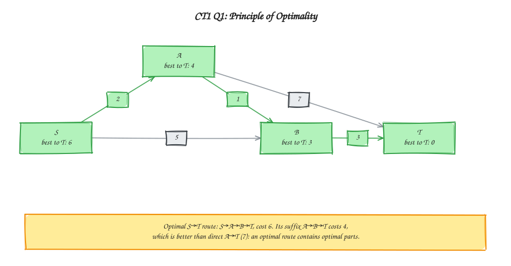

> Memory trick: best whole = best parts.

### Q2. Elements of Dynamic Programming: Fibonacci

**Question (transcribed):** Explain the elements of dynamic programming by illustrating the nth Fibonacci number. (5 marks)

**Answer.** Dynamic programming stores each distinct subproblem once and reuses it. A problem needs two properties (see [Chapter 8](../../../Chapter%208%20-%20Dynamic%20Programming/README.md)):

1. **Optimal substructure:** an optimal answer is built from optimal answers to smaller subproblems. Here $F(n)=F(n-1)+F(n-2)$ builds each value from the two before it.
2. **Overlapping subproblems:** the same smaller states are needed again and again. Both $F(5)=F(4)+F(3)$ and $F(4)=F(3)+F(2)$ need $F(3)$, so calculate and store it once.

A DP solution then has five parts. For Fibonacci they are:

| DP part | Choice for Fibonacci |
| :--- | :--- |
| State | $F(n)$: the $n$th Fibonacci number |
| Base case | $F(0)=0$ and $F(1)=1$ |
| Recurrence | $F(n)=F(n-1)+F(n-2)$ for $n\ge2$ |
| Table order | Fill $n=2,3,\ldots$ in increasing order |
| Final answer | $F(n)$; for $n=5$, $F(5)=5$ |

**Why DP helps.** Plain recursion for $F(5)$ makes 15 calls: it computes $F(3)$ twice, $F(2)$ three times, $F(1)$ five times, and $F(0)$ three times. DP stores each answer once.

| Feature | Memoization (top-down) | Tabulation (bottom-up) |
| :--- | :--- | :--- |
| Approach | Start from $F(5)$ and request smaller values | Start from $F(0)$ and $F(1)$ and fill upward |
| Technique | Recursion + cache | Iteration + table |
| Solves | Only the needed subproblems | All subproblems |

Tabulation for $F(5)$:

| $n$ | 0 | 1 | 2 | 3 | 4 | 5 |
| :---: | :---: | :---: | :---: | :---: | :---: | :---: |
| $F(n)$ | 0 | 1 | 1 | 2 | 3 | **5** |

Both methods give the same answer. Tabulation takes $\Theta(n)$ time and space; retaining only the previous two values takes $\Theta(1)$ space.

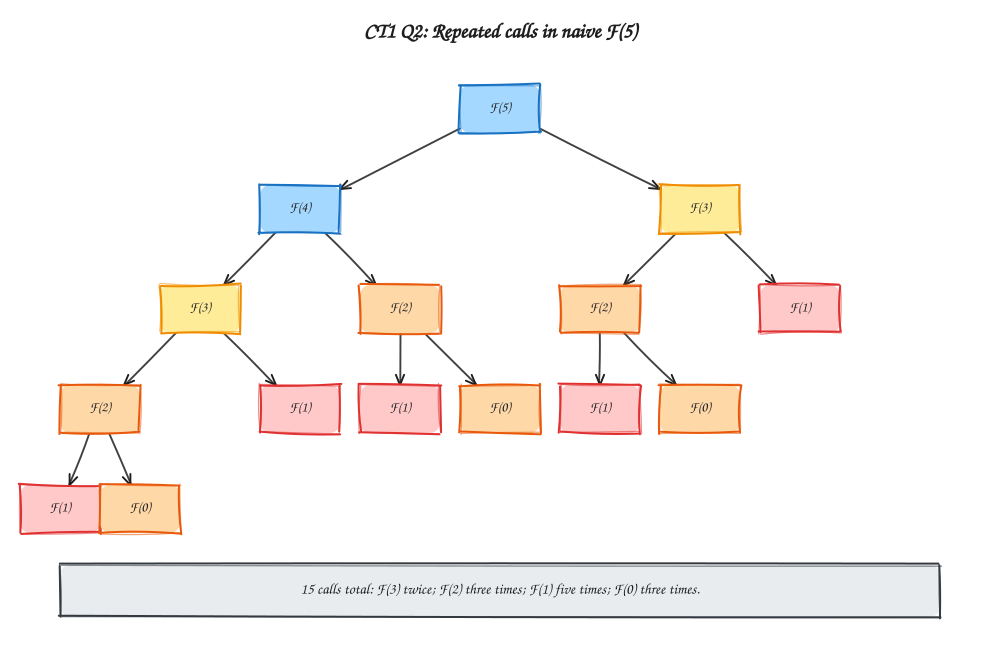

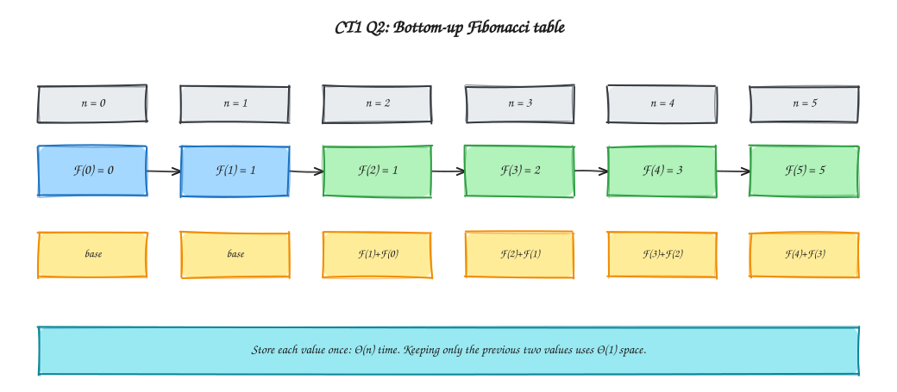

> Memory trick: store each repeated subproblem once.

### Q3. Longest Common Subsequence

**Question (transcribed):** Find the LCS of AGGTAB and GXTXAYB and write the subsequence. (5 marks)

**Answer.** A **subsequence** keeps letters in their original order but may skip letters. Let $X=\text{AGGTAB}$ and $Y=\text{GXTXAYB}$. Let $c[i,j]$ be the length of the longest common subsequence (**LCS**) of the first $i$ letters of $X$ and the first $j$ letters of $Y$ (see [Chapter 8](../../../Chapter%208%20-%20Dynamic%20Programming/README.md)).

$$
c[i,j]=
\begin{cases}
0, & i=0 \text{ or } j=0\\
c[i-1,j-1]+1, & x_i=y_j\\
\max\big(c[i-1,j],\ c[i,j-1]\big), & x_i\ne y_j
\end{cases}
$$

| DP part | Choice for LCS |
| :--- | :--- |
| State | $c[i,j]$: LCS length of $X[1..i]$ and $Y[1..j]$ |
| Base case | $c[0,j]=c[i,0]=0$, because an empty string has no common letters |
| Recurrence | The three cases above |
| Table order | Row by row, left to right |
| Final answer | $c[6,7]$ |

**Arrow legend:** $\nwarrow$ means the letters match, so the value is the diagonal cell plus 1. $\uparrow$ means they do not match and the upper cell is chosen. $\leftarrow$ means they do not match and the left cell is chosen. If the upper and left cells tie, $\uparrow$ is chosen (the rule $c[i-1][j]\ge c[i][j-1]$ in the chapter's algorithm).

**DP table** (row = letter of $X$, column = letter of $Y$):

| $i \backslash j$ | - | G | X | T | X | A | Y | B |
| :---: | :---: | :---: | :---: | :---: | :---: | :---: | :---: | :---: |
| - | 0 | 0 | 0 | 0 | 0 | 0 | 0 | 0 |
| A | 0 | 0 ($\uparrow$) | 0 ($\uparrow$) | 0 ($\uparrow$) | 0 ($\uparrow$) | 1 ($\nwarrow$) | 1 ($\leftarrow$) | 1 ($\leftarrow$) |
| G | 0 | 1 ($\nwarrow$) | 1 ($\leftarrow$) | 1 ($\leftarrow$) | 1 ($\leftarrow$) | 1 ($\uparrow$) | 1 ($\uparrow$) | 1 ($\uparrow$) |
| G | 0 | 1 ($\nwarrow$) | 1 ($\uparrow$) | 1 ($\uparrow$) | 1 ($\uparrow$) | 1 ($\uparrow$) | 1 ($\uparrow$) | 1 ($\uparrow$) |
| T | 0 | 1 ($\uparrow$) | 1 ($\uparrow$) | 2 ($\nwarrow$) | 2 ($\leftarrow$) | 2 ($\leftarrow$) | 2 ($\leftarrow$) | 2 ($\leftarrow$) |
| A | 0 | 1 ($\uparrow$) | 1 ($\uparrow$) | 2 ($\uparrow$) | 2 ($\uparrow$) | 3 ($\nwarrow$) | 3 ($\leftarrow$) | 3 ($\leftarrow$) |
| B | 0 | 1 ($\uparrow$) | 1 ($\uparrow$) | 2 ($\uparrow$) | 2 ($\uparrow$) | 3 ($\uparrow$) | 3 ($\uparrow$) | **4** ($\nwarrow$) |

Key calculations:

- $c[1,5]=c[0,4]+1=1$, because $A=A$.
- $c[4,3]=c[3,2]+1=2$, because $T=T$.
- $c[5,5]=c[4,4]+1=3$, because $A=A$.
- $c[6,7]=c[5,6]+1=4$, because $B=B$.

**Traceback** starts at $c[6,7]=4$ and follows the arrows:

1. $c[6,7]$: $B=B$. Take **B** and move $\nwarrow$ to $c[5,6]$.
2. $c[5,6]$: $A\ne Y$. The upper value is 2 and the left value is 3, so move $\leftarrow$ to $c[5,5]$.
3. $c[5,5]$: $A=A$. Take **A** and move $\nwarrow$ to $c[4,4]$.
4. $c[4,4]$: $T\ne X$. The left value (2) is larger, so move $\leftarrow$ to $c[4,3]$.
5. $c[4,3]$: $T=T$. Take **T** and move $\nwarrow$ to $c[3,2]$.
6. $c[3,2]$: $G\ne X$. Up and left tie at 1, so move $\uparrow$ to $c[2,2]$.
7. $c[2,2]$: $G\ne X$. The left value (1) is larger, so move $\leftarrow$ to $c[2,1]$.
8. $c[2,1]$: $G=G$. Take **G** and move $\nwarrow$ to $c[1,0]$. Stop.

Reading the taken letters backwards gives **G, T, A, B**.

**LCS = GTAB, length = 4.** Filling the table takes $\Theta(mn)$ time and space for strings of lengths $m$ and $n$. Tracing back takes $O(m+n)$ time.

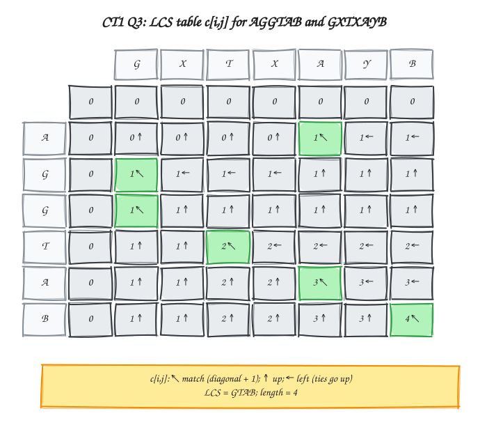

> Memory trick: match = diagonal + 1; mismatch = max(up, left).

### Q4. 0/1 Knapsack by Dynamic Programming

**Question (transcribed):** Solve a 0/1 knapsack problem using DP. Show the table and give the maximum profit and selected items. (5 marks)

> **Illustrative data:** The scan does not show the item table. Use capacity $W=8$, weights $[3,4,5,6]$, and profits $[2,3,1,4]$. Replace these numbers if the original paper has different data. The question says *profit*; [Chapter 8](../../../Chapter%208%20-%20Dynamic%20Programming/README.md) says *value*; they mean the same thing.

**Answer.** **Problem:** there are $n$ items. Item $i$ has weight $w_i$ and value $v_i$ (here the profit). Take each item **whole, at most once**, to get the maximum total value without exceeding capacity $W$.

**State:** $V[i,j]$ is the maximum value using the **first $i$ items** with capacity $j$. For item $i$ there are two choices: **skip** it (value $V[i-1,j]$) or **take** it, only if $w_i\le j$ (value $v_i+V[i-1,j-w_i]$).

$$
V[i,j]=
\begin{cases}
V[i-1,j], & \text{if } w_i>j\\
\max\big(V[i-1,j],\ v_i+V[i-1,j-w_i]\big), & \text{if } w_i\le j
\end{cases}
\qquad V[0,j]=V[i,0]=0
$$

| DP part | Choice for 0/1 knapsack |
| :--- | :--- |
| State | $V[i,j]$: best value from the first $i$ items at capacity $j$ |
| Base case | $V[0,j]=0$ (no items) and $V[i,0]=0$ (no capacity) |
| Recurrence | The two cases above |
| Table order | Rows $i=1,\dots,n$; in each row, columns $j=1,\dots,W$ |
| Final answer | $V[n,W]=V[4,8]$ |

**Arrow legend:** $\uparrow$ means the item is skipped (value copied from the upper row). $\nwarrow$ means the item is taken (value comes from the previous row at reduced capacity). If skipping and taking tie, $\uparrow$ is shown. The base row and base column have no arrows because their values are fixed at 0.

| Item | Weight | Value (profit) | $W=0$ | $W=1$ | $W=2$ | $W=3$ | $W=4$ | $W=5$ | $W=6$ | $W=7$ | $W=8$ |
| :---: | :---: | :---: | :---: | :---: | :---: | :---: | :---: | :---: | :---: | :---: | :---: |
| 0 | - | - | 0 | 0 | 0 | 0 | 0 | 0 | 0 | 0 | 0 |
| 1 | 3 | 2 | 0 | 0 ($\uparrow$) | 0 ($\uparrow$) | 2 ($\nwarrow$) | 2 ($\nwarrow$) | 2 ($\nwarrow$) | 2 ($\nwarrow$) | 2 ($\nwarrow$) | 2 ($\nwarrow$) |
| 2 | 4 | 3 | 0 | 0 ($\uparrow$) | 0 ($\uparrow$) | 2 ($\uparrow$) | 3 ($\nwarrow$) | 3 ($\nwarrow$) | 3 ($\nwarrow$) | 5 ($\nwarrow$) | 5 ($\nwarrow$) |
| 3 | 5 | 1 | 0 | 0 ($\uparrow$) | 0 ($\uparrow$) | 2 ($\uparrow$) | 3 ($\uparrow$) | 3 ($\uparrow$) | 3 ($\uparrow$) | 5 ($\uparrow$) | 5 ($\uparrow$) |
| 4 | 6 | 4 | 0 | 0 ($\uparrow$) | 0 ($\uparrow$) | 2 ($\uparrow$) | 3 ($\uparrow$) | 3 ($\uparrow$) | 4 ($\nwarrow$) | 5 ($\uparrow$) | **5** ($\uparrow$) |

Key calculations:

- $V[2,7]=\max(V[1,7],\ 3+V[1,3])=\max(2,5)=5$.
- $V[3,8]=\max(V[2,8],\ 1+V[2,3])=\max(5,3)=5$.
- $V[4,6]=\max(V[3,6],\ 4+V[3,0])=\max(3,4)=4$.
- $V[4,8]=\max(V[3,8],\ 4+V[3,2])=\max(5,4)=5$.

**Traceback** (start at $V[n,W]$; if $V[i,j]\ne V[i-1,j]$, item $i$ is selected and $j$ becomes $j-w_i$):

1. Start at $V[4,8]=5$. Since $V[4,8]=V[3,8]$, item 4 is not selected.
2. At $V[3,8]=5=V[2,8]$, item 3 is not selected.
3. At $V[2,8]=5\ne V[1,8]=2$, item 2 is selected. The remaining capacity is $8-4=4$.
4. At $V[1,4]=2\ne V[0,4]=0$, item 1 is selected. The remaining capacity is $4-3=1$.

**Answer: maximum profit 5**, using items **1 and 2** (weight $3+4=7\le8$, profit $2+3=5$). The time is $\Theta(nW)$ and the space is $\Theta(nW)$.

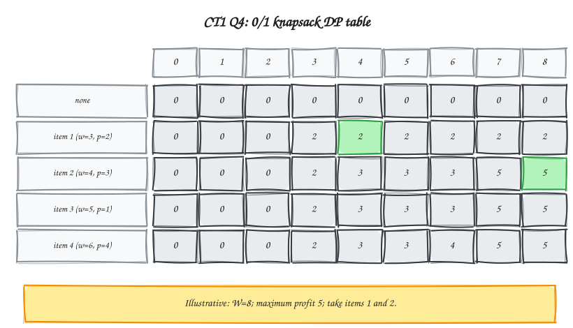

> Memory trick: select an item when its row improves the value.

---

## Class Test 2: Graph Algorithms

### Q1. Topological Sort

**Question (transcribed):** Perform a topological sort of the given DAG. (4 marks)

<p align="center">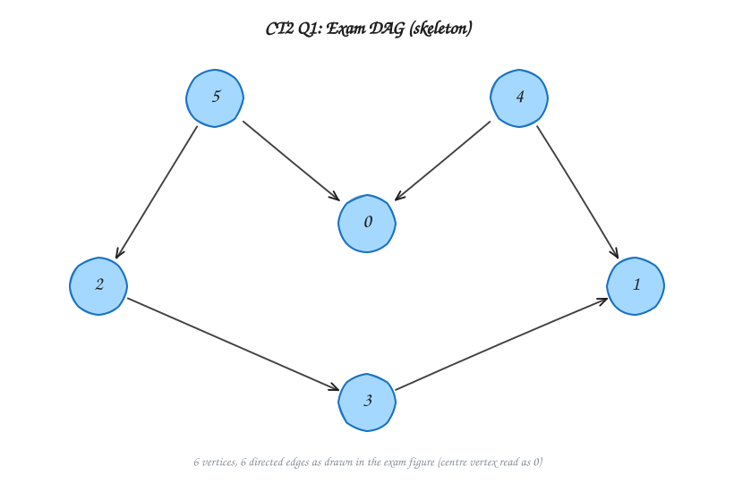</p>
<p align="center"><em>Figure given in the question (centre vertex read as 0).</em></p>

**Answer.** A **topological ordering** places every vertex $u$ before every vertex $v$ for each directed edge $u\to v$. It exists only for a DAG (a directed acyclic graph). The edges read from the scan are 5→6, 4→6, 5→2, 4→1, 2→3, and 3→1 (see [Chapter 11](../../../Chapter%2011%20-%20Graph%20Algorithms/README.md)).

**Method (DFS finish stack).** Scan the start vertices in order $1,2,\dots,6$ and each adjacency list in increasing order. Run DFS and push a vertex onto a stack only **after** all of its outgoing neighbours have finished. The left-to-right stack is the finish order; its rightmost item is popped first.

| Vertex | Outgoing neighbours |
| :---: | :--- |
| 1 | - |
| 2 | 3 |
| 3 | 1 |
| 4 | 1, 6 |
| 5 | 2, 6 |
| 6 | - |

| Step | DFS call / return action | Why it happens | Finish stack |
| :---: | :--- | :--- | :--- |
| 1 | `DFS(1)`; finish `1`; push `1` | Vertex 1 has no outgoing neighbour. | 1 |
| 2 | `DFS(2) → DFS(3)`; finish `3`; push `3` | $3\to1$, but 1 is already finished. | 1, 3 |
| 3 | Return to and finish `2`; push `2` | Its only neighbour, 3, is complete. | 1, 3, 2 |
| 4 | `DFS(4) → DFS(6)`; finish `6`; push `6` | $4\to1$ is already finished; 6 has no outgoing neighbour. | 1, 3, 2, 6 |
| 5 | Return to and finish `4`; push `4` | Both neighbours, 1 and 6, are complete. | 1, 3, 2, 6, 4 |
| 6 | `DFS(5)`; finish `5`; push `5` | $5\to2$ and $5\to6$ are already finished. | 1, 3, 2, 6, 4, 5 |

Pop from the right of the stack:

$$
5,\ 4,\ 6,\ 2,\ 3,\ 1
$$

**Check each edge** (source before destination): 5→6, 4→6, 5→2, 4→1, 2→3, and 3→1 all point left to right. DFS-based topological sort takes $\Theta(V+E)$ time and $\Theta(V)$ space.

The order is not unique. Kahn's algorithm (repeatedly remove a vertex whose in-degree is 0, starting with 4 and 5) gives another valid order, **4, 5, 6, 2, 3, 1**.

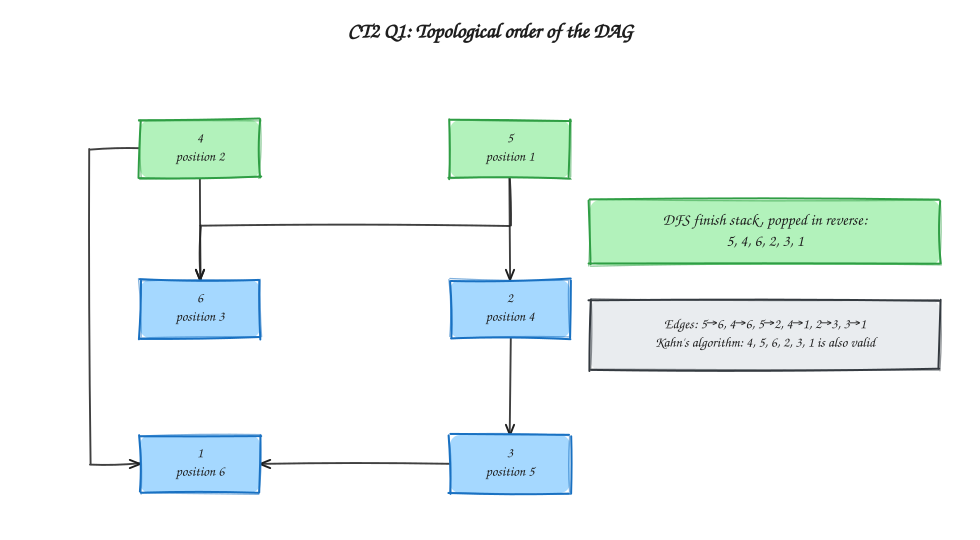

> Memory trick: finish the dependents first, push, and pop in reverse.

### Q2. Bellman–Ford from S to T

**Question (transcribed):** Use Bellman–Ford to find the shortest path from S to T in the weighted graph. (8 marks)

<p align="center">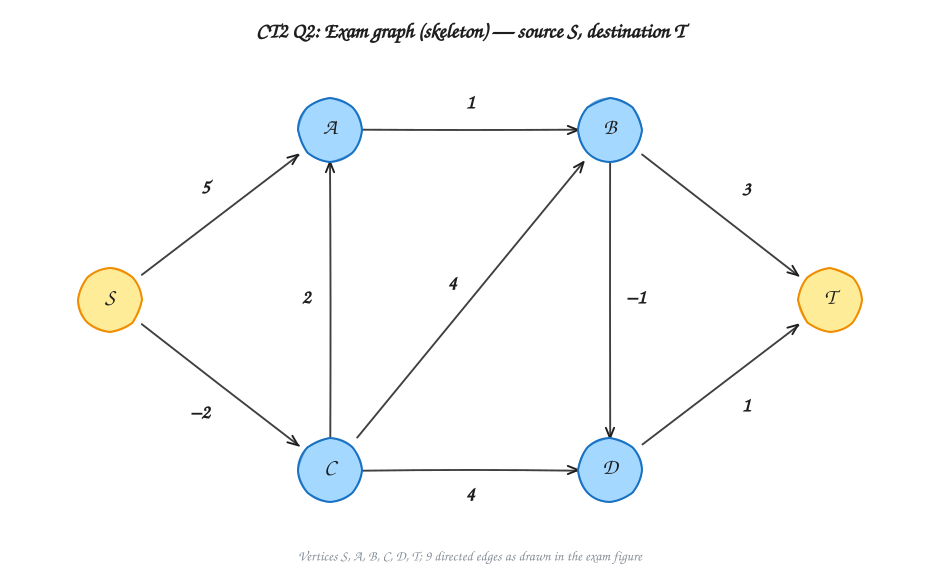</p>
<p align="center"><em>Figure given in the question.</em></p>

**Answer.** The edges read from the scan are S→A=5, S→C=−2, A→B=1, C→A=2, C→B=4, C→D=4, B→D=−1, B→T=3, and D→T=1. Bellman–Ford handles negative edge weights (see [Chapter 11](../../../Chapter%2011%20-%20Graph%20Algorithms/README.md)). To **relax** an edge $(u,v)$ means: if $dist[u]+w(u,v)<dist[v]$, set $dist[v]=dist[u]+w(u,v)$.

**Adjacency list** (neighbour, weight $w(u,v)$):

```text
S: A(5), C(-2)
A: B(1)
B: D(-1), T(3)
C: A(2), B(4), D(4)
D: T(1)
T: -
```

**Method (selected-vertex relaxation table).** Relax the edges grouped by source vertex, in the fixed order $S,A,B,C,D,T$. This still relaxes every edge once per round. Each row is labelled by the vertex whose *outgoing* edges are relaxed next, and shows the array $[dist[S],\dots,dist[T]]$ at that moment. The **bold** cell marks the selected vertex. With $|V|=6$, at most $|V|-1=5$ rounds are needed.

**Round 1** - start from $dist[S]=0$ and $\infty$ elsewhere:

| Selected vertex | S | A | B | C | D | T |
| :---: | :---: | :---: | :---: | :---: | :---: | :---: |
| S | **0** | $\infty$ | $\infty$ | $\infty$ | $\infty$ | $\infty$ |
| A | 0 | **5** | $\infty$ | -2 | $\infty$ | $\infty$ |
| B | 0 | 5 | **6** | -2 | $\infty$ | $\infty$ |
| C | 0 | 5 | 6 | **-2** | 5 | 9 |
| D | 0 | 0 | 2 | -2 | **2** | 9 |
| T | 0 | 0 | 2 | -2 | 2 | **3** |

- Row A: relax $S\to A$ ($0+5=5$) and $S\to C$ ($0-2=-2$).
- Row B: relax $A\to B$ ($5+1=6$).
- Row C: relax $B\to D$ ($6-1=5$) and $B\to T$ ($6+3=9$).
- Row D: relax $C\to A$ ($-2+2=0$, improves $A$ from 5), $C\to B$ ($-2+4=2$, improves $B$ from 6), and $C\to D$ ($-2+4=2$, improves $D$ from 5).
- Row T: relax $D\to T$ ($2+1=3$, improves $T$ from 9).

**Round 2** - carried over from $[0,0,2,-2,2,3]$:

| Selected vertex | S | A | B | C | D | T |
| :---: | :---: | :---: | :---: | :---: | :---: | :---: |
| S | **0** | 0 | 2 | -2 | 2 | 3 |
| A | 0 | **0** | 2 | -2 | 2 | 3 |
| B | 0 | 0 | **1** | -2 | 2 | 3 |
| C | 0 | 0 | 1 | **-2** | 0 | 3 |
| D | 0 | 0 | 1 | -2 | **0** | 3 |
| T | 0 | 0 | 1 | -2 | 0 | **1** |

$A\to B$ improves $B$ to 1 ($0+1$); then $B\to D$ improves $D$ to 0 ($1-1$); finally $D\to T$ improves $T$ to 1 ($0+1$).

**Round 3** - carried over from $[0,0,1,-2,0,1]$:

| Selected vertex | S | A | B | C | D | T |
| :---: | :---: | :---: | :---: | :---: | :---: | :---: |
| S | **0** | 0 | 1 | -2 | 0 | 1 |
| A | 0 | **0** | 1 | -2 | 0 | 1 |
| B | 0 | 0 | **1** | -2 | 0 | 1 |
| C | 0 | 0 | 1 | **-2** | 0 | 1 |
| D | 0 | 0 | 1 | -2 | **0** | 1 |
| T | 0 | 0 | 1 | -2 | 0 | **1** |

Nothing changed in Round 3, so the values have converged. Rounds 4 and 5 (still required by the $|V|-1$ bound) and the negative-cycle check pass leave the table unchanged.

**Final distances from S:**

| Vertex | S | A | B | C | D | T |
| :---: | :---: | :---: | :---: | :---: | :---: | :---: |
| Distance | 0 | 0 | 1 | -2 | 0 | 1 |

Walking `parent[v]` backward gives $parent[T]=D$, $parent[D]=B$, $parent[B]=A$, $parent[A]=C$, and $parent[C]=S$. The shortest path is **S→C→A→B→D→T**, with cost $-2+2+1-1+1=1$.

**Negative cycle:** none. No edge can still be relaxed after the converged round, so no negative cycle is reachable from $S$. Bellman–Ford takes $\Theta(VE)$ time and $\Theta(V)$ space.

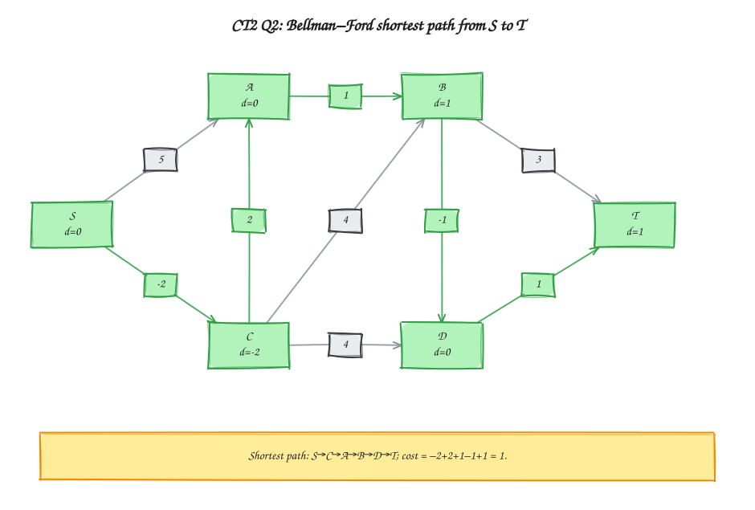

> Memory trick: relax every edge V−1 times; then check once more for a negative cycle.

### Q3. Floyd–Warshall

**Question (transcribed):** Use Floyd–Warshall to find all-pairs shortest paths in the weighted graph. (8 marks)

> **Graph reading:** the edges are 1→2=2, 2→3=3, 3→4=1, 4→3=12, 4→1=4, 1→4=5, and the diagonals 3→1=6 and 4→2=7. Those two diagonal labels are hard to read; verify them against the paper.

**Answer.**

**Givens:** a directed graph with vertices 1–4 and the eight weighted edges above. $\infty$ means there is no direct edge; each diagonal 0 is the distance from a vertex to itself. Assume there is no negative-weight cycle (see [Chapter 11](../../../Chapter%2011%20-%20Graph%20Algorithms/README.md)).

Floyd–Warshall finds shortest distances between **every pair** of vertices. Let $D^{(k)}[i,j]$ be the shortest distance from $i$ to $j$ using only vertices $1$ through $k$ as intermediate vertices. When vertex $k$ is allowed, either do not use it, or go through it:

$$D^{(k)}[i,j]=\min\big(D^{(k-1)}[i,j],\ D^{(k-1)}[i,k]+D^{(k-1)}[k,j]\big)$$

**Initial matrix $D^{(0)}$** (direct edges only):

$$
D^{(0)}=
\begin{pmatrix}
0 & 2 & \infty & 5 \\
\infty & 0 & 3 & \infty \\
6 & \infty & 0 & 1 \\
4 & 7 & 12 & 0
\end{pmatrix}
$$

**$D^{(1)}$: allow vertex 1 as intermediate.** Row 1 and column 1 do not change. Every other cell is checked against a detour through vertex 1:

- $D[2,3]=\min(3,\ D[2,1]+D[1,3])=\min(3,\ \infty+\infty)=3$
- $D[2,4]=\min(\infty,\ D[2,1]+D[1,4])=\min(\infty,\ \infty+5)=\infty$
- $D[3,2]=\min(\infty,\ D[3,1]+D[1,2])=\min(\infty,\ 6+2)=8$
- $D[3,4]=\min(1,\ D[3,1]+D[1,4])=\min(1,\ 6+5)=1$
- $D[4,2]=\min(7,\ D[4,1]+D[1,2])=\min(7,\ 4+2)=6$
- $D[4,3]=\min(12,\ D[4,1]+D[1,3])=\min(12,\ 4+\infty)=12$

Two cells improve: $D[3,2]$ drops from $\infty$ to **8** and $D[4,2]$ drops from 7 to **6**:

$$
D^{(1)}=
\begin{pmatrix}
0 & 2 & \infty & 5 \\
\infty & 0 & 3 & \infty \\
6 & 8 & 0 & 1 \\
4 & 6 & 12 & 0
\end{pmatrix}
$$

Arrow-guided update for intermediate vertex $k=1$ (changed cells):

| Cell | Keep direct path | Try detour through $1$ | Chosen arrow | Stored value |
| :---: | :---: | :---: | :---: | :---: |
| $D[3,2]$ | $\infty$ | $D[3,1]+D[1,2]=6+2=8$ | $3 \rightarrow 1 \rightarrow 2$ | **8** |
| $D[4,2]$ | 7 | $D[4,1]+D[1,2]=4+2=6$ | $4 \rightarrow 1 \rightarrow 2$ | **6** |

**$D^{(2)}$: allow vertices 1 and 2 as intermediate.** Row 2 and column 2 stay fixed:

- $D[1,3]=\min(\infty,\ D[1,2]+D[2,3])=\min(\infty,\ 2+3)=5$
- $D[1,4]=\min(5,\ D[1,2]+D[2,4])=\min(5,\ 2+\infty)=5$
- $D[3,1]=\min(6,\ D[3,2]+D[2,1])=\min(6,\ 8+\infty)=6$
- $D[3,4]=\min(1,\ D[3,2]+D[2,4])=\min(1,\ 8+\infty)=1$
- $D[4,1]=\min(4,\ D[4,2]+D[2,1])=\min(4,\ 6+\infty)=4$
- $D[4,3]=\min(12,\ D[4,2]+D[2,3])=\min(12,\ 6+3)=9$

Two cells improve: $D[1,3]$ drops from $\infty$ to **5** and $D[4,3]$ drops from 12 to **9**:

$$
D^{(2)}=
\begin{pmatrix}
0 & 2 & 5 & 5 \\
\infty & 0 & 3 & \infty \\
6 & 8 & 0 & 1 \\
4 & 6 & 9 & 0
\end{pmatrix}
$$

| Cell | Keep direct path | Try detour through $2$ | Chosen arrow | Stored value |
| :---: | :---: | :---: | :---: | :---: |
| $D[1,3]$ | $\infty$ | $D[1,2]+D[2,3]=2+3=5$ | $1 \rightarrow 2 \rightarrow 3$ | **5** |
| $D[4,3]$ | 12 | $D[4,2]+D[2,3]=6+3=9$ | $4 \rightarrow 2 \rightarrow 3$ | **9** |

**$D^{(3)}$: allow vertices 1, 2, and 3 as intermediate.** Row 3 and column 3 stay fixed:

- $D[1,2]=\min(2,\ D[1,3]+D[3,2])=\min(2,\ 5+8)=2$
- $D[1,4]=\min(5,\ D[1,3]+D[3,4])=\min(5,\ 5+1)=5$
- $D[2,1]=\min(\infty,\ D[2,3]+D[3,1])=\min(\infty,\ 3+6)=9$
- $D[2,4]=\min(\infty,\ D[2,3]+D[3,4])=\min(\infty,\ 3+1)=4$
- $D[4,1]=\min(4,\ D[4,3]+D[3,1])=\min(4,\ 9+6)=4$
- $D[4,2]=\min(6,\ D[4,3]+D[3,2])=\min(6,\ 9+8)=6$

Two cells improve: $D[2,1]$ drops from $\infty$ to **9** and $D[2,4]$ drops from $\infty$ to **4**:

$$
D^{(3)}=
\begin{pmatrix}
0 & 2 & 5 & 5 \\
9 & 0 & 3 & 4 \\
6 & 8 & 0 & 1 \\
4 & 6 & 9 & 0
\end{pmatrix}
$$

| Cell | Keep direct path | Try detour through $3$ | Chosen arrow | Stored value |
| :---: | :---: | :---: | :---: | :---: |
| $D[2,1]$ | $\infty$ | $D[2,3]+D[3,1]=3+6=9$ | $2 \rightarrow 3 \rightarrow 1$ | **9** |
| $D[2,4]$ | $\infty$ | $D[2,3]+D[3,4]=3+1=4$ | $2 \rightarrow 3 \rightarrow 4$ | **4** |

**$D^{(4)}$: allow all vertices as intermediate (final matrix).** Row 4 and column 4 stay fixed:

- $D[1,2]=\min(2,\ D[1,4]+D[4,2])=\min(2,\ 5+6)=2$
- $D[1,3]=\min(5,\ D[1,4]+D[4,3])=\min(5,\ 5+9)=5$
- $D[2,1]=\min(9,\ D[2,4]+D[4,1])=\min(9,\ 4+4)=8$
- $D[2,3]=\min(3,\ D[2,4]+D[4,3])=\min(3,\ 4+9)=3$
- $D[3,1]=\min(6,\ D[3,4]+D[4,1])=\min(6,\ 1+4)=5$
- $D[3,2]=\min(8,\ D[3,4]+D[4,2])=\min(8,\ 1+6)=7$

Three cells improve: $D[2,1]$ drops from 9 to **8**, $D[3,1]$ drops from 6 to **5**, and $D[3,2]$ drops from 8 to **7**:

$$
D^{(4)}=
\begin{pmatrix}
0 & 2 & 5 & 5 \\
8 & 0 & 3 & 4 \\
5 & 7 & 0 & 1 \\
4 & 6 & 9 & 0
\end{pmatrix}
$$

| Cell | Keep direct path | Try detour through $4$ | Chosen arrow | Stored value |
| :---: | :---: | :---: | :---: | :---: |
| $D[2,1]$ | 9 | $D[2,4]+D[4,1]=4+4=8$ | $2 \rightarrow 4 \rightarrow 1$ | **8** |
| $D[3,1]$ | 6 | $D[3,4]+D[4,1]=1+4=5$ | $3 \rightarrow 4 \rightarrow 1$ | **5** |
| $D[3,2]$ | 8 | $D[3,4]+D[4,2]=1+6=7$ | $3 \rightarrow 4 \rightarrow 2$ | **7** |

**Negative-cycle check:** every diagonal entry of $D^{(4)}$ is still 0, so there is no negative cycle and all distances are valid.

The final distances include $d(2,1)=8$ (path $2\to3\to4\to1$, cost $3+1+4$), $d(3,1)=5$ (path $3\to4\to1$), and $d(3,2)=7$ (path $3\to4\to1\to2$). Floyd–Warshall takes $\Theta(n^3)$ time and $\Theta(n^2)$ space.

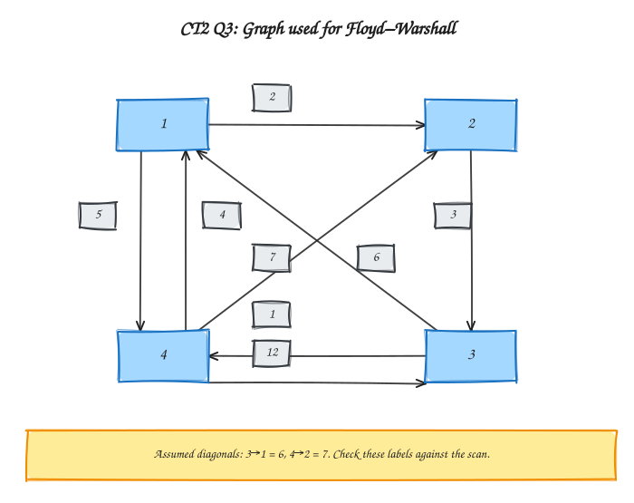

> Memory trick: for each $k$, ask: "Is going through $k$ shorter?"

---

## Class Test 3: CSE 2201 - CT - 3 PDF

The filename identifies this as CT3. The PDF header says “Class Test: 01”; that internal label is treated as a typo, as requested.

### Q1. Union by Rank

**Question (transcribed):** Explain how union by rank helps reduce the height of a DSU tree. Illustrate your answer with an example. (5 marks)

**Answer.**

A **disjoint-set union (DSU)** keeps each set as a tree. The root represents the set. `find(x)` follows parent links to get the root; `union(a, b)` joins the two sets.

**Union by rank** stores a small rank at each root as an estimate of its tree height. When joining two roots:

1. Attach the root with the **smaller rank** below the root with the larger rank.
2. If the ranks are equal, attach either root below the other and increase the new root's rank by 1.

Rank is **not** the number of children or the size of the set: without path compression it tracks tree height (see [Chapter 11](../../../Chapter%2011%20-%20Graph%20Algorithms/README.md)). The union step, applied to two distinct roots, is:

```text
UNION-BY-RANK(rootX, rootY)
1. require rootX and rootY are distinct roots
2. if rank[rootX] < rank[rootY]: swap rootX and rootY
3. parent[rootY] <- rootX
4. if rank[rootX] = rank[rootY]: rank[rootX] <- rank[rootX] + 1
```

This avoids attaching a tall tree under a shorter one. For example, with elements 1–8, join the pairs `(1,2)`, `(3,4)`, `(5,6)`, `(7,8)`, then join the resulting pairs `(1,3)`, `(5,7)`, and finally `(1,5)`. Every rank starts at 0:

| Operation | Roots (rank) before | Decision | New root (rank) | Height of merged tree |
| :---: | :---: | :--- | :---: | :---: |
| `UNION(1,2)` | 1 (0), 2 (0) | Tie: `parent[2]=1` | 1 (1) | 1 |
| `UNION(3,4)` | 3 (0), 4 (0) | Tie: `parent[4]=3` | 3 (1) | 1 |
| `UNION(5,6)` | 5 (0), 6 (0) | Tie: `parent[6]=5` | 5 (1) | 1 |
| `UNION(7,8)` | 7 (0), 8 (0) | Tie: `parent[8]=7` | 7 (1) | 1 |
| `UNION(1,3)` | 1 (1), 3 (1) | Tie: `parent[3]=1` | 1 (2) | 2 |
| `UNION(5,7)` | 5 (1), 7 (1) | Tie: `parent[7]=5` | 5 (2) | 2 |
| `UNION(1,5)` | 1 (2), 5 (2) | Tie: `parent[5]=1` | 1 (3) | **3** |

Equal-rank roots are joined at every step, so the rank rises only on a tie. The final tree has height **3**. A poor sequence of unions without rank can make a chain of height **7**.

A rank-r root represents at least $2^r$ elements, because its rank only increases when two roots of the same rank are joined. Therefore rank is at most $\log_2 n$, and union by rank alone keeps the height logarithmic. With path compression as well, the amortized cost per operation is nearly constant, $O(\alpha(n))$.

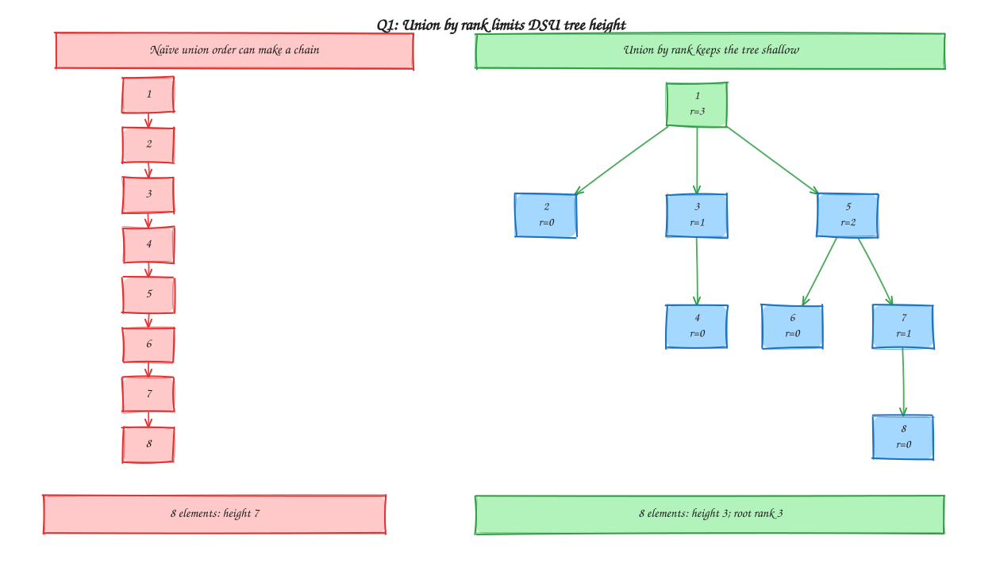

> Memory trick: attach the shorter tree below the taller one; raise rank only on a tie.

---

### Q2. Divide-and-Conquer Maximum Subarray Sum

**Question (transcribed):** Illustrate with an example construction of the divide-and-conquer solution for Maximum Subarray Sum problem to find in using a suitable test-case. (5 marks)

**Answer.**

> **Illustrative test case:** the paper does not give an array. Use `[-2, 1, -3, 4, -1, 2, 1, -5]` below. Indices are zero-based.

Split the array into two halves until each part contains one value. For every interval, compute:

- the best subarray entirely in the **left half**;
- the best subarray entirely in the **right half**;
- the best **crossing** subarray, which is the largest suffix of the left half plus the largest prefix of the right half.

Return the largest of those three values. A one-element interval is the base case: its best sum is that element.

| Interval | Best left | Best right | Best crossing | Best for interval |
|----------|-----------|------------|---------------|-------------------|
| `[0,1]` | -2 | 1 | -1 | 1 at `[1,1]` |
| `[2,3]` | -3 | 4 | 1 | 4 at `[3,3]` |
| `[0,3]` | 1 | 4 | 2 | 4 at `[3,3]` |
| `[4,5]` | -1 | 2 | 1 | 2 at `[5,5]` |
| `[6,7]` | 1 | -5 | -4 | 1 at `[6,6]` |
| `[4,7]` | 2 | 1 | 3 | 3 at `[5,6]` |
| `[0,7]` | 4 | 3 | **6** | **6 at `[3,6]`** |

At the final split, the best left-half sum is 4, the best right-half sum is 3, and the best crossing sum is 4 + (−1 + 2 + 1) = **6**. Therefore the maximum-sum subarray is `[4, -1, 2, 1]`, at indices 3 through 6.

**Recurrence.** The two recursive calls each solve half the array, and finding the crossing sum scans the whole interval once. Therefore $T(n)=2T(n/2)+\Theta(n)$. Compare $f(n)=\Theta(n)$ with the watershed function (see [Chapter 3](../../../Chapter%203%20-%20Recurrences%20Correctness%20and%20Loop%20Invariants/README.md)):

| $a$ | $b$ | $f(n)$ | $n^{\log_b a}$ | Case | Result |
| :---: | :---: | :---: | :---: | :---: | :---: |
| 2 | 2 | $n$ | $n^{\log_2 2}=n$ | Case 2 ($k=0$) | $\Theta(n\log n)$ |

Each of the $\log_2 n$ levels does $\Theta(n)$ work. The recursion stack uses $O(\log n)$ extra space. (Kadane's one-pass method is faster, $O(n)$, but this question asks for divide and conquer; see [Chapter 6](../../../Chapter%206%20-%20Divide%20and%20Conquer/README.md).)

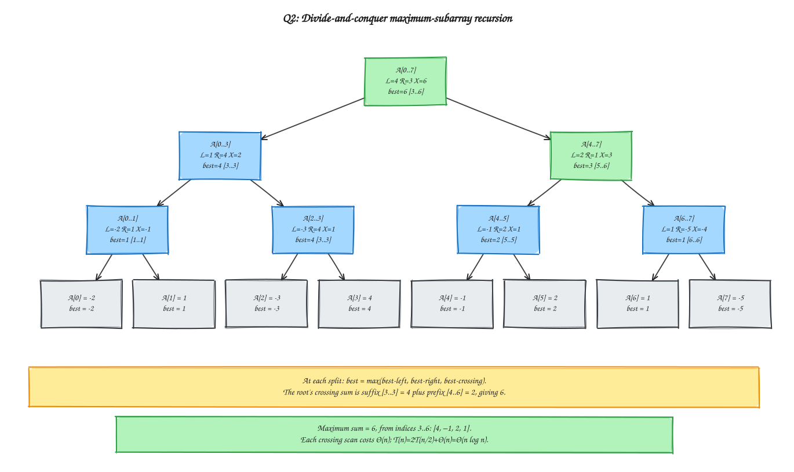

> Memory trick: split; compare left, right, and crossing.

---

### Q3. Segment Tree and Range-Sum Query

**Question (transcribed):** Consider the following C++ function for constructing a Segment Tree and performing a Range Sum Query. Complete all the sections marked TODO.

```cpp
#include <bits/stdc++.h>
using namespace std;
vector<int> tree;
// Build Segment Tree
void build(int node, int l, int r, vector<int> &arr)
{
    // TODO 1: Write the base case
    // TODO 2: Calculate the middle position
    // TODO 3: Recursively build the left half
    // TODO 4: Recursively build the right half
    // TODO 5: Combine the results of the two children
}
// Range Sum Query
int query(int node, int l, int r, int ql, int qr)
{
    // TODO 6: Handle the No Overlap case
    // TODO 7: Handle the Complete Overlap case
    // TODO 8: Calculate the middle position
    // TODO 9: Perform query on the left child
    // TODO 10: Perform query on the right child
    // TODO 11: Return the combined result
}
int main()
{
    vector<int> arr = {2, 1, 5, 3, 4, 7, 6, 8};
    int n = arr.size();
    // Allocate memory for Segment Tree
    tree.resize(4 * n);
    // Root = tree[0]
    build(0, 0, n - 1, arr);
    // TODO 12: Perform a range sum query for [1, 4]
    return 0;
}
```

**Tasks (transcribed):**

- a) Complete TODO 1-5 to implement the `build()` function. (3 marks)
- b) Complete TODO 6-11 to implement the `query()` function. (3 marks)
- c) Complete TODO 12 to perform the range-sum query `[2, 6]`. (1 mark)
- d) Draw the Segment Tree corresponding to the given array. (3 marks)

#### Q3(a) and Q3(b). Complete the functions

**Answer.** The tree stores the sum of each interval. With zero-based indexing, node `node` has children `2 * node + 1` and `2 * node + 2`.

- **TODO 1:** If the interval is a single index, store that array value.
- **TODO 2:** Find the midpoint.
- **TODO 3–4:** Build both halves recursively.
- **TODO 5:** Add the children's sums.
- **TODO 6:** If the query interval and current interval do not overlap, return 0 (the identity for sum).
- **TODO 7:** If the current interval is fully inside the query, return its stored sum.
- **TODO 8–10:** Otherwise, query both children.
- **TODO 11:** Add the two partial answers.

```cpp
void build(int node, int l, int r, vector<int> &arr)
{
    if (l == r) {
        tree[node] = arr[l];
        return;
    }

    int mid = l + (r - l) / 2;
    build(2 * node + 1, l, mid, arr);
    build(2 * node + 2, mid + 1, r, arr);
    tree[node] = tree[2 * node + 1] + tree[2 * node + 2];
}

int query(int node, int l, int r, int ql, int qr)
{
    if (qr < l || r < ql) return 0;           // No overlap
    if (ql <= l && r <= qr) return tree[node]; // Complete overlap

    int mid = l + (r - l) / 2;
    int leftSum = query(2 * node + 1, l, mid, ql, qr);
    int rightSum = query(2 * node + 2, mid + 1, r, ql, qr);
    return leftSum + rightSum;
}
```

> Memory trick: no overlap returns 0; full overlap returns the stored sum; otherwise split.

#### Q3(c). Query `[2, 6]`

**Answer.** The source code comment says `[1, 4]`, but task (c) explicitly requests `[2, 6]`. Follow the task's range:

```cpp
cout << query(0, 0, n - 1, 2, 6) << '\n';
```

The array entries at indices 2 through 6 are `5, 3, 4, 7, 6`, so the sum is **25**.

At each node, compare its interval `[l, r]` with the query `[2, 6]`: **no overlap** returns 0, **complete overlap** returns the stored sum, and **partial overlap** queries both children (see [Chapter 6](../../../Chapter%206%20-%20Divide%20and%20Conquer/README.md)). The trace, in call order, is:

| Node | Interval | Overlap with `[2,6]` | Returns |
| :---: | :---: | :--- | :---: |
| 0 | `[0,7]` | Partial: query both children | 25 |
| 1 | `[0,3]` | Partial: query both children | 8 |
| 3 | `[0,1]` | None | 0 |
| 4 | `[2,3]` | Complete | 8 |
| 2 | `[4,7]` | Partial: query both children | 17 |
| 5 | `[4,5]` | Complete | 11 |
| 6 | `[6,7]` | Partial: query both children | 6 |
| 13 | `[6,6]` | Complete | 6 |
| 14 | `[7,7]` | None | 0 |

The combined results are $0+8=8$ at node 1, $6+0=6$ at node 6, $11+6=17$ at node 2, and $8+17=25$ at the root.

> Memory trick: the query endpoints are inclusive, so `[2,6]` has five entries.

#### Q3(d). Draw the Segment Tree

**Answer.** The root represents the full interval `[0,7]`. Each internal node stores the sum of its two child intervals; each leaf stores one array value.

| Tree node | Interval | Stored sum |
|-----------|----------|------------|
| 0 | `[0,7]` | 36 |
| 1 | `[0,3]` | 11 |
| 2 | `[4,7]` | 25 |
| 3 | `[0,1]` | 3 |
| 4 | `[2,3]` | 8 |
| 5 | `[4,5]` | 11 |
| 6 | `[6,7]` | 14 |
| 7 | `[0,0]` | 2 |
| 8 | `[1,1]` | 1 |
| 9 | `[2,2]` | 5 |
| 10 | `[3,3]` | 3 |
| 11 | `[4,4]` | 4 |
| 12 | `[5,5]` | 7 |
| 13 | `[6,6]` | 6 |
| 14 | `[7,7]` | 8 |

For the `[2,6]` query, the green nodes cover `[2,3]`, `[4,5]`, and `[6,6]`. Their sums are 8, 11, and 6, giving 8 + 11 + 6 = **25**.

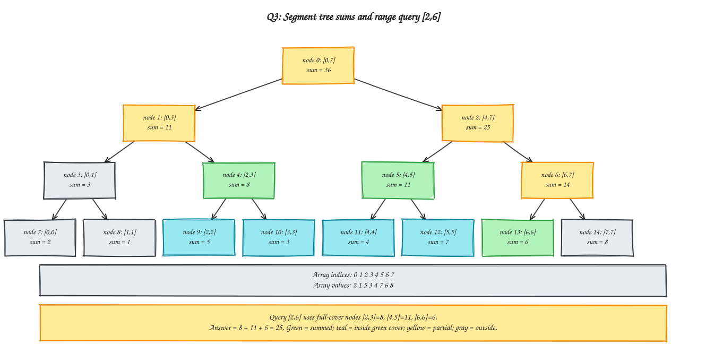

> Memory trick: each parent stores left sum + right sum; query only the covered pieces.

---

## Class Test 4: Backtracking and N-Queens

The supplied CT4 paper contains four questions worth 20 marks in total. The wording below follows the paper; the 4-Queens diagrams and dry run are illustrative examples because the paper does not specify a value of `n`.

### Q1. State-Space Tree

**Question (transcribed):** What is a state space tree? Explain its role in backtracking. (4 marks)

**Answer.** A **state-space tree** is a rooted tree that represents the choices in a search problem. The root is the empty partial solution; each edge adds one choice, and each node records the partial solution reached so far. A leaf is either a complete solution or a partial solution that cannot be extended.

Backtracking explores this tree depth-first. At each node it tests whether the partial solution is still promising. If not, it prunes that whole branch, undoes the last choice, and tries another branch. This organizes the search and avoids completing candidates that already violate the constraints; the worst-case search can still be exponential.

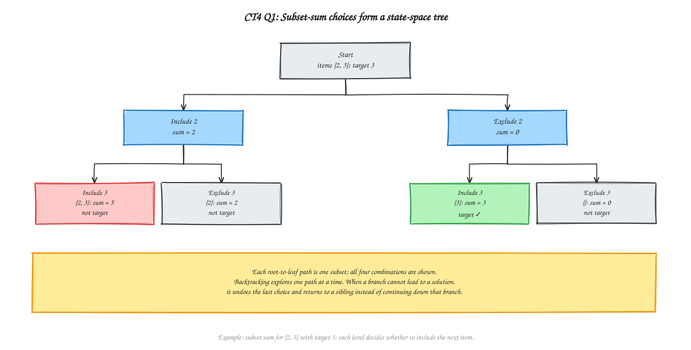

> Memory trick: choose, check, recurse; if blocked, undo and try a sibling.

### Q2. Constraints for the N-Queens Problem

**Question (transcribed):** State the constraints required to ensure that no two queens attack each other. (4 marks)

**Answer.** Number the rows and columns from `1` to `n`, and let `qᵢ` be the column containing the queen in row `i`. Placing exactly one queen in each row is built into this representation. For every pair of different rows `i < j`, the remaining constraints are:

1. **Different columns:** `qᵢ ≠ qⱼ`.
2. **Different diagonals:** `|qᵢ − qⱼ| ≠ |i − j|`.

The diagonal condition follows because two squares share a diagonal exactly when their row difference equals the absolute column difference. Thus these rules prevent every pair of queens from sharing a row, column, or diagonal.

For the illustrative 4-Queens placement `q = [2, 4, 1, 3]`, every row has one queen, all columns are distinct, and no pair shares a diagonal.

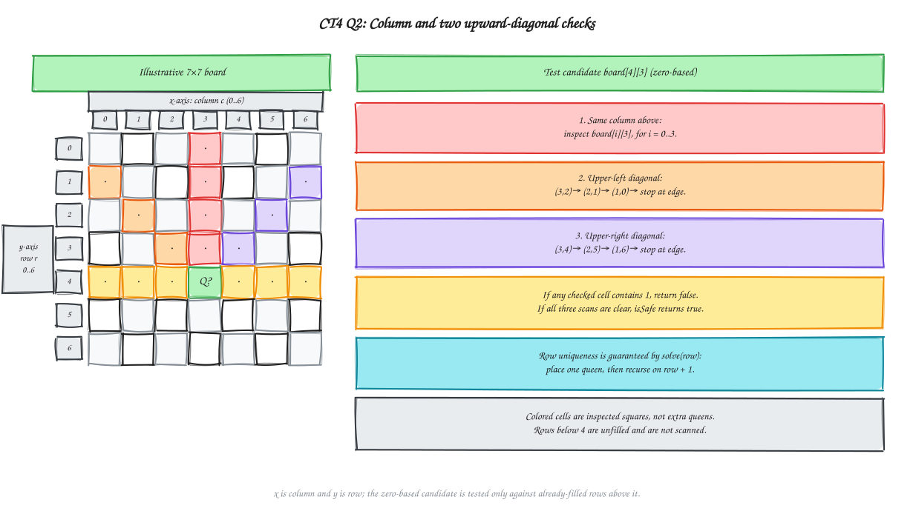

> Memory trick: one queen per row; no repeated column or diagonal.

### Q3. Other Applications of Backtracking

**Question (transcribed):** State two applications of backtracking other than the n-queen problem. (2 marks)

**Answer.** Two applications are:

1. **Graph coloring:** assign a color to each vertex while ensuring adjacent vertices have different colors. If a choice creates a conflict, undo it and try another color.
2. **Subset sum:** choose whether to include each number, seeking a subset with the target sum. For positive inputs, a branch whose partial sum already exceeds the target can be pruned.

The diagram illustrates a valid two-coloring of a 4-cycle and a subset-sum solution `{4, 5}` for the example set `{3, 4, 5, 7}` with target `9`.

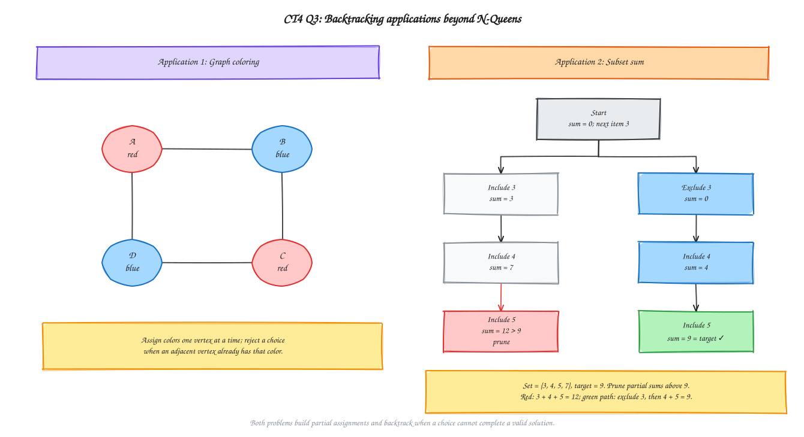

> Memory trick: backtracking fits problems that build a solution through constrained choices.

### Q4. Backtracking Algorithm for N-Queens

**Question (transcribed):** Write a backtracking algorithm to solve the n-queen problem for a given value of n. (10 marks)

**Answer.** Use an `n × n` board initialized to `0`; a `1` marks a queen. `solve(row)` handles one row at a time, so the one-queen-per-row rule is enforced by recursion and `isSafe` does not need a separate row check.

**Implementation comment:** This mirrors the supplied C++ control flow: `isSafe` checks the same column and both upward diagonals; `solve(row)` places one queen, recurses, and resets `board[row][col]` only after the recursive call fails.

**Algorithm (instruction-style):**

1. Read `n` and create `board[n][n]`, filling every cell with `0`.
2. Define `isSafe(row, col)`:
   1. Check column `col` in each earlier row `i = 0..row−1`. If `board[i][col] == 1`, return `false`.
   2. Scan the upper-right diagonal, starting at `i = row−1`, `j = col+1`. While `i ≥ 0` and `j < n`, check `board[i][j]`; if it is `1`, return `false`. Otherwise move one square up-right (`i ← i−1`, `j ← j+1`).
   3. Scan the upper-left diagonal, starting at `i = row−1`, `j = col−1`. While `i ≥ 0` and `j ≥ 0`, check `board[i][j]`; if it is `1`, return `false`. Otherwise move one square up-left (`i ← i−1`, `j ← j−1`).
   4. If all three scans are clear, return `true`.
3. Define `solve(row)` to place queens from top to bottom:
   1. If `row == n`, return `true`; all rows have a queen.
   2. Try each column `col = 0..n−1` in the current row:
      - If `isSafe(row, col)` is false, continue to the next column.
      - Otherwise place the queen: `board[row][col] ← 1`.
      - Call `solve(row + 1)`. If it returns `true`, return `true`.
      - If it returns `false`, undo the choice: `board[row][col] ← 0`, then try the next column.
   3. If no column works, return `false`.
4. Begin the search with `solve(0)`.
5. If it returns `true`, output the board; otherwise report `"No solution"`.

**Why it works:** when `solve(row)` begins, rows `0..row−1` each contain one queen and those queens do not attack one another. `isSafe` checks every earlier position that could attack the candidate. A safe placement preserves this invariant; if a later row has no valid column, the algorithm clears the choice and tries the next one. Because every column is tried, it finds a solution if one exists.

**Illustrative dry run for `n = 4`** (columns are tested from `0`):

| Placed columns by row | Result |
|---|---|
| `[0, 2]` | No safe column in row `2`; backtrack. |
| `[0, 3, 1]` | No safe column in row `3`; backtrack. |
| `[1, 3, 0, 2]` | Complete solution; the algorithm returns `true`. |

The paper does not specify `n = 4`; this example only illustrates the algorithm. Each `isSafe` call scans at most `O(n)` cells. The standard worst-case time bound is `O(n · n!)`. The explicit board uses `Θ(n²)` space, and the recursion stack uses `Θ(n)`. The algorithm returns one solution; `n = 2` and `n = 3` have no solution.

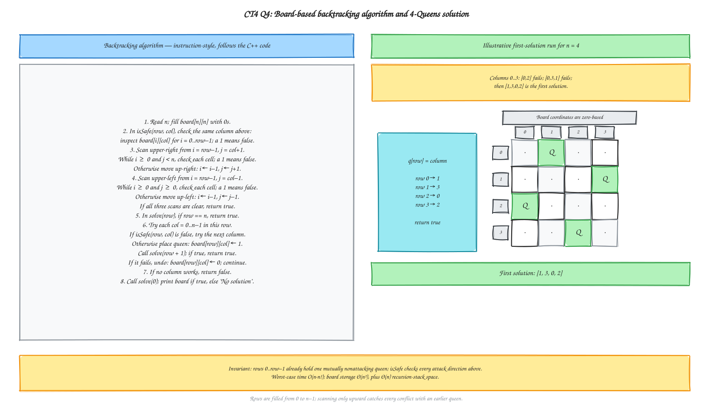

> Memory trick: check upward, place one queen, recurse; on failure, clear it and try the next column.

---

## Verification

Run `python tools/verify_ct3.py` and `python tools/verify_ct4.py` from the repository root. The existing verifier checks the CT1–CT3 worked examples plus the combined question/diagram inventory; the CT4 verifier checks the N-Queens solver examples, transcription, diagram pairs, and local links. These checks validate the worked examples and repository links, not the source paper's transcription.

## Quick Revision

| Test / topic | One-line memory |
|--------------|-----------------|
| CT1 — Principle of Optimality | A part of an optimal solution is optimal for its own subproblem |
| CT1 — Fibonacci DP | Optimal substructure + overlapping subproblems; state $F(n)$, store each state once |
| CT1 — LCS | $c[i,j]$: match $\nwarrow$ + 1; else larger of $\uparrow$ and $\leftarrow$ (tie: up); LCS = GTAB, length 4 |
| CT1 — 0/1 knapsack | $V[i,j]$: skip $\uparrow$ or take $\nwarrow$; for the illustrative data, items 1 and 2 give profit 5 |
| CT2 — Topological sort | DFS finish stack, popped in reverse: 5, 4, 6, 2, 3, 1 (Kahn's 4, 5, 6, 2, 3, 1 is also valid) |
| CT2 — Bellman–Ford | Selected-vertex relaxation table, $V-1$ rounds; shortest S-to-T distance is 1 |
| CT2 — Floyd–Warshall | $D^{(k)}[i,j]=\min(D^{(k-1)}[i,j],\ D^{(k-1)}[i,k]+D^{(k-1)}[k,j])$; final matrix $D^{(4)}$ |
| CT3 — Union by rank | Attach smaller rank below larger; raise the rank only on a tie |
| CT3 — Maximum subarray | `max(best-left, best-right, best-crossing)`; $T(n)=2T(n/2)+\Theta(n)=\Theta(n\log n)$; example answer 6 at `[3,6]` |
| CT3 — Segment tree | Parent sum = left child + right child; no-overlap query contributes 0 |
| CT3 — Range `[2,6]` | Inclusive range sum is 25; task (c) takes precedence over the `[1,4]` comment |
| CT4 — State-space tree | Each level adds a choice; prune dead ends and backtrack |
| CT4 — N-Queens constraints | One queen per row; distinct columns and diagonals |
| CT4 — Backtracking applications | Graph coloring; subset sum |
| CT4 — N-Queens algorithm | Try safe columns row by row; recurse, undo on failure |
