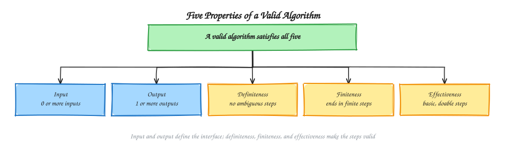
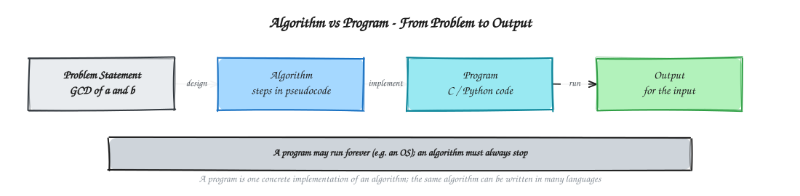

# Chapter 1 - Introduction and Algorithm Foundations

[Previous: Chapter 0 - Previous Year Questions](../Chapter%200%20-%20Previous%20Year%20Questions/README.md) | [Home](../README.md) | [Next: Chapter 2 - Complexity Analysis and Asymptotic Notation](../Chapter%202%20-%20Complexity%20Analysis%20and%20Asymptotic%20Notation/README.md)

---

An algorithm is a precise, finite, step-by-step procedure that takes some input and produces some output. Before analyzing how fast an algorithm runs, we need to know what counts as an algorithm at all, how it differs from a program, and which properties every valid algorithm must have.

This chapter defines algorithms, lists the five properties of a valid algorithm, separates algorithm design from algorithm analysis, and gives a map of the design paradigms covered in the rest of the course.

---

## Table of Contents

1. [What Is an Algorithm?](#1-what-is-an-algorithm)
2. [Algorithm vs Program](#2-algorithm-vs-program)
3. [Properties of a Valid Algorithm](#3-properties-of-a-valid-algorithm)
   - [Visual Map: Five Properties](#visual-map-five-properties)
4. [Algorithm Design and Algorithm Analysis](#4-algorithm-design-and-algorithm-analysis)
5. [Why Algorithms Matter](#5-why-algorithms-matter)
6. [Overview of Algorithm Design Paradigms](#6-overview-of-algorithm-design-paradigms)
7. [Check the Properties of Given Procedures](#check-the-properties-of-given-procedures)

---

## 1. What Is an Algorithm?

An **algorithm** is a finite sequence of well-defined instructions that, for every valid input, produces an output and then stops.

**Example: Euclid's algorithm for the greatest common divisor (GCD).**

Input: two non-negative integers $a$ and $b$, not both zero. Output: the largest integer that divides both.

```c
int gcd(int a, int b) {
    while (b != 0) {
        int r = a % b;   // remainder of a divided by b
        a = b;
        b = r;
    }
    return a;
}
```

Trace `gcd(48, 18)`:

| Step | $a$ | $b$ | $r = a \bmod b$ | Action |
| :---: | :---: | :---: | :---: | :--- |
| 1 | 48 | 18 | 12 | $(a, b) \leftarrow (18, 12)$ |
| 2 | 18 | 12 | 6 | $(a, b) \leftarrow (12, 6)$ |
| 3 | 12 | 6 | 0 | $(a, b) \leftarrow (6, 0)$ |
| 4 | 6 | 0 | - | $b = 0$, stop and return $a = 6$ |

The loop always ends because the remainder shrinks at every step, so the algorithm produces $\gcd(48, 18) = 6$.

---

## 2. Algorithm vs Program

An algorithm is an idea for solving a problem. A program is one concrete implementation of that idea in a specific language on a specific machine.

| Aspect | Algorithm | Program |
| :--- | :--- | :--- |
| What it is | A method, written as steps or pseudocode | Code written in a language such as C or Python |
| Language dependence | Independent of any programming language | Tied to a language and its libraries |
| Machine dependence | Independent of hardware and operating system | Depends on the compiler, OS, and hardware |
| Must always stop? | Yes (finiteness, see below) | Not necessarily; an operating system or a server may run forever by design |
| Example | "Repeat: replace $(a, b)$ by $(b, a \bmod b)$ until $b = 0$" | The `gcd()` function above, compiled and run |

So one algorithm can have many programs (in C, Python, Java, and so on), while a program that does not stop is not an algorithm.

---

## 3. Properties of a Valid Algorithm

A procedure is a valid algorithm only if it satisfies all five properties below.

| Property | Meaning | Violating Example |
| :--- | :--- | :--- |
| **Input** | Takes zero or more well-defined inputs | "Sort some numbers" without saying which numbers are given |
| **Output** | Produces at least one output | A "sort the array" procedure that never returns or prints the sorted array |
| **Definiteness** | Every step is precisely and unambiguously defined | "Pick a number roughly around 5 and add it" |
| **Finiteness** | Terminates after a finite number of steps for every valid input | `while (x > 0) x = x + 1;` never stops |
| **Effectiveness** | Every step is basic enough to be carried out exactly in finite time | "List the largest prime number" (no largest prime exists, so the list can never be completed) |

Input and output describe the interface of the algorithm. Definiteness, finiteness, and effectiveness describe the quality of its steps. Proving that the output is actually correct is covered later in [Chapter 3 - Recurrences Correctness and Loop Invariants](../Chapter%203%20-%20Recurrences%20Correctness%20and%20Loop%20Invariants/README.md).

### Visual Map: Five Properties



### Visual Map: Algorithm vs Program



---

## 4. Algorithm Design and Algorithm Analysis

Working with algorithms involves two separate activities:

- **Algorithm design** is devising a method that solves the problem. Common design strategies are listed in Section 6.
- **Algorithm analysis** is predicting the resources an algorithm needs, usually running time and memory, as a function of the input size $n$. Analysis is what lets us compare two algorithms that solve the same problem without running them on a computer. The tools for this are introduced in [Chapter 2 - Complexity Analysis and Asymptotic Notation](../Chapter%202%20-%20Complexity%20Analysis%20and%20Asymptotic%20Notation/README.md).

Design comes first: we propose a method, then we analyze whether it is fast enough and correct enough.

---

## 5. Why Algorithms Matter

Choosing a better algorithm often matters more than buying faster hardware. Consider searching for a value in a sorted array of $n = 1{,}000{,}000$ elements:

- **Linear search** checks elements one by one. In the worst case it makes $n = 1{,}000{,}000$ comparisons.
- **Binary search** halves the remaining range each time. It makes about $\log_2 n \approx 20$ comparisons in the worst case.

Both algorithms are correct, but one does roughly fifty thousand times less work at this input size. The growth rate of the algorithm, not the speed of the machine, decides whether a solution is practical for large inputs. Both searches are developed in [Chapter 4 - Searching and Basic Traversal](../Chapter%204%20-%20Searching%20and%20Basic%20Traversal/README.md).

---

## 6. Overview of Algorithm Design Paradigms

A design paradigm is a general strategy that many different problems can be solved with. The table below gives a one-line summary of each paradigm and the chapter where it is studied in detail.

| Paradigm | Core Idea | Studied In |
| :--- | :--- | :--- |
| Divide and Conquer | Split the problem into smaller subproblems, solve them, and combine the results | [Chapter 6](../Chapter%206%20-%20Divide%20and%20Conquer/README.md) |
| Greedy | Make the locally best choice at each step and never revisit it | [Chapter 7](../Chapter%207%20-%20Greedy%20Algorithms/README.md) |
| Dynamic Programming | Solve each overlapping subproblem once and store the result | [Chapter 8](../Chapter%208%20-%20Dynamic%20Programming/README.md) |
| Backtracking | Build candidate solutions step by step and abandon any path that cannot succeed | [Chapter 9](../Chapter%209%20-%20Backtracking/README.md) |
| Branch and Bound | Systematically search the solution space, pruning branches with a bound | [Chapter 10](../Chapter%2010%20-%20Branch%20and%20Bound/README.md) |
| Approximation | Find a near-optimal solution for problems where the exact one is too hard to compute | [Chapter 13](../Chapter%2013%20-%20Approximation%20Algorithms/README.md) |
| Randomized | Use random choices to get good expected running time | [Chapter 14](../Chapter%2014%20-%20Randomized%20and%20Parallel%20Algorithms/README.md) |

---

## Check the Properties of Given Procedures

Use the five properties to check whether each procedure is a valid algorithm.

| Procedure | Definite? | Finite? | Effective? | Verdict |
| :--- | :---: | :---: | :---: | :--- |
| Euclid's GCD (Section 1) | Yes | Yes | Yes | Valid algorithm |
| `while (x > 0) x = x + 1;` | Yes | No (never stops for $x > 0$) | Yes | Not an algorithm |
| "Print the largest prime number" | Yes | No (the list never ends) | No (no largest prime exists) | Not an algorithm |
| "Take a number roughly around 5 and add it" | No | - | - | Not an algorithm |

---

[Previous: Chapter 0 - Previous Year Questions](../Chapter%200%20-%20Previous%20Year%20Questions/README.md) | [Home](../README.md) | [Next: Chapter 2 - Complexity Analysis and Asymptotic Notation](../Chapter%202%20-%20Complexity%20Analysis%20and%20Asymptotic%20Notation/README.md)
