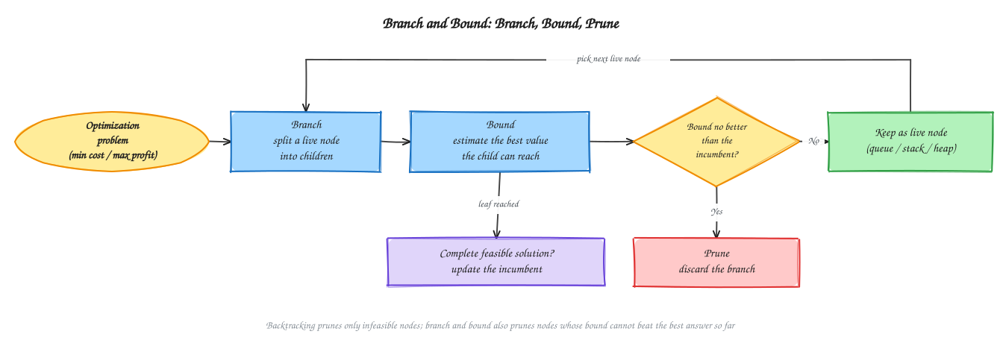
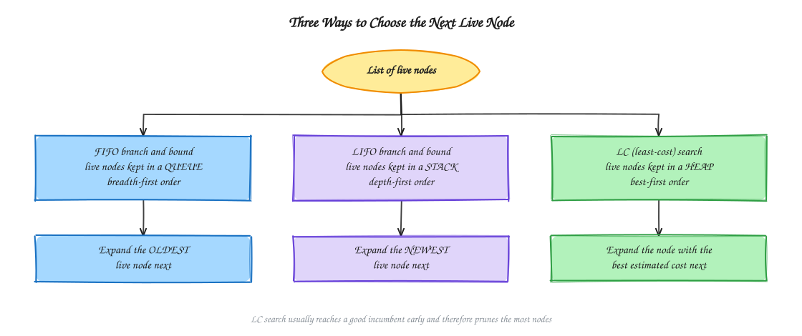
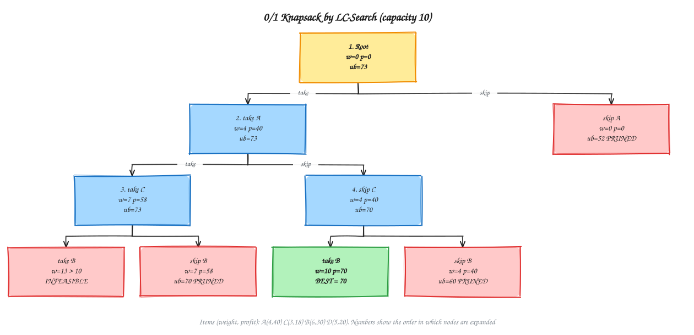
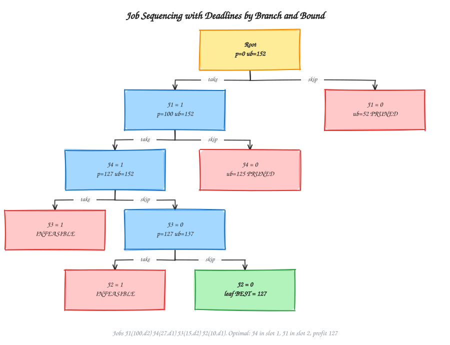
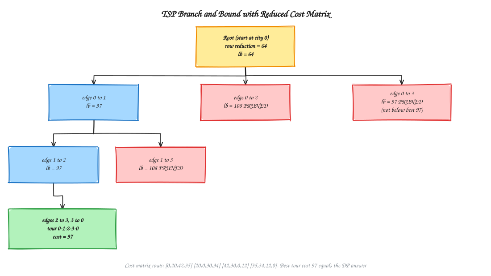

# Chapter 10 - Branch and Bound

[Previous: Chapter 9 - Backtracking](../Chapter%209%20-%20Backtracking/README.md) | [Home](../README.md) | [Next: Chapter 11 - Graph Algorithms](../Chapter%2011%20-%20Graph%20Algorithms/README.md)

---

Branch and bound (B&B) is a systematic search for an **optimal** solution (the smallest cost or the largest profit). Like backtracking, it explores a state-space tree. Unlike backtracking, it attaches a numeric **bound** to every node and discards a node as soon as that bound shows it cannot beat the best complete solution found so far.

This chapter follows the course syllabus and the previous-year questions: the B&B idea, the bounding and cost functions, FIFO, LIFO and LC search, and the three standard problems: 0/1 knapsack with LC search, job sequencing with deadlines, and the traveling salesperson problem. The worked instances are the same ones used in the [2nd Batch theory answers](../Chapter%200%20-%20Previous%20Year%20Questions/2nd%20Batch/Theory/README.md) (Q7(b), Q8(b), Q8(c)), so the two places agree. The chapter intentionally contains no implementation code.

---

## Start Here: The Idea in Plain Words

**The problem.** You want the *best* answer: the cheapest trip, the biggest profit. The only sure way is to try every possible plan. But there are far too many plans.

**The trick.** You do not have to finish every plan. Say you already have one complete plan that costs 50. Now you are half-way through another plan, and it already costs 60. It can only get more expensive, so **stop and throw it away**. You saved all the work of finishing it.

Branch and bound is just this idea, done carefully:

1. **Branch:** split a plan into smaller choices (take this item, or do not).
2. **Bound:** make an *optimistic guess* of the best result this plan could still reach.
3. **Cut:** if even the optimistic guess is not better than the best full plan you already have, drop the plan.

**Tiny example.** You want the most profit. Your best full plan so far gives 70. A half-made plan can reach at most 60 even in the best case. 60 is less than 70, so drop it.

**Words used in this chapter, in simple terms**

| Word | Simple meaning |
| :--- | :--- |
| Optimal | The best possible answer. |
| State-space tree | A tree of all the choices. Each box is a half-made plan. |
| Bound | An optimistic guess of the best a plan could become. It must never be too pessimistic. |
| Prune | Cut off a plan we do not need to finish. |
| Live node | A plan we have not finished looking at yet. |
| Incumbent | The best full answer found so far (the "current champion"). |
| Queue / stack / heap | A queue serves the oldest item first. A stack serves the newest first. A heap serves the best-scoring first. |
| Feasible | Follows all the rules (for example, not too heavy). |

**Before you start:** it helps to know [Chapter 9 - Backtracking](../Chapter%209%20-%20Backtracking/README.md) and the fractional knapsack from [Chapter 7](../Chapter%207%20-%20Greedy%20Algorithms/README.md). **Reading tip:** read the knapsack section first. The TSP section is the hardest, so read it last, and slowly.

---

## Table of Contents

- [Start Here: The Idea in Plain Words](#start-here-the-idea-in-plain-words)
1. [Branch and Bound](#branch-and-bound)
2. [Backtracking vs Branch and Bound](#backtracking-vs-branch-and-bound)
3. [Bounding Function and Cost Function](#bounding-function-and-cost-function)
4. [State-Space Tree Vocabulary](#state-space-tree-vocabulary)
5. [FIFO, LIFO, and LC Search](#fifo-lifo-and-lc-search)
6. [0/1 Knapsack Using LC Search](#01-knapsack-using-lc-search)
7. [Job Sequencing with Deadlines](#job-sequencing-with-deadlines)
8. [Traveling Salesperson Problem Using Branch and Bound](#traveling-salesperson-problem-using-branch-and-bound)
9. [Correctness and Complexity](#correctness-and-complexity)
10. [Practice and Exam Notes](#practice-and-exam-notes)

---

## Branch and Bound

A B&B algorithm repeats three actions:

1. **Branch:** pick a live node and split it into children, one for each possible next decision.
2. **Bound:** compute, for each child, an optimistic estimate of the best value any completion of that child could reach.
3. **Prune:** discard the child if its estimate is no better than the **incumbent**, the best complete feasible solution found so far. Also discard it if it is infeasible.

> **Branch into choices → bound each choice → prune the hopeless ones → keep the promising ones.**

When a complete feasible solution is reached and it is better than the incumbent, it becomes the new incumbent. The search ends when no live node is left, and the final incumbent is optimal.

See the [diagram index](diagrams/README.md) for editable Excalidraw sources and SVG previews.

---

## Backtracking vs Branch and Bound

| Feature | Backtracking ([Chapter 9](../Chapter%209%20-%20Backtracking/README.md)) | Branch and bound |
| :--- | :--- | :--- |
| Typical goal | Find one or all **feasible** solutions | Find an **optimal** solution |
| Problem type | Constraint satisfaction (N-Queens, graph coloring) | Optimization (knapsack, scheduling, TSP) |
| Pruning rule | Partial solution violates a constraint | Infeasible **or** bound is no better than the incumbent |
| Node numbers | None needed | Every node carries a bound or cost estimate |
| Search order | Depth-first (recursion) | Queue, stack, or priority queue (FIFO, LIFO, LC) |
| Memory | Recursion stack, O(depth) | List of live nodes, can be exponential |
| Worst case | Exponential | Exponential, but usually far fewer nodes |

Backtracking asks, "can this partial solution still be legal?" Branch and bound asks the stronger question, "can this partial solution still be **better than what I already have**?"

---

## Bounding Function and Cost Function

The **cost function** $c(x)$ of a node $x$ is the true value of the best solution in the subtree below $x$. It is unknown until the subtree is explored, so the algorithm uses an estimate $\hat{c}(x)$, the **bounding function**.

| Problem type | Estimate $\hat{c}(x)$ | Safe direction | Prune node $x$ when |
| :--- | :--- | :--- | :--- |
| Minimization (TSP, job cost) | **Lower bound** on the cost | Never larger than the true cost | $\hat{c}(x) \ge$ best cost found |
| Maximization (knapsack, job profit) | **Upper bound** on the profit | Never smaller than the true profit | $\hat{c}(x) \le$ best profit found |

A bound that is never wrong in this direction is called **admissible**. Admissibility is what makes pruning safe: a pruned node could never have contained a better solution.

A good bound has two properties:

- **Valid:** it never excludes the optimum.
- **Tight and cheap:** it is close to the true value and quick to compute. A loose bound prunes little; an expensive bound costs more than it saves.

A maximization problem can be turned into the minimization form that LC search uses by negating the profit: the "cost" of a node is $-\hat{p}(x)$.

---

## State-Space Tree Vocabulary

| Term | Meaning |
| :--- | :--- |
| **Live node** | Generated, but its children have not all been generated yet. |
| **E-node** | The live node currently being expanded. |
| **Dead node** | Pruned, infeasible, a complete solution, or fully expanded. It is never expanded again. |
| **Incumbent** | The best complete feasible solution found so far. Its value is the pruning threshold. |
| **Promising node** | A live node whose bound could still beat the incumbent. |

In every strategy, the E-node generates **all** of its children at once, then the algorithm chooses the next E-node from the list of live nodes. (Backtracking differs: it generates one child at a time.)

---

## FIFO, LIFO, and LC Search

The three variants differ only in how the list of live nodes is organized.

| Variant | Live-node structure | Next E-node | Resembles |
| :--- | :--- | :--- | :--- |
| **FIFO** branch and bound | Queue | The oldest live node | Breadth-first search |
| **LIFO** branch and bound | Stack | The newest live node | Depth-first search |
| **LC** (least-cost) search | Priority queue (heap) | The live node with the best bound $\hat{c}$ | Best-first search |

- FIFO and LIFO ignore the bounds when choosing the next node; they use bounds only to prune.
- LC search uses the bounds to **choose** as well. It is guided toward the most promising region, so it tends to find a good incumbent early, and the earlier a good incumbent exists, the more nodes can be pruned.
- Ties are broken by insertion order (the node generated first is expanded first). State this rule in an exam answer so the trace is reproducible.
- LC search pays for its guidance with a heap, $O(\log m)$ per operation for $m$ live nodes, and with memory that can grow to the whole frontier.

---

## 0/1 Knapsack Using LC Search

**Problem.** Given $n$ items with weights $w_i$ and profits $p_i$ and a capacity $W$, choose a subset (each item taken whole or not at all) with total weight at most $W$ and maximum total profit.

**State-space tree.** Level $i$ decides item $i$: the left child takes it, the right child skips it. A node stores the weight and profit chosen so far.

**Bounding function.** Sort the items by profit per unit weight, largest first. At a node, fill the remaining capacity greedily with the remaining items, allowing a **fraction** of the last item. This is the [fractional knapsack](../Chapter%207%20-%20Greedy%20Algorithms/README.md) solution of the remaining problem. Fractions can only help, so the result is an upper bound:

$$ub = \text{profit so far} + \text{profit of the best fractional fill of the remaining items}$$

**Instance.** Capacity $W = 10$. Items as (weight, profit): A (4, 40), C (3, 18), B (6, 30), D (5, 20). Profit per weight: A = 10, C = 6, B = 5, D = 4, so the sorted order is A, C, B, D.

**Rules.** Expand the live node with the **largest** $ub$ (ties: earliest generated). Add the take-child before the skip-child. Prune a node if it is overweight or if $ub \le$ incumbent.

| Node | Decisions | Weight | Profit | $ub$ | Status |
| :--- | :--- | :---: | :---: | :---: | :--- |
| Root | none | 0 | 0 | 73 | Expand first |
| A=1 | take A | 4 | 40 | 73 | Expand |
| A=0 | skip A | 0 | 0 | 52 | Pruned later (52 ≤ 70) |
| A=1, C=1 | take A, C | 7 | 58 | 73 | Expand |
| A=1, C=0 | take A, skip C | 4 | 40 | 70 | Expand |
| A=1, C=1, B=1 | take A, C, B | 13 | 88 | — | **Infeasible** (13 > 10) |
| A=1, C=1, B=0 | take A, C | 7 | 58 | 70 | Pruned (70 ≤ 70) |
| A=1, C=0, B=1 | take A, B | 10 | 70 | 70 | **Incumbent = 70** |
| A=1, C=0, B=0 | take A | 4 | 40 | 60 | Pruned (60 ≤ 70) |

**Bound arithmetic.**

- Root and A=1: $40 + 18 + \tfrac{3}{6}\cdot 30 = 73$ (A and C fit, half of B fills the last 3 units).
- A=0: $18 + 30 + \tfrac{1}{5}\cdot 20 = 52$.
- A=1, C=1: $58 + \tfrac{3}{6}\cdot 30 = 73$.
- A=1, C=0: $40 + 30 = 70$ (A and B fill the capacity exactly).
- A=1, C=1, B=0: $58 + \tfrac{3}{5}\cdot 20 = 70$.
- A=1, C=0, B=0: $40 + 20 = 60$.

**Expansion order:** root → A=1 → A=1,C=1 → A=1,C=0. Expanding the last node produces the complete choice A + B with weight 10 and profit 70. Every other live node has a bound of at most 70, so none can improve it.

**Answer:** take **A and B**: weight 10, profit **70**. Only 4 of the 9 generated nodes were expanded.

> Why a fractional bound? It is easy to compute in $O(n)$, it never underestimates the true best profit, and it is exact whenever the greedy fill happens to use whole items only.

---

## Job Sequencing with Deadlines

**Problem.** One machine processes jobs. Every job takes one time slot, and job $i$ earns profit $p_i$ only if it finishes by its deadline $d_i$. Choose a set of jobs, and an order for them, that maximizes total profit.

**Feasibility.** A set of jobs can all be finished on time if, after sorting by deadline, the $k$-th job has deadline at least $k$. Equivalently, for every $t$, at most $t$ chosen jobs have deadline at most $t$.

**Instance.** J1 (profit 100, deadline 2), J4 (profit 27, deadline 1), J3 (profit 15, deadline 2), J2 (profit 10, deadline 1). Jobs are listed in decreasing profit order.

**Tree.** Level $i$ decides job $i$: include it (if the chosen set stays feasible) or exclude it.

**Bound.** $ub$ = profit already chosen + profit of **all** undecided jobs. It ignores deadlines for the undecided jobs, so it can only overestimate, which keeps it admissible.

**Rules.** Depth-first, include-child first, start with incumbent 0, and update the incumbent at complete leaves.

| Node | Decision | Profit | $ub$ | Status |
| :--- | :--- | :---: | :---: | :--- |
| Root | none | 0 | 152 | Branch |
| J1=1 | take J1 | 100 | 152 | Branch |
| J1=1, J4=1 | take J1, J4 | 127 | 152 | Branch (J4 in slot 1, J1 in slot 2) |
| J1=1, J4=1, J3=1 | add J3 | — | — | **Infeasible**: three jobs with deadline ≤ 2 |
| J1=1, J4=1, J3=0 | skip J3 | 127 | 137 | Branch |
| J1=1, J4=1, J3=0, J2=1 | add J2 | — | — | **Infeasible**: two jobs with deadline ≤ 1 |
| J1=1, J4=1, J3=0, J2=0 | leaf | 127 | 127 | **Incumbent = 127** |
| J1=1, J4=0 | skip J4 | 100 | 125 | **Pruned** (125 ≤ 127) |
| J1=0 | skip J1 | 0 | 52 | **Pruned** (52 ≤ 127) |

The bounds are $152 = 100 + 27 + 15 + 10$, $137 = 127 + 10$, $125 = 100 + 15 + 10$ and $52 = 27 + 15 + 10$.

**Answer:** choose **J1 and J4**. Schedule J4 in slot 1 and J1 in slot 2. Maximum profit = **127**.

> Cross-check: the greedy rule "take jobs by decreasing profit and place each in the latest free slot not after its deadline" also yields J1 and J4 with profit 127. B&B reaches the same answer while also proving optimality from the bounds.

---

## Traveling Salesperson Problem Using Branch and Bound

**Problem.** Find the cheapest tour that visits every city exactly once and returns to the start. For $n$ cities there are $(n-1)!$ tours, so we need pruning.

**Bounding function: the reduced cost matrix.** Every tour uses exactly one edge leaving each city and exactly one edge entering each city. So subtracting a constant from a whole row or column lowers every tour's cost by exactly that constant.

1. **Row reduction:** subtract each row's minimum from that row (rows with minimum ∞ are skipped).
2. **Column reduction:** subtract each column's minimum from that column.
3. The sum of everything subtracted is a **lower bound** on the cost of any tour.

**Child cost.** When a node chooses edge $i \to j$:

1. Set row $i$ and column $j$ to ∞ (city $i$ has left; city $j$ has been entered).
2. Set entry $[j][\text{start}]$ to ∞ so that the tour cannot close early.
3. Reduce the matrix again; let $r$ be the amount subtracted.
4. $$\hat{c}(\text{child}) = \hat{c}(\text{parent}) + M[i][j] + r$$ where $M[i][j]$ is the entry in the parent's reduced matrix.

**Instance** (the same matrix as the [DP example](../Chapter%200%20-%20Previous%20Year%20Questions/2nd%20Batch/Theory/README.md) for Q8(c)), start city 0:

| From / to | 0 | 1 | 2 | 3 |
| :---: | :---: | :---: | :---: | :---: |
| 0 | ∞ | 20 | 42 | 35 |
| 1 | 20 | ∞ | 30 | 34 |
| 2 | 42 | 30 | ∞ | 12 |
| 3 | 35 | 34 | 12 | ∞ |

**Root.** Row minima are 20, 20, 12, 12 (sum 64). After subtracting them, every column already contains a 0, so the column reduction adds nothing. Root lower bound = **64**.

| Reduced | 0 | 1 | 2 | 3 |
| :---: | :---: | :---: | :---: | :---: |
| 0 | ∞ | 0 | 22 | 15 |
| 1 | 0 | ∞ | 10 | 14 |
| 2 | 30 | 18 | ∞ | 0 |
| 3 | 23 | 22 | 0 | ∞ |

**Level 1: choose the first edge from city 0.**

| Edge | $M[i][j]$ | Reduction $r$ | Bound |
| :--- | :---: | :--- | :---: |
| 0 → 1 | 0 | rows: 10 (row 1); columns: 23 (column 0); $r = 33$ | $64 + 0 + 33 = $ **97** |
| 0 → 2 | 22 | rows: 22 (row 3); columns: 0; $r = 22$ | $64 + 22 + 22 = $ **108** |
| 0 → 3 | 15 | rows: 18 (row 2); columns: 0; $r = 18$ | $64 + 15 + 18 = $ **97** |

Expand the cheapest live node. Nodes 0→1 and 0→3 tie at 97; expand 0→1 (generated first). Its reduced matrix is:

| Reduced | 0 | 1 | 2 | 3 |
| :---: | :---: | :---: | :---: | :---: |
| 1 | ∞ | ∞ | 0 | 4 |
| 2 | 7 | ∞ | ∞ | 0 |
| 3 | 0 | ∞ | 0 | ∞ |

**Level 2: choose the edge leaving city 1.**

| Edge | $M[i][j]$ | Reduction $r$ | Bound |
| :--- | :---: | :--- | :---: |
| 1 → 2 | 0 | 0 | $97 + 0 + 0 = $ **97** |
| 1 → 3 | 4 | 7 (row 2) | $97 + 4 + 7 = $ **108** |

Expand 1→2 (bound 97). Only city 3 is left, so the tour is forced: 2 → 3 (bound stays 97), then 3 → 0 (bound stays 97). The complete tour is $0 \to 1 \to 2 \to 3 \to 0$ with cost $20 + 30 + 12 + 35 = 97$.

**Pruning.** The incumbent is now 97. The remaining live nodes have bounds 97 (edge 0→3), 108 (edge 0→2) and 108 (edge 1→3). None is **strictly below** 97, so none can produce a cheaper tour, and all are pruned. (The node with bound 97 could at best tie, for example with the reverse tour $0 \to 3 \to 2 \to 1 \to 0$ of the same cost.)

**Answer:** minimum tour cost **97**, tour $0 \to 1 \to 2 \to 3 \to 0$. This agrees with the dynamic-programming result of Chapter 8 for the same matrix.

> Observation: the level-1 bounds 97, 108, 97 equal the DP values $20+77$, $42+66$, $35+62$. Here the reduced-matrix bound turned out to be tight, which is why so few nodes were needed.

---

## Correctness and Complexity

**Why pruning is safe.** Suppose a node $x$ is pruned because $\hat{c}(x) \ge \text{incumbent}$ (minimization). Because the bound is a lower bound, every solution below $x$ costs at least $\hat{c}(x)$, which is no better than a solution we already hold. So the optimum is never discarded. Infeasible nodes are pruned for the same reason: they contain no valid solution.

**Termination.** The tree is finite, and every node is generated at most once, so the algorithm stops when the list of live nodes is empty.

| Problem | Worst-case time | Typical behavior | Memory |
| :--- | :--- | :--- | :--- |
| 0/1 knapsack | $O(2^n)$ | A good bound expands very few nodes | Live-node list, up to $O(2^n)$ |
| Job sequencing | $O(2^n)$ nodes, plus a feasibility check per node | Pruned by the profit bound | Live-node list |
| TSP | $O(n!)$ nodes, $O(n^2)$ matrix reduction per node | Often a tiny fraction of the tree | $O(n^2)$ per stored node |

The worst case is not better than exhaustive search, because the bound may prune nothing. The value of B&B is practical: on most inputs a tight bound removes most of the tree. For TSP, the dynamic program of [Chapter 8](../Chapter%208%20-%20Dynamic%20Programming/README.md) is guaranteed $O(n^2 2^n)$, whereas B&B has no better guarantee but often wins in practice on specific instances. All three problems are NP-hard in their optimization form (see [Chapter 15](../Chapter%2015%20-%20Lower%20Bound%20Theory%20and%20NP%20Completeness/README.md)).

---

## Practice and Exam Notes

- State the bounding function before tracing anything, and say whether it is an upper bound (maximization) or a lower bound (minimization).
- Always state the tie-breaking rule and the order in which children are generated; examiners follow the trace node by node.
- A trace table should list each node's decisions, weight or cost, bound, and status (expanded, pruned, infeasible, incumbent). Pruned nodes need the inequality that justifies the pruning, for example $60 \le 70$.
- Compare with backtracking in one line: backtracking prunes by **feasibility**, branch and bound prunes by **feasibility and bound**, and LC search additionally **chooses** by bound.
- If the question gives no items or jobs, create a small instance and say it is an example. The previous papers did exactly this (see 2nd Batch Q7(b) and Q8(b)).
- For TSP, memorize the five steps: reduce the root; pick an edge; set the row, column and return entry to ∞; reduce again; add parent bound + entry + reduction.
- Frequently asked: difference between backtracking and branch and bound, FIFO vs LIFO vs LC search, an admissible bounding function, a worked 0/1 knapsack state-space tree, job sequencing, and TSP.

### Final Revision Checklist

- I can define live node, E-node, dead node, and incumbent.
- I can explain why a bound must be admissible.
- I can compute the fractional upper bound for a knapsack node and expand nodes in LC order.
- I can check job-sequencing feasibility and compute the "profit so far + all undecided" bound.
- I can reduce a TSP cost matrix and compute a child's lower bound.
- I can explain why B&B is exponential in the worst case but fast in practice.

---

[Previous: Chapter 9 - Backtracking](../Chapter%209%20-%20Backtracking/README.md) | [Home](../README.md) | [Next: Chapter 11 - Graph Algorithms](../Chapter%2011%20-%20Graph%20Algorithms/README.md)
