# Chapter 11: Graph Algorithms

[Previous: Chapter 10 - Branch and Bound](../Chapter%2010%20-%20Branch%20and%20Bound/README.md) | [Home](../README.md) | [Next: Chapter 12 - Flow Algorithms](../Chapter%2012%20-%20Flow%20Algorithms/README.md)

---

Graph Algorithms study how to model relationships and solve problems on connected objects. A graph can represent cities connected by roads, courses connected by prerequisites, computers connected in a network, or tasks connected by dependencies.

This chapter keeps only the requested graph theory and graph algorithm topics. Each topic is explained in a simple sequence with definitions, diagrams, walkthrough tables, algorithm sketches, and complexity analysis.

---

## Table of Contents

1. [Graph Algorithms](#graph-algorithms)
   - [Classroom Problem-Solving Sequence](#classroom-problem-solving-sequence)
2. [Tree vs Graph](#1-tree-vs-graph)
3. [Graph Categories](#2-graph-categories)
   - [Weighted vs Unweighted](#weighted-vs-unweighted)
   - [Directed vs Undirected](#directed-vs-undirected)
   - [Cyclic vs Acyclic](#cyclic-vs-acyclic)
4. [Graph Representation](#3-graph-representation)
   - [Adjacency Matrix](#adjacency-matrix)
   - [Adjacency List](#adjacency-list)
5. [Shortest Path Problem Overview](#4-shortest-path-problem-overview)
6. [BFS for Unweighted Shortest Path](#5-bfs-for-unweighted-shortest-path)
7. [Single Source Shortest Path - Dijkstra's Algorithm](#6-single-source-shortest-path---dijkstras-algorithm)
   - [Relaxation Condition](#relaxation-condition)
   - [Worked Example 1: Undirected Graph](#worked-example-1-undirected-graph)
   - [Worked Example 2: Directed Graph](#worked-example-2-directed-graph)
8. [Single Source Shortest Path - Bellman-Ford Algorithm](#7-single-source-shortest-path---bellman-ford-algorithm)
9. [Shortest Path (All Pairs) - Floyd-Warshall Algorithm](#8-shortest-path-all-pairs---floyd-warshall-algorithm)
   - [Working with Negative Edge Weights](#working-with-negative-edge-weights)
   - [Classroom Problem: Four-Vertex Graph with Negative Edges](#classroom-problem-four-vertex-graph-with-negative-edges)
10. [Topological Sorting](#9-topological-sorting)
   - [Definition](#definition)
   - [DAG](#dag)
   - [DFS-Based Topological Sort](#dfs-based-topological-sort)
   - [Kahn's Algorithm - Optional/Self-Study](#kahns-algorithm---optionalself-study)
   - [Time Complexity](#time-complexity)
   - [Applications](#applications)
11. [Connected Components](#10-connected-components)
12. [Strongly Connected Components](#11-strongly-connected-components)
	- [Kosaraju's Algorithm](#kosarajus-algorithm)
	- [Tarjan's Algorithm - Optional/Self-Study](#tarjans-algorithm---optionalself-study)
13. [Spanning Trees](#12-spanning-trees)
	- [Definition](#definition-2)
	- [Properties](#properties)
	- [Tree vs Graph](#tree-vs-graph)
	- [Minimum Spanning Tree (MST)](#minimum-spanning-tree-mst)
	- [Prim's Algorithm](#1-prims-algorithm)
	- [Kruskal's Algorithm](#2-kruskals-algorithm)
		- [Lecture worked example: sort, test, and accept](#lecture-worked-example-sort-test-and-accept)
		- [DSU state trace for the lecture example](#dsu-state-trace-for-the-lecture-example)
	- [Disjoint Set Union (Union-Find)](#3-disjoint-set-union-union-find)
	- [Time Complexity](#4-time-complexity)
	- [Applications](#applications-1)
14. [Analyze Time Complexity of Above Topics](#analyze-time-complexity-of-above-topics)

---

## Graph Algorithms

A **graph** is a mathematical structure used to represent relationships.

A graph is written as:

$$
G=(V,E)
$$

Where:

- $V$ is the set of **vertices** or **nodes**.
- $E$ is the set of **edges** or **connections** between vertices.

Example:

- Vertices: $V = \{A,B,C,D\}$
- Edges: $E = \{(A,B),(A,C),(B,D),(C,D)\}$

Graph algorithms usually answer questions like:

- Can one vertex reach another vertex?
- What is the shortest path from a source vertex?
- Does the graph contain a cycle?
- In what order should dependent tasks be completed?
- Which vertices belong to the same connected group?
- Can adding an edge create a cycle?

### Classroom Problem-Solving Sequence

For the worked graph questions in class, the answer is written as a trace rather than only giving the final result. Use this order for the matching topics in this chapter:

1. **Read the graph:** state whether it is directed or undirected, weighted or unweighted, and list the relevant source or starting vertex.
2. **Write the representation:** record the adjacency list first; construct an adjacency matrix only when the question asks for it or when matrix updates are required.
3. **Initialize the working record:** use a queue and `visited`/`dist` values for BFS, a DFS stack or finish order for DFS-based problems, component labels for components, or disjoint sets for Kruskal support.
4. **Trace one decision at a time:** after each dequeue, DFS finish, edge relaxation, or accepted/rejected edge, write the updated queue, stack, table, component, or set.
5. **State the final answer:** give the traversal/order, distances, components, or selected edges, then give the applicable time complexity.

This sequence is intentional: it mirrors the board and notebook method used for the examples, makes each decision checkable, and avoids skipping directly to an answer.

### Recommended Study Sequence

Study this chapter in the following order:

1. Understand what graphs are and how they differ from trees.
2. Learn graph categories: weighted, unweighted, directed, undirected, cyclic, and acyclic.
3. Learn how to store graphs using adjacency matrix and adjacency list.
4. Use BFS to solve shortest path in an unweighted graph.
5. Learn the general shortest path idea, then Dijkstra's Algorithm for weighted graphs with nonnegative edges.
6. Learn Bellman-Ford for weighted graphs that may contain negative edges.
7. Learn Floyd-Warshall to find shortest paths between all pairs of vertices at once.
8. Learn topological sorting for dependency ordering in a DAG.
9. Learn connected components in undirected graphs.
10. Learn strongly connected components in directed graphs.
11. Learn spanning trees and minimum spanning trees.
12. Compare Prim's and Kruskal's greedy MST strategies.
13. Learn Union-Find / DSU as cycle-detection support for Kruskal's algorithm.

### Visual Map: Graph Algorithm Roadmap

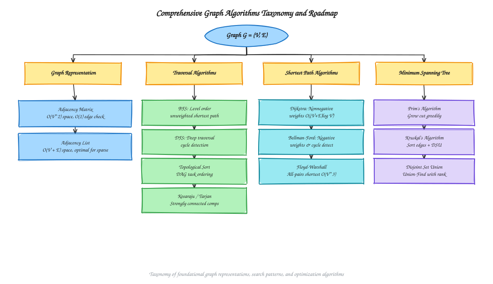

---

## 1. Tree vs Graph

A **tree** is a special type of graph. Every tree is a graph, but every graph is not a tree.

The easiest way to remember this:

- A tree is connected and has no cycle.
- A general graph may be disconnected and may contain cycles.

| Feature | Tree | Graph |
| :--- | :--- | :--- |
| Meaning | A connected acyclic structure | A general node-edge structure |
| Cycle allowed? | No | May or may not have cycles |
| Connected? | Always connected | May be connected or disconnected |
| Number of edges | Exactly $|V|-1$ for $|V|$ vertices | Can be from $0$ up to many edges |
| Path between two vertices | Exactly one simple path | May have zero, one, or many paths |
| Root needed? | Often rooted in applications | Usually no root unless defined |

### Example

For $4$ vertices:

- A tree must have $4-1=3$ edges and no cycle.
- A graph may have $0$, $1$, $2$, $3$, or more edges depending on the category.

### Visual Map: Tree Is a Special Graph

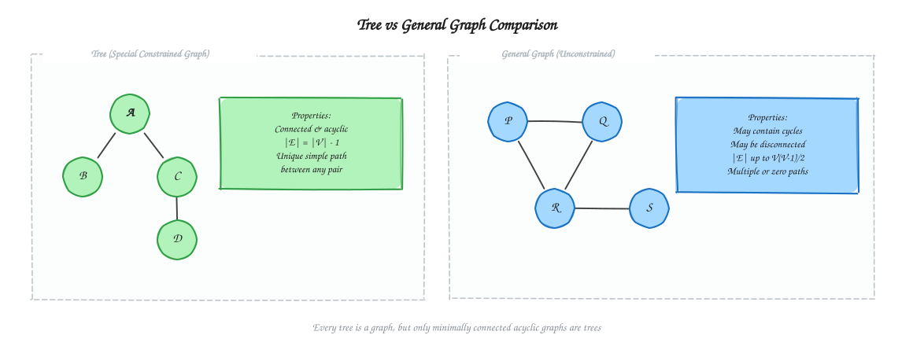

---

## 2. Graph Categories

Graph categories describe what type of edges the graph has and what kind of algorithms are suitable for it.

### Weighted vs Unweighted

An **unweighted graph** treats every edge as having the same cost.

Example: friendship connection.

A **weighted graph** gives a value or cost to each edge.

Example: road distance, flight price, network delay.

| Type | Edge meaning | Example | Common shortest path idea |
| :--- | :--- | :--- | :--- |
| Unweighted graph | Every edge has equal cost | Social network | BFS |
| Weighted graph | Each edge has a weight/cost | Road map | Bellman-Ford for this chapter |

### Directed vs Undirected

An **undirected graph** has edges that work both ways.

If $A-B$ exists, then $A$ can reach $B$ and $B$ can reach $A$ through that edge.

A **directed graph** has edges with direction.

If $A \to B$ exists, then $A$ can go to $B$, but $B$ cannot automatically go to $A$.

| Type | Edge notation | Meaning | Example |
| :--- | :--- | :--- | :--- |
| Undirected | $(A,B)$ | Two-way connection | Roads with two-way movement |
| Directed | $A \to B$ | One-way connection | Course prerequisite, one-way road |

### Cyclic vs Acyclic

A **cycle** is a path that starts and ends at the same vertex without repeating other vertices.

A **cyclic graph** contains at least one cycle.

An **acyclic graph** contains no cycle.

A **DAG** means **Directed Acyclic Graph**. DAGs are very important for topological sorting.

| Type | Cycle present? | Example use |
| :--- | :---: | :--- |
| Cyclic graph | Yes | Routes with loops, mutual dependencies |
| Acyclic graph | No | Trees, dependency chains |
| DAG | No directed cycle | Course prerequisite ordering, task scheduling |

### Visual Map: Main Graph Categories

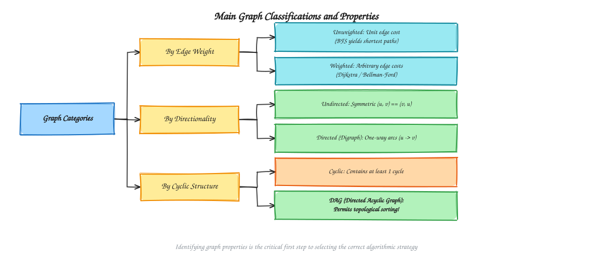

---

## 3. Graph Representation

Before running any graph algorithm, the graph must be stored in memory.

The two most common representations are:

1. Adjacency Matrix
2. Adjacency List

Use this example graph for both representations:

$$
V = \{A,B,C,D\}
$$

$$
E = \{(A,B),(A,C),(B,D),(C,D)\}
$$

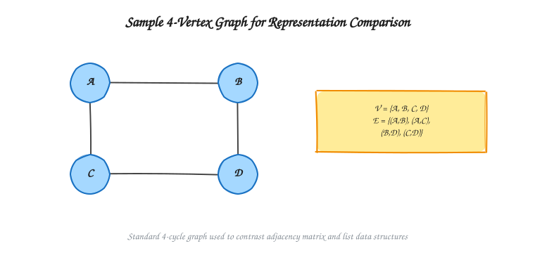

### Adjacency Matrix

For a classroom matrix question, first fix the row/column order and then fill one source vertex per row. For an unweighted graph, put `1` exactly where the corresponding adjacency-list edge exists; for an undirected graph, the matching entry on the other side of the diagonal must be the same.

An **adjacency matrix** uses a $|V| \times |V|$ table.

For an unweighted graph:

- Matrix value is `1` if an edge exists.
- Matrix value is `0` if no edge exists.

For a weighted graph:

- Matrix value stores the edge weight.
- A special value such as $\infty$ may be used when no edge exists.

For the example undirected graph:

| From / To | A | B | C | D |
| :---: | :---: | :---: | :---: | :---: |
| A | 0 | 1 | 1 | 0 |
| B | 1 | 0 | 0 | 1 |
| C | 1 | 0 | 0 | 1 |
| D | 0 | 1 | 1 | 0 |

Because the graph is undirected, the matrix is symmetric.

**Advantages:**

- Easy to check if an edge exists between two vertices.
- Edge lookup is $O(1)$.
- Good for dense graphs.

**Disadvantages:**

- Uses $\Theta(V^2)$ space.
- Wastes space for sparse graphs.
- To list all neighbors of one vertex, a full row must be scanned.

### Adjacency List

An **adjacency list** stores each vertex with the list of its neighbors.

For the same undirected graph:

| Vertex | Neighbor list |
| :---: | :--- |
| A | B, C |
| B | A, D |
| C | A, D |
| D | B, C |

For a weighted graph, each neighbor can be stored with its edge weight.

Example weighted adjacency list:

| Vertex | Neighbors and edge weights |
| :---: | :--- |
| A | B (4), C (2) |
| B | D (5) |
| C | D (1) |
| D | None |

**Advantages:**

- Uses $\Theta(V+E)$ space.
- Efficient for sparse graphs.
- Easy to iterate over neighbors.

**Disadvantages:**

- Checking whether a specific edge exists may take time proportional to the degree of the vertex.
- Slightly less direct than a matrix for edge lookup.

### Representation Comparison

| Operation / Feature | Adjacency Matrix | Adjacency List |
| :--- | :---: | :---: |
| Space | $\Theta(V^2)$ | $\Theta(V+E)$ |
| Check edge $(u,v)$ | $O(1)$ | $O(deg(u))$ |
| Iterate all neighbors of $u$ | $O(V)$ | $O(deg(u))$ |
| Best for | Dense graphs | Sparse graphs |
| Used often with | Simple edge lookup | BFS, DFS, components, topological sort |

### Visual Map: Matrix vs List

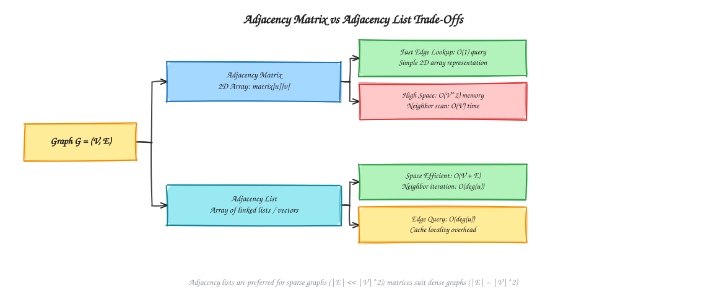

---

## 4. Shortest Path Problem Overview

A **path** is a sequence of vertices connected by edges.

A **shortest path** is a path with minimum total cost from one vertex to another.

The meaning of "minimum cost" depends on the graph:

- In an unweighted graph, cost means the number of edges.
- In a weighted graph, cost means the sum of edge weights.

### Main Shortest Path Types

| Problem type | Question | Algorithm in this chapter |
| :--- | :--- | :--- |
| Single pair shortest path | What is the shortest path from $s$ to $t$? | BFS for unweighted graph |
| Single source shortest path | What are the shortest paths from $s$ to all vertices? | BFS, Dijkstra's Algorithm, or Bellman-Ford |
| All-pairs shortest path | What are the shortest paths between every pair of vertices? | Floyd-Warshall |
| Weighted graph with only nonnegative edges | Which algorithm is fastest? | Dijkstra's Algorithm |
| Weighted graph with negative edges | Can shortest paths still be found? | Bellman-Ford (single source) or Floyd-Warshall (all pairs) |

### Algorithm Selection in This Chapter

| Graph condition | Suitable algorithm here | Reason |
| :--- | :--- | :--- |
| Unweighted graph | BFS | BFS explores by distance layers |
| Weighted graph with only nonnegative edges | Dijkstra's Algorithm | Greedily finalizes the nearest unvisited vertex first |
| Weighted graph with negative edges, single source | Bellman-Ford | Handles negative edges if there is no reachable negative cycle |
| Weighted graph with negative edges, all pairs needed | Floyd-Warshall | Computes every pair's shortest path in one $\Theta(n^3)$ pass |
| Graph with reachable negative cycle | No finite shortest path | Distance can keep decreasing forever |

### Visual Map: Shortest Path Choice

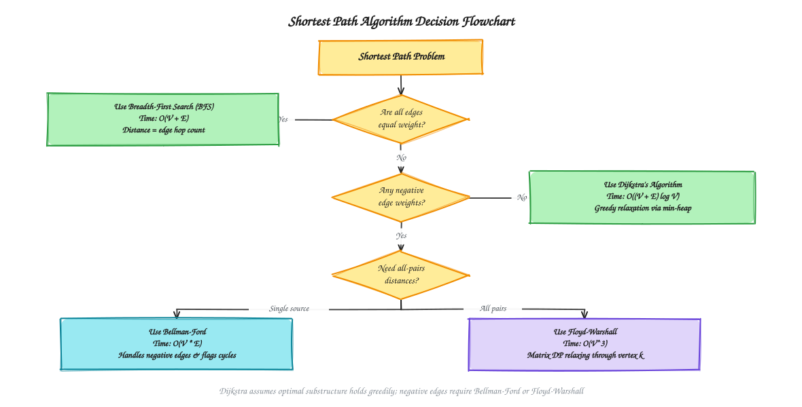

---

## 5. BFS for Unweighted Shortest Path

### Problem Statement

Given an unweighted graph and a source vertex $s$, find the shortest distance from $s$ to every reachable vertex.

Here, distance means the minimum number of edges.

### Inputs and Output

- **Input:** graph $G=(V,E)$ and source vertex $s$.
- **Output:** distance array `dist` and optional parent array `parent` for reconstructing shortest paths.

### Main Idea

BFS uses a queue and explores the graph level by level.

- Level 0: source vertex.
- Level 1: vertices reachable using 1 edge.
- Level 2: vertices reachable using 2 edges.
- Continue until no new vertex remains.

The first time BFS visits a vertex, it has found the shortest unweighted distance to that vertex.

### Worked Example

Find shortest paths from source $S$.

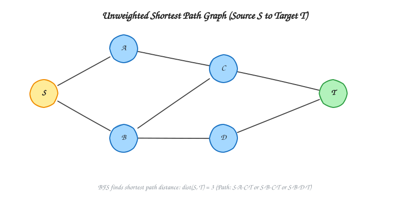

Assume neighbors are processed alphabetically. Mark a vertex when it is enqueued so that it is not added a second time. The table uses the same queue-trace format as the BFS traversal section: the queue is shown after the current vertex is processed, with the front in bold.

| Vertices visited | Vertices in queue (front first) | Vertex traversal done |
| :--- | :--- | :---: |
| S, A, B | **A**, B | S |
| S, A, B, C | **B**, C | A |
| S, A, B, C, D | **C**, D | B |
| S, A, B, C, D, T | **D**, T | C |
| — | **T** | D |
| — | empty | T |

The distance is assigned when a vertex first enters the queue: $dist[A]=dist[B]=1$, $dist[C]=dist[D]=2$, and $dist[T]=3$.

Final distances from $S$:

| Vertex | S | A | B | C | D | T |
| :---: | :---: | :---: | :---: | :---: | :---: | :---: |
| Distance | 0 | 1 | 1 | 2 | 2 | 3 |

One shortest path from $S$ to $T$ is:

$$
S \to A \to C \to T
$$

This path uses $3$ edges, so the shortest distance is $3$.

### Visual Map: BFS Layer Expansion

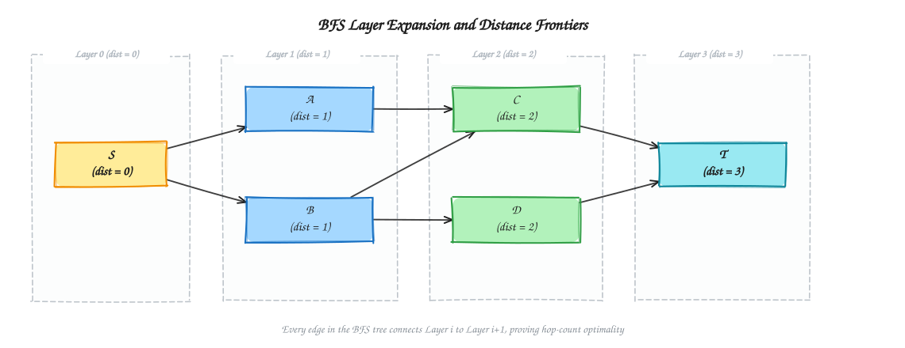

### Algorithm

1. Give every vertex an unknown distance and no predecessor; give the source distance zero.
2. Place the source in a queue.
3. Repeatedly remove the front vertex and inspect each neighbor.
4. The first time a neighbor is found, record its distance as one more than the current vertex's distance, record the current vertex as its predecessor, and add the neighbor to the back of the queue.
5. Continue until the queue is empty. The recorded distances and predecessors describe shortest paths by number of edges.

### Complexity Analysis

| Representation | Time Complexity | Space Complexity | Reason |
| :--- | :---: | :---: | :--- |
| Adjacency list | $\Theta(V+E)$ | $\Theta(V)$ | Every vertex and edge is processed at most a constant number of times |
| Adjacency matrix | $\Theta(V^2)$ | $\Theta(V)$ | For every vertex, a full matrix row may be scanned |

---

## 6. Single Source Shortest Path - Dijkstra's Algorithm

### Problem Statement

Given a weighted graph (directed or undirected) with **nonnegative** edge weights and a source vertex $s$, find the shortest distance from $s$ to every other reachable vertex.

**Dijkstra's Algorithm** is a greedy single-source shortest path algorithm: at every step it finalizes the unvisited vertex with the smallest tentative distance, and that distance is never revisited or improved later.

### Inputs and Output

- **Input:** weighted graph $G=(V,E)$ with edge cost function $c(u,v) \ge 0$, and source vertex $s$.
- **Output:** shortest distance $d(v)$ for every vertex $v$, plus a parent array to reconstruct the shortest paths.

### Greedy Rule

**At every turn, finalize the unvisited vertex with the smallest tentative distance.**

The algorithm is correct because with nonnegative edge weights, no later path can make a finalized vertex cheaper.

### Relaxation Condition

Every time a vertex $u$ is finalized, every edge $(u, v)$ leaving $u$ is **relaxed** using this test:

$$
\text{if } \big(d(u) + c(u,v) < d(v)\big) \implies d(v) = d(u) + c(u,v)
$$

In words: if going through $u$ gives a cheaper way to reach $v$ than the current best known distance $d(v)$, replace $d(v)$ with that cheaper value (and remember $u$ as the new parent of $v$). If the new total is **not** smaller, $d(v)$ is left unchanged.

For example, relaxing the source's own first edge $A \to B$ with weight $14$ when $d(A)=0$ and $d(B)=\infty$ gives:

$$
0 + 14 = 14 \quad < \infty \quad \Rightarrow \quad d(B) = 14
$$

### Important Condition

Dijkstra's Algorithm requires all edge weights to be nonnegative.

If negative edges exist, the greedy choice may be wrong because a vertex finalized early could later receive a cheaper path through a negative edge. Bellman-Ford (next section) removes this restriction.

### Worked Example 1: Undirected Graph

Source vertex: $A$. This example finalizes one vertex per step, always picking the **unvisited vertex with the smallest tentative distance**, then relaxing all of its edges.

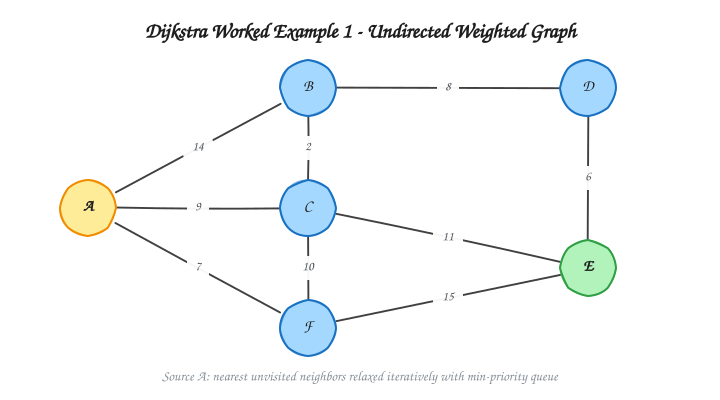

**Step 0 - Initialize.** $d(A) = 0$, every other vertex starts at $\infty$.

**Step 1 - Finalize $A$ (distance 0).** Relax all edges out of $A$:

- $0 + 14 = 14 < \infty \Rightarrow d(B) = 14$
- $0 + 9 = 9 < \infty \Rightarrow d(C) = 9$
- $0 + 7 = 7 < \infty \Rightarrow d(F) = 7$

**Step 2 - Smallest tentative distance is $F = 7$, so finalize $F$.** Relax edges out of $F$ (to $C$ and $E$):

- $7 + 10 = 17$, compare with $d(C) = 9$. Since $17 \not< 9$, $C$ stays $9$.
- $7 + 15 = 22 < \infty \Rightarrow d(E) = 22$

**Step 3 - Smallest remaining is $C = 9$, so finalize $C$.** Relax edges out of $C$ (to $B$ and $E$):

- $9 + 2 = 11 < 14 \Rightarrow d(B) = 11$
- $9 + 11 = 20 < 22 \Rightarrow d(E) = 20$

**Step 4 - Smallest remaining is $B = 11$, so finalize $B$.** Relax edges out of $B$ (to $D$):

- $11 + 8 = 19 < \infty \Rightarrow d(D) = 19$

**Step 5 - Smallest remaining is $D = 19$, so finalize $D$.** Relax edges out of $D$ (to $E$):

- $19 + 6 = 25$, compare with $d(E) = 20$. Since $25 \not< 20$, $E$ stays $20$.

**Step 6 - Only $E = 20$ remains, so finalize $E$.** All vertices are now visited.

Distance table, one row per finalized (visited) vertex, in the exact order they were finalized:

| Visited $\downarrow$ | A | B | C | D | E | F |
| :---: | :---: | :---: | :---: | :---: | :---: | :---: |
| **A** | **0** | $\infty$ | $\infty$ | $\infty$ | $\infty$ | $\infty$ |
| **F** | | 14 | 9 | $\infty$ | $\infty$ | **7** |
| **C** | | 14 | **9** | $\infty$ | 22 | - |
| **B** | | **11** | - | $\infty$ | 20 | |
| **D** | | - | | **19** | 20 | |
| **E** | | | | - | **20** | |

Bold values are the distances finalized (boxed) in that step; a dash `-` marks a vertex already finalized in an earlier step (its column is closed off, matching the vertical line drawn through it on the board).

Final shortest distances from $A$: $A=0$, $F=7$, $C=9$, $B=11$, $D=19$, $E=20$.

Reconstructing paths by walking parent pointers backward from the destination:

- **Path to $E$:** $E$ was last updated by $C$ ($9+11=20$), and $C$ was reached from $A$. Reading backward: $E, C, A$, so forward the path is $A \to C \to E$ with total cost $9 + 11 = 20$.
- **Path to $D$:** $D$ was last updated by $B$ ($11+8=19$), $B$ was updated by $C$ ($9+2=11$), and $C$ was reached from $A$. Reading backward: $D, B, C, A$, so forward the path is $A \to C \to B \to D$ with total cost $9 + 2 + 8 = 19$.

### Worked Example 2: Directed Graph

The same relaxation rule applies to a **directed** graph; a vertex can only relax edges that point *out* of it.

Source vertex: $A$.

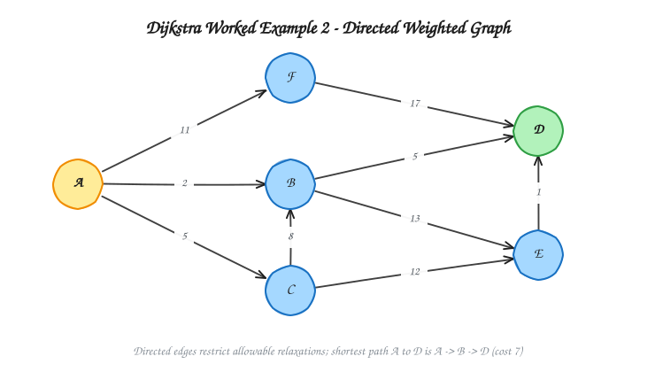

**Step 0 - Initialize.** $d(A) = 0$, every other vertex starts at $\infty$.

**Step 1 - Finalize $A$ (distance 0).** Relax all edges out of $A$:

- $0 + 11 = 11 < \infty \Rightarrow d(F) = 11$
- $0 + 2 = 2 < \infty \Rightarrow d(B) = 2$
- $0 + 5 = 5 < \infty \Rightarrow d(C) = 5$

**Step 2 - Smallest tentative distance is $B = 2$, so finalize $B$.** Relax edges out of $B$ (to $D$, $E$, and $C$):

- $2 + 5 = 7 < \infty \Rightarrow d(D) = 7$
- $2 + 13 = 15 < \infty \Rightarrow d(E) = 15$
- $B$ has no outgoing edge to $C$ in this graph, so $C$ is untouched here.

**Step 3 - Smallest remaining is $C = 5$, so finalize $C$.** Relax edges out of $C$ (to $B$ and $E$):

- $C \to B$: $B$ is already finalized, so this edge is not used again.
- $5 + 12 = 17$, compare with $d(E) = 15$. Since $17 \not< 15$, $E$ stays $15$.

**Step 4 - Smallest remaining is $D = 7$, so finalize $D$.** $D$ has no outgoing edges in this graph, so nothing is relaxed.

**Step 5 - Smallest remaining is $F = 11$, so finalize $F$.** Relax edges out of $F$ (to $D$):

- $11 + 17 = 28$, compare with $d(D) = 7$. Since $28 \not< 7$, $D$ stays $7$ (it is also already finalized).

**Step 6 - Only $E = 15$ remains, so finalize $E$.** Relax edges out of $E$ (to $D$):

- $15 + 1 = 16$, compare with $d(D) = 7$. Since $16 \not< 7$, $D$ stays $7$.

Distance table, one row per finalized (visited) vertex, in the exact order they were finalized:

| Visited $\downarrow$ | A | B | C | D | E | F |
| :---: | :---: | :---: | :---: | :---: | :---: | :---: |
| **A** | **0** | $\infty$ | $\infty$ | $\infty$ | $\infty$ | $\infty$ |
| **B** | | **2** | 5 | $\infty$ | $\infty$ | 11 |
| **C** | | - | **5** | 7 | 15 | 11 |
| **D** | | | - | **7** | 15 | 11 |
| **F** | | | | - | 15 | **11** |
| **E** | | | | | **15** | - |

Bold values are the distances finalized (boxed) in that step; a dash `-` marks a vertex already finalized in an earlier step.

Final shortest distances from $A$: $A=0$, $B=2$, $C=5$, $D=7$, $F=11$, $E=15$.

Reconstructing the path to $E$: $E$ was last updated by $B$ ($2+13=15$), and $B$ was reached directly from $A$. Reading backward: $E, B, A$, so forward the path is $A \to B \to E$ with total cost $2 + 13 = 15$.

### Visual Map: Dijkstra's Greedy Finalization

The diagram below visualizes the finalization order from **Worked Example 1**: $A \to F \to C \to B \to D \to E$.

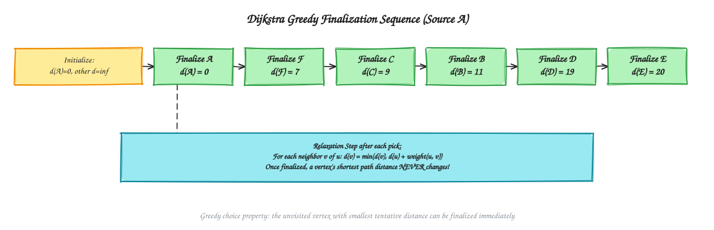

### Algorithm

1. Start every vertex at infinite distance with no predecessor; set the source distance to zero.
2. Keep the vertices ordered by their current tentative distances.
3. Repeatedly choose and finalize the unvisited vertex with the smallest tentative distance.
4. Inspect each outgoing edge from that vertex. If travelling across the edge gives a neighbor a shorter distance, replace that neighbor's distance and predecessor.
5. Continue until every reachable vertex is finalized. The distance and predecessor records give the shortest paths.

### Complexity Analysis

- Using adjacency matrix: $\Theta(V^2)$
- Using adjacency list and binary heap: $\Theta((V+E)\log V)$
- Space Complexity: $\Theta(V+E)$

---

## 7. Single Source Shortest Path - Bellman-Ford Algorithm

### Problem Statement

Given a weighted directed graph and a source vertex $s$, find the shortest distance from $s$ to every other vertex.

Bellman-Ford can handle negative edge weights, but it cannot produce finite shortest paths if a reachable negative cycle exists.

### Inputs and Output

- **Input:** weighted graph $G=(V,E)$, edge weight function $w(u,v)$, and source vertex $s$.
- **Output:** shortest distance array `dist`, parent array `parent`, and negative-cycle information.

### Main Idea: Edge Relaxation

To **relax** an edge $(u,v)$ means checking whether going through $u$ gives a shorter path to $v$.

If:

$$
dist[u] + w(u,v) < dist[v]
$$

Then update:

$$
dist[v] = dist[u] + w(u,v)
$$

Bellman-Ford relaxes every edge $|V|-1$ times.

Why $|V|-1$ times?

- A shortest simple path can contain at most $|V|-1$ edges.
- Each round allows shortest path information to move at least one edge farther.

After those rounds, one more relaxation pass is used to detect a negative cycle.

### Worked Example: Six-Vertex Graph (Selected-Vertex Relaxation Table)

This walkthrough traces Bellman-Ford the way it is often done by hand: edges are grouped by their source vertex, and vertices are relaxed in a fixed order — $A, B, C, D, E, F$ — instead of scanning a flat edge list. This still relaxes every edge exactly once per round; only the bookkeeping changes. One table is built per round. Inside a table, each row is labeled by the vertex whose *outgoing* edges are relaxed next, and the row shows the distance array at that moment (immediately before that vertex's out-edges are relaxed). The **bold** cell marks the selected vertex about to be processed.

Graph and source vertex $A$:

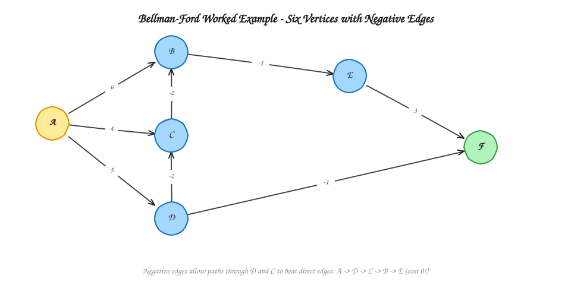

With $|V| = 6$, Bellman-Ford needs $|V|-1 = 5$ relaxation rounds.

**Round 1** — start from $dist[A]=0$, all other vertices at $\infty$:

| Selected vertex | A | B | C | D | E | F |
| :---: | :---: | :---: | :---: | :---: | :---: | :---: |
| A | **0** | $\infty$ | $\infty$ | $\infty$ | $\infty$ | $\infty$ |
| B | 0 | **6** | 4 | 5 | $\infty$ | $\infty$ |
| C | 0 | 6 | **4** | 5 | 5 | $\infty$ |
| D | 0 | 2 | 4 | **5** | 5 | $\infty$ |
| E | 0 | 2 | 3 | 5 | **5** | 4 |
| F | 0 | 2 | 3 | 5 | 5 | **4** |

- Row B: relax $A \to B$ ($0+6=6$), $A \to C$ ($0+4=4$), $A \to D$ ($0+5=5$).
- Row C: relax $B \to E$ ($6-1=5$).
- Row D: relax $C \to B$ ($4-2=2$, improves $B$ from 6 to 2).
- Row E: relax $D \to C$ ($5-2=3$, improves $C$) and $D \to F$ ($5-1=4$).
- Row F: relax $E \to F$ ($5+3=8$), which does **not** improve $F=4$.

**Round 2** — carried over from $[0,2,3,5,5,4]$:

| Selected vertex | A | B | C | D | E | F |
| :---: | :---: | :---: | :---: | :---: | :---: | :---: |
| A | **0** | 2 | 3 | 5 | 5 | 4 |
| B | 0 | **2** | 3 | 5 | 5 | 4 |
| C | 0 | 2 | **3** | 5 | 1 | 4 |
| D | 0 | 1 | 3 | **5** | 1 | 4 |
| E | 0 | 1 | 3 | 5 | **1** | 4 |
| F | 0 | 1 | 3 | 5 | 1 | **4** |

$B \to E$ improves $E$ to 1 ($2-1$), then $C \to B$ improves $B$ to 1 ($3-2$).

**Round 3** — carried over from $[0,1,3,5,1,4]$:

| Selected vertex | A | B | C | D | E | F |
| :---: | :---: | :---: | :---: | :---: | :---: | :---: |
| A | **0** | 1 | 3 | 5 | 1 | 4 |
| B | 0 | **1** | 3 | 5 | 1 | 4 |
| C | 0 | 1 | **3** | 5 | 0 | 4 |
| D | 0 | 1 | 3 | **5** | 0 | 4 |
| E | 0 | 1 | 3 | 5 | **0** | 4 |
| F | 0 | 1 | 3 | 5 | 0 | **3** |

$B \to E$ improves $E$ to 0 ($1-1$); later $E \to F$ improves $F$ to 3 ($0+3$).

**Round 4** — carried over from $[0,1,3,5,0,3]$:

| Selected vertex | A | B | C | D | E | F |
| :---: | :---: | :---: | :---: | :---: | :---: | :---: |
| A | **0** | 1 | 3 | 5 | 0 | 3 |
| B | 0 | **1** | 3 | 5 | 0 | 3 |
| C | 0 | 1 | **3** | 5 | 0 | 3 |
| D | 0 | 1 | 3 | **5** | 0 | 3 |
| E | 0 | 1 | 3 | 5 | **0** | 3 |
| F | 0 | 1 | 3 | 5 | 0 | **3** |

Nothing changed in Round 4, so the values have already converged. Round 5 (still required by the $|V|-1$ bound) and the negative-cycle check pass both leave the table unchanged, confirming there is no reachable negative cycle.

Final shortest distances from $A$:

| Vertex | A | B | C | D | E | F |
| :---: | :---: | :---: | :---: | :---: | :---: | :---: |
| Distance | 0 | 1 | 3 | 5 | 0 | 3 |

---

### Drawback: A Negative Cycle Prevents Convergence

The extra check pass in Bellman-Ford exists because a **reachable negative cycle** stops the distances from ever settling. Every trip around the cycle keeps lowering the distance, so no finite shortest path exists. This example uses the same selected-vertex table to see it happen directly.

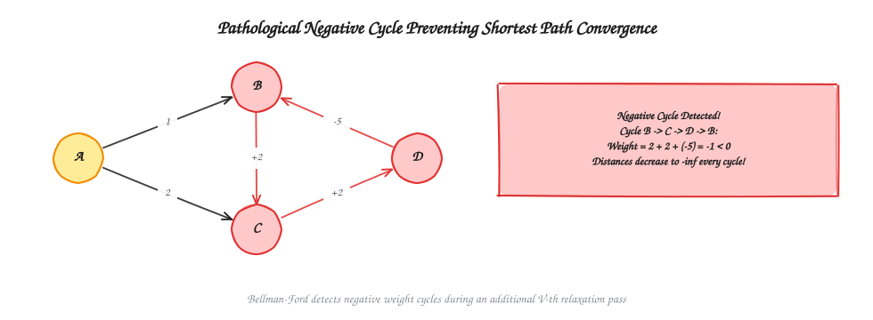

The cycle $B \to C \to D \to B$ has total weight $2 + 2 + (-5) = -1$. With $|V|=4$, only $|V|-1 = 3$ rounds are theoretically required — watch what the 4th round (the check pass) still does.

**Round 1** — start from $dist[A]=0$, all others $\infty$. A row is added for the wraparound edge $D \to B$, since it belongs to the same relaxation order and closes the cycle:

| Selected vertex | A | B | C | D |
| :---: | :---: | :---: | :---: | :---: |
| A | **0** | $\infty$ | $\infty$ | $\infty$ |
| B | 0 | **1** | 2 | $\infty$ |
| C | 0 | 1 | **2** | $\infty$ |
| D | 0 | 1 | 2 | **4** |
| D → B (wrap) | 0 | **-1** | 2 | 4 |

**Round 2:**

| Selected vertex | A | B | C | D |
| :---: | :---: | :---: | :---: | :---: |
| A | **0** | -1 | 2 | 4 |
| B | 0 | **-1** | 2 | 4 |
| C | 0 | -1 | **1** | 4 |
| D | 0 | -1 | 1 | **3** |
| D → B (wrap) | 0 | **-2** | 1 | 3 |

**Round 3** (the last round the $|V|-1$ bound calls for):

| Selected vertex | A | B | C | D |
| :---: | :---: | :---: | :---: | :---: |
| A | **0** | -2 | 1 | 3 |
| B | 0 | **-2** | 1 | 3 |
| C | 0 | -2 | **0** | 3 |
| D | 0 | -2 | 0 | **2** |
| D → B (wrap) | 0 | **-3** | 0 | 2 |

**Round 4** (this plays the role of the negative-cycle check pass):

| Selected vertex | A | B | C | D |
| :---: | :---: | :---: | :---: | :---: |
| A | **0** | -3 | 0 | 2 |
| B | 0 | **-3** | 0 | 2 |
| C | 0 | -3 | **-1** | 2 |
| D | 0 | -3 | -1 | **1** |
| D → B (wrap) | 0 | **-4** | -1 | 1 |

$dist(B)$ keeps falling by exactly 1 every round ($1 \to -1 \to -2 \to -3 \to -4 \to \dots$), matching the cycle weight of $-1$. Because an edge relaxation still succeeds after the required $|V|-1=3$ rounds, Bellman-Ford's final check pass reports **a negative cycle is reachable from the source** instead of returning finite distances.

### Visual Map: Bellman-Ford Relaxation Flow

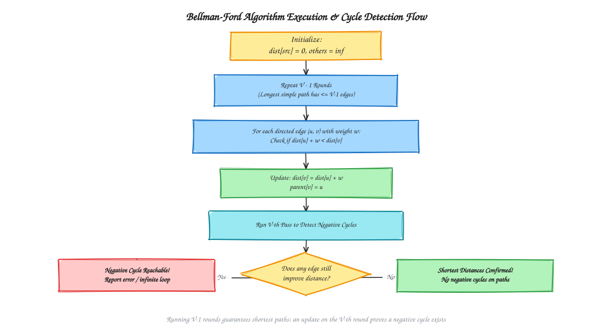

### Algorithm

1. Give each vertex infinite distance and no predecessor; set the source distance to zero.
2. Make $|V|-1$ complete passes over the edges. Whenever an edge can improve the distance to its destination, record the shorter distance and its predecessor.
3. Make one extra pass over the edges. If a reachable edge can still improve a distance, a negative-weight cycle is reachable from the source.
4. If the extra pass finds no such edge, report the final distances and predecessors.

### Complexity Analysis

| Part | Complexity |
| :--- | :---: |
| Initialization | $\Theta(V)$ |
| Relaxation rounds | $\Theta(VE)$ |
| Negative cycle check | $\Theta(E)$ |
| Total time | $\Theta(VE)$ |
| Space | $\Theta(V)$ |

---

## 8. Shortest Path (All Pairs) - Floyd-Warshall Algorithm

### Problem Statement

Given a weighted directed graph, find the shortest path distance between **every pair** of vertices. Bellman-Ford (Section 7) answers this from a single source; Floyd-Warshall answers it for all sources at once.

Floyd-Warshall allows each vertex to become an intermediate point one by one and updates the distance matrix accordingly.

### Working with Negative Edge Weights

Floyd-Warshall works correctly with a mix of negative and positive edge weights, **provided the graph has no negative-weight cycle** — the same restriction Bellman-Ford has (see [Section 7](#7-single-source-shortest-path---bellman-ford-algorithm)).

**Detecting a negative cycle after the fact:** once the final matrix $D^{(n)}$ is computed, check its diagonal. Normally $D[i,i] = 0$ for every vertex $i$ (the shortest path from a vertex to itself). If any $D[i,i] < 0$, vertex $i$ lies on a negative cycle, and the computed distances can no longer be trusted as shortest paths.

### Inputs and Output

- **Input:** adjacency weight matrix $W$ of size $n \times n$.
- **Output:** matrix $D$ where $D[i,j]$ is the shortest distance from vertex $i$ to vertex $j$.

### Subproblem Decomposition

Let $D^{(k)}[i,j]$ be the shortest distance from $i$ to $j$ using only vertices $1$ through $k$ as intermediate vertices.

When vertex $k$ is allowed:

- Do not use $k$: distance remains $D^{(k-1)}[i,j]$.
- Use $k$: distance becomes $D^{(k-1)}[i,k] + D^{(k-1)}[k,j]$.

$$
D^{(k)}[i,j] = \min(D^{(k-1)}[i,j],\ D^{(k-1)}[i,k] + D^{(k-1)}[k,j])
$$

### Tabulation Walkthrough

For a 3-vertex graph:

- Edge $1 \to 2$ has weight 3.
- Edge $2 \to 3$ has weight 1.
- Edge $1 \to 3$ has weight 6.

Initial matrix:

$$
D^{(0)} =
\begin{pmatrix}
0 & 3 & 6 \\
\infty & 0 & 1 \\
\infty & \infty & 0
\end{pmatrix}
$$

Allow vertex 1 as intermediate:

$$
D^{(1)} = D^{(0)}
$$

Allow vertex 2 as intermediate:

$$
D[1,3] = \min(6, D[1,2] + D[2,3]) = \min(6,3+1)=4
$$

Updated matrix:

$$
D^{(2)} =
\begin{pmatrix}
0 & 3 & 4 \\
\infty & 0 & 1 \\
\infty & \infty & 0
\end{pmatrix}
$$

Arrow-guided update for intermediate vertex $k=2$:

| Cell | Keep direct path | Try detour through $2$ | Chosen arrow | Stored value |
| :---: | :---: | :---: | :---: | :---: |
| $D[1,2]$ | 3 | $D[1,2]+D[2,2]=3+0=3$ | $\uparrow$ keep | 3 |
| $D[1,3]$ | 6 | $D[1,2]+D[2,3]=3+1=4$ | $1 \rightarrow 2 \rightarrow 3$ | **4** |
| $D[2,3]$ | 1 | $D[2,2]+D[2,3]=0+1=1$ | $\uparrow$ keep | 1 |

The shortest path from 1 to 3 is updated from **6** to **4** through vertex 2.

### Visual Map: Floyd-Warshall Detour Update

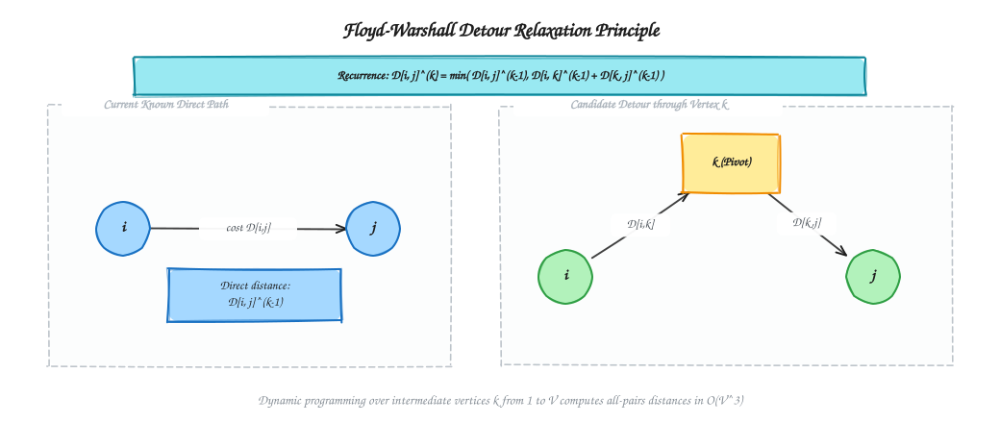

### Algorithm

1. Begin with the matrix of direct edge weights, using infinity where no direct edge exists.
2. Consider each vertex in turn as a possible intermediate stop.
3. For every pair of vertices, compare the current distance with the distance of travelling through that intermediate vertex; keep the smaller value.
4. After every vertex has been considered, the matrix contains the shortest distances between all pairs.

### Complexity Analysis

- Time Complexity: $\Theta(n^3)$
- Space Complexity: $\Theta(n^2)$

### Classroom Problem: Four-Vertex Graph with Negative Edges

**Problem.** Find all-pairs shortest paths for the following 4-vertex directed graph, which mixes positive and negative edge weights but contains **no negative cycle**:

| Edge | Weight |
| :---: | :---: |
| $1 \to 2$ | 1 |
| $1 \to 3$ | -2 |
| $2 \to 1$ | 4 |
| $2 \to 3$ | 3 |
| $3 \to 4$ | 2 |
| $4 \to 1$ | 5 |

All other pairs have no direct edge ($\infty$).

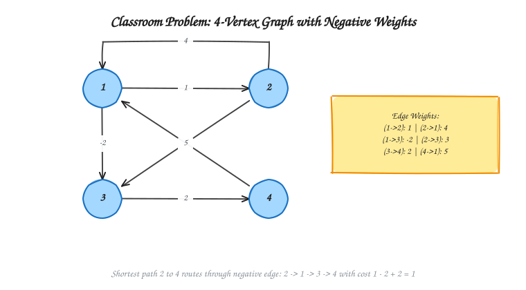

#### Initial Matrix $D^{(0)}$

$$
D^{(0)} =
\begin{pmatrix}
0 & 1 & -2 & \infty \\
4 & 0 & 3 & \infty \\
\infty & \infty & 0 & 2 \\
5 & \infty & \infty & 0
\end{pmatrix}
$$

#### $D^{(1)}$: Allow Vertex 1 as Intermediate

Row 1 and column 1 never change at $k=1$, since a path cannot get shorter by detouring through its own endpoint. Every other cell is checked against a detour through vertex 1:

$$
D[2,3] = \min(3,\ D[2,1]+D[1,3]) = \min(3,\ 4+(-2)) = \min(3,\ 2) = 2
$$

$$
D[2,4] = \min(\infty,\ D[2,1]+D[1,4]) = \min(\infty,\ 4+\infty) = \infty
$$

$$
D[3,2] = \min(\infty,\ D[3,1]+D[1,2]) = \min(\infty,\ \infty+1) = \infty
$$

$$
D[3,4] = \min(2,\ D[3,1]+D[1,4]) = \min(2,\ \infty) = 2
$$

$$
D[4,2] = \min(\infty,\ D[4,1]+D[1,2]) = \min(\infty,\ 5+1) = 6
$$

$$
D[4,3] = \min(\infty,\ D[4,1]+D[1,3]) = \min(\infty,\ 5+(-2)) = 3
$$

The negative edge already pays off here: the direct edge $2 \to 3$ costs 3, but detouring $2 \to 1 \to 3$ costs $4+(-2)=2$, so $D[2,3]$ drops to **2**.

$$
D^{(1)} =
\begin{pmatrix}
0 & 1 & -2 & \infty \\
4 & 0 & 2 & \infty \\
\infty & \infty & 0 & 2 \\
5 & 6 & 3 & 0
\end{pmatrix}
$$

#### $D^{(2)}$: Allow Vertices 1 and 2 as Intermediate

Row 2 and column 2 stay fixed at $k=2$. Checking the remaining cells against a detour through vertex 2:

$$
D[1,3] = \min(-2,\ D[1,2]+D[2,3]) = \min(-2,\ 1+2) = -2
$$

$$
D[1,4] = \min(\infty,\ D[1,2]+D[2,4]) = \min(\infty,\ 1+\infty) = \infty
$$

$$
D[3,1] = \min(\infty,\ D[3,2]+D[2,1]) = \min(\infty,\ \infty+4) = \infty
$$

$$
D[3,4] = \min(2,\ D[3,2]+D[2,4]) = \min(2,\ \infty) = 2
$$

$$
D[4,1] = \min(5,\ D[4,2]+D[2,1]) = \min(5,\ 6+4) = 5
$$

$$
D[4,3] = \min(3,\ D[4,2]+D[2,3]) = \min(3,\ 6+2) = 3
$$

No cell improves, so:

$$
D^{(2)} = D^{(1)} =
\begin{pmatrix}
0 & 1 & -2 & \infty \\
4 & 0 & 2 & \infty \\
\infty & \infty & 0 & 2 \\
5 & 6 & 3 & 0
\end{pmatrix}
$$

#### $D^{(3)}$: Allow Vertices 1, 2, and 3 as Intermediate

Row 3 and column 3 stay fixed at $k=3$. Checking the remaining cells against a detour through vertex 3:

$$
D[1,2] = \min(1,\ D[1,3]+D[3,2]) = \min(1,\ -2+\infty) = 1
$$

$$
D[1,4] = \min(\infty,\ D[1,3]+D[3,4]) = \min(\infty,\ -2+2) = 0
$$

$$
D[2,1] = \min(4,\ D[2,3]+D[3,1]) = \min(4,\ 2+\infty) = 4
$$

$$
D[2,4] = \min(\infty,\ D[2,3]+D[3,4]) = \min(\infty,\ 2+2) = 4
$$

$$
D[4,1] = \min(5,\ D[4,3]+D[3,1]) = \min(5,\ 3+\infty) = 5
$$

$$
D[4,2] = \min(6,\ D[4,3]+D[3,2]) = \min(6,\ 3+\infty) = 6
$$

Two cells improve here: $D[1,4]$ drops from $\infty$ to **0** via $1 \to 3 \to 4$ (cost $-2+2$), and $D[2,4]$ drops from $\infty$ to **4** via $2 \to 3 \to 4$.

$$
D^{(3)} =
\begin{pmatrix}
0 & 1 & -2 & 0 \\
4 & 0 & 2 & 4 \\
\infty & \infty & 0 & 2 \\
5 & 6 & 3 & 0
\end{pmatrix}
$$

#### $D^{(4)}$: Allow All Vertices as Intermediate (Final Matrix)

Row 4 and column 4 stay fixed at $k=4$. Checking the remaining cells against a detour through vertex 4:

$$
D[1,2] = \min(1,\ D[1,4]+D[4,2]) = \min(1,\ 0+6) = 1
$$

$$
D[1,3] = \min(-2,\ D[1,4]+D[4,3]) = \min(-2,\ 0+3) = -2
$$

$$
D[2,1] = \min(4,\ D[2,4]+D[4,1]) = \min(4,\ 4+5) = 4
$$

$$
D[2,3] = \min(2,\ D[2,4]+D[4,3]) = \min(2,\ 4+3) = 2
$$

$$
D[3,1] = \min(\infty,\ D[3,4]+D[4,1]) = \min(\infty,\ 2+5) = 7
$$

$$
D[3,2] = \min(\infty,\ D[3,4]+D[4,2]) = \min(\infty,\ 2+6) = 8
$$

Vertex 3 finally reaches vertices 1 and 2 by routing through vertex 4: $3 \to 4 \to 1$ costs $2+5=7$, and $3 \to 4 \to 2$ costs $2+6=8$.

$$
D^{(4)} =
\begin{pmatrix}
0 & 1 & -2 & 0 \\
4 & 0 & 2 & 4 \\
7 & 8 & 0 & 2 \\
5 & 6 & 3 & 0
\end{pmatrix}
$$

**Negative-cycle check:** every diagonal entry of $D^{(4)}$ is still $0$, confirming there is no negative cycle in this graph and all shortest distances above are valid.

---

## 9. Topological Sorting

Topological sorting is used when some tasks must happen before other tasks.

### Definition

A **topological ordering** of a directed graph is a linear ordering of vertices such that, for every directed edge:

$$
u \to v
$$

vertex $u$ appears **before** vertex $v$ in the ordering. In dependency language, $u$ must be completed before $v$ can begin.

Topological sorting is possible only for a DAG. The order need not be unique: whenever two vertices have no dependency path forcing one before the other, either may appear first.

### DAG

A **DAG** is a **Directed Acyclic Graph**.

- Directed: edges have direction.
- Acyclic: no directed cycle exists.

If a directed graph has a cycle, topological sorting is impossible because the cycle creates circular dependency.

Example of impossible dependency:

$$
A \to B, \quad B \to C, \quad C \to A
$$

This says $A$ before $B$, $B$ before $C$, and $C$ before $A$, which cannot all be true.

For the DFS method, a DAG has one especially useful property: when DFS finishes a vertex $u$, every vertex reachable from $u$ has already finished. Therefore, putting $u$ **after** its neighbours in a finish stack and then reading that stack backwards puts $u$ before every dependent vertex in the final order.

### Worked Example

Suppose tasks have these dependencies:

| Edge | Meaning |
| :---: | :--- |
| A -> C | A must be completed before C |
| B -> C | B must be completed before C |
| C -> D | C must be completed before D |
| C -> E | C must be completed before E |
| D -> F | D must be completed before F |
| E -> F | E must be completed before F |

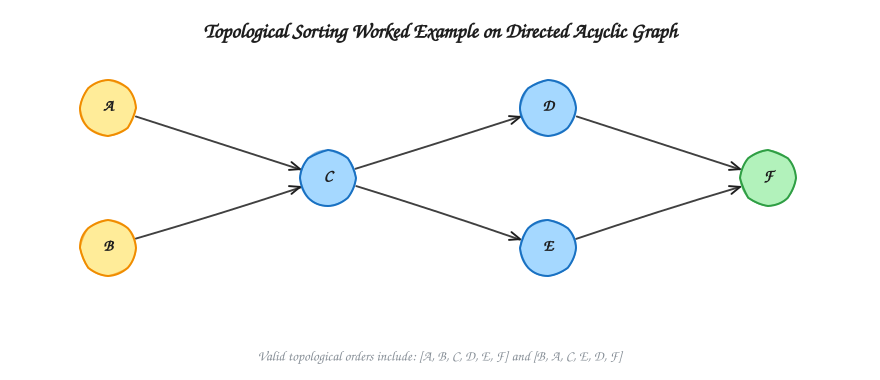

One valid topological order is:

$$
A, B, C, D, E, F
$$

Another valid order is:

$$
B, A, C, E, D, F
$$

Topological order is not always unique.

### DFS-Based Topological Sort

DFS-based topological sort follows the recursive, **postorder** process demonstrated in the provided video, [*Topological Sorting with examples | Topological Sorting using DFS*](https://youtu.be/3tkcfvCNtM8?si=iY2xpQd3mwXs-3xs):

1. Start DFS from an unvisited vertex.
2. Visit each unvisited outgoing neighbour recursively.
3. Do **not** output the current vertex when it is first visited.
4. Push the current vertex onto a stack only when all of its outgoing neighbours have been completely processed.
5. Repeat from every still-unvisited vertex; this matters when the DAG is disconnected.
6. Pop the stack to obtain the topological order.

The stack records **finish order**. Because a prerequisite finishes after the DFS exploration of its dependents, it is pushed later and is popped earlier. Thus, popping the stack reverses finish order into a prerequisite-before-dependent order.

#### DFS Walkthrough

Use the same graph, scan start vertices alphabetically ($A,B,C,D,E,F$), and scan each adjacency list alphabetically:

| Vertex | Outgoing neighbours |
| :---: | :--- |
| A | C |
| B | C |
| C | D, E |
| D | F |
| E | F |
| F | — |

The left-to-right stack below is the **push/finish order**; its rightmost item is the next item popped.

| Step | DFS call / return action | Why it happens | Finish stack |
| :---: | :--- | :--- | :--- |
| 1 | `DFS(A) → DFS(C) → DFS(D) → DFS(F)` | Follow the first unvisited outgoing neighbour at each vertex. | empty |
| 2 | Finish `F`; push `F` | $F$ has no outgoing neighbour. | F |
| 3 | Return to and finish `D`; push `D` | $D$'s only neighbour, $F$, is complete. | F, D |
| 4 | Return to `C`; call `DFS(E)` | $C$ still has unvisited neighbour $E$. | F, D |
| 5 | Finish `E`; push `E` | $E \to F$, but $F$ is already visited and finished. | F, D, E |
| 6 | Finish `C`; push `C` | Both $D$ and $E$ are complete. | F, D, E, C |
| 7 | Finish `A`; push `A` | $A$'s only neighbour, $C$, is complete. | F, D, E, C, A |
| 8 | Start and finish `DFS(B)`; push `B` | $B \to C$, and $C$ is already visited. | F, D, E, C, A, B |

Now pop from the right of the stack:

$$
B, A, C, E, D, F
$$

Every edge points left-to-right in this result: $A$ and $B$ occur before $C$; $C$ occurs before $D$ and $E$; and both $D$ and $E$ occur before $F$. Since $D$ and $E$ are independent after $C$, exchanging them gives another valid order, such as $B,A,C,D,E,F$.

### Visual Map: DFS Finish-Time Idea

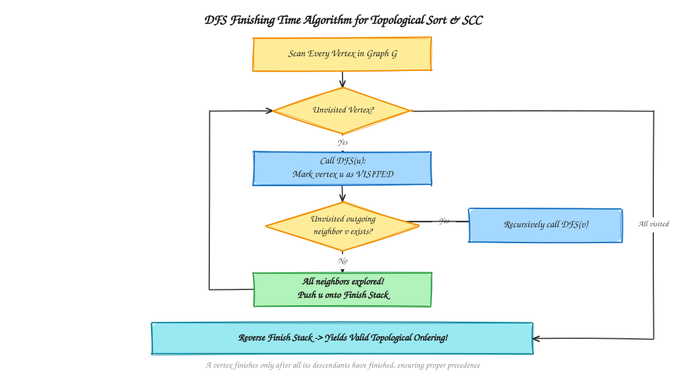

#### Algorithm

1. Start with every vertex unvisited and an empty stack.
2. Visit each still-unvisited vertex using depth-first search.
3. During a search, first finish all of a vertex's unvisited neighbors; only then place that vertex on the stack.
4. When all searches finish, read the stack from top to bottom. This reverse finishing order is a topological ordering.

### Kahn's Algorithm - Optional/Self-Study

Kahn's Algorithm solves topological sorting using indegree.

The **indegree** of a vertex is the number of incoming edges.

Main idea:

1. Compute indegree of every vertex.
2. Put all vertices with indegree $0$ into a queue.
3. Repeatedly remove a vertex from the queue and append it to the answer.
4. For each outgoing neighbor, decrease its indegree.
5. If a neighbor's indegree becomes $0$, put it into the queue.
6. If all vertices are output, a topological order exists.
7. If some vertices remain, the graph has a cycle.


### Visual Map: Kahn's Algorithm Execution Sequence

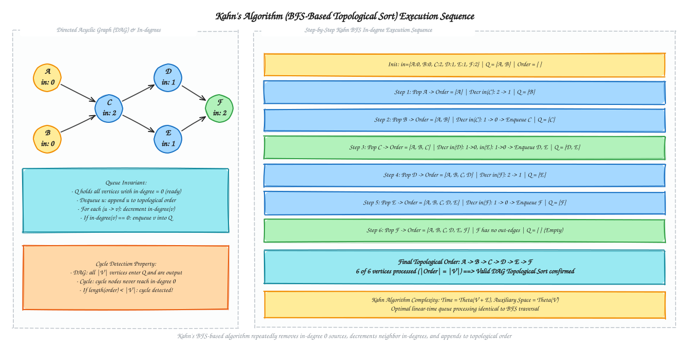

#### Step-by-Step Kahn BFS Execution Trace

Tracing Kahn's BFS algorithm on the classroom 6-vertex DAG ($V = \{A, B, C, D, E, F\}$):

| Step | Action | In-degree updates | Queue $Q$ | Output order |
| :---: | :--- | :--- | :--- | :--- |
| **0 (Init)** | Compute in-degrees: $A:0, B:0, C:2, D:1, E:1, F:2$ | Enqueue all 0-in-degree sources ($A, B$) | `[A, B]` | `[ ]` |
| **1** | Dequeue $A$, append to order | Decrement $C$: $2 \to 1$ | `[B]` | `[A]` |
| **2** | Dequeue $B$, append to order | Decrement $C$: $1 \to 0$ $\implies$ Enqueue $C$ | `[C]` | `[A, B]` |
| **3** | Dequeue $C$, append to order | Decrement $D$: $1 \to 0$, $E$: $1 \to 0$ $\implies$ Enqueue $D, E$ | `[D, E]` | `[A, B, C]` |
| **4** | Dequeue $D$, append to order | Decrement $F$: $2 \to 1$ | `[E]` | `[A, B, C, D]` |
| **5** | Dequeue $E$, append to order | Decrement $F$: $1 \to 0$ $\implies$ Enqueue $F$ | `[F]` | `[A, B, C, D, E]` |
| **6** | Dequeue $F$, append to order | $F$ has no outgoing edges | `[ ]` (empty) | `[A, B, C, D, E, F]` |

Because $\text{length}(order) = 6 = |V|$, the algorithm verifies that graph $G$ is acyclic and outputs valid topological order:

$$
A, B, C, D, E, F
$$

#### Plain-language procedure

The seven steps above give the complete procedure: repeatedly output a zero-indegree vertex and remove its outgoing edges from the remaining graph. If every vertex is output, the result is a topological order; if some vertices remain, the graph contains a cycle.


### Time Complexity

| Algorithm | Time Complexity | Space Complexity | Notes |
| :--- | :---: | :---: | :--- |
| DFS-based topological sort | $\Theta(V+E)$ | $\Theta(V)$ | Uses visited array and stack |
| Kahn's Algorithm | $\Theta(V+E)$ | $\Theta(V)$ | Uses indegree array and queue |

### Applications

Topological sorting is useful when order matters because of dependencies.

| Application | Meaning |
| :--- | :--- |
| Task scheduling | A task can start only after its prerequisite tasks are completed |
| Course prerequisite ordering | A course can be taken only after required previous courses |
| Dependency resolution | A package or module must be installed after its dependencies |

---

## 10. Connected Components

Connected components are used for undirected graphs.

### Connected Graph Definition

An undirected graph is **connected** if every vertex can reach every other vertex.

If at least one pair of vertices cannot reach each other, the graph is disconnected.

### Connected Components in Undirected Graph

A **connected component** is a maximal group of vertices where every vertex can reach every other vertex in that group.

"Maximal" means the group cannot be expanded by adding another reachable vertex.

### Worked Example

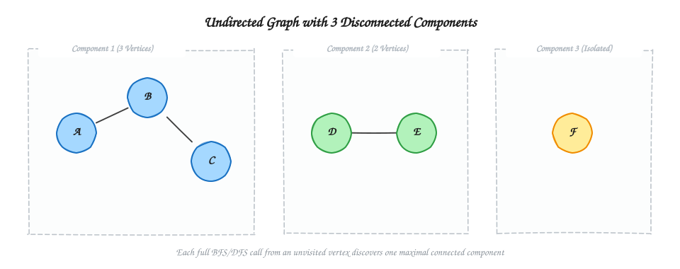

This graph has 3 connected components:

| Component number | Vertices |
| :---: | :--- |
| 1 | A, B, C |
| 2 | D, E |
| 3 | F |

Vertex $F$ is isolated, so it forms a component by itself.

### Finding Connected Components Using DFS/BFS

Main idea:

1. Mark every vertex as unvisited.
2. Start DFS or BFS from an unvisited vertex.
3. All vertices reached in that search belong to the same component.
4. Repeat from the next unvisited vertex.
5. Stop when every vertex has been visited.

### Walkthrough Table

Scan the vertices in order. Each time an unvisited vertex is encountered, run one complete BFS or DFS before returning to the scan; the vertices reached in that one run are exactly one component.

| Step | Start vertex | Search reaches | New component found |
| :---: | :---: | :--- | :--- |
| 1 | A | A, B, C | Component 1 |
| 2 | D | D, E | Component 2 |
| 3 | F | F | Component 3 |

### Algorithm Using DFS

1. Mark every vertex unvisited and prepare a component label.
2. Scan the vertices. Whenever an unvisited vertex is found, give it a new label and run a full depth-first search from it.
3. Give the same label to every vertex reached in that search.
4. Each completed search identifies one connected component.

### Algorithm Using BFS

1. Mark every vertex unvisited.
2. Scan the vertices. When an unvisited vertex is found, give it a new component label and put it in a queue.
3. Repeatedly remove a vertex from the queue, label it, and add each unvisited neighbor to the queue after marking that neighbor visited.
4. When the queue empties, that component is complete. Continue scanning for another unvisited vertex.

### Visual Map: Component Discovery

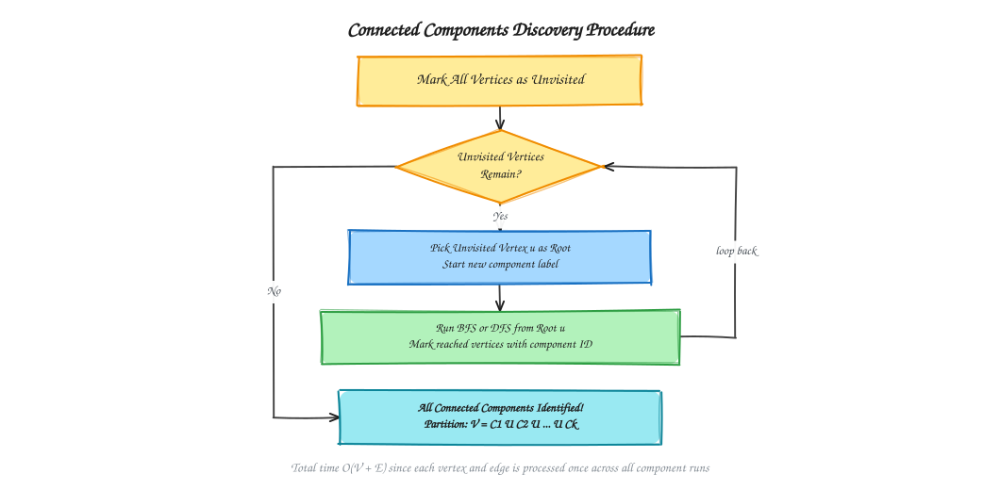

### Complexity Analysis

| Representation | Time Complexity | Space Complexity |
| :--- | :---: | :---: |
| Adjacency list | $\Theta(V+E)$ | $\Theta(V)$ |
| Adjacency matrix | $\Theta(V^2)$ | $\Theta(V)$ |

---

## 11. Strongly Connected Components

Strongly connected components are used for directed graphs.

### Definition

In a directed graph, vertices $u$ and $v$ are **strongly connected** if:

- $u$ can reach $v$.
- $v$ can reach $u$.

A **strongly connected component** or **SCC** is a maximal group of vertices where every vertex can reach every other vertex in the same group.

### Video Walkthrough Example

The following graph and DFS order reproduce the worked example from the supplied video. Its edges are:

$$
\begin{aligned}
&0 \to 1,\quad 1 \to 2,\quad 2 \to 0,\quad 2 \to 3,\quad 3 \to 4,\\
&4 \to 5,\quad 5 \to 6,\quad 6 \to 4,\quad 4 \to 7,\quad 6 \to 7.
\end{aligned}
$$

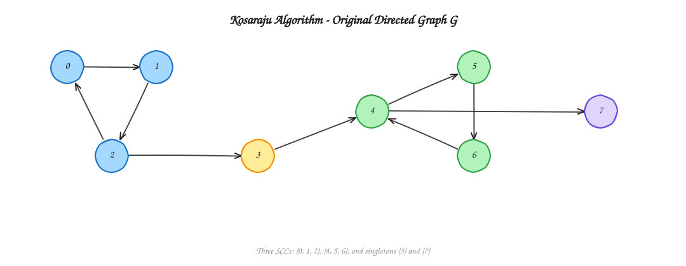

The SCCs in this graph are $\{0, 1, 2\}$, $\{3\}$, $\{4, 5, 6\}$, and $\{7\}$. Kosaraju's Algorithm obtains these groups in three steps.

### Kosaraju's Algorithm

1. Run DFS on the original graph. **Push a vertex onto a stack only when its DFS finishes.**
2. Reverse every edge to form the transpose graph $G^T$.
3. Reset `visited`. Pop vertices from the stack; whenever the popped vertex is unvisited, run DFS from it in $G^T$. The vertices reached by that DFS form one SCC.

### Why Reversing Edges Works

Reversing all edges preserves reachability inside an SCC: if every vertex can reach every other vertex in the original graph, the same is true in its transpose.

The first DFS stack puts a component with the latest finishing time on top. Starting the second DFS from that vertex in $G^T$ isolates exactly one SCC; continue popping until the stack is empty.

### Kosaraju Walkthrough

#### Step 1: DFS on the original graph and fill the stack

Start at vertex `0` and visit adjacent vertices in the order shown in the diagram. The DFS path is:

$$
0 \to 1 \to 2 \to 3 \to 4 \to 5 \to 6 \to 7
$$

A vertex is pushed after all of its outgoing neighbours have been processed. Therefore the **finish/push sequence** is:

$$
7, 6, 5, 4, 3, 2, 1, 0
$$

The final stack, displayed as in the video with the top first, is:

| Stack position | Vertex |
| :--- | :---: |
| Top | 0 |
|  | 1 |
|  | 2 |
|  | 3 |
|  | 4 |
|  | 5 |
|  | 6 |
| Bottom | 7 |

Equivalently, popping the stack produces `0, 1, 2, 3, 4, 5, 6, 7`; vertices already visited during the second DFS are skipped.

#### Step 2: Reverse the original graph

Construct $G^T$ by reversing every arrow of the original graph, then reset every `visited` value to `false`.

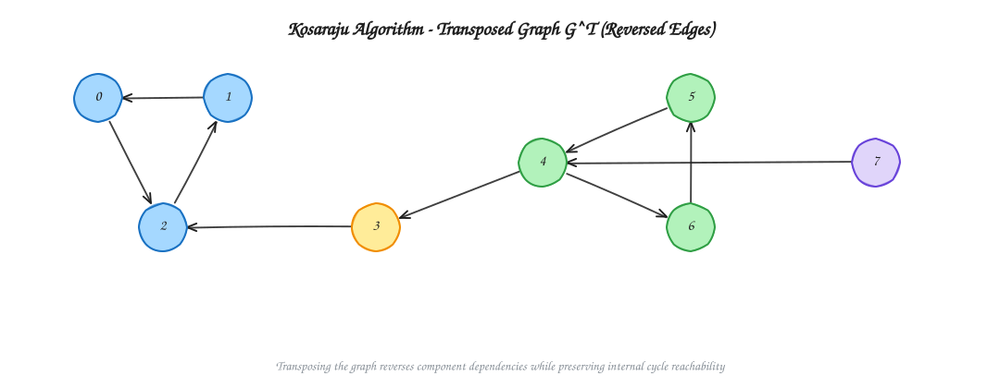

For example, the original edge $2 \to 3$ becomes $3 \to 2$, and the original edge $6 \to 4$ becomes $4 \to 6$.

#### Step 3: DFS on $G^T$ in stack-pop order

Pop the stack and start a new DFS only at an unvisited vertex:

| Stack action | DFS reached in $G^T$ | SCC produced |
| :--- | :--- | :--- |
| Pop `0`; unvisited, so start DFS | `0, 2, 1` | $\{0, 2, 1\}$ |
| Pop `1`, `2`; already visited, so skip | — | — |
| Pop `3`; unvisited, so start DFS | `3` | $\{3\}$ |
| Pop `4`; unvisited, so start DFS | `4, 6, 5` | $\{4, 6, 5\}$ |
| Pop `5`, `6`; already visited, so skip | — | — |
| Pop `7`; unvisited, so start DFS | `7` | $\{7\}$ |

Thus the strongly connected components, in the order found by this walkthrough, are:

$$
\boxed{\{0, 2, 1\},\ \{3\},\ \{4, 6, 5\},\ \{7\}}
$$

### Visual Map: Kosaraju Three-Step Flow

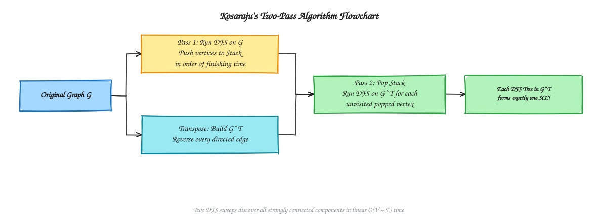

### Algorithm

1. Run depth-first search on the original graph and place each vertex on a stack only after all of its reachable neighbors finish.
2. Reverse every edge to form the transpose graph, then mark every vertex unvisited again.
3. Remove vertices from the stack in order. For each still-unvisited vertex, run depth-first search on the transpose graph; all vertices reached in that search form one strongly connected component.
4. Repeat until the stack is empty.

### Complexity Analysis

| Part | Complexity |
| :--- | :---: |
| First DFS | $\Theta(V+E)$ |
| Building transpose graph | $\Theta(V+E)$ |
| Second DFS | $\Theta(V+E)$ |
| Total time | $\Theta(V+E)$ |
| Space | $\Theta(V+E)$ |

### Tarjan's Algorithm - Optional/Self-Study

Tarjan's Algorithm also finds SCCs, but it uses only one DFS pass.

It tracks:

- Discovery time of each vertex.
- Low-link value of each vertex.
- A stack of active vertices in the current DFS path.

High-level idea:

1. Run DFS and assign each vertex a discovery number.
2. Maintain `low[u]`, the smallest discovery number reachable from $u$ using DFS tree edges and back edges.
3. Keep active vertices on a stack.
4. If `low[u] == discovery[u]`, then $u$ is the root of an SCC.
5. Pop from the stack until $u$ is popped. Those popped vertices form one SCC.

| Algorithm | DFS passes | Time Complexity | Space Complexity | Study status |
| :--- | :---: | :---: | :---: | :--- |
| Kosaraju | 2 | $\Theta(V+E)$ | $\Theta(V+E)$ | Main topic |
| Tarjan | 1 | $\Theta(V+E)$ | $\Theta(V)$ | Optional/self-study |

---

## 12. Spanning Trees

Spanning trees and minimum spanning trees belong primarily to graph algorithms because they describe how to connect every vertex of an undirected graph without cycles. Prim's and Kruskal's algorithms are also greedy algorithms: each repeatedly makes a locally cheapest safe choice. See [Chapter 7: Greedy Algorithms](../Chapter%207%20-%20Greedy%20Algorithms/README.md#3-greedy-graph-optimization) for the general greedy-choice, feasibility, and cut-property viewpoint.

### Definition

A **spanning tree** of a connected undirected graph $G=(V,E)$ is a subgraph $T=(V,E_T)$ that:

- contains every vertex of $G$;
- is connected; and
- contains no cycle.

A spanning tree removes redundant edges while preserving a path between every pair of vertices.

### Properties

For a connected graph with $V$ vertices, every spanning tree:

1. contains exactly $V-1$ edges;
2. has exactly one simple path between every pair of vertices;
3. becomes disconnected if any tree edge is removed;
4. forms exactly one cycle if any non-tree edge is added; and
5. may not be unique, because the original graph can contain several valid spanning trees.

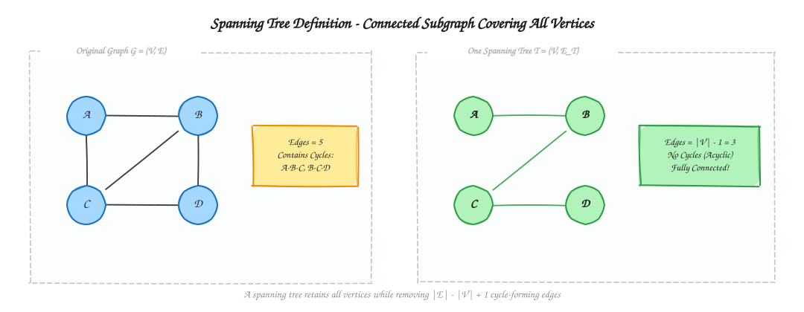

### Tree vs Graph

| Feature | Tree | General graph |
| :--- | :--- | :--- |
| Connectivity | Always connected | May be connected or disconnected |
| Cycles | Never contains a cycle | May contain cycles |
| Edges for $V$ vertices | Exactly $V-1$ | Any valid number |
| Path between two vertices | Exactly one simple path | Zero, one, or many paths |
| Role in this section | Final spanning structure | Original structure from which the tree is selected |

A tree is a special graph. A spanning tree is therefore not a separate copy of the vertices; it is a carefully selected subset of the original graph's edges.

### Minimum Spanning Tree (MST)

For a connected, weighted, undirected graph, a **Minimum Spanning Tree** is a spanning tree whose total edge weight is as small as possible:

$$
w(T)=\sum_{e\in T}w(e)
$$

An MST has $V-1$ edges, contains no cycle, and may have more than one valid solution when edge weights tie. The weight may represent road distance or construction cost, but the MST objective is the **sum of the selected edge weights**. It is not the shortest route from one chosen starting vertex; shortest-path algorithms answer that different question.

#### Safe-Edge Properties

- **Cut property:** a lightest edge crossing a cut is safe for some MST.
- **Cycle property:** a heaviest edge in a cycle does not need to belong to an MST.
- **Prim's connection:** choose the lightest edge crossing from the current tree to an outside vertex.
- **Kruskal's connection:** choose the globally lightest remaining edge whose addition does not create a cycle.

### Shared Worked Graph

Both algorithms below use the supplied weighted graph:

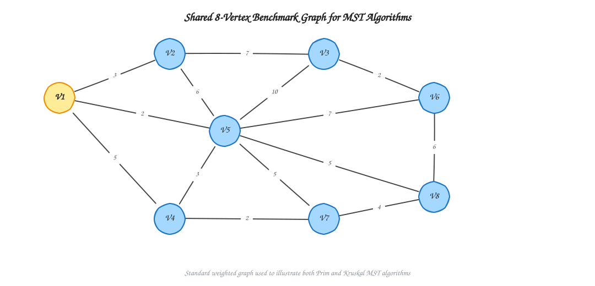

### Algorithms

#### 1. Prim's Algorithm

Prim's Algorithm grows one connected tree. Start at any vertex and repeatedly select the cheapest edge with exactly one endpoint in the current tree.

1. Choose a starting vertex and treat it as the first vertex in the tree.
2. Among all edges with one endpoint in the current tree and one endpoint outside it, choose a lightest edge.
3. Add that edge and its outside endpoint to the tree.
4. Repeat until every vertex is included. The chosen edges form the MST.

Start from $V_1$. At each step, only crossing edges from the current tree to an outside vertex are eligible.

| Step | Tree vertices before selection | Minimum crossing choice | Edge added | Running weight |
| :---: | :--- | :--- | :---: | :---: |
| 1 | $\{V_1\}$ | $V_1V_5(2)$ | $V_1V_5$ | 2 |
| 2 | $\{V_1,V_5\}$ | Tie: $V_1V_2(3)$ or $V_5V_4(3)$ | $V_5V_4$ | 5 |
| 3 | $\{V_1,V_4,V_5\}$ | $V_4V_7(2)$ | $V_4V_7$ | 7 |
| 4 | $\{V_1,V_4,V_5,V_7\}$ | $V_1V_2(3)$ | $V_1V_2$ | 10 |
| 5 | $\{V_1,V_2,V_4,V_5,V_7\}$ | $V_7V_8(4)$ | $V_7V_8$ | 14 |
| 6 | $\{V_1,V_2,V_4,V_5,V_7,V_8\}$ | $V_8V_6(6)$ | $V_8V_6$ | 20 |
| 7 | $\{V_1,V_2,V_4,V_5,V_6,V_7,V_8\}$ | $V_6V_3(2)$ | $V_6V_3$ | **22** |

The selected weights do not have to increase: $V_6V_3(2)$ becomes eligible only after $V_6$ joins the tree.

> **Correction to the supplied slide order:** after $V_4V_7$, Prim must select the available crossing edge $V_1V_2(3)$ before $V_7V_8(4)$. The corrected sequence preserves the slide's final MST and follows Prim's greedy rule.

Each label below gives `selection step: edge weight`. Edges numbered $1$ through $k$ show the tree after step $k$.

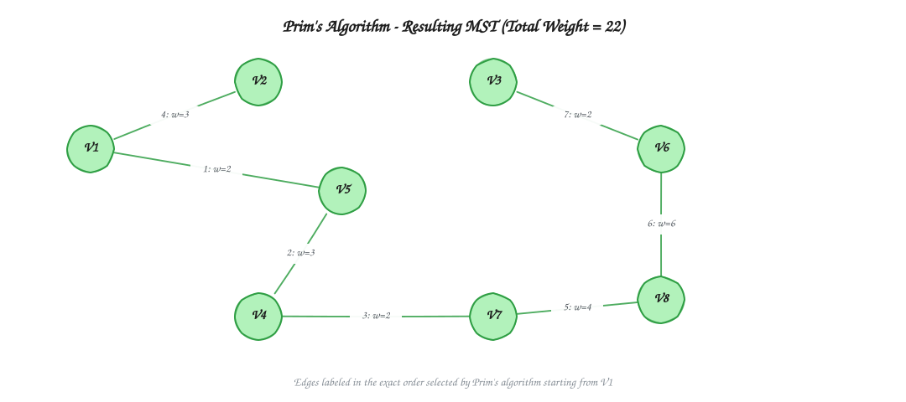

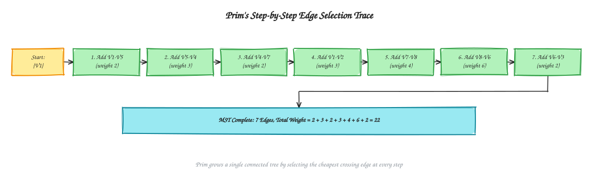

#### 2. Kruskal's Algorithm

Kruskal's Algorithm begins with a forest of one-vertex trees. Sort every edge by nondecreasing weight and accept an edge only when it joins two different components. It is a **greedy** algorithm: at each step it takes the cheapest remaining edge that is safe to add. The selected edges stay acyclic, and the process ends when they connect all vertices.

Write each weighted edge as its two endpoints and its weight, and place all edges in a list. Sort that list from smallest weight to largest. Compare the **weight**, not the endpoint labels; endpoint order does not decide which edge is considered first.

Equal-weight edges may appear in either order. A different tie order can select a different edge set, but all resulting MSTs have the same minimum total weight.

1. Begin with no selected edges and make one separate DSU set for every vertex.
2. Sort all edges from lightest to heaviest.
3. For each edge in that order, find the set representative of each endpoint.
4. If the representatives differ, add the edge to the answer and merge the two sets. If they match, skip the edge because it would make a cycle.
5. Stop immediately after accepting $V-1$ edges. If the list runs out first, the graph is disconnected and the accepted edges form a minimum spanning forest, not a spanning tree.

Finding a representative tells Kruskal which component contains a vertex; it does not give a path or a distance. DSU only tracks which vertices are already connected. The selected MST edges and their total weight are kept separately.

Equal-weight edges may be processed in any order. This table follows the supplied visual sequence.

| Scan | Edge | Weight | Decision | Selected forest after decision |
| :---: | :---: | :---: | :---: | :--- |
| 1 | $V_1V_5$ | 2 | Take | $\{V_1V_5\}$ |
| 2 | $V_4V_7$ | 2 | Take | Add $V_4V_7$ |
| 3 | $V_3V_6$ | 2 | Take | Add $V_3V_6$ |
| 4 | $V_1V_2$ | 3 | Take | Add $V_1V_2$ |
| 5 | $V_4V_5$ | 3 | Take | Join the $V_4,V_7$ and $V_1,V_2,V_5$ components |
| 6 | $V_7V_8$ | 4 | Take | Add $V_7V_8$ |
| 7 | $V_1V_4$ | 5 | Skip | Same component; cycle |
| 8 | $V_5V_7$ | 5 | Skip | Same component; cycle |
| 9 | $V_5V_8$ | 5 | Skip | Same component; cycle |
| 10 | $V_2V_5$ | 6 | Skip | Same component; cycle |
| 11 | $V_8V_6$ | 6 | Take | Join the main forest to $\{V_3,V_6\}$; MST complete |

Stop after scan 11 because $V-1=7$ edges have been accepted. The remaining edges $V_2V_3(7)$, $V_5V_6(7)$, and $V_3V_5(10)$ would create cycles.

Each edge label below gives its accepted-edge number. Accepted edges $1$ through $k$ show Kruskal's forest after acceptance step $k$.

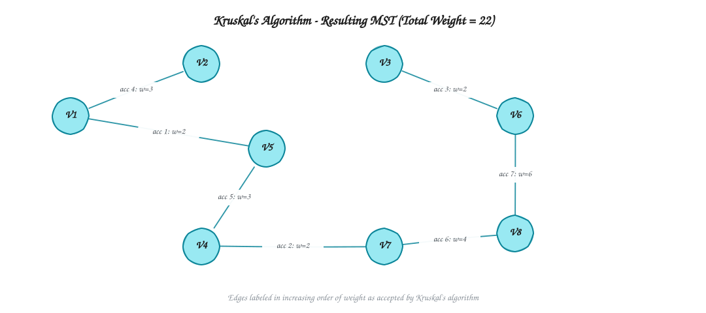

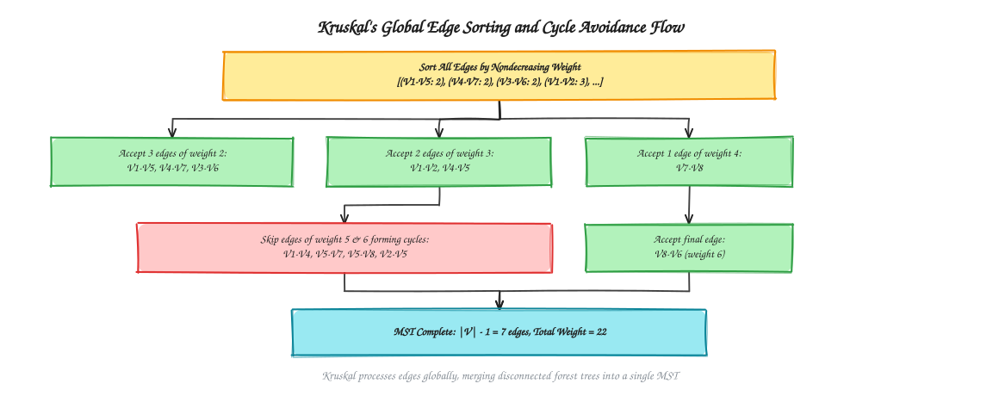

Both algorithms produce the same MST edge set (possibly in a different order):

$$
T=\{V_1V_5,V_4V_7,V_3V_6,V_1V_2,V_4V_5,V_7V_8,V_8V_6\}
$$

$$
w(T)=2+2+2+3+3+4+6=\boxed{22}
$$

#### Lecture worked example: sort, test, and accept

The lecture example has five zero-indexed vertices, $\{0,1,2,3,4\}$, and six undirected weighted edges. Each record gives the two endpoints followed by the weight:

| Endpoints | Weight |
| :---: | :---: |
| 3--4 | 2 |
| 1--4 | 1 |
| 1--3 | 2 |
| 2--3 | 3 |
| 0--2 | 5 |
| 0--1 | 1 |

Sort by weight, keeping the lecture's input order within equal-weight ties. Another tie order is also valid:

| Order | Edge | Weight |
| :---: | :---: | :---: |
| 1 | 1--4 | 1 |
| 2 | 0--1 | 1 |
| 3 | 3--4 | 2 |
| 4 | 1--3 | 2 |
| 5 | 2--3 | 3 |
| 6 | 0--2 | 5 |

Use union by rank for the DSU. When two roots have equal rank, keep the first endpoint's root and increase that root's rank by one. The edge-by-edge trace is:

| Scan | Edge | Weight | Roots before decision | Decision | Accepted MST so far |
| :---: | :---: | :---: | :---: | :--- | :--- |
| 1 | `(1,4)` | 1 | `1`, `4` | Accept; merge | `(1,4,1)` |
| 2 | `(0,1)` | 1 | `0`, `1` | Accept; merge | add `(0,1,1)` |
| 3 | `(3,4)` | 2 | `3`, `1` | Accept; merge | add `(3,4,2)` |
| 4 | `(1,3)` | 2 | `1`, `1` | Skip; cycle | unchanged |
| 5 | `(2,3)` | 3 | `2`, `1` | Accept; merge | add `(2,3,3)` |
| 6 | `(0,2)` | 5 | — | Not checked; the MST is already complete | unchanged |

After scan 5, the MST has $V-1=4$ edges, so a correct early-stopping trace ends there. Edge 6 is not examined. If the scan were deliberately continued for practice, its endpoints would have the same representative and it would be rejected as a cycle. The MST weight is $1+1+2+3=7$.

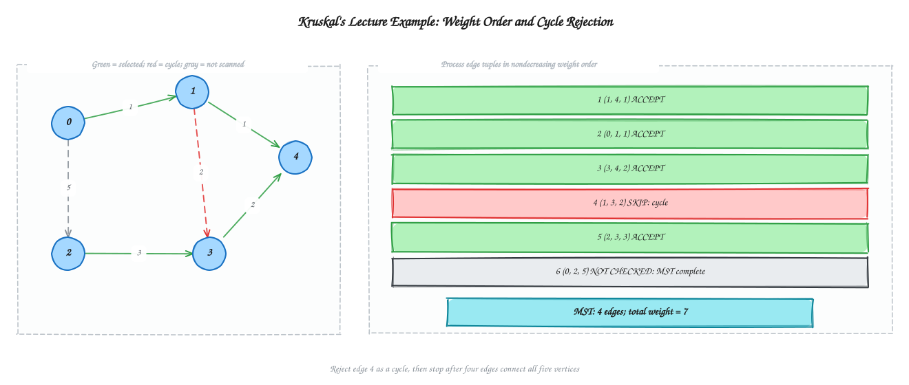

#### DSU state trace for the lecture example

The edge trace shows which choices Kruskal makes. This second view shows what the disjoint sets and parent trees look like behind those choices. A parent list records where each vertex points; a root points to itself. The rank list records the balancing rank of each root. Entries are shown in vertex order $0,1,2,3,4$.

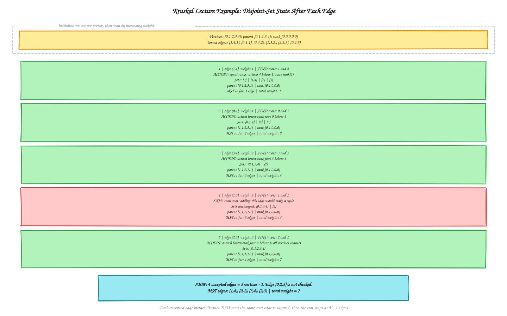

| State | Parent list | Rank list | Components |
| :--- | :--- | :--- | :--- |
| Start | $[0,1,2,3,4]$ | $[0,0,0,0,0]$ | $\{0\},\{1\},\{2\},\{3\},\{4\}$ |
| After edge 1--4 | $[0,1,2,3,1]$ | $[0,1,0,0,0]$ | $\{0\},\{1,4\},\{2\},\{3\}$ |
| After edge 0--1 | $[1,1,2,3,1]$ | $[0,1,0,0,0]$ | $\{0,1,4\},\{2\},\{3\}$ |
| After edge 3--4 | $[1,1,2,1,1]$ | $[0,1,0,0,0]$ | $\{0,1,3,4\},\{2\}$ |
| After edge 1--3 | $[1,1,2,1,1]$ | $[0,1,0,0,0]$ | $\{0,1,3,4\},\{2\}$ |
| After edge 2--3 | $[1,1,1,1,1]$ | $[0,1,0,0,0]$ | $\{0,1,2,3,4\}$ |

Read the trace slowly:

1. For 1--4, the roots differ and have equal rank. Accept the edge, attach 4 below 1, and raise the rank of 1.
2. For 0--1, the roots are 0 and 1. Root 1 has the higher rank, so attach 0 below 1 and accept the edge.
3. For 3--4, the roots are 3 and 1. Attach 3 below 1 and accept the edge.
4. For 1--3, both endpoints already have root 1. Skip the edge: it would close a cycle.
5. For 2--3, the roots are 2 and 1. Attach 2 below 1 and accept the edge. Four edges now connect all five vertices, so stop. Do not scan 0--2 in the actual Kruskal run.

#### Kruskal algorithm in plain steps

1. List every vertex as its own component; start with no chosen edges and a total weight of zero.
2. Sort the edges from smallest weight to largest.
3. Look at the next edge and find the current component representative of each endpoint.
4. If the representatives match, leave the edge out because the endpoints are already connected.
5. If the representatives differ, add the edge, add its weight to the total, and merge the two components. For union by rank, attach the lower-rank root below the higher-rank root; on a tie, choose one root and raise its rank.
6. Stop as soon as the chosen edges number one less than the number of vertices. Those edges form the MST.

#### DSU actions used by Kruskal

Create a singleton set by making a vertex its own representative and giving it rank zero. To find a vertex's representative, follow parent links until reaching a root; path halving can shorten the route as it is followed. To unite two vertices, first find both roots. If the roots are the same, report that no merge happened. Otherwise, link the lower-rank root below the higher-rank root. When ranks tie, link one root below the other and increase the surviving root's rank. The union operation reports whether it merged two previously separate sets.

For the lecture input, the selected edges and weights are:

| Edge | Weight |
| :---: | :---: |
| 1--4 | 1 |
| 0--1 | 1 |
| 3--4 | 2 |
| 2--3 | 3 |
| **Total** | **7** |

Union by rank changes only the parent-tree shape; it does not change the sorted edge choices or the MST weight. If the graph is disconnected, edge processing ends before $V-1$ edges are accepted, and the result is a minimum spanning forest rather than an MST.

### 3. Disjoint Set Union (Union-Find)

A **Disjoint Set Union** data structure, also called **Union-Find**, maintains a collection of mutually disjoint sets. Each element belongs to exactly one set. DSU supports two essential tasks: determining whether two elements belong to the same set and merging two sets when a new relationship joins them.

A set is represented by a rooted tree, and its root is the set's **representative**. A parent array stores the tree links. This section consistently uses the self-parent convention: a root points to itself. DSU records component membership; it does **not** store the graph's adjacency structure or paths between vertices.

> **Different roots → merge the sets. Same root → already connected.**
>
> For an edge in an undirected graph, same roots mean that a prior path already connects its endpoints, so adding the edge creates a cycle.

The most useful exam patterns are a cycle-detection trace, the `MAKE-SET`/`FIND`/`UNION` operations, optimized DSU pseudocode, and DSU's role in Kruskal's algorithm. Path compression, union by size or rank, and complexity support these core patterns.

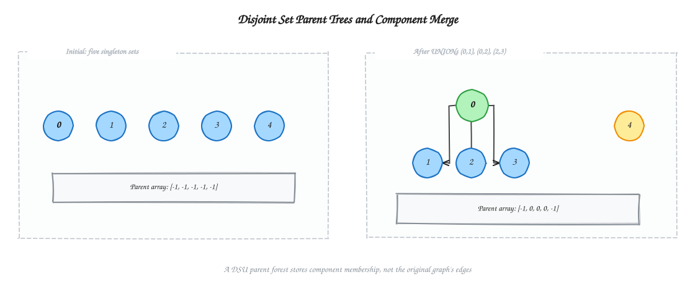

#### 1. Definition, representation, and core operations

The three primary operations are:

| Operation | Purpose |
| :--- | :--- |
| `MAKE-SET(x)` | Create a singleton set containing `x`. |
| `FIND(x)` | Return the representative/root of the set containing `x`. |
| `UNION(x, y)` | Merge the sets containing `x` and `y`, if they are different. |

With the self-parent convention, initialize each element as its own root. For example, vertices `0..4` begin as `{0}, {1}, {2}, {3}, {4}` and `parent = [0,1,2,3,4]`. When using union by size, each singleton initially has size one.

`FIND(x)` follows parent links until it reaches a vertex whose parent is itself. Two elements belong to the same set exactly when their representatives are equal. `UNION(x,y)` first finds both representatives. It links one root below the other only when the roots differ; linking roots, rather than arbitrary vertices, preserves the set-tree representation.

#### 2. Optimized operations: path compression and union by size

**Path compression** shortens the search paths used by `FIND`. After a root is found, each visited node is made to point directly to it. The recursive form below uses the same self-parent root convention:

```text
MAKE-SET(x)
    parent[x] ← x
    size[x] ← 1

FIND(x)
    if parent[x] ≠ x
        parent[x] ← FIND(parent[x])
    return parent[x]
```

For example, before `FIND(4)`, suppose the chain is `4 → 3 → 2 → 1 → 0`, with `parent = [0,0,1,2,3]`. The find returns `0` and compresses the visited path so that `parent = [0,0,0,0,0]`. Future finds on those elements take fewer parent-link steps.

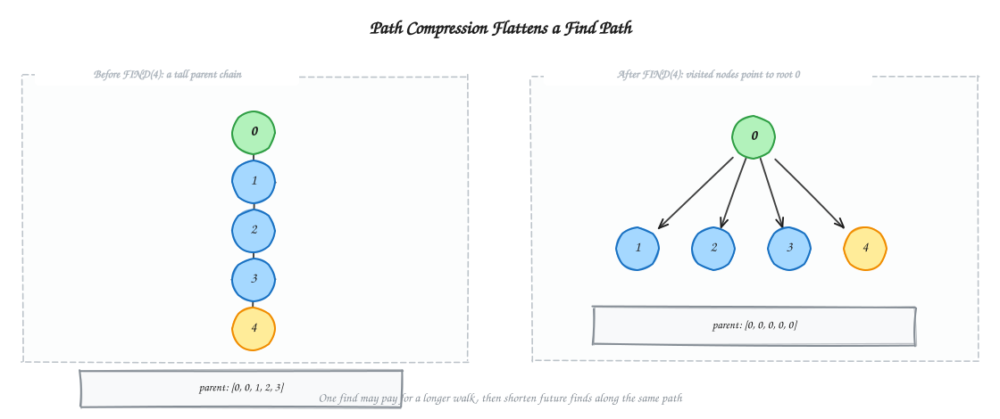

**Union by size** stores the number of members at each root. When two different sets are merged, attach the smaller set's root below the larger set's root and update the surviving root's size. If the sizes tie, either root may become the parent. Size values at non-roots are not used.

```text
UNION(x, y)
    rootX ← FIND(x)
    rootY ← FIND(y)

    if rootX = rootY
        return FALSE

    if size[rootX] < size[rootY]
        swap(rootX, rootY)

    parent[rootY] ← rootX
    size[rootX] ← size[rootX] + size[rootY]
    return TRUE
```

`TRUE` means two sets were merged; `FALSE` means both elements were already in the same set. Path compression flattens paths found by queries, while union by size limits tree growth during merges.

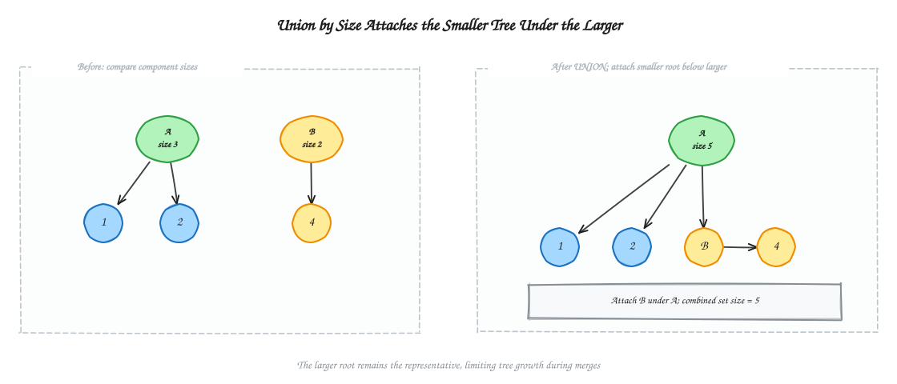

**Union by rank** is an alternative balancing rule. Rank is a height estimate, not the number of elements or children. Initialize each rank to zero, attach a lower-rank root below a higher-rank root, and increase the surviving root's rank only when the two root ranks are equal:

```text
UNION-BY-RANK(x, y)
    rootX ← FIND(x)
    rootY ← FIND(y)

    if rootX = rootY
        return FALSE

    if rank[rootX] < rank[rootY]
        parent[rootX] ← rootY
    else if rank[rootX] > rank[rootY]
        parent[rootY] ← rootX
    else
        parent[rootY] ← rootX
        rank[rootX] ← rank[rootX] + 1

    return TRUE
```

Do not add the two ranks together: rank increases by one only when equal-rank roots are joined. Rank and size have different meanings and update rules, but either can be combined with path compression to keep DSU efficient.

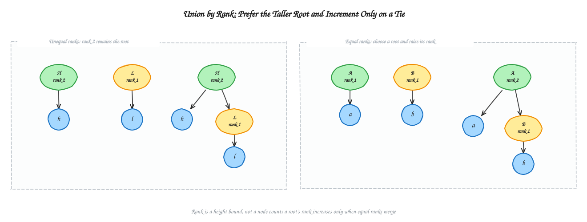

#### 3. Cycle detection in an undirected graph

Process undirected edges one at a time. For each edge `(u,v)`, compare `FIND(u)` and `FIND(v)`. Different roots mean the edge joins two components, so merge them. Equal roots mean the endpoints are already connected by a path; the new edge closes a cycle. This ordinary DSU test is for **undirected** graphs, not directed-cycle detection.

Consider `V = {0,1,2,3,4}` and edges `(0,1), (0,2), (1,3), (2,4), (3,4)`. Initially every vertex is a separate set. Using union by size with the first root retained on equal sizes, the complete trace is:

| Edge | `FIND(u)` | `FIND(v)` | Decision | Components afterward |
| :---: | :---: | :---: | :--- | :--- |
| Initial | — | — | — | `{0}, {1}, {2}, {3}, {4}` |
| `(0,1)` | `0` | `1` | Union | `{0,1}, {2}, {3}, {4}` |
| `(0,2)` | `0` | `2` | Union | `{0,1,2}, {3}, {4}` |
| `(1,3)` | `0` | `3` | Union | `{0,1,2,3}, {4}` |
| `(2,4)` | `0` | `4` | Union | `{0,1,2,3,4}` |
| `(3,4)` | `0` | `0` | Cycle; stop | unchanged |

At `(1,3)`, for example, find the root of `1` rather than reading only its parent: `FIND(1) = 0`, while `FIND(3) = 3`. The roots differ, so the sets merge. At `(3,4)`, both finds return `0`; a previously processed path connects the endpoints, and `(3,4)` closes a cycle. Therefore, the graph contains a cycle, detected at edge `(3,4)`.

The same logic gives the general algorithm. Here `UNION` returns `FALSE` when its arguments already have the same root:

```text
HAS-CYCLE(V, edges)
    for each vertex v in V
        MAKE-SET(v)

    for each edge (u, v) in edges
        if UNION(u, v) = FALSE
            return TRUE

    return FALSE
```

If all edges are processed without a failed union, the graph has no cycle. The explicit final `FALSE` is required. The represented component partition and root comparisons must be correct; the exact parent-tree shape may vary with union tie-breaking.

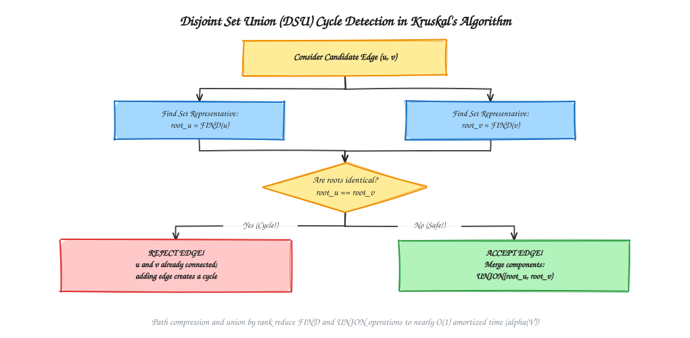

#### 4. DSU in Kruskal's minimum spanning tree algorithm

Kruskal sorts weighted edges in nondecreasing order and uses DSU to determine whether each candidate edge joins two different components. Accept an edge and union its endpoints when their roots differ. Reject an edge when their roots are the same, because it would create a cycle. For a connected graph with `V` vertices, stop after selecting `V-1` edges.

For the sorted edges `(A,B,1), (C,D,2), (B,C,3), (A,C,4), (D,E,5)`, begin with `{A}, {B}, {C}, {D}, {E}`:

| Order | Edge | Weight | Root comparison | Decision |
| :---: | :---: | :---: | :--- | :--- |
| 1 | A-B | 1 | Different | Accept and union |
| 2 | C-D | 2 | Different | Accept and union |
| 3 | B-C | 3 | Different | Accept and union |
| 4 | A-C | 4 | Same | Reject; cycle would form |
| 5 | D-E | 5 | Different | Accept and union |

The selected MST edges are `{A-B, C-D, B-C, D-E}` and the total cost is `1 + 2 + 3 + 5 = 11`. Four edges have been accepted, which is `V-1` for five vertices. If the input graph is disconnected, Kruskal cannot select `V-1` edges and instead returns a minimum spanning forest.

> **Kruskal rule:** `FIND(u) ≠ FIND(v)` means accept the edge and union; `FIND(u) = FIND(v)` means reject the edge.

#### 5. Complexity

Without balancing or path compression, a parent tree can become a chain of height `V`. A basic `FIND` can then take $O(V)$ time, and processing `E` edges for cycle detection can take $O(EV)$ in the worst case.

With path compression and union by size or rank, `FIND` and `UNION` take $O(\alpha(V))$ amortized time, where $\alpha(V)$ is the inverse Ackermann function and grows extremely slowly. This is an amortized bound over a sequence of operations, not a strict constant bound for every individual call.

| Operation or workload | Complexity |
| :--- | :---: |
| `MAKE-SET` per element | $\Theta(1)$ |
| Basic `FIND` / `UNION` without balancing | $O(V)$ worst case |
| Optimized `FIND` / `UNION` | $O(\alpha(V))$ amortized |
| Basic cycle detection | $O(EV)$ worst case |
| Optimized cycle detection | $O((V+E)\alpha(V))$ |
| Kruskal, including edge sorting | $O(E\log E + E\alpha(V)) = O(E\log E)$ |
| DSU storage | $O(V)$ |

#### 6. Applications and limitations

Common DSU applications include:

- detecting cycles in undirected graphs;
- supporting Kruskal's minimum spanning tree algorithm;
- answering dynamic-connectivity queries as links are added;
- maintaining connected components or friend-circle/group membership; and
- grouping connected image regions or percolation components.

DSU is best suited to **merge operations and connectivity queries**. It can tell whether two vertices are in the same component, but it does not retain the complete adjacency structure, an actual path, traversal order, or distances. Ordinary DSU also does not efficiently support deleting an edge, splitting a set, or undoing arbitrary unions. It is therefore not a general replacement for DFS or BFS.

#### 7. Exam trace format and revision checklist

For a DSU trace, show the set partition or parent representation after each edge; there is no need to redraw the original graph repeatedly. A trace table is usually the clearest presentation:

| Edge | Root of first endpoint | Root of second endpoint | Decision | Components afterward |
| :--- | :--- | :--- | :--- | :--- |
| Initial | — | — | — | `{...}, {...}` |
| `(u,v)` | `FIND(u)` | `FIND(v)` | Union or cycle | Updated sets |

A complete numerical answer follows this sequence:

1. Initialize `parent[v] = v`; for union by size, initialize `size[v] = 1`.
2. For each edge, find both endpoint roots.
3. If roots differ, union the sets and record the updated components.
4. If roots match, report a cycle at that edge and stop.
5. State the final conclusion and the relevant complexity when requested.

The key facts to retain are:

- **Different roots → union; same root → already connected / cycle** for an undirected edge.
- **Path compression:** make visited nodes point directly to the root.
- **Union by size:** attach the smaller set's root below the larger set's root.
- **Union by rank:** rank is a height estimate and increases only on an equal-rank merge.
- **Optimized operations:** $O(\alpha(V))$ amortized; DSU storage is $O(V)$.
- **Optimized cycle detection:** $O((V+E)\alpha(V))$; **Kruskal:** $O(E\log E)$ including sorting.

For revision, prioritize a cycle-detection trace, the three core operations, path compression, one balancing rule, and the DSU decision made by Kruskal. Draw a parent tree only when it clarifies a find path or a merge; a trace table plus the final conclusion is normally sufficient.

### 4. Time Complexity

| Algorithm / structure | Implementation | Time Complexity | Space Complexity | Best suited for |
| :--- | :--- | :---: | :---: | :--- |
| Prim | Adjacency matrix | $\Theta(V^2)$ | $\Theta(V^2)$ | Dense graphs |
| Prim | Adjacency list + binary heap | $\Theta((V+E)\log V)$ | $\Theta(V+E)$ | Sparse graphs |
| Kruskal | Sorted edge list + optimized DSU | $\Theta(E\log E)$ | $\Theta(V+E)$ | Sparse graphs and edge-list input |
| Optimized DSU operation | Path compression + union by rank/size | $O(\alpha(V))$ amortized | $\Theta(V)$ total DSU storage | Fast Kruskal cycle checks |

The sorting phase dominates Kruskal. With optimized DSU, all `FIND` and `UNION` operations together cost $O(E\alpha(V))$, which is smaller than $\Theta(E\log E)$ for ordinary graph sizes.

### Applications

Minimum spanning trees are used when every required point must be connected with minimum total construction or connection cost:

- low-cost computer, telephone, and electrical networks;
- road, railway, cable, pipeline, and water-supply design;
- communication backbones with redundant links removed;
- data clustering by deleting selected large MST edges;
- image segmentation and pattern recognition; and
- approximation methods for harder network-design problems.

---

## Analyze Time Complexity of Above Topics

The following table summarizes the major complexity results from this chapter.

| Topic / Algorithm | Graph type | Time Complexity | Space Complexity | Main reason |
| :--- | :--- | :---: | :---: | :--- |
| Adjacency matrix | Any graph | Build: $\Theta(V^2)$ | $\Theta(V^2)$ | Stores every possible vertex pair |
| Adjacency list | Any graph | Build: $\Theta(V+E)$ | $\Theta(V+E)$ | Stores actual vertices and edges |
| BFS shortest path | Unweighted graph | $\Theta(V+E)$ | $\Theta(V)$ | Visits each vertex and edge once |
| Dijkstra's Algorithm | Weighted graph, nonnegative edges | $\Theta(V^2)$ with matrix, $\Theta((V+E)\log V)$ with binary heap | $\Theta(V+E)$ | Greedily finalizes the nearest unvisited vertex |
| Bellman-Ford | Weighted directed graph | $\Theta(VE)$ | $\Theta(V)$ | Relaxes all edges for $V-1$ rounds |
| Floyd-Warshall | Weighted directed graph, all pairs | $\Theta(V^3)$ | $\Theta(V^2)$ | Tries every vertex as an intermediate point for every pair |
| DFS topological sort | DAG | $\Theta(V+E)$ | $\Theta(V)$ | DFS visits each vertex and edge once |
| Kahn's Algorithm | DAG | $\Theta(V+E)$ | $\Theta(V)$ | Processes each vertex and edge once |
| Connected components | Undirected graph | $\Theta(V+E)$ | $\Theta(V)$ | Repeated DFS/BFS still visits each edge once |
| Kosaraju SCC | Directed graph | $\Theta(V+E)$ | $\Theta(V+E)$ | Two DFS passes plus transpose graph |
| Tarjan SCC | Directed graph | $\Theta(V+E)$ | $\Theta(V)$ | One DFS pass with stack and low-link values |
| Prim | Weighted connected undirected graph | $\Theta(V^2)$ with matrix, $\Theta((V+E)\log V)$ with binary heap | $\Theta(V+E)$ with adjacency list | Repeatedly chooses the cheapest crossing edge |
| Kruskal | Weighted connected undirected graph | $\Theta(E\log E)$ | $\Theta(V+E)$ | Sorts edges and rejects cycle-forming choices |
| Union-Find / DSU | Disjoint sets | $O(\alpha(V))$ per operation | $\Theta(V)$ | Path compression and union by rank/size |

### Final Revision Checklist

Before moving to the next chapter, make sure you can explain:

- Why every tree is a graph but every graph is not a tree.
- The difference between weighted and unweighted graphs.
- The difference between directed and undirected graphs.
- Why a DAG is needed for topological sorting.
- How adjacency matrix and adjacency list store the same graph differently.
- Why BFS gives shortest paths only for unweighted graphs.
- How Dijkstra's Algorithm relaxes edges and finalizes vertices greedily.
- Why Dijkstra's Algorithm requires nonnegative edge weights.
- How Bellman-Ford uses edge relaxation.
- Why Bellman-Ford needs $|V|-1$ relaxation rounds.
- Why Bellman-Ford is still needed even though Dijkstra's Algorithm exists.
- How Floyd-Warshall's $D^{(k)}[i,j] = \min(D^{(k-1)}[i,j],\ D^{(k-1)}[i,k]+D^{(k-1)}[k,j])$ recurrence checks every vertex as an intermediate point.
- Why Floyd-Warshall and Bellman-Ford share the same no-negative-cycle requirement, and how to spot a negative cycle from Floyd-Warshall's final diagonal.
- How DFS-based topological sort uses finish time.
- How connected components are found in an undirected graph.
- How Kosaraju's Algorithm finds SCCs using two DFS passes.
- The definition and properties of a spanning tree and an MST.
- How Prim grows one tree using the cheapest crossing edge.
- How Kruskal grows a forest using globally sorted safe edges, and why the edge sort must use weight rather than source.
- How the parent array represents disjoint sets and how `MAKE-SET`, `FIND`, and `UNION` work.
- Why a root-convention mismatch is incorrect, and how path compression plus union by size/rank improve DSU.
- Why rank differs from set size, and why rank increases only when equal-rank roots are merged.
- How DSU detects cycles in an undirected graph and supports Kruskal's safe-edge check.
- Why a disconnected input produces a minimum spanning forest rather than a spanning tree.

---

[Previous: Chapter 10 - Branch and Bound](../Chapter%2010%20-%20Branch%20and%20Bound/README.md) | [Home](../README.md) | [Next: Chapter 12 - Flow Algorithms](../Chapter%2012%20-%20Flow%20Algorithms/README.md)
