# Chapter 12 - Flow Algorithms

[Previous: Chapter 11 - Graph Algorithms](../Chapter%2011%20-%20Graph%20Algorithms/README.md) | [Home](../README.md) | [Next: Chapter 13 - Approximation Algorithms](../Chapter%2013%20-%20Approximation%20Algorithms/README.md)

---

A flow network models something that moves through a graph: water through pipes, packets through links, cars through roads. Each edge can carry only a limited amount. The **maximum-flow problem** asks how much can be pushed from a source $s$ to a sink $t$ at the same time. The same machinery also solves matching problems.

This chapter covers the vocabulary of flow networks, residual graphs, the Ford-Fulkerson method (with a full step-by-step trace that follows the video [Ford Fulkerson algorithm step by step example](https://youtu.be/Da-VAtoL2sk)), its time complexity, Edmonds-Karp, a proof and worked certificate for the max-flow min-cut theorem, and bipartite matching. It builds on the graph representations and BFS of [Chapter 11](../Chapter%2011%20-%20Graph%20Algorithms/README.md). It intentionally contains no implementation code.

---

## Start Here: The Idea in Plain Words

**Think of water pipes.** Water starts at a tank (the **source**, called $s$) and must reach a house (the **sink**, called $t$). Each pipe can carry only so much water. The big question: **how much water can reach the house at the same time?**

**Two easy examples.**

- One pipe from $s$ to $t$ that carries 5. The answer is 5.
- Two pipes in a row, the first carries 5, the second carries 3. The answer is only 3. The narrowest pipe limits everything.

With many pipes joined together, finding the answer is harder. That is what this chapter teaches.

**The method in plain words.**

1. Start with no water moving.
2. Look for **any route** from $s$ to $t$ that still has room in every pipe.
3. Send as much water as the narrowest pipe on that route allows.
4. Repeat. When no route with room is left, you are done.

**One clever part.** Sometimes an early choice was a bad idea. The method lets you **take back** some water you already sent, so it can go a better way. This is the "backward edge" idea. It is the hardest idea in the chapter, so read [When a Backward Edge Is Needed](#when-a-backward-edge-is-needed) slowly.

**Words used in this chapter, in simple terms**

| Word | Simple meaning |
| :--- | :--- |
| Flow network | A map of one-way pipes, each with a size limit. |
| Source / sink | Where the water starts / where it must end. |
| Capacity | The most a pipe can carry. |
| Flow | How much water is really going through a pipe now. |
| Residual graph | A map of the **room left** in each pipe, and how much we may take back. |
| Augmenting path | A route from source to sink that still has room. |
| Bottleneck | The narrowest pipe on a route. |
| Cut | A line that splits the map into a source side and a sink side. |
| Matching | Pairs of people and jobs where nobody is used twice. |

**Before you start:** it helps to know how a graph is drawn and how BFS works ([Chapter 11](../Chapter%2011%20-%20Graph%20Algorithms/README.md)).

---

## Table of Contents

- [Start Here: The Idea in Plain Words](#start-here-the-idea-in-plain-words)
1. [Flow Networks](#flow-networks)
2. [Residual Graph](#residual-graph)
3. [Ford-Fulkerson Algorithm](#ford-fulkerson-algorithm)
   - [Foundations in Plain Words](#foundations-in-plain-words)
   - [How Ford-Fulkerson Works](#how-ford-fulkerson-works)
   - [Worked Example (from the video)](#worked-example-from-the-video)
   - [When a Backward Edge Is Needed](#when-a-backward-edge-is-needed)
   - [Time Complexity and Analysis](#time-complexity-and-analysis)
4. [Edmonds-Karp Algorithm](#edmonds-karp-algorithm)
5. [Max-Flow Min-Cut](#max-flow-min-cut)
   - [The Question and the Cut Upper Bound](#the-question-and-the-cut-upper-bound)
   - [The Theorem, End to End](#the-theorem-end-to-end)
   - [Standard Procedure: Find and Certify a Maximum Flow](#standard-procedure-find-and-certify-a-maximum-flow)
   - [Worked Certificate: The Flow-22 Network](#worked-certificate-the-flow-22-network)
   - [Exam-Style Question and Model Answer](#exam-style-question-and-model-answer)
6. [Bipartite Matching](#bipartite-matching)
7. [Correctness and Complexity](#correctness-and-complexity)
8. [Practice and Exam Notes](#practice-and-exam-notes)

---

## Flow Networks

A **flow network** is a directed graph $G = (V, E)$ with:

- a **source** $s$, where flow starts, and a **sink** $t$, where it ends;
- a **capacity** $c(u, v) \ge 0$ on every edge, the most that edge can carry.

A **flow** assigns each edge a value $f(u, v)$ that satisfies two rules:

1. **Capacity constraint:** $0 \le f(u, v) \le c(u, v)$.
2. **Flow conservation:** for every vertex other than $s$ and $t$, flow in equals flow out.

The **value** of a flow, $|f|$, is the net flow leaving the source. The **maximum-flow problem** asks for a flow of largest value.

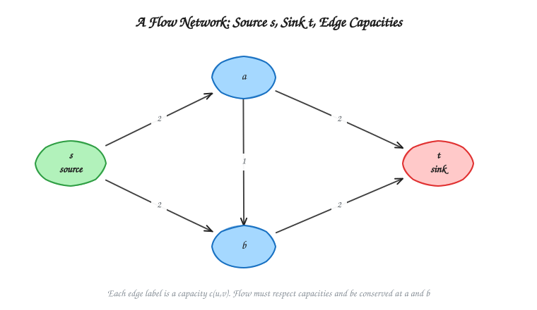

See the [diagram index](diagrams/README.md) for editable Excalidraw sources and SVG previews.

| Situation | How to model it |
| :--- | :--- |
| Several sources or sinks | Add a **super-source** with infinite-capacity edges to every source, and a **super-sink** that every sink points to. |
| Vertex capacity | Split the vertex into $v_{in} \to v_{out}$ with that capacity. |
| Undirected edge | Replace it with two opposite directed edges of the same capacity. |

---

## Residual Graph

Given a flow $f$, the **residual graph** $G_f$ shows where more flow could still be sent. For every edge $(u, v)$:

| Residual edge | Residual capacity | Meaning |
| :--- | :--- | :--- |
| Forward $(u, v)$ | $c(u, v) - f(u, v)$ | Unused room: we can push this much more. |
| Backward $(v, u)$ | $f(u, v)$ | Flow already sent: we can **cancel** up to this much. |

Only edges with positive residual capacity appear. The backward edges are the key idea. They let the algorithm undo an earlier choice that turned out to be poor, without starting over.

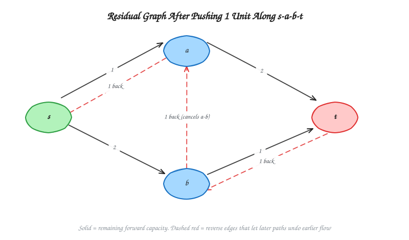

---

## Ford-Fulkerson Algorithm

This section is built around the worked example in the video [Ford Fulkerson algorithm step by step example in 8 minutes](https://youtu.be/Da-VAtoL2sk) (Er Sahil ka Gyan). It uses the same network, the same five augmenting paths in the same order, and the same answer (**22**). Every step is drawn twice: the residual graph the algorithm *searches*, and the flow network after it *pushes*.

### Foundations in Plain Words

Read this part first. Each idea is used in every step that follows.

| Term | Plain meaning | In symbols |
| :--- | :--- | :--- |
| Capacity | The size of a pipe: the most it can carry. | $c(u,v)$ |
| Flow | How much is really moving through the pipe now. | $f(u,v)$, with $0 \le f(u,v) \le c(u,v)$ |
| `f/c` label | The video writes both numbers on each edge. `3/10` means 3 is flowing in a pipe of size 10. | $f(u,v)\,/\,c(u,v)$ |
| Conservation | Every middle vertex passes on exactly what it receives. Nothing is stored or lost. | flow in $=$ flow out |
| Flow value | How much leaves $s$, which always equals how much reaches $t$. | $\lvert f\rvert$ |
| Residual capacity | Room left in a pipe. The video writes it as **capacity - flow**. | $c_f(u,v) = c(u,v) - f(u,v)$ |
| Backward (undo) edge | For flow already sent along $u \to v$, the algorithm may later send up to that much back along $v \to u$, which cancels it. | $c_f(v,u) = f(u,v)$ |
| Residual graph $G_f$ | The map of all room left (forward edges) and all undo room (backward edges). Only amounts above 0 are drawn. | $G_f$ |
| Augmenting path | Any route from $s$ to $t$ in $G_f$. Every edge on it still has room. | $s \leadsto t$ in $G_f$ |
| Bottleneck | The smallest room on the augmenting path. That is the most the path can carry. | $\min c_f(u,v)$ over the path |
| Saturated edge | A full pipe ($f = c$). Its forward room is 0, so it disappears from $G_f$. The video circles these. | $f(u,v) = c(u,v)$ |

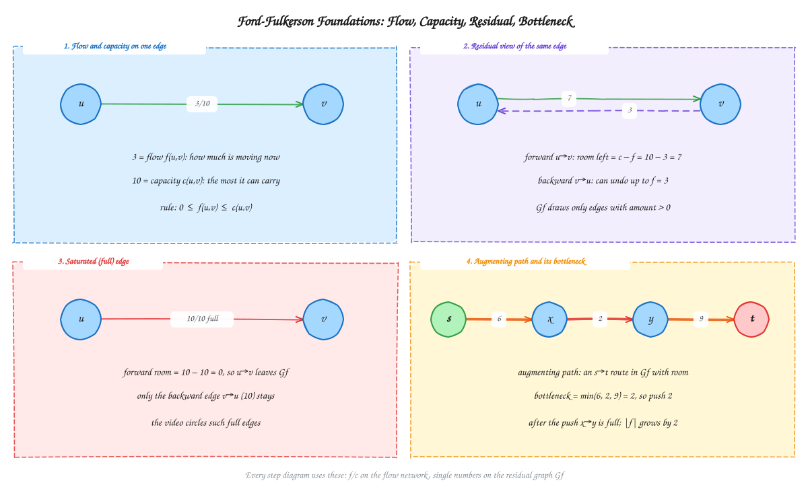

**Three facts that make the method work**

1. **The bottleneck is always safe.** Pushing the bottleneck amount never overfills any edge on the path, because no edge on it has less room.
2. **Every push raises the flow value.** The path starts at $s$ and ends at $t$, so exactly $b$ more units leave $s$ and arrive at $t$. Conservation still holds at every middle vertex, because each one gets $b$ more in and sends $b$ more out.
3. **Backward edges allow second thoughts.** If an earlier push used a pipe badly, a later path can cancel that flow and send it a better way. The [example below](#when-a-backward-edge-is-needed) shows this.

### How Ford-Fulkerson Works

1. **Start:** set $f(u,v) = 0$ on every edge, so $\lvert f\rvert = 0$. The residual graph is then the original network.
2. **Search:** look for any augmenting path from $s$ to $t$ in $G_f$. DFS, BFS, or picking one by eye all work.
3. **Bottleneck:** find $b = \min c_f(u,v)$ over the edges of the path.
4. **Push:** for every edge on the path:
   - forward edge $u \to v$: increase $f(u,v)$ by $b$;
   - backward edge $v \to u$: decrease $f(u,v)$ by $b$ (cancel flow).
5. **Update $G_f$:** each path edge loses $b$ of room and its reverse edge gains $b$. Edges whose room drops to 0 disappear.
6. **Repeat** from step 2. When no augmenting path exists, **stop**. The current $\lvert f\rvert$ is the maximum flow.

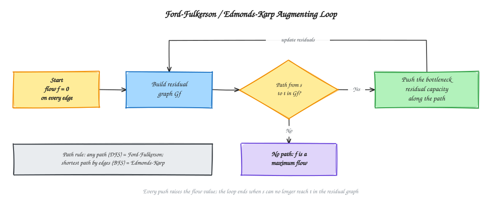

Ford-Fulkerson is called a *method* because it does not say **how** to find the path. Any search is allowed, and that choice affects the running time (see [Time Complexity and Analysis](#time-complexity-and-analysis)). The final **value** of the maximum flow is the same whatever order is used.

### Worked Example (from the video)

#### The Problem (Step 0)

Find the maximum flow from $s$ to $t$ in this network of 7 vertices and 12 directed edges.

| Edge | $s \to a$ | $s \to c$ | $s \to d$ | $c \to a$ | $a \to b$ | $c \to b$ | $c \to t$ | $b \to t$ | $d \to c$ | $c \to e$ | $d \to e$ | $e \to t$ |
| :--- | :---: | :---: | :---: | :---: | :---: | :---: | :---: | :---: | :---: | :---: | :---: | :---: |
| Capacity | 5 | 10 | 12 | 5 | 8 | 7 | 3 | 10 | 4 | 2 | 8 | 9 |

As in the video, start by writing `0/c` on every edge: no flow yet, so $\lvert f\rvert = 0$.

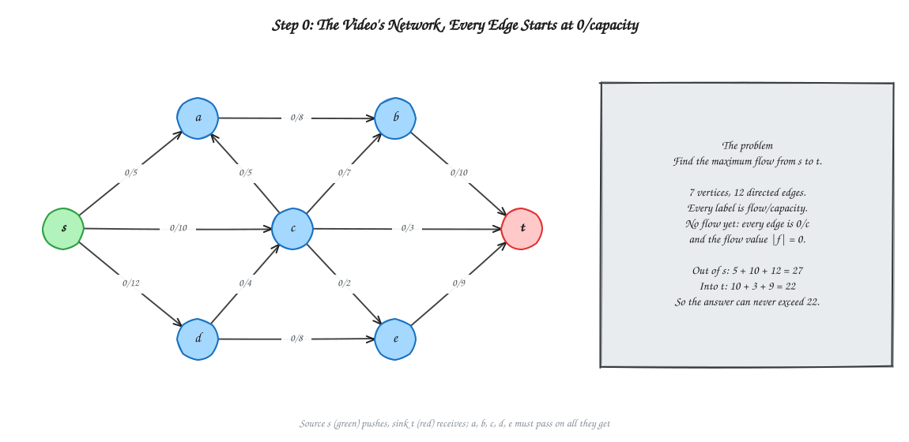

**A quick upper bound before starting.** Everything must leave $s$ (at most $5 + 10 + 12 = 27$) and enter $t$ (at most $10 + 3 + 9 = 22$). So the answer can never be more than **22**. We will see that the algorithm reaches exactly 22.

#### How to Read the Step Diagrams

Each step diagram has three parts:

| Part | What it shows |
| :--- | :--- |
| **Left panel: Search** | The residual graph $G_f$ **before** the step. Solid arrows show room left; dashed violet arrows are backward (undo) edges. The augmenting path found is **bold orange**. |
| **Right panel: Push** | The flow network **after** the step, with `f/c` on every edge. Bold orange shows the path just used, green shows edges carrying flow, red shows full edges (marked `full`), and black shows unused edges. |
| **Bottom box** | The path, the room on each of its edges, the bottleneck, every flow change, every residual change, and the new flow value. |

The paths below are chosen in the order the video uses. The method allows any order.

#### Step 1: $s \to a \to b \to t$ (bottleneck 5)

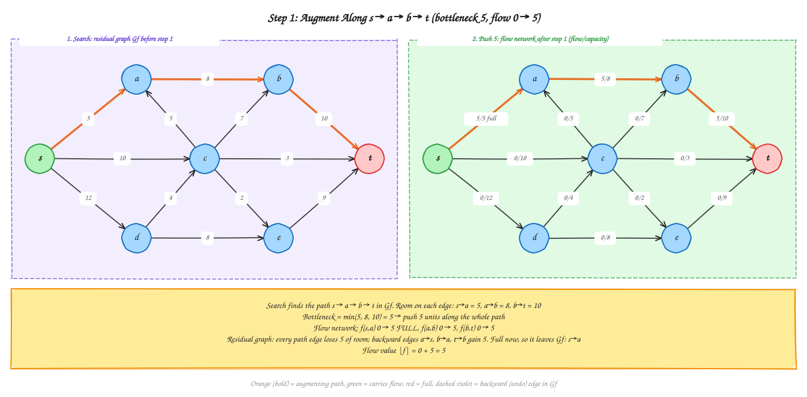

**What happens**

- At the start, $G_f$ is just the original network, so the room on each edge is its capacity.
- The path $s \to a \to b \to t$ has room $5, 8, 10$. The bottleneck is $\min(5, 8, 10) = 5$, so 5 units are sent.
- $s \to a$ is now **full** (5/5). It leaves $G_f$, and no later path can go forward through it.

| Edge | Flow before | Flow after | Room left $c - f$ | Undo room $f$ |
| :--- | :---: | :---: | :---: | :---: |
| $s \to a$ | 0 | **5/5 full** | 0 | 5 |
| $a \to b$ | 0 | 5/8 | 3 | 5 |
| $b \to t$ | 0 | 5/10 | 5 | 5 |

**Flow value:** $\lvert f\rvert = 0 + 5 = 5$.

#### Step 2: $s \to c \to t$ (bottleneck 3)

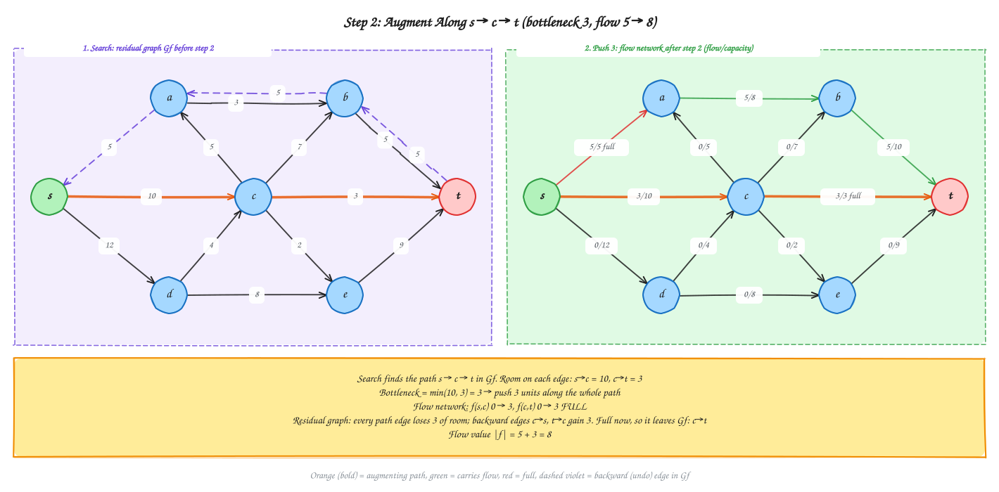

**What happens**

- In $G_f$, $s \to a$ is gone and the dashed undo edges $a \to s$, $b \to a$, $t \to b$ (5 each) have appeared.
- The direct path $s \to c \to t$ has room $10, 3$. The bottleneck is $\min(10, 3) = 3$.
- $c \to t$ is now **full** (3/3). The pipe $s \to c$ still has 7 units of room for later.

| Edge | Flow before | Flow after | Room left | Undo room |
| :--- | :---: | :---: | :---: | :---: |
| $s \to c$ | 0 | 3/10 | 7 | 3 |
| $c \to t$ | 0 | **3/3 full** | 0 | 3 |

**Flow value:** $\lvert f\rvert = 5 + 3 = 8$.

#### Step 3: $s \to d \to e \to t$ (bottleneck 8)

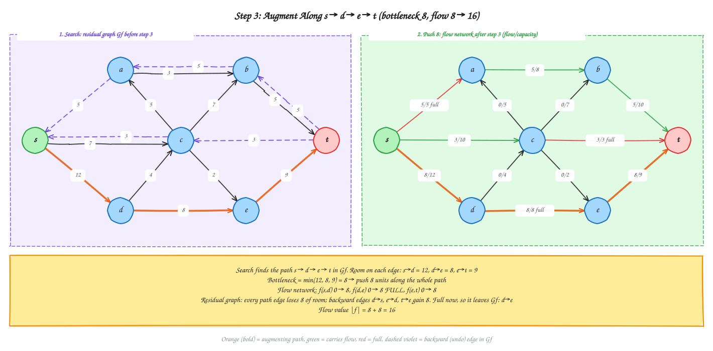

**What happens**

- $c \to t$ has left $G_f$ and a dashed $t \to c$ (3) has appeared. $s \to c$ now shows room 7 forward and 3 backward.
- The lower route $s \to d \to e \to t$ has room $12, 8, 9$. The bottleneck is $\min(12, 8, 9) = 8$.
- $d \to e$ is now **full** (8/8). $e \to t$ has only 1 unit of room left. This matters in Step 5.

| Edge | Flow before | Flow after | Room left | Undo room |
| :--- | :---: | :---: | :---: | :---: |
| $s \to d$ | 0 | 8/12 | 4 | 8 |
| $d \to e$ | 0 | **8/8 full** | 0 | 8 |
| $e \to t$ | 0 | 8/9 | 1 | 8 |

**Flow value:** $\lvert f\rvert = 8 + 8 = 16$.

#### Step 4: $s \to c \to b \to t$ (bottleneck 5)

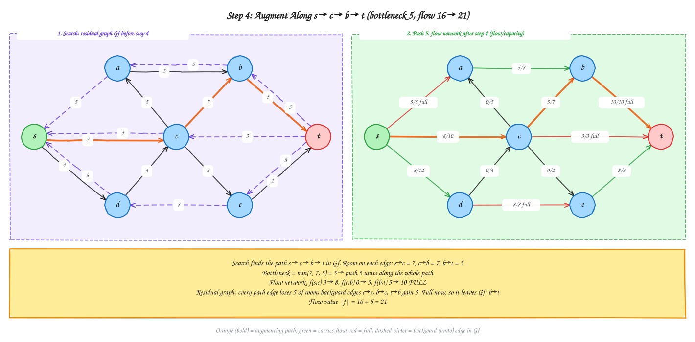

**What happens**

- $s \to c$ still has 7 units of room, but $c \to t$ is full. So the flow at $c$ must go another way, here through $b$.
- The path $s \to c \to b \to t$ has room $7, 7, 5$. The bottleneck is $\min(7, 7, 5) = 5$. The limit is $b \to t$, which already carries 5 units from Step 1.
- $b \to t$ is now **full** (10/10). Two of the three edges into $t$ are now full.

| Edge | Flow before | Flow after | Room left | Undo room |
| :--- | :---: | :---: | :---: | :---: |
| $s \to c$ | 3 | 8/10 | 2 | 8 |
| $c \to b$ | 0 | 5/7 | 2 | 5 |
| $b \to t$ | 5 | **10/10 full** | 0 | 10 |

**Flow value:** $\lvert f\rvert = 16 + 5 = 21$.

#### Step 5: $s \to d \to c \to e \to t$ (bottleneck 1)

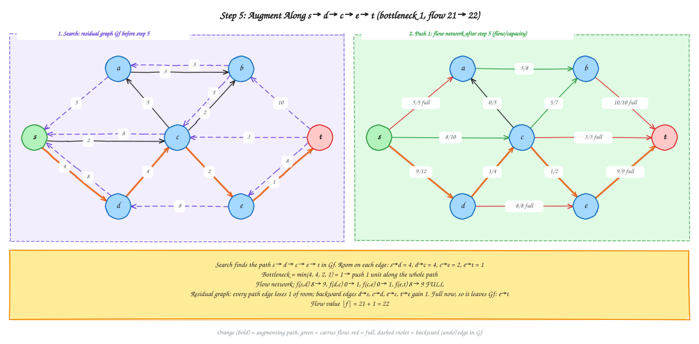

**What happens**

- The only edge into $t$ that still has room is $e \to t$, with 1 unit. $d \to e$ is full, so the flow must reach $e$ through $c \to e$, and reach $c$ through $d \to c$.
- The path $s \to d \to c \to e \to t$ has room $4, 4, 2, 1$. The bottleneck is $\min(4, 4, 2, 1) = 1$.
- $e \to t$ is now **full** (9/9). All three edges into $t$ are full.
- Another valid choice here is $s \to c \to e \to t$ (room $2, 2, 1$). It also has bottleneck 1 and gives the same final value.

| Edge | Flow before | Flow after | Room left | Undo room |
| :--- | :---: | :---: | :---: | :---: |
| $s \to d$ | 8 | 9/12 | 3 | 9 |
| $d \to c$ | 0 | 1/4 | 3 | 1 |
| $c \to e$ | 0 | 1/2 | 1 | 1 |
| $e \to t$ | 8 | **9/9 full** | 0 | 9 |

**Flow value:** $\lvert f\rvert = 21 + 1 = 22$.

#### Summary of All Augmentations

This is the table the video builds on the right side of the page, with a running total added.

| Step | Augmenting path | Bottleneck capacity | Edge(s) that become full | Flow value |
| :---: | :--- | :---: | :--- | :---: |
| 1 | $s \to a \to b \to t$ | 5 | $s \to a$ | 5 |
| 2 | $s \to c \to t$ | 3 | $c \to t$ | 8 |
| 3 | $s \to d \to e \to t$ | 8 | $d \to e$ | 16 |
| 4 | $s \to c \to b \to t$ | 5 | $b \to t$ | 21 |
| 5 | $s \to d \to c \to e \to t$ | 1 | $e \to t$ | **22** |

$$\text{Maximum flow} = 5 + 3 + 8 + 5 + 1 = \mathbf{22}$$

Every augmentation fills at least one edge. That is why each step makes the residual graph "smaller" and pushes the search toward the edges that are left.

#### Why It Stops: No Augmenting Path Left

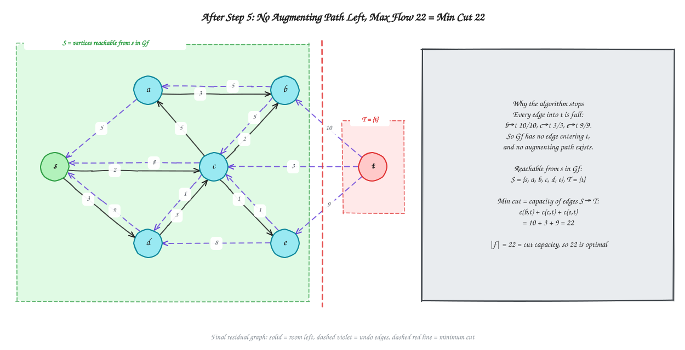

After Step 5, every edge into $t$ is full: $b \to t$ (10/10), $c \to t$ (3/3), $e \to t$ (9/9). In $G_f$, $t$ has only outgoing (undo) edges and **no incoming edge**, so no search from $s$ can reach it. The algorithm stops.

The vertices that $s$ can still reach are $S = \{s, a, b, c, d, e\}$, and the rest is $T = \{t\}$. The edges from $S$ to $T$ form a **cut** with capacity

$$c(S,T) = c(b,t) + c(c,t) + c(e,t) = 10 + 3 + 9 = 22 = \lvert f\rvert.$$

No flow can be larger than any cut, and this flow equals this cut. So 22 is the **maximum flow**, and this cut is a **minimum cut**. It also matches the quick upper bound from Step 0. See [Max-Flow Min-Cut](#max-flow-min-cut) for the general theorem.

#### Checking the Answer

Final flow on every edge:

| Edge | $s \to a$ | $s \to c$ | $s \to d$ | $c \to a$ | $a \to b$ | $c \to b$ | $c \to t$ | $b \to t$ | $d \to c$ | $c \to e$ | $d \to e$ | $e \to t$ |
| :--- | :---: | :---: | :---: | :---: | :---: | :---: | :---: | :---: | :---: | :---: | :---: | :---: |
| `f/c` | 5/5 | 8/10 | 9/12 | 0/5 | 5/8 | 5/7 | 3/3 | 10/10 | 1/4 | 1/2 | 8/8 | 9/9 |

**Capacity rule:** every `f` is between 0 and `c`. **Conservation rule:** at each middle vertex, flow in equals flow out.

| Vertex | Flow in | Flow out | Balanced? |
| :---: | :--- | :--- | :---: |
| $a$ | $f(s,a) + f(c,a) = 5 + 0 = 5$ | $f(a,b) = 5$ | Yes |
| $b$ | $f(a,b) + f(c,b) = 5 + 5 = 10$ | $f(b,t) = 10$ | Yes |
| $c$ | $f(s,c) + f(d,c) = 8 + 1 = 9$ | $f(c,a) + f(c,b) + f(c,t) + f(c,e) = 0 + 5 + 3 + 1 = 9$ | Yes |
| $d$ | $f(s,d) = 9$ | $f(d,c) + f(d,e) = 1 + 8 = 9$ | Yes |
| $e$ | $f(c,e) + f(d,e) = 1 + 8 = 9$ | $f(e,t) = 9$ | Yes |

Leaving $s$: $5 + 8 + 9 = 22$. Entering $t$: $10 + 3 + 9 = 22$. Both equal $\lvert f\rvert = 22$.

**Notice:** this example never needed a backward edge, because every path used only forward edges. The next example shows a case where a backward edge is essential.

### When a Backward Edge Is Needed

Use the small network in the first diagram: $c(s,a) = 2$, $c(s,b) = 2$, $c(a,b) = 1$, $c(a,t) = 2$, $c(b,t) = 2$.

**Ford-Fulkerson with an unlucky first path.**

| Step | Augmenting path | Bottleneck | Flow value |
| :---: | :--- | :---: | :---: |
| 1 | $s \to a \to b \to t$ | $\min(2, 1, 2) = 1$ | 1 |
| 2 | $s \to a \to t$ | $\min(1, 2) = 1$ | 2 |
| 3 | $s \to b \to t$ | $\min(2, 1) = 1$ | 3 |
| 4 | $s \to b \to a \to t$ (uses the **backward** edge $b \to a$) | $\min(1, 1, 1) = 1$ | 4 |

Step 4 shows why backward edges matter. After steps 1 to 3, the edge $a \to b$ carries one unit, and no forward-only path is left. The backward edge $b \to a$ cancels that unit on $a \to b$ and sends it along $a \to t$ instead, so the extra flow from $b$ can reach $t$ through $a$. Without backward edges, the algorithm would stop at value 3, which is **not** maximum.

**Final flow:** $f(s,a) = 2$, $f(s,b) = 2$, $f(a,b) = 0$, $f(a,t) = 2$, $f(b,t) = 2$. The maximum flow value is **4**.

### Time Complexity and Analysis

Let $V$ be the number of vertices, $E$ the number of edges, and $\lvert f^*\rvert$ the value of the maximum flow. Assume all capacities are **integers**.

**Cost of one iteration (one augmentation)**

| Work in one iteration | Cost | Reason |
| :--- | :---: | :--- |
| Find an $s \to t$ path in $G_f$ (DFS or BFS) | $O(V + E)$ | $G_f$ has at most $2E$ edges (a forward and a backward edge for each original edge). |
| Find the bottleneck | $O(V)$ | A simple path has at most $V - 1$ edges. |
| Update flows and residual capacities | $O(V)$ | Only the path edges and their reverse edges change. |
| **One iteration** | $O(E)$ | Assume every vertex lies on some $s$-$t$ path, so $E \ge V - 1$ and $O(V + E) = O(E)$. |

**Number of iterations**

- With integer capacities, every residual capacity is an integer. So every bottleneck is at least 1, and each augmentation raises $\lvert f\rvert$ by **at least 1**.
- $\lvert f\rvert$ starts at 0 and can never exceed $\lvert f^*\rvert$. So there are **at most $\lvert f^*\rvert$ augmentations**, plus one last search that fails.

**Total**

$$T(V, E) = O(E) \times O(\lvert f^*\rvert) = O(E \cdot \lvert f^*\rvert), \qquad \text{space} = O(V + E) \text{ for the residual graph.}$$

**Applied to the video's network:** $V = 7$, $E = 12$, $\lvert f^*\rvert = 22$. The bound allows up to 22 augmentations, each scanning at most $2 \times 12 = 24$ residual edges. The actual run needed only **5** augmentations and one failed search, because the bottlenecks were large ($5, 3, 8, 5, 1$). The bound is a worst case, not a prediction.

**Worst case: a bad path choice.** The running time depends on the capacity **values**, not just on $V$ and $E$. In the network below, a search that always goes through the middle edge (capacity 1) adds only 1 unit per round. It uses that edge, cancels it with the backward edge, and uses it again. That takes 2000 rounds, while two sensible paths would finish in 2.

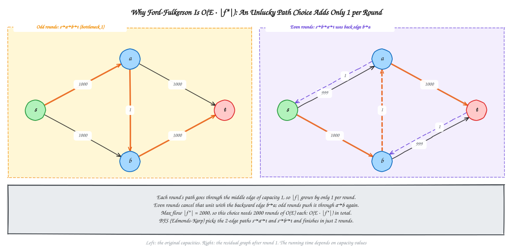

**Key points for exams**

| Point | Explanation |
| :--- | :--- |
| Pseudo-polynomial | $O(E \cdot \lvert f^*\rvert)$ grows with the **numeric value** of the capacities. If capacities are around $10^9$, the bound is huge even for a small graph. |
| Integer capacities | Termination is guaranteed, and the final flow is an integer on every edge (the **integrality property**, used in [Bipartite Matching](#bipartite-matching)). |
| Rational capacities | Multiply every capacity by a common denominator to make them integers, so the method still terminates. |
| Irrational capacities | With a bad path choice, the method may **never terminate**. It can even approach a value that is not the maximum. |
| Fix: choose paths wisely | Always picking a shortest path with BFS gives [Edmonds-Karp](#edmonds-karp-algorithm), $O(VE^2)$, which does not depend on capacity values. |
| Correctness | When no augmenting path is left, the reachable set $S$ gives a cut whose capacity equals $\lvert f\rvert$, so the flow is maximum ([Max-Flow Min-Cut](#max-flow-min-cut)). |

| Variant | Path rule | Augmentations (worst case) | Time |
| :--- | :--- | :--- | :--- |
| Ford-Fulkerson | Any path, usually DFS | $\lvert f^*\rvert$ | $O(E \cdot \lvert f^*\rvert)$ |
| Edmonds-Karp | Shortest path by edge count (BFS) | $O(VE)$ | $O(VE^2)$ |

---

## Edmonds-Karp Algorithm

**Edmonds-Karp** is Ford-Fulkerson with one rule: always augment along a **shortest path** (fewest edges) in the residual graph, found with **BFS**.

On the small network from [When a Backward Edge Is Needed](#when-a-backward-edge-is-needed), BFS from $s$ finds $s \to a \to t$ first (two edges, bottleneck 2), then $s \to b \to t$ (two edges, bottleneck 2). After these **two** augmentations the flow is 4 and $s$ has no outgoing residual edge. The unlucky four-step sequence above never happens, because the zig-zag path $s \to a \to b \to t$ has three edges and is longer than the alternatives.

Why prefer shortest paths? The shortest-path distance from $s$ to any vertex never decreases during the algorithm, and each augmentation saturates at least one *critical* edge. Together these facts bound the number of augmentations by $O(VE)$, no matter how large the capacities are.

| Method | Path rule | Augmentations | Total time |
| :--- | :--- | :--- | :--- |
| Ford-Fulkerson | Any path (for example DFS) | Up to $\lvert f^*\rvert$ for integer capacities | $O(E \cdot \lvert f^*\rvert)$ |
| Edmonds-Karp | Shortest path by edge count (BFS) | $O(VE)$ | $O(VE^2)$ |

Here $\lvert f^*\rvert$ is the value of the maximum flow. Ford-Fulkerson depends on the *numbers* in the capacities (a path might add only 1 unit per round), while Edmonds-Karp depends only on the *shape* of the graph.

---

## Max-Flow Min-Cut

### The Question and the Cut Upper Bound

Given a finite directed network $G=(V,E)$, nonnegative edge capacities $c$, a source $s$, and a sink $t$, the **maximum-flow problem** asks for a feasible flow $f$ with the largest possible value $|f|$. A result is most useful when it includes both:

- a **feasible flow**: every edge respects its capacity and every intermediate vertex conserves flow;
- an **optimality certificate**: evidence that no other feasible flow can be larger.

An **$s$-$t$ cut** $(S,T)$ partitions the vertices so $s\in S$ and $t\in T$. Its capacity counts only original directed edges going **from $S$ to $T$**; edges from $T$ back to $S$ are not included:

$$c(S,T)=\sum_{(u,v)\in E,\ u\in S,\ v\in T} c(u,v).$$

For any flow $f$, write $f(A,B)$ for the total flow on original edges directed from set $A$ to set $B$. Flow conservation at the vertices in $S\setminus\{s\}$ makes all internal flow cancel, leaving

$$|f|=f(S,T)-f(T,S)\le f(S,T)\le c(S,T).$$

This is the **cut upper bound**: every cut limits every feasible flow. It gives a quick way to bound an answer, but an arbitrary cut need not be the minimum one.

### The Theorem, End to End

**Max-flow min-cut theorem.** For any feasible flow $f$ in a finite network with finite, nonnegative capacities, these statements are equivalent. In optimization notation:

$$\max\{|f|: f\text{ is feasible}\}=\min\{c(S,T):(S,T)\text{ is an }s\text{-}t\text{ cut}\}.$$

1. $f$ is a **maximum flow**.
2. The residual graph $G_f$ contains **no path from $s$ to $t**.
3. There is an $s$-$t$ cut $(S,T)$ with $|f|=c(S,T)$. That cut is a **minimum cut**.

The theorem applies to real as well as integer capacities. Integrality affects whether a particular augmenting-path algorithm is guaranteed to finish, not whether the theorem is true.

**Why the three statements are equivalent.**

1. **Maximum flow implies no augmenting path.** If a residual $s$-$t$ path existed, every edge on it would have positive residual capacity. Pushing the path's positive bottleneck would increase $|f|$, contradicting maximality.
2. **No augmenting path gives an equal-capacity cut.** Let $S$ be exactly the vertices reachable from $s$ in $G_f$, and let $T=V\setminus S$. Then $t\in T$. Every original edge from $S$ to $T$ is saturated; otherwise its forward residual edge would reach a vertex in $T$. Every original edge from $T$ to $S$ carries zero flow; otherwise its reverse residual edge would leave $S$ and reach $T$. Therefore

   $$|f|=f(S,T)-f(T,S)=c(S,T)-0=c(S,T).$$
3. **An equal-capacity cut proves optimality.** The cut upper bound says every feasible flow $g$ satisfies $|g|\le c(S,T)=|f|$. Thus $f$ is maximum. No cut can have capacity below $|f|$, so this cut is minimum.

Together, this is a proof and a practical certificate: a feasible flow plus a cut of the same value proves both are optimal.

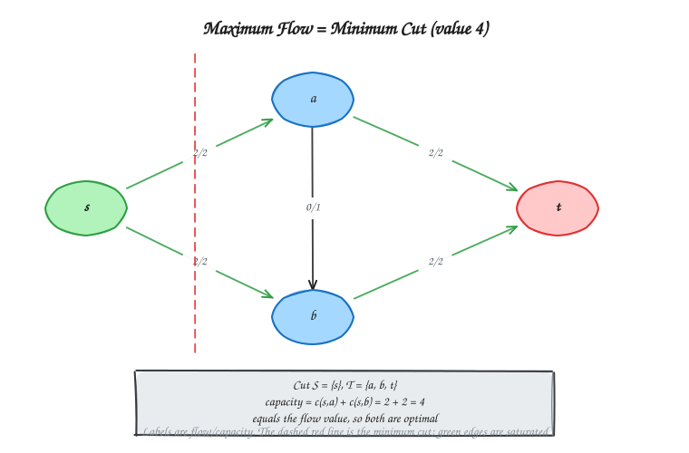

*Warm-up: in this small network, the cut leaving $s$ has capacity $2+2=4$, matching the feasible flow of 4.*

### Standard Procedure: Find and Certify a Maximum Flow

This is the Ford-Fulkerson augmenting-path method, followed by the theorem's cut certificate. Edmonds-Karp uses the same procedure but chooses each path with BFS.

1. **Initialize:** set $f(e)=0$ on every edge.
2. **Build/search the residual graph $G_f$:** a forward edge has room $c(u,v)-f(u,v)$; a backward edge has room $f(u,v)$ and can undo previous flow.
3. **Find an augmenting path** $P$ from $s$ to $t$. If none exists, go to Step 6.
4. **Find the bottleneck:** $\Delta=\min_{e\in P} c_f(e)$, the least residual capacity on the path.
5. **Augment by $\Delta$:** add $\Delta$ on forward original edges and cancel $\Delta$ on backward edges. Update the residual graph and repeat from Step 3.
6. **Extract the cut:** reuse the final search's reachable set as $S$ and set $T=V\setminus S$.
7. **Certify:** add the capacities of original edges from $S$ to $T$. The final residual search guarantees this sum equals $|f|$, proving maximum flow equals minimum cut.

**Guarantee to keep straight:** integer capacities make each Ford-Fulkerson augmentation increase the integer flow value by at least 1, so that version terminates. With arbitrary real capacities, a poor path rule can fail to terminate; the theorem still holds, and Edmonds-Karp's BFS rule has the capacity-independent bound $O(VE^2)$ (see [Edmonds-Karp](#edmonds-karp-algorithm)).

### Worked Certificate: The Flow-22 Network

Use the same seven-vertex network and final flow as the [Ford-Fulkerson trace](#worked-example-from-the-video). Its five augmentations push $5,3,8,5,1$ units, giving $|f|=22$. The final residual search reaches $S=\{s,a,b,c,d,e\}$ but cannot reach $t$, so $T=\{t\}$.

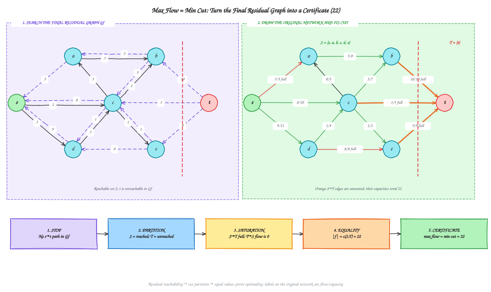

Only three original edges cross this cut from $S$ to $T$:

| Cut edge | Flow / capacity | Capacity counted |
| :--- | :---: | :---: |
| $b\to t$ | $10/10$ | 10 |
| $c\to t$ | $3/3$ | 3 |
| $e\to t$ | $9/9$ | 9 |
| **Cut capacity** |  | **22** |

$$|f|=5+3+8+5+1=22=c(S,T)=10+3+9.$$

Every edge crossing into $t$ is full, so there is no residual route from $s$ to $t$. The feasible flow reaches the cut's upper bound: **maximum flow = minimum cut = 22**. This is the general proof applied to the exact final state of Ford-Fulkerson, not just a numerical coincidence.

### Exam-Style Question and Model Answer

The theorem above explains why the method works. The following is the concise, numbered format to use when solving a flow problem in an exam: show each path, its **current residual capacities**, the bottleneck, and the running flow; then finish with a cut certificate.

**Question.** Consider the directed network shown below. Each edge is labelled $0/c$, where $c$ is its capacity. Use Ford-Fulkerson to find the maximum flow from $s$ to $t$, find a minimum $s$-$t$ cut, and verify the Max-Flow Min-Cut Theorem.

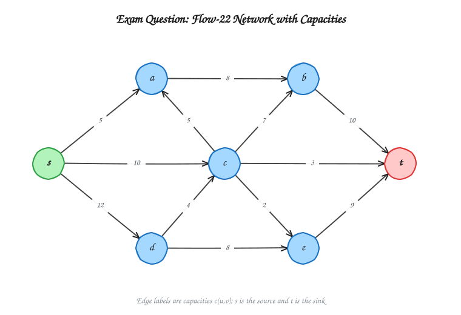

[Open the question network's editable Excalidraw diagram](diagrams/ch12-16-exam-flow-network.excalidraw).

The capacities are:

| Edge | Capacity | Edge | Capacity |
| :--- | ---: | :--- | ---: |
| $s \to a$ | 5 | $s \to c$ | 10 |
| $s \to d$ | 12 | $c \to a$ | 5 |
| $a \to b$ | 8 | $c \to b$ | 7 |
| $c \to t$ | 3 | $b \to t$ | 10 |
| $d \to c$ | 4 | $c \to e$ | 2 |
| $d \to e$ | 8 | $e \to t$ | 9 |

**Answer.** Initially, $f(e)=0$ for every edge, so $|f|=0$. Using the augmenting-path order below:

1. $P_1=s\to a\to b\to t$. Residual capacities: $5,8,10$. Thus $\Delta_1=\min(5,8,10)=5$ and $|f|=5$.
2. $P_2=s\to c\to t$. Residual capacities: $10,3$. Thus $\Delta_2=\min(10,3)=3$ and $|f|=8$.
3. $P_3=s\to d\to e\to t$. Residual capacities: $12,8,9$. Thus $\Delta_3=\min(12,8,9)=8$ and $|f|=16$.
4. $P_4=s\to c\to b\to t$. Residual capacities: $7,7,5$. Thus $\Delta_4=\min(7,7,5)=5$ and $|f|=21$.
5. $P_5=s\to d\to c\to e\to t$. Residual capacities: $4,4,2,1$. Thus $\Delta_5=\min(4,4,2,1)=1$ and $|f|=22$.

The residual capacities above are those **at the time each path is chosen**. After the fifth augmentation there is no $s$-$t$ path in the residual graph (all three original edges entering $t$ are saturated), so the algorithm stops. Therefore, $|f|=5+3+8+5+1=22$.

**Minimum cut.** In the final residual graph, the vertices reachable from $s$ are

$$S=\{s,a,b,c,d,e\},\qquad T=V\setminus S=\{t\}.$$

Only count original directed edges from $S$ to $T$:

$$b\to t\ (10),\qquad c\to t\ (3),\qquad e\to t\ (9).$$

Therefore,

$$c(S,T)=c(b,t)+c(c,t)+c(e,t)=10+3+9=22.$$

[Open the final-flow and minimum-cut certificate's editable Excalidraw diagram](diagrams/ch12-15-max-flow-min-cut-certificate.excalidraw).

Since $|f|=c(S,T)=22$, the flow is maximum and the cut is minimum. By the Max-Flow Min-Cut Theorem,

$$\boxed{\text{Maximum Flow}=\text{Minimum Cut}=22.}$$

**What to draw for full credit.** On the final flow graph, label edges as $f/c$ and mark the cut separating $S$ from $T$ (a dashed line is clear). List the original edges crossing from $S$ to $T$ and add their capacities. The exam sequence to remember is

$$\boxed{\text{PATH}\to\text{BOTTLENECK}\to\text{PUSH}\to\text{REPEAT}\to\text{STOP}\to\text{CUT}\to\text{PROVE}.}$$

---

## Bipartite Matching

A graph is **bipartite** if its vertices split into a left set $L$ and a right set $R$ with every edge between the two sets. A **matching** is a set of edges, no two sharing a vertex. A **maximum matching** has the most edges.

**Reduction to maximum flow.**

1. Add a source $s$ with an edge $s \to u$ for every $u \in L$.
2. Add a sink $t$ with an edge $v \to t$ for every $v \in R$.
3. Direct every original edge from $L$ to $R$.
4. Give every edge capacity **1**.

With integer capacities, a maximum flow can always be chosen with every edge carrying 0 or 1 (the integrality property). The edges $L \to R$ that carry flow 1 form a matching, and **maximum flow value = maximum matching size**.

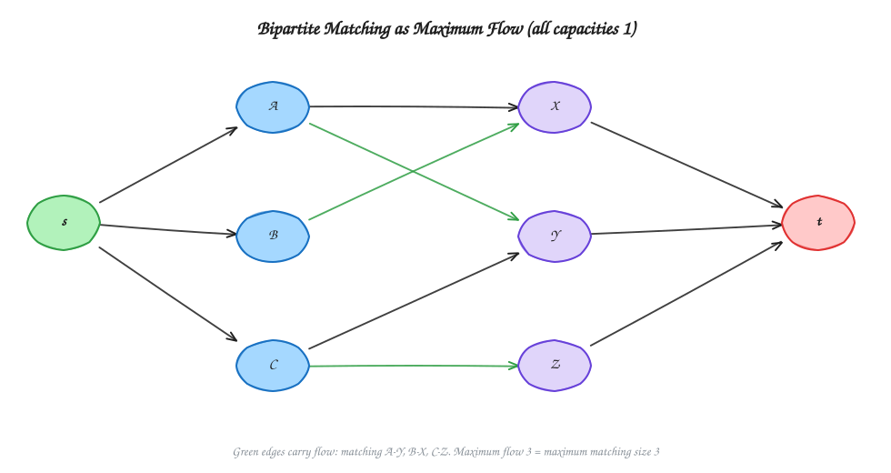

**Example.** Left $\{A, B, C\}$, right $\{X, Y, Z\}$, edges $A\text{-}X$, $A\text{-}Y$, $B\text{-}X$, $C\text{-}Y$, $C\text{-}Z$.

| Step | Action | Matching |
| :---: | :--- | :--- |
| 1 | $A$ takes its first free neighbor $X$. | $\{A\text{-}X\}$ |
| 2 | $B$ wants $X$, which is taken. The augmenting path $s \to B \to X \to A \to Y \to t$ reassigns $A$ to $Y$ and gives $X$ to $B$. | $\{A\text{-}Y, B\text{-}X\}$ |
| 3 | $C$'s neighbor $Y$ is taken, but $Z$ is free. | $\{A\text{-}Y, B\text{-}X, C\text{-}Z\}$ |

The matching has size 3 and every left vertex is matched, so it is a **perfect matching**. In matching language, an augmenting path is an *alternating path*: it alternates between non-matching and matching edges and starts and ends at unmatched vertices.

A useful link to [Chapter 13](../Chapter%2013%20-%20Approximation%20Algorithms/README.md): in a bipartite graph, the maximum matching size equals the minimum vertex cover size (König's theorem). For general graphs, finding a minimum vertex cover is NP-hard.

---

## Correctness and Complexity

**Termination and correctness.** Each augmentation raises the integer flow value by at least 1, and the value is bounded by the capacity of any cut, so the method terminates when capacities are integers. When it stops there is no augmenting path, and by the theorem above the flow is maximum. The full cost breakdown is in [Time Complexity and Analysis](#time-complexity-and-analysis).

| Algorithm | Time | Notes |
| :--- | :--- | :--- |
| Ford-Fulkerson | $O(E \cdot \lvert f^*\rvert)$ | Integer capacities only; can be slow when $\lvert f^*\rvert$ is large. |
| Edmonds-Karp | $O(VE^2)$ | $O(VE)$ augmentations, each a BFS of $O(E)$. |
| Bipartite matching via Ford-Fulkerson | $O(VE)$ | The flow value is at most $\min(\lvert L\rvert, \lvert R\rvert) \le V$, and each augmentation costs $O(E)$. |

The residual graph needs $O(V + E)$ space. A specialized algorithm (Hopcroft-Karp) matches bipartite graphs in $O(E\sqrt{V})$, but it is beyond the syllabus.

---

## Practice and Exam Notes

- Define flow, capacity, source, sink, residual graph, and augmenting path in one sentence each.
- When tracing, write the residual capacities after each augmentation, and circle the bottleneck edge. Mark backward edges clearly.
- Use the video's layout for a trace answer: redraw the graph with `f/c` labels after each step, circle full edges, and keep a side table of *augmenting path | bottleneck capacity*. Add the bottlenecks for the final answer (here $5 + 3 + 8 + 5 + 1 = 22$).
- End a trace by proving it is maximum: show that no $s \to t$ path remains in $G_f$, and give the cut $(S, T)$ whose capacity equals the flow.
- Explain **why backward edges exist**: they let a later path cancel flow that an earlier path should not have used.
- State the difference between Ford-Fulkerson (any path) and Edmonds-Karp (BFS shortest path) and give both bounds.
- To certify a maximum flow, take the vertices reachable from $s$ in the final residual graph, set $T=V\setminus S$, and count only original edges from $S$ to $T$. Verify that their capacity equals $|f|$.
- For a copyable, complete numerical solution, follow the [exam-style question and model answer](#exam-style-question-and-model-answer).
- For matching, draw the flow network with all capacities 1 and report the matched $L$-$R$ edges.
- Frequently asked: the max-flow problem, residual graph construction, a Ford-Fulkerson trace on a given network, and bipartite matching.

[Previous: Chapter 11 - Graph Algorithms](../Chapter%2011%20-%20Graph%20Algorithms/README.md) | [Home](../README.md) | [Next: Chapter 13 - Approximation Algorithms](../Chapter%2013%20-%20Approximation%20Algorithms/README.md)
