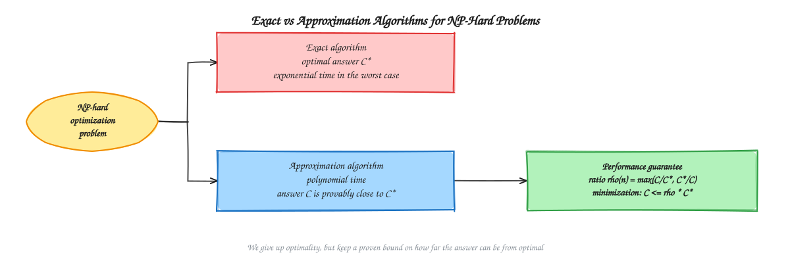
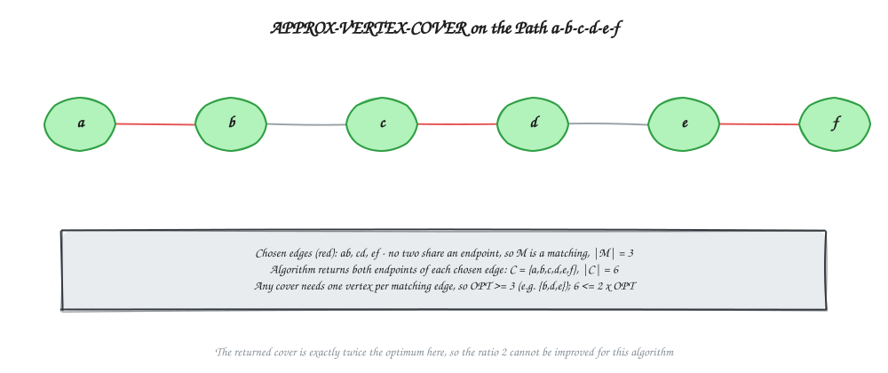
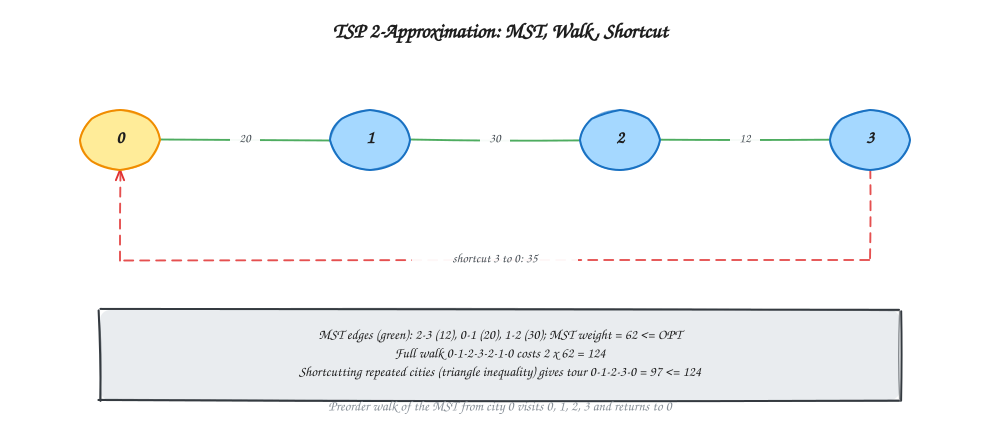
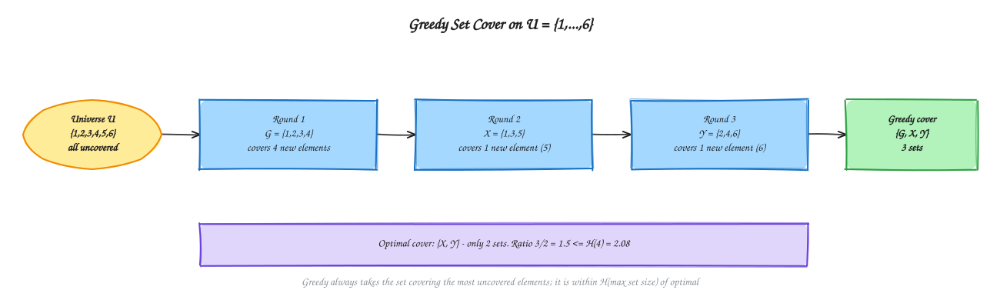

# Chapter 13 - Approximation Algorithms

[Previous: Chapter 12 - Flow Algorithms](../Chapter%2012%20-%20Flow%20Algorithms/README.md) | [Home](../README.md) | [Next: Chapter 14 - Randomized and Parallel Algorithms](../Chapter%2014%20-%20Randomized%20and%20Parallel%20Algorithms/README.md)

---

Many important optimization problems are NP-hard, so no polynomial-time algorithm that always finds the optimum is known. An **approximation algorithm** accepts this: it runs in polynomial time and returns a solution that is *provably* close to optimal. The distance from optimal is measured by the **approximation ratio**.

This chapter explains why approximation is needed, defines the ratio and performance guarantee, and works through three standard algorithms: vertex cover, the traveling salesperson problem with the triangle inequality, and set cover. It follows [Chapter 15](../Chapter%2015%20-%20Lower%20Bound%20Theory%20and%20NP%20Completeness/README.md) in spirit (NP-hardness is the reason approximation exists) and reuses the TSP matrix from [Chapter 10](../Chapter%2010%20-%20Branch%20and%20Bound/README.md). It intentionally contains no implementation code.

---

## Start Here: The Idea in Plain Words

**A delivery driver has 60 stops.** The perfect shortest route is very hard to find. Even a fast computer may need longer than your lifetime. But a computer can find a *good* route in one second, and you can **prove** it is never more than twice as long as the perfect one.

Would you take it? Most people would. That is an **approximation algorithm**: a fast method that gives an answer that is not perfect, but comes with a **promise** about how close it is.

**How we measure "how close".** Divide your answer by the best answer. This is the **approximation ratio**.

- The best route is 50 km. Yours is 75 km. The ratio is 75 / 50 = **1.5**.
- A ratio of 1 means perfect. A ratio of 2 means "at most twice as bad".

**Why not just find the best answer?** The problems here are "NP-hard". In simple words: nobody knows a fast way to solve them exactly, and most experts believe none exists. So we accept a good-enough answer.

**How do you prove a promise when you do not know the best answer?** You find a number that the best answer can never go below (a *floor*), and show your answer is at most twice that floor. This trick appears in every proof in this chapter.

**Words used in this chapter, in simple terms**

| Word | Simple meaning |
| :--- | :--- |
| Optimal | The best possible answer. |
| Approximation algorithm | A fast method with a proven promise about how close it gets. |
| Approximation ratio | Your answer divided by the best answer (for "smaller is better" problems). |
| Vertex cover | A set of points that touches every line in a drawing. We want the smallest set. |
| Matching | A set of lines where no two lines share a point. |
| Spanning tree (MST) | The cheapest set of lines that joins all points with no loops. |
| Triangle inequality | Going straight is never longer than going around a corner. |
| Set cover | Pick the fewest groups so that every item belongs to at least one chosen group. |

**Before you start:** it helps to know what a graph and a minimum spanning tree are ([Chapter 11](../Chapter%2011%20-%20Graph%20Algorithms/README.md)) and what NP-hard means ([Chapter 15](../Chapter%2015%20-%20Lower%20Bound%20Theory%20and%20NP%20Completeness/README.md)). If NP-hard is new to you, the short idea above is enough for now. **Reading tip:** the "Intuition for the proof" part of set cover is optional on a first read.

---

## Table of Contents

- [Start Here: The Idea in Plain Words](#start-here-the-idea-in-plain-words)
1. [Exact vs Approximation Algorithms](#exact-vs-approximation-algorithms)
2. [Approximation Ratio and Performance Guarantee](#approximation-ratio-and-performance-guarantee)
3. [Vertex Cover: A 2-Approximation](#vertex-cover-a-2-approximation)
4. [Traveling Salesperson Problem: A 2-Approximation](#traveling-salesperson-problem-a-2-approximation)
5. [Set Cover: A Greedy Approximation](#set-cover-a-greedy-approximation)
6. [Relationship with NP-Hard Problems](#relationship-with-np-hard-problems)
7. [Summary of Guarantees](#summary-of-guarantees)
8. [Practice and Exam Notes](#practice-and-exam-notes)

---

## Exact vs Approximation Algorithms

| Feature | Exact algorithm | Approximation algorithm |
| :--- | :--- | :--- |
| Answer | Always optimal | Within a proven factor of optimal |
| Running time on NP-hard problems | Exponential in the worst case | Polynomial |
| Use when | The input is small, or a fast exact method exists | The input is large and a near-optimal answer is acceptable |
| Examples | Brute force, DP for TSP, branch and bound | 2-approximate vertex cover, MST-based TSP |

**Need for approximation.** For an NP-hard problem, exact methods such as the [DP for TSP](../Chapter%208%20-%20Dynamic%20Programming/README.md) take time exponential in $n$. With 60 cities, $2^{60}$ steps is out of reach, while an approximation finishes at once. A guaranteed answer within a factor of 2 is often far more useful than an exact answer that never arrives.

See the [diagram index](diagrams/README.md) for editable Excalidraw sources and SVG previews.

---

## Approximation Ratio and Performance Guarantee

Let $C$ be the cost of the algorithm's solution and $C^*$ the cost of an optimal solution.

The algorithm has **approximation ratio** $\rho(n)$ if, for every input of size $n$,

$$
\max\left(\frac{C}{C^*},\ \frac{C^*}{C}\right) \le \rho(n)
$$

- **Minimization** (vertex cover, TSP, set cover): $C \ge C^*$, so the condition is $C \le \rho(n)\, C^*$.
- **Maximization** (for example maximum clique or knapsack profit): $C \le C^*$, so the condition is $C^* \le \rho(n)\, C$.
- The ratio is always at least 1; ratio 1 means optimal.

An algorithm with ratio $\rho(n)$ is called a **$\rho(n)$-approximation algorithm**, and $\rho(n)$ is its **performance guarantee**. It is a worst-case promise: the answer is never worse than this factor, though on many inputs it is much better.

**How to prove a ratio.** We usually cannot compute $C^*$, which is the whole difficulty. The standard method is to find an easily computed baseline $L$ with $L \le C^*$ (a lower bound on the optimum for minimization), and show $C \le \rho \cdot L$. Then $C \le \rho\, C^*$ follows directly. We never need to know the exact optimum to guarantee that our answer is close to it.

---

## Vertex Cover: A 2-Approximation

**Problem.** A **vertex cover** of an undirected graph is a set of vertices that contains at least one endpoint of every edge. Find a cover of minimum size. The decision version is NP-complete.

**Algorithm (APPROX-VERTEX-COVER).**

1. Start with an empty cover $C$ and let $E'$ be the set of all edges.
2. While $E'$ is not empty: pick any edge $(u, v)$ in $E'$, add **both** $u$ and $v$ to $C$, and delete from $E'$ every edge touching $u$ or $v$.
3. Return $C$.

**Example.** Path $a - b - c - d - e - f$ with edges $ab, bc, cd, de, ef$.

| Step | Edge picked | Added to $C$ | Edges removed | Edges left |
| :---: | :--- | :--- | :--- | :--- |
| 1 | $ab$ | $a, b$ | $ab, bc$ | $cd, de, ef$ |
| 2 | $cd$ | $c, d$ | $cd, de$ | $ef$ |
| 3 | $ef$ | $e, f$ | $ef$ | none |

The cover is $C = \{a, b, c, d, e, f\}$ with $|C| = 6$. An optimal cover is $\{b, d, e\}$ with size 3 (it touches $ab, bc$ via $b$; $cd, de$ via $d$; $ef$ via $e$). The ratio is $6/3 = 2$ exactly.

**Proof that the ratio is 2.**

- The edges chosen in step 2 form a set $M$. No two of them share an endpoint, because after choosing an edge, every edge touching its endpoints is deleted. So $M$ is a **matching**.
- Any cover, including an optimal one, must contain at least one endpoint of each edge in $M$, and those endpoints are all different. Hence $|C^*| \ge |M|$.
- The algorithm adds exactly two vertices per chosen edge, so $|C| = 2|M|$.
- Therefore $|C| = 2|M| \le 2|C^*|$.

**Cost.** Using adjacency lists, $O(V + E)$ time. The returned set is always a valid cover, because the loop ends only when every edge has been removed, and an edge is removed only when one of its endpoints enters $C$.

> A tempting alternative, "repeatedly take the vertex of highest degree," feels smarter but has no constant-factor guarantee: its ratio can grow like $\ln n$. The simple matching-based algorithm has the better worst-case promise.

---

## Traveling Salesperson Problem: A 2-Approximation

**Problem.** Given $n$ cities and the cost $c(u, v)$ of travelling between each pair, find the cheapest tour that visits every city exactly once and returns to the start.

**Two situations.**

- **General costs:** if $\text{P} \ne \text{NP}$, no polynomial-time algorithm can approximate TSP within *any* constant factor. A tour cost can be made arbitrarily bad by a single huge edge.
- **Triangle inequality:** if $c(u, w) \le c(u, v) + c(v, w)$ for all cities (going directly is never longer than a detour, as with real distances), a good approximation exists.

**Algorithm (APPROX-TSP-TOUR), assuming the triangle inequality.**

1. Choose a start city $r$.
2. Compute a **minimum spanning tree** $T$ of the complete graph (Prim or Kruskal, see [Chapter 11](../Chapter%2011%20-%20Graph%20Algorithms/README.md)).
3. List the cities in the **preorder walk** of $T$ from $r$ (each city the first time it is visited).
4. Return that order, closed back to $r$, as the tour $H$.

**Example.** The cost matrix is the same as in Chapter 10, with cities 0, 1, 2, 3:

| From / to | 0 | 1 | 2 | 3 |
| :---: | :---: | :---: | :---: | :---: |
| 0 | 0 | 20 | 42 | 35 |
| 1 | 20 | 0 | 30 | 34 |
| 2 | 42 | 30 | 0 | 12 |
| 3 | 35 | 34 | 12 | 0 |

This matrix satisfies the triangle inequality (every direct cost is at most any two-step cost). Sort the edges: $2\text{-}3\,(12)$, $0\text{-}1\,(20)$, $1\text{-}2\,(30)$, $1\text{-}3\,(34)$, $0\text{-}3\,(35)$, $0\text{-}2\,(42)$. Kruskal accepts $2\text{-}3$, $0\text{-}1$, $1\text{-}2$ and then rejects the rest as cycle-forming. The MST is the path $0 - 1 - 2 - 3$ with weight $12 + 20 + 30 = 62$.

- A **full walk** around the tree is $0, 1, 2, 3, 2, 1, 0$ with cost $2 \times 62 = 124$.
- Skipping already-visited cities gives the preorder tour $0, 1, 2, 3$, returning to 0: cost $20 + 30 + 12 + 35 = 97$.

The result, 97, equals the optimum found in Chapters 8 and 10. This is a lucky instance: the guarantee is only that the tour costs at most $2 \times 62 = 124$.

**Proof that the ratio is 2.**

1. Delete one edge from an optimal tour $H^*$. What remains is a spanning tree, so $c(T) \le c(H^*) - (\text{one edge}) \le c(H^*)$, because $T$ is a **minimum** spanning tree.
2. The full walk $W$ traverses every tree edge twice, so $c(W) = 2c(T)$.
3. The tour $H$ is obtained from $W$ by shortcutting: replacing a path through already-visited cities by a direct edge. By the triangle inequality, shortcutting never increases the cost, so $c(H) \le c(W)$.
4. Combining: $c(H) \le c(W) = 2c(T) \le 2c(H^*)$.

**Cost.** $O(n^2)$ with Prim's algorithm on the complete graph, which is polynomial. Christofides' algorithm improves the ratio to 3/2 by adding a minimum-weight matching, but it is beyond the syllabus.

---

## Set Cover: A Greedy Approximation

**Problem.** Given a universe $U$ of $n$ elements and a family of subsets $S_1, \dots, S_m$ whose union is $U$, choose the fewest subsets whose union is $U$. The decision version is NP-complete. Vertex cover is the special case where the elements are edges and each vertex is the set of its incident edges.

**Algorithm (GREEDY-SET-COVER).**

1. Let $R = U$ be the set of still-uncovered elements.
2. While $R$ is not empty: choose the set that covers the **most** elements of $R$, add it to the cover, and remove its elements from $R$.
3. Return the chosen sets.

**Example.** $U = \{1, 2, 3, 4, 5, 6\}$ with $G = \{1,2,3,4\}$, $X = \{1,3,5\}$, $Y = \{2,4,6\}$.

| Round | Uncovered before | Best set (new elements) | Uncovered after |
| :---: | :--- | :--- | :--- |
| 1 | $\{1,2,3,4,5,6\}$ | $G$ (4 new) | $\{5, 6\}$ |
| 2 | $\{5, 6\}$ | $X$ (1 new: 5; ties with $Y$, take the first) | $\{6\}$ |
| 3 | $\{6\}$ | $Y$ (1 new: 6) | none |

Greedy uses **3** sets $\{G, X, Y\}$. The optimum is **2** sets, $\{X, Y\}$, which already cover everything. The ratio is $3/2 = 1.5$. The big set $G$ looked best locally but forced an extra set later, the same "local choice is not always globally best" lesson as in [Chapter 7](../Chapter%207%20-%20Greedy%20Algorithms/README.md).

**Guarantee.** Greedy returns a cover of size at most $H(d)\cdot |C^*|$, where $d$ is the size of the largest set and $H(d) = 1 + \tfrac12 + \dots + \tfrac1d$ is the $d$-th harmonic number. Since $H(d) \le \ln d + 1 \le \ln n + 1$, the ratio is $O(\log n)$. In the example, $H(4) = 2.08 \ge 1.5$.

**Intuition for the proof (cost-sharing).** Think of each chosen set as costing $1$. When a set covers $k$ newly covered elements, each of those elements pays an equal share of $1/k$. As elements get covered round by round, each remaining element pays at most $1, 1/2, 1/3, \dots, 1/d$. Adding these up gives $H(d) = 1 + \tfrac12 + \dots + \tfrac1d \approx \ln d$, proving that greedy picks at most $H(d)$ times the optimal number of sets.

**Cost.** Polynomial: there are at most $m$ rounds (every round picks a new set), and each round scans all sets to count their uncovered elements. Better data structures make it near-linear in the total size of the sets. It is also known that, unless $\text{P} = \text{NP}$, no polynomial algorithm does substantially better than $\ln n$.

---

## Relationship with NP-Hard Problems

- The **decision** versions of vertex cover, TSP and set cover are NP-complete, and their **optimization** versions are NP-hard (see [Chapter 15](../Chapter%2015%20-%20Lower%20Bound%20Theory%20and%20NP%20Completeness/README.md)). If $\text{P} = \text{NP}$ were true, optimal solutions would be available in polynomial time and approximation would be unnecessary.
- NP-hard problems are **not** equally hard to approximate. Vertex cover has a constant ratio 2; set cover has ratio $\Theta(\log n)$; general TSP has no constant ratio at all unless $\text{P} = \text{NP}$; and knapsack has a FPTAS. Reductions that preserve NP-hardness do not preserve approximability.
- Approximation is one of several responses to hardness, alongside exact exponential methods ([backtracking](../Chapter%209%20-%20Backtracking/README.md), [branch and bound](../Chapter%2010%20-%20Branch%20and%20Bound/README.md)), heuristics without guarantees, and randomized algorithms ([Chapter 14](../Chapter%2014%20-%20Randomized%20and%20Parallel%20Algorithms/README.md)).

---

## Summary of Guarantees

| Problem | Algorithm | Ratio | Time | Lower bound used in the proof |
| :--- | :--- | :---: | :--- | :--- |
| Vertex cover | Take both endpoints of a maximal matching | 2 | $O(V + E)$ | $\lvert C^*\rvert \ge \lvert M\rvert$ |
| TSP (triangle inequality) | MST + preorder walk | 2 | $O(n^2)$ | $c(H^*) \ge c(T)$ |
| Set cover | Greedy by most new elements | $H(d) \le \ln n + 1$ | Polynomial | Price argument over an optimal cover |
| General TSP | None possible | No constant | n/a | Unless $\text{P} = \text{NP}$ |

---

## Practice and Exam Notes

- Define approximation ratio for both minimization and maximization, and state that it is a worst-case guarantee.
- For any proof, name the lower bound on the optimum first (matching size, MST weight), then relate the algorithm's cost to it.
- For vertex cover, show the matching, state $\lvert C\rvert = 2\lvert M\rvert$ and $\lvert C^*\rvert \ge \lvert M\rvert$.
- For TSP, say explicitly that the triangle inequality is required, and show the three steps: MST, full walk (cost $2c(T)$), shortcut.
- For set cover, trace greedy on a small family, and give the optimum for comparison.
- Be ready to explain why a heuristic with no guarantee is different from an approximation algorithm.
- Frequently asked: need for approximation algorithms, the meaning of approximation ratio, the vertex cover and TSP approximations, and why these problems relate to NP-hardness.

### Final Revision Checklist

- I can explain why exact algorithms are impractical for NP-hard problems at scale.
- I can compute the approximation ratio $C/C^*$ for a given instance.
- I can run the matching-based vertex-cover algorithm and prove its ratio.
- I can build the MST tour for a metric TSP instance and prove its ratio.
- I can trace greedy set cover and compare with the optimum.
- I can say why the triangle inequality matters for TSP approximation.

---

[Previous: Chapter 12 - Flow Algorithms](../Chapter%2012%20-%20Flow%20Algorithms/README.md) | [Home](../README.md) | [Next: Chapter 14 - Randomized and Parallel Algorithms](../Chapter%2014%20-%20Randomized%20and%20Parallel%20Algorithms/README.md)
