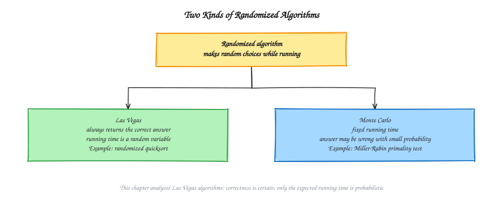
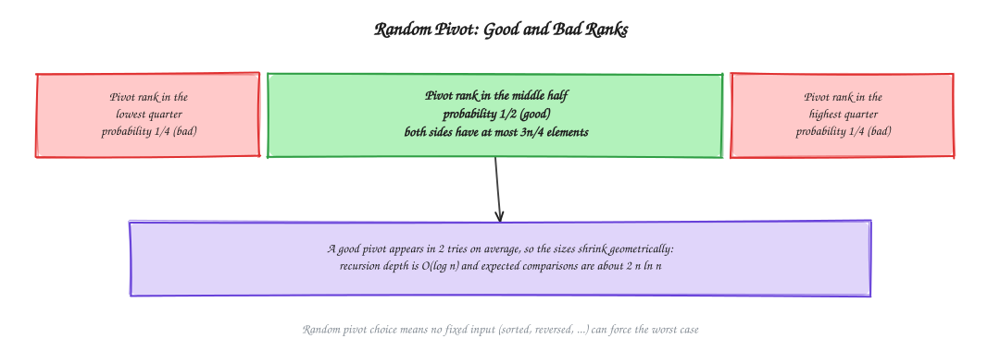
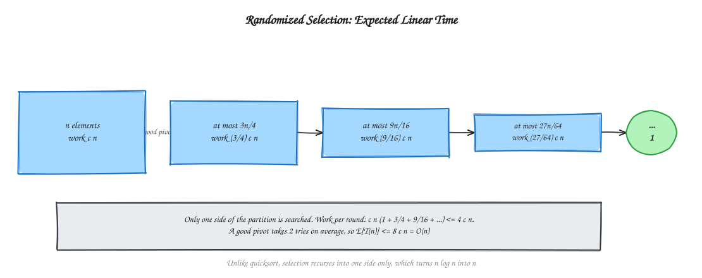
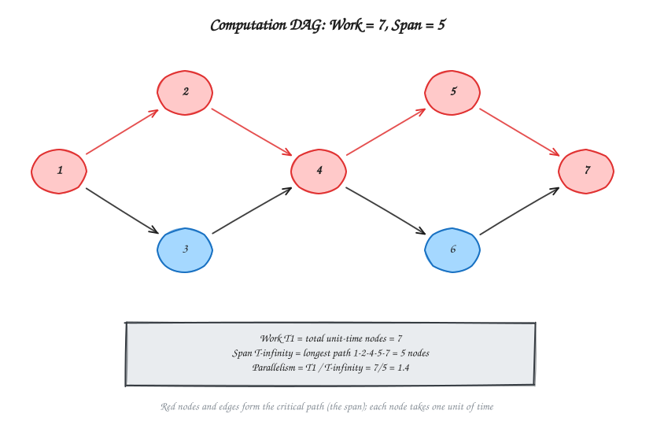
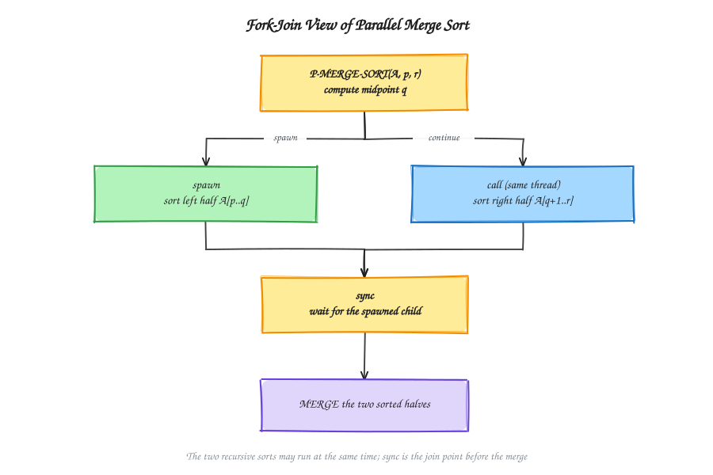

# Chapter 14 - Randomized and Parallel Algorithms

[Previous: Chapter 13 - Approximation Algorithms](../Chapter%2013%20-%20Approximation%20Algorithms/README.md) | [Home](../README.md) | [Next: Chapter 15 - Lower Bound Theory and NP Completeness](../Chapter%2015%20-%20Lower%20Bound%20Theory%20and%20NP%20Completeness/README.md)

---

A **randomized algorithm** makes random choices while it runs, so no fixed input can reliably force its worst case. A **parallel algorithm** performs several steps at the same time, so we must measure how much work there is and how long the longest chain of dependent steps is.

This chapter covers probabilistic analysis, randomized quicksort, randomized selection and expected running time (Part 1), then work, span, the fork-join model, parallel merge sort and a parallel matrix-multiplication overview (Part 2). It builds on [Chapter 5](../Chapter%205%20-%20Sorting%20Algorithms/README.md) and [Chapter 6](../Chapter%206%20-%20Divide%20and%20Conquer/README.md). It intentionally contains no implementation code.

---

## Start Here: The Idea in Plain Words

This chapter has two separate ideas.

### Idea 1: Use a coin flip (randomized algorithms)

Suppose a guard always checks the doors in the same order. A thief who knows this can always pick the worst door. Now the guard flips a coin to choose the order. **No thief can plan against a coin.**

Quicksort has the same problem. If it always picks the first item as the pivot, a sorted list makes it very slow. If it picks the pivot **at random**, no input can be reliably bad. Sometimes the pick is unlucky, but **on average** it is fast.

**"Expected time"** just means the *average time over many runs*. If you roll a die, the expected number is 3.5. You never roll 3.5, but it is the average.

### Idea 2: Do several things at once (parallel algorithms)

Imagine making a meal with 4 friends. Chopping vegetables, washing rice and setting the table can happen **at the same time**. But the cooking cannot start until the chopping is done.

- **Work** = all the hours of effort added up. This is how long one person alone would take.
- **Span** = the longest chain of steps where each step must wait for the one before. Even with 1000 friends, you cannot finish faster than this.
- **Parallelism** = work divided by span. It tells you how many helpers are actually useful.

**Tiny example.** 7 steps of 1 hour each. The longest chain of waiting steps has 5 steps. Work = 7 hours, span = 5 hours, parallelism = 7 / 5 = 1.4. More than about 2 helpers will not help.

**Words used in this chapter, in simple terms**

| Word | Simple meaning |
| :--- | :--- |
| Random choice | A choice made by a coin flip or dice. |
| Pivot | The item that quicksort uses to split the list into smaller and bigger items. |
| Expected value | The average result over many runs. |
| Las Vegas algorithm | Always right, but the time changes from run to run. |
| Monte Carlo algorithm | Takes fixed time, but may be wrong with a small chance. |
| Indicator variable | A counter that is 1 if something happens and 0 if not. Adding counters counts things. |
| Work / Span | Total effort / longest chain of waiting steps. |
| Spawn / sync | "Start this task on the side" / "wait here until the side tasks finish". |

**Before you start:** it helps to know quicksort and merge sort ([Chapter 5](../Chapter%205%20-%20Sorting%20Algorithms/README.md)). **Reading tip:** the quicksort proof with indicator variables is the hardest math here. On a first read, remember only the result: expected time is $O(n \log n)$ for every input.

---

## Table of Contents

- [Start Here: The Idea in Plain Words](#start-here-the-idea-in-plain-words)

**Part 1: Randomized Algorithms**

1. [Randomized Algorithm Concept](#randomized-algorithm-concept)
2. [Probabilistic Analysis and Indicator Variables](#probabilistic-analysis-and-indicator-variables)
3. [Randomized Quicksort](#randomized-quicksort)
4. [Randomized Selection](#randomized-selection)

**Part 2: Parallel Algorithms**

5. [Parallel Algorithm Basics: Work and Span](#parallel-algorithm-basics-work-and-span)
6. [Fork-Join Model](#fork-join-model)
7. [Parallel Merge Sort](#parallel-merge-sort)
8. [Parallel Matrix Multiplication Overview](#parallel-matrix-multiplication-overview)
9. [Practice and Exam Notes](#practice-and-exam-notes)

---

# Part 1: Randomized Algorithms

## Randomized Algorithm Concept

A randomized algorithm uses a random-number generator to decide some of its steps. Its running time (and sometimes its answer) becomes a random variable, even for a fixed input.

| Kind | Answer | Running time | Example |
| :--- | :--- | :--- | :--- |
| **Las Vegas** | Always correct | Random; we analyze the **expected** time | Randomized quicksort, randomized selection, verified Rabin-Karp |
| **Monte Carlo** | Correct with high probability, may be wrong | Fixed | Miller-Rabin primality test, hash-only Rabin-Karp ([Chapter 16](../Chapter%2016%20-%20String%20Matching%20Algorithms/README.md)) |

See the [diagram index](diagrams/README.md) for editable Excalidraw sources and SVG previews.

The key difference from average-case analysis: average-case analysis assumes the **input** is random, which may be false. A randomized algorithm creates its **own** randomness, so the expectation holds for **every** input.

---

## Probabilistic Analysis and Indicator Variables

**Expected value** of a random variable $X$ is $E[X] = \sum_x x \cdot \Pr[X = x]$. Expectation is linear: $E[X + Y] = E[X] + E[Y]$, even when $X$ and $Y$ are dependent.

An **indicator random variable** $X_A$ equals 1 if event $A$ happens and 0 otherwise, so $E[X_A] = \Pr[A]$. Think of it as a simple tally mark: it counts 1 when the event occurs and 0 when it does not. To count total occurrences, simply sum the probabilities of the individual tally marks.

**Hiring problem.** Interview $n$ candidates in random order; hire whenever the current candidate is the best so far. Let $X_i = 1$ if candidate $i$ is hired. Candidate $i$ is the best of the first $i$ with probability $1/i$, so

$$
E[\text{hires}] = \sum_{i=1}^{n} \frac{1}{i} = H_n = \ln n + O(1).
$$

Only about $\ln n$ hires are expected, although the worst case is $n$. This indicator-variable method is exactly what analyzes quicksort below.

---

## Randomized Quicksort

Ordinary quicksort picks a fixed pivot (for example the last element) and takes $\Theta(n^2)$ on sorted input. **Randomized quicksort** picks the pivot **uniformly at random** from the current subarray, then partitions and recurses as usual.

**Why it works.** A pivot is *good* if its rank lies in the middle half of the subarray (probability 1/2). Then both sides have at most $3n/4$ elements, so the recursion depth is $O(\log n)$.

**Expected comparisons.** Let $z_1 < z_2 < \dots < z_n$ be the sorted values. Two elements are compared **at most once**, and only if one of them is chosen as pivot while both are still in the same subarray. Elements $z_i$ and $z_j$ are compared exactly when the first pivot chosen from $\{z_i, \dots, z_j\}$ is $z_i$ or $z_j$, which has probability $\frac{2}{j - i + 1}$. Hence

$$
E[\text{comparisons}] = \sum_{i<j} \frac{2}{j-i+1} < 2n \sum_{k=1}^{n} \frac{1}{k} = O(n \log n).
$$

The exact figure is about $2n \ln n \approx 1.39\, n \log_2 n$.

**Plain explanation:** Two numbers are compared only if one is picked as a pivot before any number lying between them in sorted order is picked. Numbers close together in sorted order have a high chance of comparison, while numbers far apart are almost never compared because another pivot between them separates them early. Summing this over all pairs gives $O(n \log n)$.

| Case | Time |
| :--- | :--- |
| Expected (every input) | $O(n \log n)$ |
| Worst case (extremely unlucky pivots) | $O(n^2)$, with negligible probability |
| Space | $O(\log n)$ expected stack depth |

No particular input is bad; only an unlucky sequence of random choices is bad.

---

## Randomized Selection

**Problem.** Find the $k$-th smallest element of an unsorted array (the median is $k = \lceil n/2 \rceil$). Sorting costs $O(n \log n)$; selection can be done in expected $O(n)$.

**Method (quickselect with a random pivot).**

1. Choose a random pivot and partition the array around it.
2. Let $q$ be the pivot's final rank. If $k = q$, return the pivot.
3. If $k < q$, recurse on the left part only; otherwise recurse on the right part with $k - q$.

Unlike quicksort, only **one** side is searched.

**Example.** Find the 3rd smallest of $[7, 2, 9, 4, 1, 8]$. Suppose the pivot is 4. Partition: $[2, 1]\ 4\ [7, 9, 8]$, so the pivot has rank 3 and the answer is **4**. If the pivot had been 8, the rank would be 5, and we would recurse on the left part $[7,2,4,1]$ for the 3rd smallest.

**Expected time.** A good pivot (probability 1/2) needs about 2 tries and shrinks the range to at most $3n/4$. Partitioning costs $cn$, so

$$
E[T(n)] \le 2cn\left(1 + \tfrac34 + \left(\tfrac34\right)^2 + \cdots\right) = 8cn = O(n).
$$

**Why is it $O(n)$ instead of $O(n \log n)$?** Quicksort must recursively sort **both** sides of the pivot (work: $n + n + n + \dots$). But Selection only needs to find one item, so it discards the other side completely! The work shrinks geometrically: $n + \frac{3}{4}n + (\frac{3}{4})^2 n + \dots \le 4n = O(n)$.

The worst case is still $O(n^2)$. A deterministic median-of-medians algorithm gives worst-case $O(n)$ but with a larger constant.

---

# Part 2: Parallel Algorithms

## Parallel Algorithm Basics: Work and Span

A parallel algorithm splits a computation into parts that can run on different processors at the same time. We model it as a **directed acyclic graph (DAG)**: each node is a unit-time step, and an edge means "must finish before".

| Measure | Symbol | Meaning |
| :--- | :---: | :--- |
| **Work** | $T_1$ | Total number of steps; the running time on **one** processor. |
| **Span** | $T_\infty$ | Length of the longest path (critical path); the running time on **unlimited** processors. |
| **Parallelism** | $T_1 / T_\infty$ | Average work available per step along the critical path. |
| **Speedup** | $T_1 / T_P$ | How many times faster $P$ processors are than one. |

**Laws.** With $P$ processors, $T_P \ge T_1 / P$ (work law) and $T_P \ge T_\infty$ (span law). A greedy scheduler achieves $T_P \le T_1/P + T_\infty$, so it is within a factor 2 of optimal. Speedup can never exceed $\min(P, T_1/T_\infty)$.

**Example.** In the DAG below there are 7 unit steps, so $T_1 = 7$. The longest path is $1 \to 2 \to 4 \to 5 \to 7$ with 5 nodes, so $T_\infty = 5$ and the parallelism is $7/5 = 1.4$. More than about 2 processors cannot help.

**Composition rules.** If $A$ and $B$ run one after the other (series): work adds, span adds. If they run side by side (parallel): work adds, span is the **maximum**.

---

## Fork-Join Model

The fork-join model adds three keywords to ordinary pseudocode:

- **spawn** `f(...)`: start the call as a child that *may* run in parallel with the caller.
- **sync**: wait until all children spawned by this function have finished.
- **parallel for**: run the loop iterations as if each were spawned, then sync at the end.

These words only *permit* parallelism; the scheduler decides what really runs in parallel. Removing them leaves a correct serial program (the *serialization*). Spawned children must not write to the same memory as their siblings (no race conditions).

---

## Parallel Merge Sort

Merge sort already splits into two independent halves, so the recursive calls can run in parallel.

1. Compute the midpoint.
2. **spawn** the sort of the left half; sort the right half in the current thread.
3. **sync**, then merge the two sorted halves.

| Version | Work $T_1$ | Span $T_\infty$ | Parallelism |
| :--- | :---: | :---: | :---: |
| Serial merge | $\Theta(n \log n)$ | $T_\infty(n) = T_\infty(n/2) + \Theta(n) = \Theta(n)$ | $\Theta(\log n)$ |
| Parallel merge | $\Theta(n \log n)$ | $T_\infty(n) = T_\infty(n/2) + \Theta(\log^2 n) = \Theta(\log^3 n)$ | $\Theta(n / \log^2 n)$ |

With a serial merge, the final merge of $n$ elements is a $\Theta(n)$ bottleneck on the critical path, so parallelism is only $\Theta(\log n)$. The parallel merge splits one sorted array at its median, binary-searches that value in the other array, and merges the two halves in parallel. The work stays $\Theta(n\log n)$ but the span drops to polylogarithmic.

---

## Parallel Matrix Multiplication Overview

To compute $C = A \cdot B$ for $n \times n$ matrices, every entry $c_{ij} = \sum_k a_{ik} b_{kj}$ is independent of the other entries.

| Version | Work | Span | Parallelism |
| :--- | :---: | :---: | :---: |
| Serial triple loop | $\Theta(n^3)$ | $\Theta(n^3)$ | 1 |
| `parallel for` over $i$ and $j$, serial loop over $k$ | $\Theta(n^3)$ | $\Theta(n)$ | $\Theta(n^2)$ |
| Divide and conquer into 8 sub-products, parallel additions | $\Theta(n^3)$ | polylogarithmic in $n$ | nearly $\Theta(n^3)$ |

Parallelizing the two outer loops gives $n^2$-fold parallelism for free. Parallelizing the inner sum as well requires a reduction (adding in a tree), which is what brings the span down to polylogarithmic. The work never drops below the serial work, which is why parallelism lowers time, not total effort.

---

## Practice and Exam Notes

- Distinguish Las Vegas (always correct, random time) from Monte Carlo (fixed time, may err).
- Explain why random pivots remove bad inputs: the expectation is over the algorithm's coins, not the input.
- Reproduce the indicator argument for quicksort: $\Pr[z_i, z_j \text{ compared}] = 2/(j-i+1)$, summing to $O(n\log n)$.
- For selection, say "recurse on one side only" and show the geometric series giving $O(n)$.
- Define work, span and parallelism, and compute them from a DAG (count nodes; find the longest path).
- Explain why the serial merge limits parallel merge sort to span $\Theta(n)$.
- Frequently asked: expected running time of randomized quicksort, randomized vs deterministic pivot, work and span, and the parallel merge sort recurrence.

### Final Revision Checklist

- I can compute an expectation using indicator random variables.
- I can prove randomized quicksort runs in expected $O(n\log n)$.
- I can explain why randomized selection is expected $O(n)$ but worst-case $O(n^2)$.
- I can compute $T_1$, $T_\infty$, and parallelism for a DAG, and state the work and span laws.
- I can describe spawn, sync, and parallel for.
- I can give the work and span of parallel merge sort with serial and parallel merge.

---

[Previous: Chapter 13 - Approximation Algorithms](../Chapter%2013%20-%20Approximation%20Algorithms/README.md) | [Home](../README.md) | [Next: Chapter 15 - Lower Bound Theory and NP Completeness](../Chapter%2015%20-%20Lower%20Bound%20Theory%20and%20NP%20Completeness/README.md)
