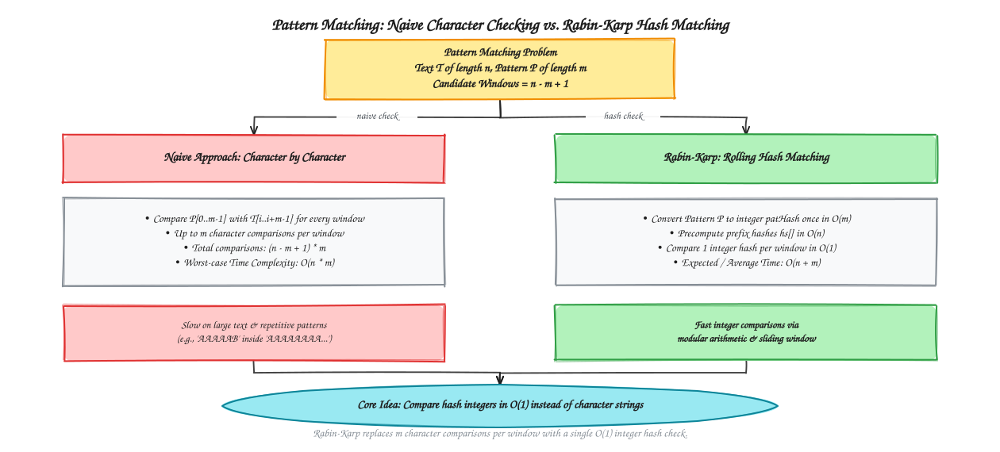
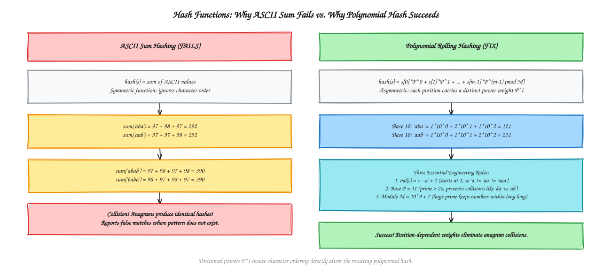
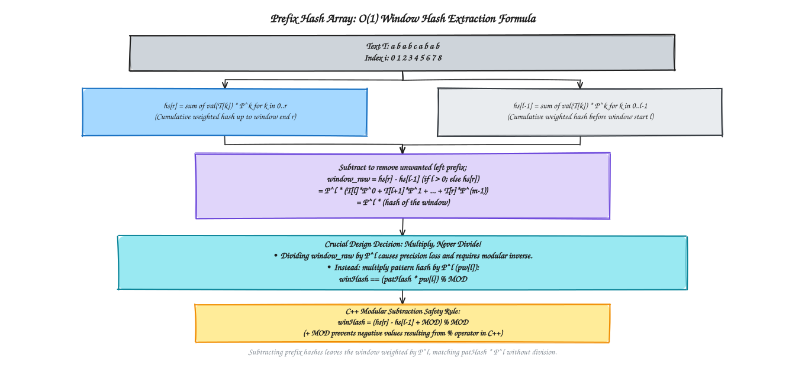
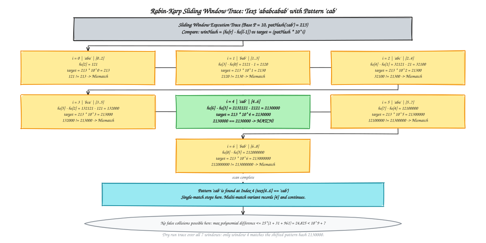

# Chapter 16 — String Matching Algorithms

[Previous: Chapter 15 - Lower Bound Theory and NP Completeness](../Chapter%2015%20-%20Lower%20Bound%20Theory%20and%20NP%20Completeness/README.md) | [Home](../README.md) | [Next: References](../References/README.md)

---

String matching is the fundamental algorithmic problem of finding all occurrences of a shorter **pattern** $P$ of length $m$ inside a longer **text** $T$ of length $n$. 

While naive string matching checks characters one-by-one in $O(n \times m)$ worst-case time, the **Rabin-Karp algorithm** converts character sequences into **polynomial rolling hashes**. By comparing integers in $O(1)$ time per sliding window instead of checking character strings, Rabin-Karp achieves an expected running time of $O(n + m)$.

This chapter follows the complete classroom lecture sheet. It focuses entirely on conceptual understanding, mathematical derivations, worked trace tables, Excalidraw diagrams, and asymptotic complexity. It intentionally contains no implementation code; runnable lab practice programs are maintained in [Chapter 0 — Lab Practice](../Chapter%200%20-%20Previous%20Year%20Questions/Lab%20Practice/).

---

## Table of Contents

1. [Q1: What is the exact string matching problem, and why does naive comparison degrade to $O(n \times m)$?](#q1-what-is-the-exact-string-matching-problem-and-why-does-naive-comparison-degrade-to-on-times-m)
2. [Q2: Why does ASCII sum hashing fail for pattern matching?](#q2-why-does-ascii-sum-hashing-fail-for-pattern-matching)
3. [Q3: How does Polynomial Rolling Hashing resolve the anagram collision flaw?](#q3-how-does-polynomial-rolling-hashing-resolve-the-anagram-collision-flaw)
4. [Q4: What are the three non-negotiable engineering details of polynomial hashing?](#q4-what-are-the-three-non-negotiable-engineering-details-of-polynomial-hashing)
5. [Q5: Step 1 — Why and how is the Power Array precomputed?](#q5-step-1--why-and-how-is-the-power-array-precomputed)
6. [Q6: Step 2 — How is the Prefix Hash Array constructed from the text?](#q6-step-2--how-is-the-prefix-hash-array-constructed-from-the-text)
7. [Q7: Step 3 & 4 — How is the pattern hashed and how is the window hash extracted in $O(1)$?](#q7-step-3--4--how-is-the-pattern-hashed-and-how-is-the-window-hash-extracted-in-o1)
8. [Q8: Complete Hand Trace — How does Rabin-Karp process `ababcabab` with pattern `cab`?](#q8-complete-hand-trace--how-does-rabin-karp-process-ababcabab-with-pattern-cab)
9. [Q9: Procedural Workflow — How does the Rabin-Karp algorithm execute step-by-step?](#q9-procedural-workflow--how-does-the-rabin-karp-algorithm-execute-step-by-step)
10. [Q10: Collisions and False Matches — When do spurious hits happen, and why did zero collisions occur here?](#q10-collisions-and-false-matches--when-do-spurious-hits-happen-and-why-did-zero-collisions-occur-here)
11. [Q11: Complexity Analysis — How does Rabin-Karp compare asymptotically with naive search?](#q11-complexity-analysis--how-does-rabin-karp-compare-asymptotically-with-naive-search)
12. [Q12: Self-Practice & One-Page Revision Summary](#q12-self-practice--one-page-revision-summary)

---

### Visual Map: String Matching Architecture

See the [diagram index](diagrams/README.md) for editable Excalidraw sources and SVG previews.

---

## Q1: What is the exact string matching problem, and why does naive comparison degrade to $O(n \times m)$?

### Problem Statement
Given:
* A **Text** $T$ of length $n$, indexed $0 \dots n-1$.
* A **Pattern** $P$ of length $m$, indexed $0 \dots m-1$ ($m \le n$).

**Goal:** Find all starting indices $i$ in $T$ such that the substring $T[i \dots i+m-1]$ equals $P[0 \dots m-1]$.

### Candidate Windows
A candidate window of length $m$ can start at any index $i$ from $0$ up to $n - m$:

$$
\text{Total Candidate Windows} = n - m + 1
$$

For classroom text $T = \text{"ababcabab"}$ ($n=9$) and pattern $P = \text{"cab"}$ ($m=3$):

$$
\text{Windows} = 9 - 3 + 1 = 7
$$

| Start Index $i$ | Window Slice $T[i \dots i+2]$ | Target Pattern $P$ | Match? |
| :---: | :---: | :---: | :---: |
| **0** | `aba` | `cab` | No |
| **1** | `bab` | `cab` | No |
| **2** | `abc` | `cab` | No |
| **3** | `bca` | `cab` | No |
| **4** | `cab` | `cab` | **YES (Match at index 4)** |
| **5** | `aba` | `cab` | No |
| **6** | `bab` | `cab` | No |

### The Naive Bottleneck
* **Naive Algorithm:** Slides a window of length $m$ across $T$. At each starting index $i$, it tests up to $m$ characters: $T[i] = P[0], T[i+1] = P[1], \dots$.
* **Worst-Case Cost:** When text and pattern contain repeated prefixes (such as $T = \text{"AAAAAAAA..."}$ and $P = \text{"AAAAB"}$), every window mismatches only at the final character, costing $m$ comparisons per window:

$$
T_{\text{naive}}(n, m) = (n - m + 1) \times m = O(n \times m)
$$

### The Rabin-Karp Paradigm Shift
> *"We won't compare character-to-character. We will compare hash values — integer with integer in $O(1)$ time."*

If the hash of every window of length $m$ can be extracted in $O(1)$ time, verifying each window takes a **single integer equality comparison**, dropping the total running time to $O(n + m)$.

---

## Q2: Why does ASCII sum hashing fail for pattern matching?

### The First Intuition
The simplest hash function sums the ASCII values of all characters in the window:

$$
\text{hash}_{\text{sum}}(s) = \sum_{k=0}^{m-1} \text{ASCII}(s[k])
$$

Using standard ASCII values ($a = 97, b = 98, c = 99$):

| Candidate String | Character Arithmetic | Hash Value | Collision Outcome |
| :--- | :--- | :---: | :--- |
| `"aba"` | $97 + 98 + 97$ | **292** | Base pattern |
| `"aab"` | $97 + 97 + 98$ | **292** | **False Match! (Identical hash, different string)** |
| `"abab"` | $97 + 98 + 97 + 98$ | **390** | Base string |
| `"baba"` | $98 + 97 + 98 + 97$ | **390** | **False Match! (Identical hash, different string)** |

### Why It Fails
1. **Symmetric Operation:** Addition is commutative ($x + y = y + x$). Sum hashing treats the string as an unordered multiset of characters rather than an ordered sequence.
2. **Anagram Collisions:** Any anagram or permutation of the pattern produces the exact same integer sum.
3. **Catastrophic False Positives:** Every anagram window reports a false positive match.

> **Conclusion:** Plain ASCII addition is order-blind. We require a hash function where character position directly determines the resulting value.

---

## Q3: How does Polynomial Rolling Hashing resolve the anagram collision flaw?

### Positional Power Weighting
Instead of adding characters uniformly, each character at index $k$ is multiplied by an increasing power of a base $P$:

$$
\text{hash}(s) = \sum_{k=0}^{m-1} \text{val}(s[k]) \cdot P^k \pmod M = \text{val}(s[0]) \cdot P^0 + \text{val}(s[1]) \cdot P^1 + \dots + \text{val}(s[m-1]) \cdot P^{m-1} \pmod M
$$

### Hand Evaluation with Base $P = 10$
Using base $P = 10$ ($a=1, b=2$):
* For `"aba"`:

  $$
  \text{hash}(\text{"aba"}) = 1 \cdot 10^0 + 2 \cdot 10^1 + 1 \cdot 10^2 = 1 + 20 + 100 = \mathbf{121}
  $$

* For `"aab"`:

  $$
  \text{hash}(\text{"aab"}) = 1 \cdot 10^0 + 1 \cdot 10^1 + 2 \cdot 10^2 = 1 + 10 + 200 = \mathbf{211}
  $$

$$
121 \neq 211 \implies \text{Order is strictly preserved!}
$$

Because positional weights differ ($P^0 \neq P^1 \neq P^2$), reordering characters alters the resulting polynomial, eliminating anagram collisions.

---

## Q4: What are the three non-negotiable engineering details of polynomial hashing?

### 1. Character Mapping: Why $'a'$ Must Be $1$, Never $0$
The mapping function maps lowercase letters to 1-based positive integers:

$$
\text{val}(c) = c - \text{'a'} + 1 \quad (a=1, b=2, \dots, z=26)
$$

* **The Failure of $0$-based mapping ($a=0$):**

  $$
  \text{hash}(\text{"a"}) = 0 \cdot P^0 = 0
  $$

  $$
  \text{hash}(\text{"aa"}) = 0 \cdot P^0 + 0 \cdot P^1 = 0
  $$

  $$
  \text{hash}(\text{"aaa"}) = 0 \cdot P^0 + 0 \cdot P^1 + 0 \cdot P^2 = 0
  $$

  Repeated occurrences of $'a'$ would vanish algebraically!

* **With $1$-based mapping:**

  $$
  \text{hash}(\text{"a"}) = 1, \quad \text{hash}(\text{"aa"}) = 1 + 10 = 11, \quad \text{hash}(\text{"aaa"}) = 1 + 10 + 100 = 111
  $$

  Every prefix and length produces a distinct numerical value.

### 2. Base Selection: Why Base $P$ Must Be a Prime $> 26$
* Base $P=10$ is used exclusively for classroom hand calculation because base-10 powers are easy to read.
* **Why Base 10 fails in practice:** Letter values range from $1$ to $26$. If the base is smaller than the alphabet size, base overflows produce collisions between distinct 2-letter words:
  * For $k = 11, a = 1$:

    $$
    \text{hash}(\text{"ka"}) = 11 \cdot 10^0 + 1 \cdot 10^1 = 11 + 10 = 21
    $$

  * For $a = 1, b = 2$:

    $$
    \text{hash}(\text{"ab"}) = 1 \cdot 10^0 + 2 \cdot 10^1 = 1 + 20 = 21
    $$

    **Two completely different strings produce the identical hash 21!**
* **The Rule:** Base $P$ must be a prime strictly greater than the alphabet size ($26$). Standard selections are $P = 31$ or $P = 37$.

### 3. Modulus $M$ and Overflow Control
* As text length grows, powers $P^k$ explode exponentially.
* All arithmetic is computed modulo a large prime:

$$
M = 10^9 + 7 = 1\,000\,000\,007
$$

* **64-bit Integer Safety:**
  The product of two values below $M$ is bounded by:

  $$
  (M - 1) \times (M - 1) \approx 10^{18} < 9.22 \times 10^{18} \quad (\text{maximum signed 64-bit integer})
  $$

  Applying $\pmod M$ after every addition and multiplication guarantees no arithmetic overflow occurs.

---

## Q5: Step 1 — Why and how is the Power Array precomputed?

### Eliminating Function Call Overhead
Each window query requires powers of the base: $P^0, P^1, P^2, \dots, P^{n-1}$.
Computing powers inside sliding loops introduces repeated $O(\log i)$ exponentiation overhead and floating-point precision risks.

### Linear Precomputation Recurrence
Powers are precalculated once into an array $pw$ of length $n$ in $\Theta(n)$ time:
* **Base Case:** $pw[0] = 1$
* **Recurrence:** $pw[i] = (pw[i-1] \times P) \pmod M \quad \text{for } 1 \le i < n$

### Precomputed Power Table (Base $P = 10$)
| Index $i$ | 0 | 1 | 2 | 3 | 4 | 5 | 6 | 7 | 8 |
| :--- | :---: | :---: | :---: | :---: | :---: | :---: | :---: | :---: | :---: |
| **$pw[i] = 10^i$** | $1$ | $10$ | $100$ | $1\,000$ | $10\,000$ | $100\,000$ | $1\,000\,000$ | $10\,000\,000$ | $100\,000\,000$ |

---

## Q6: Step 2 — How is the Prefix Hash Array constructed from the text?

### Connection to Prefix Sums
Just as standard prefix sums allow $O(1)$ range sums, the **prefix hash array** $hs[i]$ stores the cumulative weighted polynomial hash from index $0$ to index $i$:

* **Base Case:** $hs[0] = \text{val}(T[0])$
* **Recurrence:** $hs[i] = (hs[i-1] + \text{val}(T[i]) \times pw[i]) \pmod M \quad \text{for } 1 \le i < n$

### Step-by-Step Prefix Hash Table on $T = \text{"ababcabab"}$ (Base $P = 10$)
Here $a=1, b=2, c=3$:

| Index $i$ | Character $T[i]$ | $\text{val}(T[i])$ | $pw[i]$ | Added Term $\text{val} \times pw[i]$ | Cumulative Prefix Hash $hs[i]$ |
| :---: | :---: | :---: | :---: | :---: | :--- |
| **0** | `a` | 1 | $1$ | $1$ | **1** |
| **1** | `b` | 2 | $10$ | $20$ | $1 + 20 =$ **21** |
| **2** | `a` | 1 | $100$ | $100$ | $21 + 100 =$ **121** |
| **3** | `b` | 2 | $1\,000$ | $2\,000$ | $121 + 2\,000 =$ **2,121** |
| **4** | `c` | 3 | $10\,000$ | $30\,000$ | $2\,121 + 30\,000 =$ **32,121** |
| **5** | `a` | 1 | $100\,000$ | $100\,000$ | $32\,121 + 100\,000 =$ **132,121** |
| **6** | `b` | 2 | $1\,000\,000$ | $2\,000\,000$ | $132\,121 + 2\,000\,000 =$ **2,132,121** |
| **7** | `a` | 1 | $10\,000\,000$ | $10\,000\,000$ | $2\,132\,121 + 10\,000\,000 =$ **12,132,121** |
| **8** | `b` | 2 | $100\,000\,000$ | $200\,000\,000$ | $12\,132\,121 + 200\,000\,000 =$ **212,132,121** |

---

## Q7: Step 3 & 4 — How is the pattern hashed and how is the window hash extracted in $O(1)$?

### Step 3: Hashing the Pattern
The pattern $P$ of length $m$ is hashed once using the first $m$ powers:

$$
\text{patHash} = \sum_{k=0}^{m-1} (\text{val}(P[k]) \times pw[k]) \pmod M
$$

For $P = \text{"cab"}$ ($c=3, a=1, b=2$) in base $P = 10$:

$$
\text{patHash} = 3 \cdot 10^0 + 1 \cdot 10^1 + 2 \cdot 10^2 = 3 + 10 + 200 = \mathbf{213}
$$

*(In base $P = 31$: $\text{patHash} = 3 \cdot 1 + 1 \cdot 31 + 2 \cdot 961 = 1\,956$)*.

### Step 4: Window Hash Extraction Formula
For a window spanning from index $l$ to index $r$ ($r = l + m - 1$):
* $hs[r]$ contains weighted terms from index $0$ to $r$.
* $hs[l-1]$ contains weighted terms from index $0$ to $l-1$.

Subtracting removes the unwanted left prefix:

$$
\text{window\_raw} = \begin{cases} hs[r] & \text{if } l = 0 \\ hs[r] - hs[l-1] & \text{if } l > 0 \end{cases}
$$

Expanding algebraically:

$$
\text{window\_raw} = T[l] \cdot P^l + T[l+1] \cdot P^{l+1} + \dots + T[r] \cdot P^r
$$

$$
\text{window\_raw} = P^l \times \left( T[l] \cdot P^0 + T[l+1] \cdot P^1 + \dots + T[r] \cdot P^{m-1} \right) = P^l \times \text{hash}(T[l \dots r])
$$

> The extracted raw window hash equals the true window hash **scaled by $P^l$**.

### Why Multiply the Pattern Instead of Dividing the Window?
1. **Division Loses Precision:** Integer division discards fractional remainders.
2. **Modular Division Overhead:** In modular arithmetic, division requires computing the modular multiplicative inverse via Fermat's Little Theorem ($P^{-l} \equiv (P^l)^{M-2} \pmod M$), costing $O(\log M)$ steps per window.
3. **Multiplication Is Exact and Fast:**
   Multiplying $\text{patHash}$ by $pw[l]$ takes a single $O(1)$ multiplication:

   $$
   \mathbf{winHash == (\text{patHash} \times pw[l]) \pmod M}
   $$

### Non-Negative Modular Subtraction Rule
In many programming environments, modular subtraction of two numbers where the second is larger yields a negative remainder. To guarantee non-negative values before applying modulo:

$$
winHash = (hs[r] - hs[l-1] + M) \pmod M
$$

---

## Q8: Complete Hand Trace — How does Rabin-Karp process `ababcabab` with pattern `cab`?

### Full Trace Across All 7 Windows (Base $P = 10, \text{patHash} = 213$)
We iterate starting index $i$ from $0$ to $n - m = 6$:

| Window $i$ | Substring $T[i \dots i+2]$ | Range $[l \dots r]$ | Subtraction $hs[r] - hs[l-1]$ | Window Value $winHash$ | Target $\text{patHash} \times 10^i$ | Decision |
| :---: | :---: | :---: | :---: | :---: | :---: | :---: |
| **0** | `aba` | $[0 \dots 2]$ | $hs[2] = 121$ | $121$ | $213 \times 10^0 = \mathbf{213}$ | $121 \neq 213 \implies$ **Mismatch** |
| **1** | `bab` | $[1 \dots 3]$ | $hs[3] - hs[0] = 2\,121 - 1$ | $2\,120$ | $213 \times 10^1 = \mathbf{2\,130}$ | $2\,120 \neq 2\,130 \implies$ **Mismatch** |
| **2** | `abc` | $[2 \dots 4]$ | $hs[4] - hs[1] = 32\,121 - 21$ | $32\,100$ | $213 \times 10^2 = \mathbf{21\,300}$ | $32\,100 \neq 21\,300 \implies$ **Mismatch** |
| **3** | `bca` | $[3 \dots 5]$ | $hs[5] - hs[2] = 132\,121 - 121$ | $132\,000$ | $213 \times 10^3 = \mathbf{213\,000}$ | $132\,000 \neq 213\,000 \implies$ **Mismatch** |
| **4** | `cab` | $[4 \dots 6]$ | $hs[6] - hs[3] = 2\,132\,121 - 2\,121$ | **2,130,000** | $213 \times 10^4 = \mathbf{2\,130\,000}$ | **2,130,000 == 2,130,000 $\implies$ MATCH!** |
| **5** | `aba` | $[5 \dots 7]$ | $hs[7] - hs[4] = 12\,132\,121 - 32\,121$ | $12\,100\,000$ | $213 \times 10^5 = \mathbf{21\,300\,000}$ | $12.1\text{M} \neq 21.3\text{M} \implies$ **Mismatch** |
| **6** | `bab` | $[6 \dots 8]$ | $hs[8] - hs[5] = 212\,132\,121 - 132\,121$ | $212\,000\,000$ | $213 \times 10^6 = \mathbf{213\,000\,000}$ | $212\text{M} \neq 213\text{M} \implies$ **Mismatch** |

### Detailed Breakdown of the Match at $i = 4$
1. Boundaries: $l = 4, r = 4 + 3 - 1 = 6$.
2. Extract window hash:

   $$
   winHash = hs[6] - hs[3] = 2\,132\,121 - 2\,121 = 2\,130\,000
   $$

3. Target scaled pattern hash:

   $$
   \text{target} = \text{patHash} \times pw[4] = 213 \times 10\,000 = 2\,130\,000
   $$

4. Equality check:

   $$
   2\,130\,000 == 2\,130\,000 \implies \mathbf{\text{Report occurrence at index 4}}
   $$

---

## Q9: Procedural Workflow — How does the Rabin-Karp algorithm execute step-by-step?

The complete procedural sequence executes in two distinct phases:

### Phase 1: Precomputation & Hashing ($\Theta(n + m)$)
1. **Length Verification:** Check if pattern length $m$ exceeds text length $n$. If $m > n$, terminate with no match.
2. **Power Array Generation:**
   * Set $pw[0] \leftarrow 1$.
   * For $i = 1$ to $n-1$, compute $pw[i] \leftarrow (pw[i-1] \times P) \pmod M$.
3. **Prefix Hash Array Generation:**
   * Set $hs[0] \leftarrow \text{val}(T[0])$.
   * For $i = 1$ to $n-1$, compute $hs[i] \leftarrow (hs[i-1] + \text{val}(T[i]) \times pw[i]) \pmod M$.
4. **Pattern Hash Computation:**
   * Set $patHash \leftarrow \sum_{k=0}^{m-1} (\text{val}(P[k]) \times pw[k]) \pmod M$.

### Phase 2: Sliding Window Search ($\Theta(n - m + 1)$)
1. **Iterate Candidate Starts:** Loop $i$ from $0$ up to $n - m$:
   * Set window end: $r \leftarrow i + m - 1$.
   * If $i = 0$, set $winHash \leftarrow hs[r]$.
   * If $i > 0$, set $winHash \leftarrow (hs[r] - hs[i-1] + M) \pmod M$.
   * Set target: $\text{target} \leftarrow (patHash \times pw[i]) \pmod M$.
   * **Comparison:**
     * If $winHash == \text{target}$:
       * In **First-Match Search**: Output index $i$ and halt immediately.
       * In **All-Matches Search**: Append index $i$ to match list and continue scanning.
2. **Termination:** If the loop terminates with no match discovered, report pattern absent.

> *Note for Sessional Laboratory:* A runnable implementation of this exact procedure is maintained in [`Chapter 0/Lab Practice/rabin_karp.cpp`](../Chapter%200%20-%20Previous%20Year%20Questions/Lab%20Practice/rabin_karp.cpp).

---

## Q10: Collisions and False Matches — When do spurious hits happen, and why did zero collisions occur here?

### What is a Spurious Hit?
Because modulo arithmetic maps an infinite universe of possible strings into a finite integer range $[0 \dots M-1]$, two distinct strings can evaluate to the exact same hash:

$$
\text{hash}(S_1) \equiv \text{hash}(S_2) \pmod M \quad \text{while} \quad S_1 \neq S_2
$$

This event is termed a **hash collision** or **spurious hit**.

### Why Zero Collisions Occurred in Our Hand Example
In our classroom example ($T = \text{"ababcabab"}, P = \text{"cab"}$, base $P = 31, M = 10^9 + 7$):
* Any window $W$ and pattern $P$ have length $m = 3$.
* The difference between their hash polynomials is:

  $$
  \Delta = \sum_{k=0}^{2} (\text{val}(W[k]) - \text{val}(P[k])) \cdot 31^k
  $$

* Since character values range from $1$ to $26$, each difference term $\text{val}(W[k]) - \text{val}(P[k])$ is strictly bounded between $-25$ and $+25$.
* Therefore, the maximum possible absolute difference is:

  $$
  |\Delta| \le 25 \times (31^0 + 31^1 + 31^2) = 25 \times (1 + 31 + 961) = 25 \times 993 = \mathbf{24\,825}
  $$

* Notice that $24\,825 \ll 10^9 + 7$.
* Since $M = 10^9 + 7$ is prime and $|\Delta| < M$, $\Delta \pmod M$ can equal $0$ **if and only if $\Delta = 0$ exactly**!

> **Mathematical Guarantee:** For short patterns where the maximum polynomial value is strictly less than modulus $M$, hash collisions are **mathematically impossible**.

### Las Vegas vs. Monte Carlo Trade-Off
When strings are long ($m$ is large), collisions can occur with probability $\approx 1/M$:

| Framework | Action on Hash Match | Time Complexity | Correctness |
| :--- | :--- | :---: | :---: |
| **Las Vegas (Exact)** | Verify character-by-character: check if $T[i \dots i+m-1] == P$ | Expected $O(n + m)$, Worst-case $O(n \cdot m)$ | $100\%$ Guaranteed |
| **Monte Carlo (Probabilistic)** | Accept match immediately without character checking | Strictly $O(n + m)$ | Correct with probability $\ge 1 - \frac{n}{M}$ |

---

## Q11: Complexity Analysis — How does Rabin-Karp compare asymptotically with naive search?

### Step-by-Step Breakdown

| Step | Work Done | Operation | Time Complexity |
| :--- | :--- | :--- | :---: |
| **Step 1: Power Array** | $n$ modular multiplications | $pw[i] = (pw[i-1] \times P) \pmod M$ | $\Theta(n)$ |
| **Step 2: Prefix Hash Array** | $n$ multiplications & additions | $hs[i] = (hs[i-1] + \text{val} \times pw[i]) \pmod M$ | $\Theta(n)$ |
| **Step 3: Pattern Hash** | $m$ multiplications & additions | $patHash = \sum \text{val} \times pw[k] \pmod M$ | $\Theta(m)$ |
| **Step 4: Sliding Window** | $n - m + 1$ window comparisons | 1 subtraction, 1 multiplication, 1 equality check per window | $\Theta(n - m + 1) = \Theta(n)$ |
| **Total Time** | Sum of precomputation + sliding | $\Theta(n) + \Theta(n) + \Theta(m) + \Theta(n)$ | $\mathbf{O(n + m)}$ |

### Space Complexity
Two auxiliary arrays of size $n$ are maintained:
* $pw$: precomputed powers of size $n$.
* $hs$: prefix polynomial hashes of size $n$.

$$
\text{Space Complexity} = O(n)
$$

### Comparison with Naive Search

| Metric | Naive Character Comparison | Rabin-Karp (Polynomial Hashing) |
| :--- | :---: | :---: |
| **Check per Window** | Up to $m$ character comparisons | **1 integer comparison ($O(1)$)** |
| **Average Time** | $O(n \times m)$ | **$O(n + m)$** |
| **Best Case Time** | $O(n)$ (first character always mismatches) | $O(n + m)$ |
| **Worst Case Time** | $O(n \times m)$ | $O(n \times m)$ *(if malicious collisions force full checks in Las Vegas)* |
| **Auxiliary Space** | $O(1)$ | $O(n)$ *(or $O(1)$ with online rolling hash update)* |

---

## Q12: Self-Practice & One-Page Revision Summary

### Multi-Pattern Verification Exercise
Hand calculation practice on text $T = \text{"ababcabab"}$ ($n=9$) with target patterns:

| Pattern | Length $m$ | Expected Matches | Verification Trace |
| :--- | :---: | :---: | :--- |
| `aba` | 3 | **Indices 0 and 5** | $T[0..2] = \text{"aba"}$ and $T[5..7] = \text{"aba"}$ |
| `bab` | 3 | **Indices 1 and 6** | $T[1..3] = \text{"bab"}$ and $T[6..8] = \text{"bab"}$ |
| `abc` | 3 | **Index 2** | $T[2..4] = \text{"abc"}$ |
| `cab` | 3 | **Index 4** | $T[4..6] = \text{"cab"}$ (Classroom lecture example) |
| `zzz` | 3 | **None** | Character `'z'` does not exist in $T$ |

### Master Revision Summary Matrix

| Concept | Mathematical Rule | Algorithmic Purpose |
| :--- | :--- | :--- |
| **Sum Hash (ASCII)** | $\sum \text{ASCII}(c)$ | **Fails:** Commutative addition causes anagram collisions (`aba` == `aab`). |
| **Polynomial Hash** | $\sum \text{val}(c) \cdot P^k \pmod M$ | **Fixes order:** Positional powers $P^k$ ensure anagrams yield distinct hashes. |
| **Letter Mapping** | $\text{val}(c) = c - \text{'a'} + 1$ | **Prevents zero:** Ensures $'a' \neq 0$ so `"a"`, `"aa"`, `"aaa"` remain distinct. |
| **Prime Base $P$** | $P = 31$ or $37$ ($P > 26$) | **Prevents base overflow collisions:** Eliminates spurious hits like `"ka"` vs `"ab"`. |
| **Modulus $M$** | $M = 10^9 + 7$ | **Prevents integer overflow:** Keeps intermediate products within signed 64-bit limits. |
| **Power Array $pw$** | $pw[i] = (pw[i-1] \times P) \pmod M$ | **Precomputes powers in $O(n)$:** Eliminates repeated function call overhead. |
| **Prefix Hash $hs$** | $hs[i] = (hs[i-1] + \text{val} \times pw[i]) \pmod M$ | **Weighted running total:** Allows any substring hash to be extracted in $O(1)$. |
| **Window Hash** | $hs[r] - hs[l-1]$ | **Extracts range:** Leaves window hash scaled by $P^l$. |
| **Comparison** | $winHash == (patHash \times pw[l]) \pmod M$ | **Multiplies pattern:** Preserves exact integers, avoiding division & modular inverse. |
| **Safety Offset** | $(hs[r] - hs[l-1] + M) \pmod M$ | **Prevents negative remainder:** Ensures result stays non-negative before modulo. |

### Memory Tricks for Exam Success
1. **"Order needs Powers":** Plain sum treats `"aba"` and `"aab"` as equals; positional powers $P^i$ break symmetry.
2. **"Never start from zero":** If $a=0$, `"a"`, `"aa"`, and `"aaa"` all equal $0$. Always add $1$ ($a=1$).
3. **"Multiply, don't divide":** Multiplying the pattern by $P^l$ preserves exact integer arithmetic without modular inverse.
4. **"Add MOD before modulo":** In modular arithmetic, $(a - b) \pmod M$ can be negative; always write $(a - b + M) \pmod M$.

---

[Previous: Chapter 15 - Lower Bound Theory and NP Completeness](../Chapter%2015%20-%20Lower%20Bound%20Theory%20and%20NP%20Completeness/README.md) | [Home](../README.md) | [Next: References](../References/README.md)
