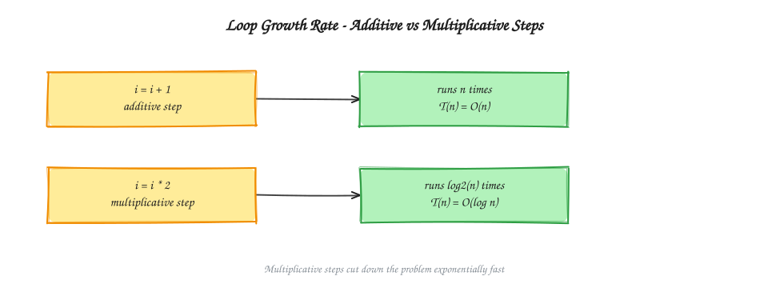
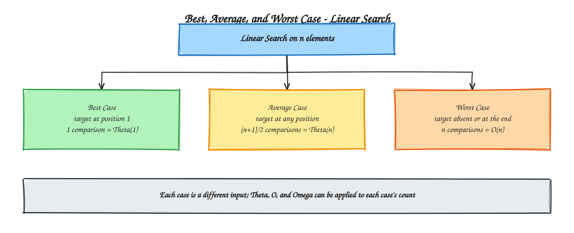
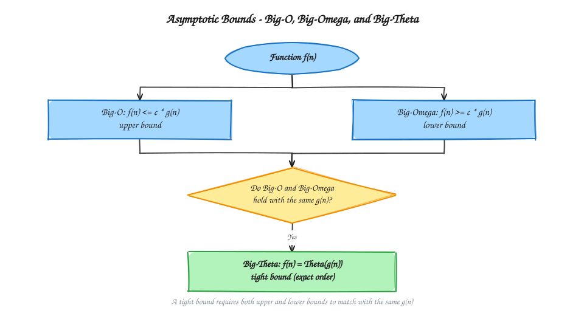
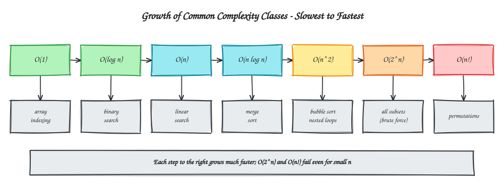

# Chapter 2 - Complexity Analysis and Asymptotic Notation

[Previous: Chapter 1 - Introduction and Algorithm Foundations](../Chapter%201%20-%20Introduction%20and%20Algorithm%20Foundations/README.md) | [Home](../README.md) | [Next: Chapter 3 - Recurrences Correctness and Loop Invariants](../Chapter%203%20-%20Recurrences%20Correctness%20and%20Loop%20Invariants/README.md)

---

Complexity analysis measures how the running time (or space) of an algorithm grows as the input size $n$ grows. Asymptotic notation gives a precise mathematical language for describing that growth while ignoring machine-dependent constants and low-order terms.

This chapter covers how to read time complexity directly from loop structure, how input size and cases (best, average, worst) affect the count, how to state growth formally using Big-O, Big-Omega, and Big-Theta notation, and the algebra and summations needed to simplify the results.

---

## Table of Contents

1. [Time Complexity of Loops](#1-time-complexity-of-loops)
   - [Fundamental Growth Intuition](#fundamental-growth-intuition)
   - [Visual Map: Loop Growth Rate](#visual-map-loop-growth-rate)
   - [20 Common Loop Patterns in C++](#20-common-loop-patterns-in-c)
   - [Pattern Recognition Summary Table](#pattern-recognition-summary-table)
   - [Exam Technique: 6-Step Loop Analysis Checklist](#exam-technique-6-step-loop-analysis-checklist)
2. [Input Size, Running Time, and Space Complexity](#2-input-size-running-time-and-space-complexity)
3. [Best, Average, and Worst Case](#3-best-average-and-worst-case)
   - [Visual Map: Best, Average, and Worst Case](#visual-map-best-average-and-worst-case)
4. [Asymptotic Notation](#4-asymptotic-notation)
   - [Big-O Notation - Upper Bound](#big-o-notation---upper-bound)
   - [Big-Omega Notation - Lower Bound](#big-omega-notation---lower-bound)
   - [Big-Theta Notation - Tight Bound](#big-theta-notation---tight-bound)
   - [Visual Map: Upper vs Lower vs Tight Bound](#visual-map-upper-vs-lower-vs-tight-bound)
5. [Comparing the Three Notations](#5-comparing-the-three-notations)
6. [Growth of Functions and Common Complexity Classes](#6-growth-of-functions-and-common-complexity-classes)
   - [Visual Map: Common Complexity Classes](#visual-map-common-complexity-classes)
7. [Algebraic Simplification](#7-algebraic-simplification)
   - [Summations](#summations)
8. [Analyze Time Complexity of Above Loop Patterns](#8-analyze-time-complexity-of-above-loop-patterns)

---

## 1. Time Complexity of Loops

The fastest way to estimate an algorithm's running time is to count how many times its loop body executes as a function of the input size $n$.

### Fundamental Growth Intuition

- **Additive updates (`i++`, `i += c`, `i--`):** The counter shifts by a constant step each time. Traversing a range of size $n$ takes proportional to $n$ steps $\implies O(n)$.
- **Multiplicative updates (`i *= c`, `i /= c`):** The counter scales exponentially. Reaching $n$ (or dropping to 1) takes $\log_c n$ steps $\implies O(\log n)$.
- **Nested loops:** When inner and outer loops are independent, multiply their iteration counts ($n \times n \implies O(n^2)$). When dependent, sum the inner counts across outer iterations ($\sum i \implies \Theta(n^2)$).
- **Sequential loops:** When loops execute one after another, sum their costs ($O(n) + O(n) \implies O(n)$).

### Visual Map: Loop Growth Rate



---

### 20 Common Loop Patterns in C++

Here is a reference of the 20 loop patterns frequently encountered in Algorithm Design and Analysis exams, presented with concise C++ snippets, iteration counts, and key takeaways:

#### 1. Single Loop Skipping Elements

```cpp
for (int i = 0; i < n; i += 2) {
    cout << i;
}
```

- **Counter Sequence:** `0, 2, 4, 6, 8, ...`
- **Iterations:** Runs approximately $\frac{n}{2}$ times.
- **Complexity:** $T(n) = \frac{n}{2} \implies O(n)$
- **Exam Rule:** Incrementing by any fixed constant ($+2, +5, +10$) remains linear $O(n)$.

#### 2. Loop Decreasing by a Fixed Amount

```cpp
for (int i = n; i > 0; i--) {
    cout << i;
}
```

- **Counter Sequence:** $n, n-1, n-2, \dots, 1$
- **Iterations:** Runs exactly $n$ times down to 0.
- **Complexity:** $T(n) = n \implies O(n)$
- **Exam Rule:** Reversing loop direction (`i--` instead of `i++`) does not alter asymptotic complexity if it still covers $n$ steps.

#### 3. Loop Multiplying Counter

```cpp
for (int i = 1; i < n; i *= 2) {
    cout << i;
}
```

- **Counter Sequence:** $1, 2, 4, 8, 16, \dots, 2^k$
- **Iterations:** Stops when $2^k \ge n \implies k \approx \log_2 n$.
- **Complexity:** $T(n) = \log_2 n \implies O(\log n)$
- **Exam Rule:** Multiplying the counter by a constant factor greater than 1 yields logarithmic complexity.

#### 4. Loop Dividing Counter

```cpp
for (int i = n; i > 1; i /= 2) {
    cout << i;
}
```

- **Counter Sequence:** $n, \frac{n}{2}, \frac{n}{4}, \frac{n}{8}, \dots, 2$ (e.g., $32, 16, 8, 4, 2$)
- **Iterations:** Counter is halved each iteration until reaching $\le 1$.
- **Complexity:** $T(n) = \log_2 n \implies O(\log n)$
- **Exam Rule:** Repeatedly dividing down to a constant threshold takes logarithmic steps, identical in growth to multiplying up.

#### 5. Two Independent Nested Loops

```cpp
for (int i = 0; i < n; i++) {
    for (int j = 0; j < n; j++) {
        cout << i << j;
    }
}
```

- **Counter Progression:** Outer loop runs $n$ times; inner loop runs $n$ times for each outer step.
- **Iterations:** Total operations equal $n \times n = n^2$.
- **Complexity:** $T(n) = n^2 \implies O(n^2)$
- **Exam Rule:** When nested loops are independent, multiply their iteration bounds.

#### 6. Nested Loops with Different Limits

```cpp
for (int i = 0; i < n; i++) {
    for (int j = 0; j < m; j++) {
        cout << i << j;
    }
}
```

- **Counter Progression:** Outer loop runs $n$ times; inner loop runs $m$ times.
- **Iterations:** Total operations equal $n \times m$.
- **Complexity:** $T(n, m) = n \times m \implies O(nm)$
- **Exam Rule:** Never assume $O(n^2)$ when the two bounds represent distinct input sizes $n$ and $m$.

#### 7. Inner Loop Dependent on Outer Loop (Forward Triangular)

```cpp
for (int i = 1; i <= n; i++) {
    for (int j = 1; j <= i; j++) {
        cout << j;
    }
}
```

- **Counter Progression:** Inner loop executes $1, 2, 3, \dots, n$ times.
- **Iterations:** $T(n) = 1 + 2 + 3 + \dots + n = \frac{n(n+1)}{2}$.
- **Complexity:** $T(n) = \frac{n^2+n}{2} \implies \Theta(n^2)$
- **Exam Rule:** Even though the inner loop does not always run $n$ times, the triangular sum still grows quadratically.

#### 8. Triangular Loop Counting Backward

```cpp
for (int i = n; i > 0; i--) {
    for (int j = 0; j < i; j++) {
        cout << j;
    }
}
```

- **Counter Progression:** Inner loop executes $n, n-1, n-2, \dots, 1$ times.
- **Iterations:** $T(n) = n + (n-1) + \dots + 1 = \frac{n(n+1)}{2}$.
- **Complexity:** $T(n) = \frac{n(n+1)}{2} \implies \Theta(n^2)$
- **Exam Rule:** Counting backwards yields the exact same triangular arithmetic series as counting forwards.

#### 9. Nested Loops Where Both Counters Double

```cpp
for (int i = 1; i < n; i *= 2) {
    for (int j = 1; j < n; j *= 2) {
        cout << i << j;
    }
}
```

- **Counter Progression:** Outer runs $\log_2 n$ times; inner runs $\log_2 n$ times for each outer pass.
- **Iterations:** $\log_2 n \times \log_2 n = (\log_2 n)^2$.
- **Complexity:** $T(n) = (\log n)^2 \implies O((\log n)^2)$
- **Exam Rule:** Nested loops do not always produce polynomial time; two nested logarithmic loops yield polylogarithmic time.

#### 10. Linear Loop Containing Logarithmic Loop

```cpp
for (int i = 0; i < n; i++) {
    for (int j = 1; j < n; j *= 2) {
        cout << i << j;
    }
}
```

- **Counter Progression:** Outer loop runs $n$ times; inner loop runs $\log_2 n$ times per outer iteration.
- **Iterations:** $n \times \log_2 n$.
- **Complexity:** $T(n) = n \log_2 n \implies O(n \log n)$
- **Exam Rule:** A linear outer loop combined with a logarithmic inner loop yields linearithmic $O(n \log n)$ time.

#### 11. Three Nested Linear Loops

```cpp
for (int i = 0; i < n; i++) {
    for (int j = 0; j < n; j++) {
        for (int k = 0; k < n; k++) {
            cout << i << j << k;
        }
    }
}
```

- **Counter Progression:** All three loops run $n$ times independently.
- **Iterations:** $n \times n \times n = n^3$.
- **Complexity:** $T(n) = n^3 \implies O(n^3)$
- **Exam Rule:** Three nested independent linear loops produce cubic complexity (typical of matrix multiplication and Floyd-Warshall).

#### 12. Loop Repeatedly Squaring Counter

```cpp
for (long long i = 2; i < n; i = i * i) {
    cout << i;
}
```

- **Counter Sequence:** $2, 4, 16, 256, 65536, \dots$ ($2^{2^0}, 2^{2^1}, 2^{2^2}, \dots, 2^{2^k}$).
- **Iterations:** Stops when $2^{2^k} \ge n \implies 2^k \approx \log_2 n \implies k \approx \log_2(\log_2 n)$.
- **Complexity:** $T(n) = \log_2(\log_2 n) \implies O(\log \log n)$
- **Exam Rule:** Squaring the counter at each step grows double-exponentially, resulting in doubly logarithmic time.

#### 13. Loop Multiplying Counter by Base $k > 2$

```cpp
for (int i = 1; i <= n; i *= 3) {
    cout << i;
}
```

- **Counter Sequence:** $1, 3, 9, 27, 81, \dots, 3^k$
- **Iterations:** Stops when $3^k \ge n \implies k \approx \log_3 n$.
- **Complexity:** $T(n) = \log_3 n = \frac{\log_2 n}{\log_2 3} \implies O(\log n)$
- **Exam Rule:** The base of the logarithm does not matter in asymptotic notation because all bases differ only by a constant multiplier ($\log_a n = \Theta(\log_b n)$).

#### 14. Nested Loop with Constant Inner Bound

```cpp
for (int i = 0; i < n; i++) {
    for (int j = 0; j < 5; j++) {
        cout << j;
    }
}
```

- **Counter Progression:** Outer loop runs $n$ times; inner loop runs a fixed 5 times regardless of $n$.
- **Iterations:** Total operations equal $5 \times n = 5n$.
- **Complexity:** $T(n) = 5n \implies O(n)$
- **Exam Rule:** Inner loops with constant bounds $O(1)$ do not raise polynomial degree; ignore constant factors.

#### 15. Consecutive (Sequential) Loops

```cpp
for (int i = 0; i < n; i++) {
    cout << i;
}
for (int j = 0; j < n; j++) {
    cout << j;
}
```

- **Counter Progression:** The loops execute sequentially one after the other, not nested inside each other.
- **Iterations:** Total operations equal $n + n = 2n$.
- **Complexity:** $T(n) = 2n \implies O(n)$
- **Exam Rule:** Add runtimes for consecutive blocks ($O(f) + O(g) = O(\max(f, g))$); multiply for nested blocks.

#### 16. Loop with Conditional Inner Loop

```cpp
for (int i = 0; i < n; i++) {
    if (i % 2 == 0) {
        for (int j = 0; j < n; j++) {
            cout << j;
        }
    }
}
```

- **Counter Progression:** Inner loop executes only when $i$ is even (triggered for approximately $\frac{n}{2}$ outer steps).
- **Iterations:** $T(n) \approx \frac{n}{2} \times n = \frac{n^2}{2}$.
- **Complexity:** $T(n) = \frac{n^2}{2} \implies O(n^2)$
- **Exam Rule:** Conditions that execute on a constant fraction of iterations reduce steps by a constant factor, leaving Big-O unchanged.

#### 17. Halving Counter via While-Loop

```cpp
int i = n;
while (i > 1) {
    i = i / 2;
}
```

- **Counter Sequence:** $n, \frac{n}{2}, \frac{n}{4}, \frac{n}{8}, \dots, 1$
- **Iterations:** Halves the remaining value each cycle until reaching 1.
- **Complexity:** $T(n) = \log_2 n \implies O(\log n)$
- **Exam Rule:** Asymptotic principles apply identically to `while` and `for` loops; only the counter's state progression matters.

#### 18. Non-Constant Counter Increment (`i += i`)

```cpp
for (int i = 1; i <= n; i += i) {
    cout << i;
}
```

- **Counter Sequence:** Since $i + i = 2i$, the counter doubles each iteration: $1, 2, 4, 8, \dots$
- **Complexity:** $T(n) \implies O(\log n)$
- **Exam Trap:** Contrast with `for (int i = 1; i <= n; i += i * 0 + 1)`, which simplifies algebraically to `i += 1` $\implies O(n)$. Always determine the mathematical growth rate rather than trusting visual syntax.

#### 19. Nested Loop with Inner Bound $n / i$ (Harmonic Series)

```cpp
for (int i = 1; i <= n; i++) {
    for (int j = 1; j <= n / i; j++) {
        cout << j;
    }
}
```

- **Counter Progression:** Inner loop runs $\frac{n}{1}, \frac{n}{2}, \frac{n}{3}, \dots, \frac{n}{n}$ times.
- **Iterations:** $T(n) = \sum_{i=1}^n \frac{n}{i} = n \left(1 + \frac{1}{2} + \frac{1}{3} + \dots + \frac{1}{n}\right) = n \cdot H_n \approx n \ln n$.
- **Complexity:** $T(n) \implies \Theta(n \log n)$
- **Exam Rule:** The sum of reciprocals is the harmonic series ($H_n \approx \ln n$); multiplying by $n$ produces $\Theta(n \log n)$.

#### 20. Loop with Square-Root Condition (`i * i <= n`)

```cpp
for (int i = 1; i * i <= n; i++) {
    cout << i;
}
```

- **Counter Progression:** The loop stops as soon as $i^2 > n \iff i > \sqrt{n}$.
- **Iterations:** Counter values are $1, 2, 3, \dots, \lfloor\sqrt{n}\rfloor$.
- **Complexity:** $T(n) = \sqrt{n} \implies O(\sqrt{n})$
- **Exam Rule:** Standard pattern in primality checking and factor trial division up to $\sqrt{n}$.

---

### Pattern Recognition Summary Table

| # | Loop Pattern | Counter Update / Condition | Iteration Count $T(n)$ | Time Complexity |
| :-: | :--- | :--- | :---: | :---: |
| 1 | Single loop skipping elements | `i += 2` (or `i += c`) | $\approx n/c$ | $O(n)$ |
| 2 | Loop decreasing by fixed step | `i--` (or `i -= c`) | $\approx n/c$ | $O(n)$ |
| 3 | Loop multiplying counter | `i *= 2` | $\approx \log_2 n$ | $O(\log n)$ |
| 4 | Loop dividing counter | `i /= 2` | $\approx \log_2 n$ | $O(\log n)$ |
| 5 | Two independent nested loops | `i < n; j < n` | $n \times n$ | $O(n^2)$ |
| 6 | Nested loops with different limits | `i < n; j < m` | $n \times m$ | $O(nm)$ |
| 7 | Forward triangular dependent loop | `i <= n; j <= i` | $\frac{n(n+1)}{2}$ | $\Theta(n^2)$ |
| 8 | Backward triangular dependent loop | `i = n; i > 0; j < i` | $\frac{n(n+1)}{2}$ | $\Theta(n^2)$ |
| 9 | Nested loops where both double | `i *= 2; j *= 2` | $\log_2 n \times \log_2 n$ | $O((\log n)^2)$ |
| 10 | Linear outer, logarithmic inner | `i++; j *= 2` | $n \times \log_2 n$ | $O(n \log n)$ |
| 11 | Three nested linear loops | `i++; j++; k++` | $n \times n \times n$ | $O(n^3)$ |
| 12 | Counter repeatedly squared | `i = i * i` | $\approx \log_2(\log_2 n)$ | $O(\log \log n)$ |
| 13 | Multiplied by arbitrary base $k$ | `i *= 3` (or `i *= k`) | $\approx \log_k n$ | $O(\log n)$ |
| 14 | Constant inner loop bound | `i < n; j < 5` | $5n$ | $O(n)$ |
| 15 | Consecutive sequential loops | `for (...)` followed by `for (...)` | $n + n = 2n$ | $O(n)$ |
| 16 | Conditional inner loop | `if (i % 2 == 0) for (...)` | $\approx \frac{n}{2} \times n$ | $O(n^2)$ |
| 17 | Halving while-loop | `while (i > 1) i /= 2` | $\approx \log_2 n$ | $O(\log n)$ |
| 18 | Dynamic doubling increment | `i += i` | $\approx \log_2 n$ | $O(\log n)$ |
| 19 | Inner limit $n / i$ (harmonic sum) | `i <= n; j <= n / i` | $n \sum_{i=1}^n \frac{1}{i}$ | $\Theta(n \log n)$ |
| 20 | Square-root boundary condition | `i * i <= n` | $\approx \sqrt{n}$ | $O(\sqrt{n})$ |

---

### Exam Technique: 6-Step Loop Analysis Checklist

When given an unfamiliar loop in an exam, apply these six checks in sequence:

1. **Count Outer Iterations:** Determine how many times the outermost loop executes as a function of the input size $n$.
2. **Count Inner Iterations:** Determine how many times the inner loop runs for each specific outer iteration.
3. **Classify Structure:** Are the loops consecutive (add runtimes) or nested (multiply runtimes)?
4. **Identify Counter Growth:**
   - Additive step ($+c$ or $-c$) $\implies O(n)$
   - Multiplicative factor ($\times c$ or $/ c$) $\implies O(\log n)$
   - Exponential / power update ($i = i^2$) $\implies O(\log \log n)$
   - Geometric termination condition ($i^2 \le n$) $\implies O(\sqrt{n})$
5. **Formulate Total Work:** Express the sum of iterations across all passes ($n \cdot m$ or $\sum$).
6. **Simplify Asymptotically:** Drop constant coefficients and lower-order terms to obtain the dominant term (e.g., $3n^2 + 5n + 10 \implies O(n^2)$).

---

## 2. Input Size, Running Time, and Space Complexity

The **input size** $n$ is the quantity the running time is measured against. For an array or a list it is the number of elements. For a number, it is the number of digits (or bits) needed to write it, not its value. For example, the loop `for (i = 1; i <= N; i++)` runs $N$ times, but $N$ can be stored in only $\log_2 N$ bits. Measured against its input size $\log_2 N$, the loop is exponential, which is why it is called *pseudo-polynomial*. Always state what $n$ measures before writing a complexity.

**Running time** counts the basic steps an algorithm performs. **Space complexity** counts the extra memory it uses as a function of $n$, usually ignoring the input itself.

| Algorithm | Time | Extra Space | Why |
| :--- | :---: | :---: | :--- |
| Sum an array with one running total | $O(n)$ | $O(1)$ | One pass; one variable |
| Copy an array into a new array | $O(n)$ | $O(n)$ | One pass; a new array of size $n$ |
| Recursive sum `sum(A, n) = A[n-1] + sum(A, n-1)` | $O(n)$ | $O(n)$ | $n$ calls; each call waits on the stack |

```c
int sum(int A[], int n) {
    if (n == 0) return 0;
    return A[n - 1] + sum(A, n - 1);
}
```

The recursive version is slower in space, not in time: it makes $n$ calls, and up to $n$ of them are on the call stack at the same time.

---

## 3. Best, Average, and Worst Case

Some algorithms do different amounts of work on inputs of the same size. Linear search is the standard example:

```c
int linearSearch(int A[], int n, int key) {
    for (int i = 0; i < n; i++) {
        if (A[i] == key) return i;
    }
    return -1;
}
```

| Case | Input | Comparisons | Complexity |
| :---: | :--- | :---: | :---: |
| Best | `key` is at `A[0]` | $1$ | $\Theta(1)$ |
| Average | `key` is equally likely at any of the $n$ positions | $\dfrac{1 + 2 + \dots + n}{n} = \dfrac{n+1}{2}$ | $\Theta(n)$ |
| Worst | `key` is at the end, or not in the array | $n$ | $\Theta(n)$ |

- **Best case** is the smallest count over all inputs of size $n$.
- **Worst case** is the largest count over all inputs of size $n$. It is the guarantee most often used in practice.
- **Average case** is the expected count when every input is equally likely. It depends on an assumed distribution of inputs, so state that assumption.

Each case is a different input, so each has its own count. Asymptotic notation (Section 4) can be applied to each count: the best case is $\Theta(1)$, and the worst case is $O(n)$, with the exact value $n$ also giving $\Theta(n)$.

### Visual Map: Best, Average, and Worst Case



---

## 4. Asymptotic Notation

Asymptotic notation describes how a function $f(n)$ grows for large $n$, ignoring constant factors and lower-order terms. It answers three different questions about $f(n)$: what is its **upper bound**, its **lower bound**, and its **exact bound**.

These notations describe a *function*, such as a running-time count. Whether that count is a best, average, or worst case is a separate choice about the input (Section 3).

### Big-O Notation - Upper Bound

$$
f(n) = O(g(n))
$$

if there exist positive constants $c$ and $n_0$ such that:

$$
f(n) \le c \cdot g(n), \qquad \text{for all } n \ge n_0
$$

Big-O says $f(n)$ grows **no faster than** $g(n)$: beyond $n_0$, $g(n)$ (scaled by $c$) stays above $f(n)$.

**Example:** $3n + 5 = O(n)$, because for large $n$ the term $n$ dominates the constant terms. Choosing $c = 8$ and $n_0 = 1$ satisfies $3n + 5 \le 8n$ for all $n \ge 1$.

> Some class notes label this crossing point $k$ instead of $n_0$: the graph of $f(n)$ and $c \cdot g(n)$ cross at $n = k$, and $f(n) \le c \cdot g(n)$ holds for every $n$ to the right of $k$. Both names refer to the same idea.

### Big-Omega Notation - Lower Bound

$$
f(n) = \Omega(g(n))
$$

if there exist positive constants $c$ and $n_0$ such that:

$$
f(n) \ge c \cdot g(n), \qquad \text{for all } n \ge n_0
$$

Big-Omega says $f(n)$ grows **no slower than** $g(n)$: beyond $n_0$, $f(n)$ stays above $g(n)$ (scaled by $c$). It is a lower bound on the function, not a statement about the best case of an algorithm.

Drawn on a graph, Big-O and Big-Omega look like mirror images: for Big-O, $c \cdot g(n)$ sits **above** $f(n)$ once $n \ge k$ (an upper bound); for Big-Omega, $c \cdot g(n)$ sits **below** $f(n)$ once $n \ge k$ (a lower bound).

### Big-Theta Notation - Tight Bound

$$
f(n) = \Theta(g(n))
$$

if and only if both of the following hold:

$$
f(n) = O(g(n)) \qquad \text{and} \qquad f(n) = \Omega(g(n))
$$

Equivalently, there are positive constants $c_1$, $c_2$, and $n_0$ such that $c_1 g(n) \le f(n) \le c_2 g(n)$ for all $n \ge n_0$. Big-Theta means $g(n)$ sandwiches $f(n)$ from both above and below, so it gives the **exact asymptotic growth rate**, not just a bound.

**Worked example:** $3n^2 + 5n = \Theta(n^2)$.

- Upper bound: $5n \le n^2$ when $n \ge 5$, so $3n^2 + 5n \le 4n^2$ for $n \ge 5$. Here $c_2 = 4$.
- Lower bound: $3n^2 + 5n \ge 3n^2$ for all $n \ge 1$. Here $c_1 = 3$.
- So $c_1 = 3$, $c_2 = 4$, $n_0 = 5$ works, and $3n^2 + 5n = \Theta(n^2)$.

### Visual Map: Upper vs Lower vs Tight Bound



---

## 5. Comparing the Three Notations

| Notation | Bound Type | Condition | Reads As |
| :---: | :--- | :--- | :--- |
| $O(g(n))$ | Upper bound | $f(n) \le c \cdot g(n)$ | $f$ grows **no faster than** $g$ |
| $\Omega(g(n))$ | Lower bound | $f(n) \ge c \cdot g(n)$ | $f$ grows **no slower than** $g$ |
| $\Theta(g(n))$ | Tight bound | $O(g(n))$ and $\Omega(g(n))$ both hold | $f$ grows **exactly as fast as** $g$ |

---

## 6. Growth of Functions and Common Complexity Classes

Common running-time functions, ordered from slowest-growing to fastest-growing:

$$
O(1) \subset O(\log n) \subset O(n) \subset O(n \log n) \subset O(n^2) \subset O(n^3) \subset O(2^n) \subset O(n!)
$$

The table shows how quickly each class grows. Even at $n = 100$, the gap between polynomial and exponential is enormous:

| $f(n)$ | $n = 10$ | $n = 20$ | $n = 100$ |
| :---: | :---: | :---: | :---: |
| $\log_2 n$ | $\approx 3.3$ | $\approx 4.3$ | $\approx 6.6$ |
| $n$ | $10$ | $20$ | $100$ |
| $n \log_2 n$ | $\approx 33$ | $\approx 86$ | $\approx 664$ |
| $n^2$ | $100$ | $400$ | $10{,}000$ |
| $n^3$ | $1{,}000$ | $8{,}000$ | $1{,}000{,}000$ |
| $2^n$ | $1{,}024$ | $\approx 1.0 \times 10^6$ | $\approx 1.3 \times 10^{30}$ |
| $n!$ | $3{,}628{,}800$ | $\approx 2.4 \times 10^{18}$ | $\approx 9.3 \times 10^{157}$ |

Typical algorithms in each class:

- $O(1)$: array indexing `A[i]`
- $O(\log n)$: binary search
- $O(n)$: linear search, a single pass over an array
- $O(n \log n)$: merge sort
- $O(n^2)$: bubble sort, naive nested loops over an array
- $O(n^3)$: naive matrix multiplication
- $O(2^n)$: generating all subsets of a set
- $O(n!)$: generating all permutations of a set

### Visual Map: Common Complexity Classes



---

## 7. Algebraic Simplification

Use these rules to reduce an exact count to its asymptotic class:

- **Drop constant factors:** $5n^2 = O(n^2)$.
- **Drop lower-order terms:** $n^3 + 100n^2 + 7 = O(n^3)$.
- **Sum rule:** $O(f) + O(g) = O(\max(f, g))$. For example, $O(n) + O(n^2) = O(n^2)$.
- **Product rule:** $O(f) \cdot O(g) = O(f \cdot g)$. For example, a loop of $n$ iterations around a body costing $O(\log n)$ is $O(n \log n)$.
- **The base of a logarithm does not matter:** $\log_a n = \Theta(\log_b n)$ for any bases $a, b > 1$, because $\log_a n = \frac{\log_b n}{\log_b a}$ differs only by a constant factor.
- **Exponents cannot be dropped:** $4^n = 2^{2n}$ is **not** $O(2^n)$, because $\frac{4^n}{2^n} = 2^n$ grows without bound.

### Summations

Most loop counts are sums. These identities cover the common cases:

$$
\sum_{i=1}^{n} 1 = n \qquad \sum_{i=1}^{n} i = \frac{n(n+1)}{2} \qquad \sum_{i=0}^{n} 2^i = 2^{n+1} - 1
$$

The first gives a linear loop, the second gives a nested dependent loop, and the third gives a geometric sum (for example, the total work of a loop that doubles its work each level).

---

## 8. Analyze Time Complexity of Above Loop Patterns

For a comprehensive breakdown and quick-reference lookup of all 20 standard loop patterns, refer to the [Pattern Recognition Summary Table](#pattern-recognition-summary-table) and [6-Step Loop Analysis Checklist](#exam-technique-6-step-loop-analysis-checklist) in Section 1.

While static loop boundaries determine execution counts for deterministic loops, algorithms whose control flow depends on the specific arrangement or presence of input data (such as searching) require input case distinction:

| Algorithm | Best Case | Average Case | Worst Case |
| :--- | :---: | :---: | :---: |
| Linear search | $\Theta(1)$ | $\Theta(n)$ | $\Theta(n)$ |

The recurrence-based way of proving logarithmic and divide-and-conquer bounds for recursive algorithms (rather than iterative loops) is covered next, in [Chapter 3 - Recurrences Correctness and Loop Invariants](../Chapter%203%20-%20Recurrences%20Correctness%20and%20Loop%20Invariants/README.md).

---

[Previous: Chapter 1 - Introduction and Algorithm Foundations](../Chapter%201%20-%20Introduction%20and%20Algorithm%20Foundations/README.md) | [Home](../README.md) | [Next: Chapter 3 - Recurrences Correctness and Loop Invariants](../Chapter%203%20-%20Recurrences%20Correctness%20and%20Loop%20Invariants/README.md)
