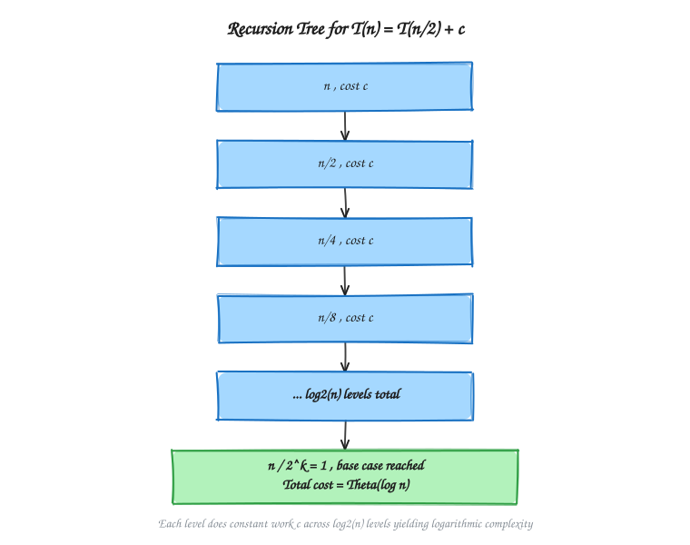
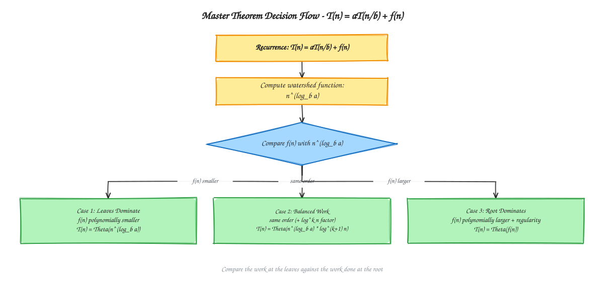

# Chapter 3 - Recurrences Correctness and Loop Invariants

[Previous: Chapter 2 - Complexity Analysis and Asymptotic Notation](../Chapter%202%20-%20Complexity%20Analysis%20and%20Asymptotic%20Notation/README.md) | [Home](../README.md) | [Next: Chapter 4 - Searching and Basic Traversal](../Chapter%204%20-%20Searching%20and%20Basic%20Traversal/README.md)

---

A recurrence relation expresses the running time of a recursive algorithm in terms of the running time on smaller inputs, plus a base case. This chapter shows how to build a recurrence directly from a recursive algorithm, use expansion and recursion trees to discover a likely bound, prove that bound with the substitution method (induction), and solve standard divide-and-conquer recurrences with the Master Theorem.

---

## Table of Contents

1. [What Is a Recurrence Relation?](#1-what-is-a-recurrence-relation)
2. [Case Study: Binary Search Recurrence](#2-case-study-binary-search-recurrence)
   - [Solving by Expansion (Unrolling)](#solving-by-expansion-recursion-tree)
3. [The Substitution Method (Repeated Expansion)](#3-the-substitution-method-repeated-expansion)
   - [A Repeatable Expansion Process](#a-repeatable-expansion-process)
   - [Five Step-by-Step Examples](#five-step-by-step-examples)
   - [Quick Revision Sheet](#quick-revision-sheet)
4. [General Divide-and-Conquer Recurrence](#4-general-divide-and-conquer-recurrence)
5. [Master Theorem](#5-master-theorem)
6. [Master Theorem: Worked Examples by Case](#6-master-theorem-worked-examples-by-case)
   - [Case 1: Recursive Work Dominates](#case-1-recursive-work-dominates)
   - [Case 2: Balanced Work and Where k Comes From](#case-2-balanced-work-and-where-k-comes-from)
   - [Case 3: Non-Recursive Work Dominates](#case-3-non-recursive-work-dominates)
   - [When the Master Theorem Does Not Apply](#when-the-master-theorem-does-not-apply)
7. [Analyze Time Complexity of Above Recurrences](#7-analyze-time-complexity-of-above-recurrences)
8. [Algorithm Correctness and Loop Invariants](#8-algorithm-correctness-and-loop-invariants)
   - [Loop Invariant Framework](#the-three-loop-invariant-properties)
   - [Case Study: Correctness of Insertion Sort](#case-study-correctness-of-insertion-sort)
   - [Mathematical Induction in Algorithm Proofs](#mathematical-induction-in-algorithm-proofs)

---

## 1. What Is a Recurrence Relation?

A recurrence relation defines a function's value in terms of its value on smaller inputs, together with a base case for the smallest input. For a recursive algorithm, the recurrence directly mirrors the recursive calls made by the algorithm:

$$
T(n) = \text{(cost of the recursive subproblem(s))} + \text{(cost of dividing and combining)}
$$

Solving the recurrence means reducing it to a closed-form asymptotic bound such as $O(\log n)$, $O(n)$, or $O(n \log n)$.

---

## 2. Case Study: Binary Search Recurrence

Binary search discards half of the remaining search space using only $O(1)$ extra work (one comparison) per call, so its recurrence is:

$$
T(n) = T(n/2) + c, \qquad T(1) = 1
$$

Written as a piecewise (base-case + recursive-case) definition, the same recurrence reads:

$$
T(n) = \begin{cases} T(n/2) + c & \text{if } n > 1 \\ 1 & \text{if } n = 1 \end{cases}
$$

### Solving by Expansion (Recursion Tree)

Expand the recurrence one level at a time:

$$
T(n) = T(n/2) + c
$$

$$
T(n/2) = T(n/4) + c \implies T(n) = T(n/4) + 2c
$$

$$
T(n/4) = T(n/8) + c \implies T(n) = T(n/8) + 3c
$$

After $k$ expansions, the pattern is:

$$
T(n) = T(n/2^k) + kc
$$

The recursion bottoms out at the base case, i.e., when:

$$
\frac{n}{2^k} = 1 \implies n = 2^k \implies k = \log_2 n
$$

Substituting back with $T(1) = 1$:

$$
T(n) = T(1) + c\log_2 n = 1 + c\log_2 n
$$

Dropping the constant factor and the lower-order additive term:

$$
T(n) = \Theta(\log n)
$$

So **binary search runs in $O(\log n)$ time**, matching the iterative analysis in [Chapter 4 - Searching and Basic Traversal](../Chapter%204%20-%20Searching%20and%20Basic%20Traversal/README.md).

> **Where the $\log n$ comes from:** substituting $n = 2^k$ into $T(n) = T(n/2^k) + kc$ gives $\log_2 n = \log_2 2^k = k \log_2 2 = k$, so $k = \log_2 n$ &mdash; this is exactly the substitution used above.

### Visual Map: Recursion Tree for T(n) = T(n/2) + c



---

## 3. The Substitution Method (Repeated Expansion)

Here, **substitution method** means repeatedly substituting the recurrence into itself (also called the **expansion** or **unrolling** method). The goal is to find a pattern, express it after $k$ substitutions, and choose $k$ so the input reaches the base case. This gives a direct, step-by-step way to find the time complexity; it does not require an upper-bound/lower-bound induction proof.

For halving recurrences, assume $n$ is a power of two so the divisions are exact. For recurrences that decrease by one, use the stated base case, here $T(1)=1$.

### A Repeatable Expansion Process

1. Write the recurrence and its base case.
2. Substitute the recurrence into itself one or more times.
3. Identify the pattern after $k$ substitutions.
4. Find $k$ by setting the remaining input equal to the base-case input.
5. Substitute that value of $k$ into the pattern and state the asymptotic complexity.

### Five Step-by-Step Examples

#### Example 1: $T(n)=2T(n/2)+n$

Let $T(1)=1$ and assume $n$ is a power of two.

$$
\begin{aligned}
T(n) &= 2T(n/2)+n \\
     &= 2[2T(n/4)+n/2]+n \\
     &= 4T(n/4)+2n \\
     &= 4[2T(n/8)+n/4]+2n \\
     &= 8T(n/8)+3n.
\end{aligned}
$$

After $k$ substitutions, $T(n)=2^kT(n/2^k)+kn$. Stop when $n/2^k=1$, so $k=\log_2 n$. Therefore $T(n)=nT(1)+n\log_2n=n+n\log_2n$, and

$$\boxed{T(n)=\Theta(n\log n)}.$$

#### Example 2: $T(n)=T(n/2)+1$

Let $T(1)=1$ and assume $n$ is a power of two.

$$
T(n)=T(n/2)+1=T(n/4)+2=T(n/8)+3=\cdots=T(n/2^k)+k.
$$

Stop when $n/2^k=1$, giving $k=\log_2 n$. Thus $T(n)=T(1)+\log_2n=1+\log_2n$, and

$$\boxed{T(n)=\Theta(\log n)}.$$

#### Example 3: $T(n)=2T(n/2)+1$

Let $T(1)=1$ and assume $n$ is a power of two.

$$
T(n)=2T(n/2)+1=4T(n/4)+3=8T(n/8)+7=\cdots=2^kT(n/2^k)+(2^k-1).
$$

Stop when $n/2^k=1$, giving $k=\log_2n$. Hence $T(n)=nT(1)+(n-1)=2n-1$, and

$$\boxed{T(n)=\Theta(n)}.$$

#### Example 4: $T(n)=T(n-1)+1$

Let $T(1)=1$.

$$
T(n)=T(n-1)+1=T(n-2)+2=T(n-3)+3=\cdots=T(n-k)+k.
$$

Stop when $n-k=1$, so $k=n-1$. Then $T(n)=T(1)+n-1=n$, and

$$\boxed{T(n)=\Theta(n)}.$$

#### Example 5: $T(n)=T(n-1)+n$

Let $T(1)=1$.

$$
\begin{aligned}
T(n)&=T(n-1)+n \\
    &=T(n-2)+(n-1)+n \\
    &=T(n-3)+(n-2)+(n-1)+n \\
    &=T(n-k)+\sum_{i=0}^{k-1}(n-i).
\end{aligned}
$$

Stop when $n-k=1$, so $k=n-1$. Therefore $T(n)=T(1)+2+3+\cdots+n=1+\frac{n(n+1)}2-1=\frac{n(n+1)}2$, and

$$\boxed{T(n)=\Theta(n^2)}.$$

### Optional: Proving Bounds by Induction

The expansion method above finds the pattern directly. A different, more formal use of the name substitution method proves a guessed bound with induction. The following proofs are included as an optional reference.

#### Example 1: $T(n)=2T(n/2)+n$ — the bound $\Theta(n\log n)$

Let $T(1)=1$ and assume $n$ is a power of two. A recursion tree suggests that each level costs $n$ and there are $\log_2 n$ levels, so guess $T(n)=\Theta(n\log n)$.

**Upper bound:** Claim $T(n)\le Cn\log_2 n$ for $n\ge2$.

- **Base case:** $T(2)=2T(1)+2=4$. The claim holds if $C\ge2$.
- **Inductive hypothesis:** Assume $T(n/2)\le C(n/2)\log_2(n/2)$.

**Substitute and simplify:**

$$
\begin{aligned}
T(n) &\le 2C\frac n2\log_2\frac n2+n \\
     &= Cn(\log_2 n-1)+n \\
     &\le Cn\log_2 n \qquad (C\ge1).
\end{aligned}
$$

So the upper bound holds, for example, with $C=2$.

**Lower bound:** Claim $T(n)\ge cn\log_2 n$ for $n\ge2$.

- **Base case:** At $n=2$, $T(2)=4\ge2c$ when $c\le2$.
- **Inductive hypothesis:** Assume $T(n/2)\ge c(n/2)\log_2(n/2)$.

**Substitute and simplify:**

$$
T(n)\ge cn(\log_2 n-1)+n
     =cn\log_2 n+(1-c)n
     \ge cn\log_2 n \quad (c\le1).
$$

Taking $c=1$ satisfies the lower proof. Therefore,

$$
\boxed{T(n)=\Theta(n\log n)}.
$$

#### Example 2: $T(n)=T(n/2)+1$ — the bound $\Theta(\log n)$

Let $T(1)=1$ and let $n$ be a power of two. Each call does constant work and halves the input. Guess $T(n)=\Theta(\log n)$.

**Upper bound:** Claim $T(n)\le C\log_2 n$ for $n\ge2$.

- **Base case:** $T(2)=2$, so choose $C\ge2$.
- **Inductive hypothesis:** Assume $T(n/2)\le C\log_2(n/2)$.

**Substitute:**

$$
T(n)\le C(\log_2 n-1)+1\le C\log_2 n \quad (C\ge1).
$$

**Lower bound:** Claim $T(n)\ge c\log_2 n$ for $n\ge2$.

- **Base case:** At $n=2$, $T(2)=2\ge c$ for $c\le2$.

**Inductive hypothesis and substitution:**

$$
T(n)\ge c\log_2(n/2)+1
     =c\log_2 n+(1-c)\ge c\log_2 n \quad (c\le1).
$$

For instance, $C=2$ and $c=1$ work, so

$$
\boxed{T(n)=\Theta(\log n)}.
$$

#### Example 3: $T(n)=2T(n/2)+1$ — the bound $\Theta(n)$

Let $T(1)=1$ and let $n$ be a power of two. Guess a linear bound because the total work grows geometrically toward the leaves.

**Upper bound:** Claim $T(n)\le Cn-1$.

- **Base case:** At $n=1$, $T(1)=1\le C-1$ if $C\ge2$.
- **Inductive hypothesis:** Assume $T(n/2)\le C(n/2)-1$.

**Substitute:**

$$
T(n)\le 2\left(C\frac n2-1\right)+1=Cn-1.
$$

**Lower bound:** Claim $T(n)\ge cn$.

- **Base case:** $T(1)=1\ge c$ when $c\le1$.

**Inductive hypothesis and substitution:**

$$
T(n)\ge2c\frac n2+1=cn+1\ge cn.
$$

Choosing $C=2$ and $c=1$ proves

$$
\boxed{T(n)=\Theta(n)}.
$$

In fact, this recurrence solves exactly to $T(n)=2n-1$ when $n$ is a power of two.

#### Example 4: $T(n)=T(n-1)+1$ — the bound $\Theta(n)$

Let $T(1)=1$. This recurrence decreases by one rather than dividing the input. Guess a linear bound.

**Upper bound:** Claim $T(n)\le Cn$. For the base case, $T(1)=1\le C$ if $C\ge1$. Assuming $T(n-1)\le C(n-1)$,

$$
T(n)\le C(n-1)+1\le Cn \quad (C\ge1).
$$

**Lower bound:** Claim $T(n)\ge cn$. The base case holds for $c\le1$. Assuming $T(n-1)\ge c(n-1)$,

$$
T(n)\ge c(n-1)+1\ge cn \quad (c\le1).
$$

Taking $c=C=1$ gives the exact solution $T(n)=n$, and hence

$$
\boxed{T(n)=\Theta(n)}.
$$

#### Example 5: $T(n)=T(n-1)+n$ — the bound $\Theta(n^2)$

Let $T(1)=1$. Since the recurrence adds work proportional to the current input at each of about $n$ calls, guess a quadratic bound.

**Upper bound:** Claim $T(n)\le Cn^2$. The base case holds for $C\ge1$. Assuming $T(n-1)\le C(n-1)^2$,

$$
\begin{aligned}
T(n) &\le C(n-1)^2+n \\
     &\le Cn^2,
\end{aligned}
$$

because $Cn^2-C(n-1)^2=C(2n-1)\ge n$ for $C\ge1$ and $n\ge2$.

**Lower bound:** Claim $T(n)\ge cn^2$. The base case holds for $c\le1$. Assuming $T(n-1)\ge c(n-1)^2$,

$$
T(n)\ge c(n-1)^2+n\ge cn^2,
$$

because $n\ge c(2n-1)$ for $c=1/2$ and $n\ge2$. Thus $c=1/2$ and $C=1$ are valid choices, and

$$
\boxed{T(n)=\Theta(n^2)}.
$$

The last two examples also show the basic pattern for $T(n)=T(n-1)+f(n)$: the work from successive calls accumulates, so the recurrence is naturally solved by expansion or induction rather than the Master Theorem.

### Quick Revision Sheet

| Recurrence | Pattern after $k$ substitutions | $k$ to reach the base case | Complexity |
| --- | --- | --- | --- |
| $T(n)=2T(n/2)+n$ | $2^kT(n/2^k)+kn$ | $\log_2 n$ | $\Theta(n\log n)$ |
| $T(n)=T(n/2)+1$ | $T(n/2^k)+k$ | $\log_2 n$ | $\Theta(\log n)$ |
| $T(n)=2T(n/2)+1$ | $2^kT(n/2^k)+(2^k-1)$ | $\log_2 n$ | $\Theta(n)$ |
| $T(n)=T(n-1)+1$ | $T(n-k)+k$ | $n-1$ | $\Theta(n)$ |
| $T(n)=T(n-1)+n$ | $T(n-k)+\sum_{i=0}^{k-1}(n-i)$ | $n-1$ | $\Theta(n^2)$ |

**Central idea:** when the input is halved, $n,n/2,n/4,\ldots$, so $k=\log_2 n$. When it decreases by one, $n,n-1,n-2,\ldots$, so $k=n-1$.

---

## 4. General Divide-and-Conquer Recurrence

Most divide-and-conquer algorithms produce a recurrence of the form:

$$
T(n) = aT(n/b) + f(n)
$$

| Symbol | Meaning |
| :---: | :--- |
| $a$ | Number of subproblems the problem is divided into ($a \ge 1$) |
| $n/b$ | Size of each subproblem ($b > 1$) |
| $f(n)$ | Cost of dividing the problem and combining the subproblem results |

---

## 5. Master Theorem

The Master Theorem solves recurrences of the form

$$
T(n)=aT(n/b)+f(n), \qquad a\ge1,\ b>1,
$$

by comparing the extra work $f(n)$ with the **critical function** $n^{\log_b a}$. (Some texts call this the watershed function.) The theorem assumes the recurrence has the standard divide-by-a-constant form and that $f(n)$ is asymptotically nonnegative.

Let $d=\log_b a$. Then the three cases are:

| Case | Compare $f(n)$ with $n^d$ | Result |
| :---: | :--- | :--- |
| 1 | $f(n)=O(n^{d-\epsilon})$ for some $\epsilon>0$; polynomially smaller | $T(n)=\Theta(n^d)$ |
| 2 | $f(n)=\Theta(n^d\log^k n)$ for some $k\ge0$; same polynomial power, possibly with logarithms | $T(n)=\Theta(n^d\log^{k+1}n)$ |
| 3 | $f(n)=\Omega(n^{d+\epsilon})$ for some $\epsilon>0$, and $a f(n/b)\le c f(n)$ for a constant $c<1$ and all sufficiently large $n$ | $T(n)=\Theta(f(n))$ |

### A Four-Step Routine

1. Match the recurrence to $T(n)=aT(n/b)+f(n)$ and identify $a$, $b$, and $f(n)$.
2. Calculate $d=\log_b a$ and the critical function $n^d$.
3. Compare $f(n)$ with $n^d$. For Case 3, also verify the regularity condition.
4. Apply only the case whose full condition is satisfied, then write the answer in $\Theta$ notation.

Do not decide the case by looking only at the largest-looking term. The comparison with $n^d$ is the key step.

### Visual Map: Choosing the Right Case



---

## 6. Master Theorem: Worked Examples by Case

Each example uses the same order: identify $a$, $b$, and $f(n)$; calculate the critical function; compare growth; then conclude. There are five examples in each case so you can practice the process rather than memorize isolated answers.

### Case 1: Recursive Work Dominates

In Case 1, the extra work is **polynomially smaller** than the critical function: $f(n)=O(n^{d-\epsilon})$ for some positive $\epsilon$. The recursive calls therefore determine the asymptotic answer, $\Theta(n^d)$.

#### Example 1: $T(n)=8T(n/2)+n^2$

1. **Identify:** $a=8$, $b=2$, and $f(n)=n^2$.
2. **Critical function:** $n^{\log_2 8}=n^3$.
3. **Compare:** $n^2=O(n^{3-1})$, so Case 1 applies with $\epsilon=1$.
4. **Answer:** $\boxed{T(n)=\Theta(n^3)}$.

#### Example 2: $T(n)=4T(n/2)+n$

1. **Identify:** $a=4$, $b=2$, and $f(n)=n$.
2. **Critical function:** $n^{\log_2 4}=n^2$.
3. **Compare:** $n=O(n^{2-1})$, so Case 1 applies with $\epsilon=1$.
4. **Answer:** $\boxed{T(n)=\Theta(n^2)}$.

#### Example 3: $T(n)=9T(n/3)+n$

1. **Identify:** $a=9$, $b=3$, and $f(n)=n$.
2. **Critical function:** $n^{\log_3 9}=n^2$.
3. **Compare:** $n=O(n^{2-1})$, so Case 1 applies with $\epsilon=1$.
4. **Answer:** $\boxed{T(n)=\Theta(n^2)}$.

#### Example 4: $T(n)=16T(n/4)+n\log n$

1. **Identify:** $a=16$, $b=4$, and $f(n)=n\log n$.
2. **Critical function:** $n^{\log_4 16}=n^2$.
3. **Compare:** Since $\log n=O(n^{1/2})$, $n\log n=O(n^{3/2})=O(n^{2-1/2})$. Case 1 applies with $\epsilon=1/2$.
4. **Answer:** $\boxed{T(n)=\Theta(n^2)}$.

#### Example 5: $T(n)=5T(n/2)+n^2$

1. **Identify:** $a=5$, $b=2$, and $f(n)=n^2$.
2. **Critical function:** $n^{\log_2 5}$, where $\log_2 5\approx2.322$.
3. **Compare:** Let $\epsilon=\log_2 5-2>0$. Then $f(n)=n^2=n^{\log_2 5-\epsilon}$, so Case 1 applies.
4. **Answer:** $\boxed{T(n)=\Theta(n^{\log_2 5})}$.

### Case 2: Balanced Work and Where $k$ Comes From

Case 2 applies when the polynomial part of $f(n)$ matches the critical function:

$$
f(n)=\Theta\bigl(n^{\log_b a}\log^k n\bigr).
$$

Here **$k$ is the exponent on the logarithm in $f(n)$**. It is not the exponent on $n$, and it is not a value found by a separate calculation. First calculate the critical function; then compare the remaining logarithmic factor. For example, $n=n\log^0 n$ because $\log^0 n=1$, so plain $n$ corresponds to $k=0$.

The answer is

$$
T(n)=\Theta\bigl(n^{\log_b a}\log^{k+1}n\bigr).
$$

**Why does the exponent increase by one?** Suppose $a=b^d$ so the critical function is $n^d$. At recursion-tree level $i$, there are $a^i$ subproblems of size $n/b^i$. If each subproblem contributes $(n/b^i)^d\log^k(n/b^i)$ extra work, the total work at that level is

$$
a^i\left(\frac{n}{b^i}\right)^d\log^k\left(\frac{n}{b^i}\right)
=n^d\log^k\left(\frac{n}{b^i}\right),
$$

because $a=b^d$ cancels the powers of $b$. Let $L=\Theta(\log n)$ be the number of levels. The level costs, from the bottom upward, are proportional to $1^k,2^k,\ldots,L^k$ (for $k=0$, each level costs a constant). Their sum is $\Theta(L^{k+1})=\Theta(\log^{k+1}n)$. This is why the answer has one more power of the logarithm than $f(n)$.

#### Example 1: $T(n)=T(n/2)+1$ — $k=0$

1. **Identify:** $a=1$, $b=2$, and $f(n)=1=\Theta(1)$.
2. **Critical function:** $n^{\log_2 1}=n^0=1$.
3. **Find $k$:** $f(n)=\Theta(1\cdot\log^0 n)$, so $k=0$.
4. **Apply Case 2:** $T(n)=\Theta(1\cdot\log^{0+1}n)$.
5. **Answer:** $\boxed{T(n)=\Theta(\log n)}$.

#### Example 2: $T(n)=2T(n/2)+n$ — $k=0$

1. **Identify:** $a=2$, $b=2$, and $f(n)=n$.
2. **Critical function:** $n^{\log_2 2}=n$.
3. **Find $k$:** $n=n\log^0n$, so $k=0$.
4. **Apply Case 2:** $T(n)=\Theta(n\log^{0+1}n)$.
5. **Answer:** $\boxed{T(n)=\Theta(n\log n)}$.

#### Example 3: $T(n)=2T(n/2)+n\log n$ — $k=1$

1. **Identify:** $a=2$, $b=2$, and $f(n)=n\log n$.
2. **Critical function:** $n^{\log_2 2}=n$.
3. **Find $k$:** $f(n)=n\log^1 n$, so $k=1$.
4. **Apply Case 2:** $T(n)=\Theta(n\log^{1+1}n)$.
5. **Answer:** $\boxed{T(n)=\Theta(n\log^2 n)}$.

#### Example 4: $T(n)=4T(n/2)+n^2\log^2 n$ — $k=2$

1. **Identify:** $a=4$, $b=2$, and $f(n)=n^2\log^2 n$.
2. **Critical function:** $n^{\log_2 4}=n^2$.
3. **Find $k$:** $f(n)=n^2\log^2 n$, so $k=2$.
4. **Apply Case 2:** $T(n)=\Theta(n^2\log^{2+1}n)$.
5. **Answer:** $\boxed{T(n)=\Theta(n^2\log^3 n)}$.

#### Example 5: $T(n)=9T(n/3)+n^2\log^3 n$ — $k=3$

1. **Identify:** $a=9$, $b=3$, and $f(n)=n^2\log^3 n$.
2. **Critical function:** $n^{\log_3 9}=n^2$.
3. **Find $k$:** $f(n)=n^2\log^3 n$, so $k=3$.
4. **Apply Case 2:** $T(n)=\Theta(n^2\log^{3+1}n)$.
5. **Answer:** $\boxed{T(n)=\Theta(n^2\log^4 n)}$.

**Case 2 quick check:** match the power of $n$ in $f(n)$ to $n^{\log_b a}$ first. Only the power on the remaining $\log n$ is $k$. Then add one to that power in the final answer.

### Case 3: Non-Recursive Work Dominates

In Case 3, $f(n)$ is polynomially larger than the critical function, and the regularity condition must hold:

$$
a f(n/b)\le c f(n) \quad \text{for some constant }c<1.
$$

The condition verifies that the recursive work shrinks geometrically relative to the work at the current problem size. Do not skip this check.

#### Example 1: $T(n)=2T(n/2)+n^2$

1. **Identify:** $a=2$, $b=2$, and $f(n)=n^2$.
2. **Critical function:** $n^{\log_2 2}=n$.
3. **Compare:** $n^2=\Omega(n^{1+1})$, so $f(n)$ is polynomially larger.
4. **Check regularity:** $2f(n/2)=2(n/2)^2=\frac12n^2=\frac12f(n)$.

   Thus $c=1/2<1$.
5. **Answer:** $\boxed{T(n)=\Theta(n^2)}$.

#### Example 2: $T(n)=2T(n/2)+n^3$

1. **Identify:** $a=2$, $b=2$, and $f(n)=n^3$.
2. **Critical function:** $n^{\log_2 2}=n$.
3. **Compare:** $n^3=\Omega(n^{1+2})$.
4. **Check regularity:** $2f(n/2)=2(n/2)^3=\frac14n^3=\frac14f(n)$, so $c=1/4<1$.
5. **Answer:** $\boxed{T(n)=\Theta(n^3)}$.

#### Example 3: $T(n)=4T(n/2)+n^3$

1. **Identify:** $a=4$, $b=2$, and $f(n)=n^3$.
2. **Critical function:** $n^{\log_2 4}=n^2$.
3. **Compare:** $n^3=\Omega(n^{2+1})$.
4. **Check regularity:** $4f(n/2)=4(n/2)^3=\frac12n^3=\frac12f(n)$, so $c=1/2<1$.
5. **Answer:** $\boxed{T(n)=\Theta(n^3)}$.

#### Example 4: $T(n)=3T(n/2)+n^2$

1. **Identify:** $a=3$, $b=2$, and $f(n)=n^2$.
2. **Critical function:** $n^{\log_2 3}\approx n^{1.585}$.
3. **Compare:** Let $\epsilon=2-\log_2 3>0$. Then $n^2=n^{\log_2 3+\epsilon}$.
4. **Check regularity:** $3f(n/2)=3(n/2)^2=\frac34n^2=\frac34f(n)$, so $c=3/4<1$.
5. **Answer:** $\boxed{T(n)=\Theta(n^2)}$.

#### Example 5: $T(n)=9T(n/3)+n^3$

1. **Identify:** $a=9$, $b=3$, and $f(n)=n^3$.
2. **Critical function:** $n^{\log_3 9}=n^2$.
3. **Compare:** $n^3=\Omega(n^{2+1})$.
4. **Check regularity:** $9f(n/3)=9(n/3)^3=\frac13n^3=\frac13f(n)$, so $c=1/3<1$.
5. **Answer:** $\boxed{T(n)=\Theta(n^3)}$.

### When the Master Theorem Does Not Apply

The theorem requires recursive input sizes of the form $n/b$, where $b$ is a fixed constant greater than 1. It does not directly apply to $T(n)=T(n-1)+1$, because the input decreases by one rather than by a constant factor.

Use expansion instead:

$$
\begin{aligned}
T(n) &= T(n-1)+1 \\
     &= T(n-2)+2 \\
     &= T(n-3)+3 \\
     &\ \vdots \\
     &= T(1)+(n-1).
\end{aligned}
$$

With $T(1)=1$, this gives $T(n)=n$, so

$$
\boxed{T(n)=\Theta(n)}.
$$

Similarly, $T(n)=T(n-1)+n$ expands to $T(1)+2+3+\cdots+n=\Theta(n^2)$; both decrease-by-one recurrences were also proved by substitution in Section 3.

---

## 7. Analyze Time Complexity of Above Recurrences

The first table collects the five substitution examples. The second is a quick-reference list of all fifteen Master Theorem examples; use Sections 3 and 6 for their full proofs and comparisons.

### Substitution Method Summary

| Recurrence | Guess / key result | Complexity |
| :--- | :--- | :--- |
| $T(n)=2T(n/2)+n$ | $n\log n$ | $\Theta(n\log n)$ |
| $T(n)=T(n/2)+1$ | $\log n$ | $\Theta(\log n)$ |
| $T(n)=2T(n/2)+1$ | $n$ | $\Theta(n)$ |
| $T(n)=T(n-1)+1$ | $n$ | $\Theta(n)$ |
| $T(n)=T(n-1)+n$ | $n^2$ | $\Theta(n^2)$ |

### Master Theorem Summary

| Recurrence | Critical function $n^{\log_b a}$ | Case | Complexity |
| :--- | :---: | :---: | :--- |
| $T(n)=8T(n/2)+n^2$ | $n^3$ | 1 | $\Theta(n^3)$ |
| $T(n)=4T(n/2)+n$ | $n^2$ | 1 | $\Theta(n^2)$ |
| $T(n)=9T(n/3)+n$ | $n^2$ | 1 | $\Theta(n^2)$ |
| $T(n)=16T(n/4)+n\log n$ | $n^2$ | 1 | $\Theta(n^2)$ |
| $T(n)=5T(n/2)+n^2$ | $n^{\log_2 5}$ | 1 | $\Theta(n^{\log_2 5})$ |
| $T(n)=T(n/2)+1$ | $1$ | 2 ($k=0$) | $\Theta(\log n)$ |
| $T(n)=2T(n/2)+n$ | $n$ | 2 ($k=0$) | $\Theta(n\log n)$ |
| $T(n)=2T(n/2)+n\log n$ | $n$ | 2 ($k=1$) | $\Theta(n\log^2 n)$ |
| $T(n)=4T(n/2)+n^2\log^2 n$ | $n^2$ | 2 ($k=2$) | $\Theta(n^2\log^3 n)$ |
| $T(n)=9T(n/3)+n^2\log^3 n$ | $n^2$ | 2 ($k=3$) | $\Theta(n^2\log^4 n)$ |
| $T(n)=2T(n/2)+n^2$ | $n$ | 3 | $\Theta(n^2)$ |
| $T(n)=2T(n/2)+n^3$ | $n$ | 3 | $\Theta(n^3)$ |
| $T(n)=4T(n/2)+n^3$ | $n^2$ | 3 | $\Theta(n^3)$ |
| $T(n)=3T(n/2)+n^2$ | $n^{\log_2 3}$ | 3 | $\Theta(n^2)$ |
| $T(n)=9T(n/3)+n^3$ | $n^2$ | 3 | $\Theta(n^3)$ |

---

## 8. Algorithm Correctness and Loop Invariants

An algorithm is said to be **correct** if, for every valid input instance, it halts with the correct output. While empirical testing shows that code runs on selected test inputs, mathematical proof guarantees correctness on **all possible** inputs.

### The Three Loop Invariant Properties

A **loop invariant** is a formal assertion about program variables that is true before and after each iteration of a loop. Proving algorithm correctness using a loop invariant requires establishing three properties (directly analogous to mathematical induction):

1. **Initialization (Base Case):**
   The invariant is true prior to the first iteration of the loop.
2. **Maintenance (Inductive Step):**
   If the invariant is true before an iteration of the loop, it remains true before the next iteration.
3. **Termination:**
   When the loop terminates, the invariant provides a useful property that proves the algorithm halts with the correct output.

| Property | Induction Counterpart | Verification Step |
| :--- | :--- | :--- |
| **Initialization** | Base Case | Verify the invariant holds before loop index $j$ takes its initial value. |
| **Maintenance** | Inductive Step | Show that executing loop body preserves the invariant for index $j + 1$. |
| **Termination** | Final Conclusion | Evaluate the invariant at loop exit ($j = \text{exit bound}$) to establish postcondition correctness. |

### Case Study: Correctness of Insertion Sort

Consider the standard Insertion Sort algorithm:

```text
INSERTION-SORT(A, n)
1. for j = 2 to n:
2.     key = A[j]
3.     // Insert A[j] into the sorted subarray A[1 .. j - 1]
4.     i = j - 1
5.     while i > 0 and A[i] > key:
6.         A[i + 1] = A[i]
7.         i = i - 1
8.     A[i + 1] = key
```

#### Stated Loop Invariant
> At the start of each iteration of the outer `for` loop (lines 1–8), the subarray $A[1 \dots j-1]$ consists of the elements originally in $A[1 \dots j-1]$, but in sorted order.

#### Formal Proof
1. **Initialization:**
   Prior to the first iteration, $j = 2$. The subarray $A[1 \dots j-1]$ is simply $A[1 \dots 1]$, consisting of a single element. A single-element array is trivially sorted, so the invariant holds before the loop begins.
2. **Maintenance:**
   The inner `while` loop (lines 5–7) shifts elements $A[j-1], A[j-2], \dots$ that are greater than `key` one position to the right until the appropriate spot for `key` is found. Line 8 inserts `key` into this position. The subarray $A[1 \dots j]$ now contains the original elements of $A[1 \dots j]$ in sorted order. Incrementing $j$ for the next iteration preserves the invariant for $j + 1$.
3. **Termination:**
   The outer loop terminates when $j > n$, which means $j = n + 1$. Substituting $j = n + 1$ into the invariant: the subarray $A[1 \dots (n + 1) - 1] = A[1 \dots n]$ consists of the original elements of $A[1 \dots n]$ in sorted order. Since $A[1 \dots n]$ is the entire array, the algorithm is proven correct.

### Mathematical Induction in Algorithm Proofs

For recursive algorithms, correctness is demonstrated using **mathematical induction on input size $n$**:
- **Weak Induction:** Assume correctness for subproblems of size $n - 1$ to prove correctness for size $n$ (used in decrease-and-conquer procedures).
- **Strong Induction:** Assume correctness for all subproblem sizes $k < n$ to prove correctness for size $n$ (used in divide-and-conquer algorithms like Merge Sort and Quick Sort).

---

[Previous: Chapter 2 - Complexity Analysis and Asymptotic Notation](../Chapter%202%20-%20Complexity%20Analysis%20and%20Asymptotic%20Notation/README.md) | [Home](../README.md) | [Next: Chapter 4 - Searching and Basic Traversal](../Chapter%204%20-%20Searching%20and%20Basic%20Traversal/README.md)
