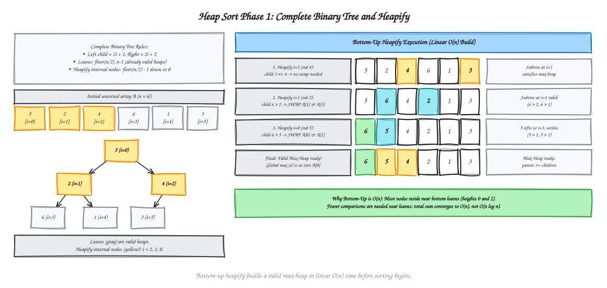
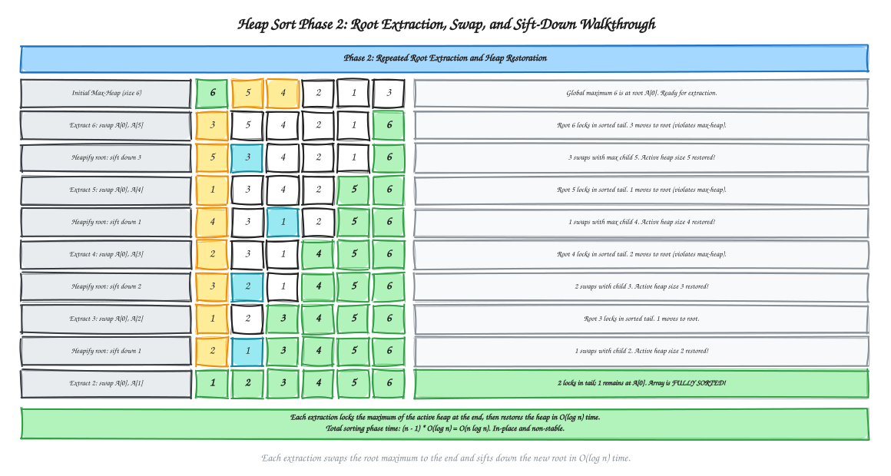
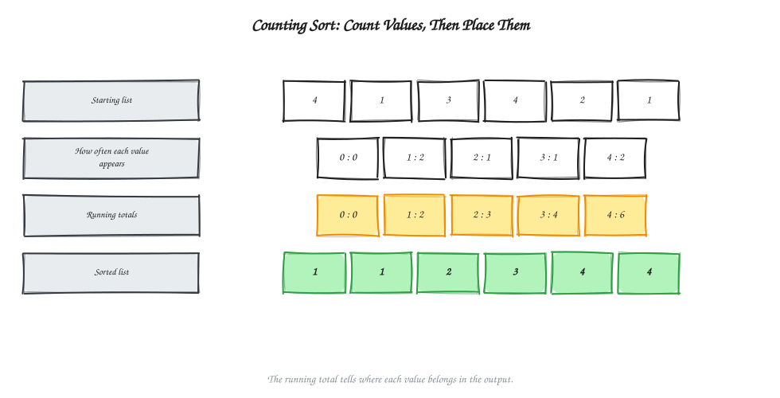

# Chapter 5 - Sorting Algorithms

[Previous: Chapter 4 - Searching and Basic Traversal](../Chapter%204%20-%20Searching%20and%20Basic%20Traversal/README.md) | [Home](../README.md) | [Next: Chapter 6 - Divide and Conquer](../Chapter%206%20-%20Divide%20and%20Conquer/README.md)

Sorting means putting items into an order, such as smallest to largest. It makes many other tasks easier: for example, finding an item, spotting duplicates, or arranging appointments.

This chapter introduces several ways to sort. The examples use small lists so you can follow each move by hand.

1. What sorting means and how sorts differ
2. Choosing a sorting method
3. Bubble sort
4. Selection sort
5. Insertion sort
6. Merge sort
7. Quick sort
8. Heap sort
9. Counting sort
10. Comparing the methods

---

## Start Here: The Idea in Plain Words

**The goal:** rearrange a list so the values go from smallest to largest. For example, `[5, 2, 4]` becomes `[2, 4, 5]`. The list keeps the same items; only their positions change.

**Tiny example.** Look at the neighboring values in `[5, 2, 4]`. Since 5 is bigger than 2, switch them: `[2, 5, 4]`. Then switch 5 and 4: `[2, 4, 5]`. That is the basic idea behind bubble sort. Other methods choose a smallest item, insert an item into its place, split the list into smaller lists, or count how often each value appears.

**Words used in this chapter, in simple terms**

| Word | Simple meaning |
| :--- | :--- |
| Compare | Check which of two values comes first. |
| Key | The value used to decide an item's order. |
| Stable | Equal-key items stay in the same relative order they had before sorting. |
| In place | Sorts inside the original list, using little extra memory. |
| Pivot | A chosen value used to divide a list in quick sort. |
| Max-heap | A tree-shaped arrangement where each parent is at least as large as its children. |
| Key range | The set of values counting sort must keep track of. |

**How to read the pseudocode:** these examples use common code symbols, but remain pseudocode rather than one specific programming language.

| Notation | Meaning |
| :--- | :--- |
| `A[i]` | The item at index `i` in array `A`. Indexes start at 0, so the last item is `A[n - 1]` when `n = length(A)`. |
| `A[left..right]` | The part of the array from `left` through `right`, including both ends. |
| `i: integer`, `swapped: boolean`, `key: item` | Examples of types: a whole number, a true/false value, or one item being sorted. |
| `=` and `==` | `=` stores a value; `==` checks whether two values are equal. |
| `<`, `<=`, `>`, `>=` | Compare which value is smaller or larger. |
| `&&` | “And.” The second test is checked only if the first one is true, which helps avoid looking outside the array. |
| `+= 1`, `-= 1` | Add one to or subtract one from a value. |
| `for i = 0 to n - 1`, `downto` | The loop includes its final value; `downto` counts backward. |
| `length(A)`, `floor(x)` | Count the items in `A`; round `x` down to a whole number. |
| `swap(x, y)`, `append(list, x)`, `break`, `return` | Exchange two values, add to a list, leave a loop, or finish and give back a result. |
| `-> array`, `-> integer`, `-> void` | The result type: return an array, return an integer, or change the array without returning a value. |

**Before you start:** it helps to know how to read [Big-O notation](../Chapter%202%20-%20Complexity%20Analysis%20and%20Asymptotic%20Notation/README.md). **Reading tip:** first understand the everyday idea and follow the example list; then use the pseudocode to check the steps.

---

## 1. What Sorting Means and How Sorts Differ

A sorting method takes a list and rearranges it into the chosen order. In this chapter, the chosen order is smallest to largest.

### Visual Map: Two Ways to Sort


Most methods here are **comparison sorts**: they decide which item comes first by comparing items. Counting sort is different: it counts how often each allowed number appears, so it does not compare items with each other.

A **stable** sort keeps equal-key items in their original relative order. For example, if two students have the same score and the first student was listed first, a stable sort keeps that order. Stability matters when items have other information attached to their keys.

An **in-place** sort works in the original list and needs little extra memory. Merge sort and counting sort need extra storage for their work. Quick sort rearranges the original list, but its recursive calls still use some extra memory.

There is an important limit: any comparison sort needs at least about `n log n` comparisons in the worst case, where `n` is the number of items. Counting sort can be faster when the values come from a small, known range because it uses counts instead of comparisons.

---

## 2. Choosing a Sorting Method

No method is best for every situation. The useful question is what matters most: a simple approach, stable ordering, a reliable time guarantee, or a small range of integer values.

### Visual Map: Choose by What You Need


- For a tiny list or one that is nearly sorted, insertion sort is often a good fit.
- For a guaranteed `O(n log n)` time and stable results, choose merge sort if extra memory is available.
- For `O(n log n)` time with little extra memory, heap sort is an option when stability is not needed.
- Quick sort is often fast in practice, but a poor pivot can make it much slower.
- Counting sort is useful when the list contains small, nonnegative integers.

---

## 3. Bubble Sort

**Core idea:** look at neighboring items and switch them when they are in the wrong order. A large value moves toward the end with each pass.

Imagine walking along the list from left to right. At each pair, put the larger value on the right. When you reach the end, the largest value you had not placed yet is in its final position. Repeat on the part that remains.

### Visual Walkthrough: One Pass at a Time


Start with `[5, 2, 4, 6, 1, 3]`:

| Step | List after the pass | What is now settled? |
| :--- | :--- | :--- |
| Start | `[5, 2, 4, 6, 1, 3]` | Nothing yet |
| Pass 1 | `[2, 4, 5, 1, 3, 6]` | 6 is at the end |
| Pass 2 | `[2, 4, 1, 3, 5, 6]` | 5 and 6 are at the end |
| Pass 3 | `[2, 1, 3, 4, 5, 6]` | 4, 5, and 6 are at the end |
| Pass 4 | `[1, 2, 3, 4, 5, 6]` | The list is sorted |
| Pass 5 | `[1, 2, 3, 4, 5, 6]` | No switch is needed, so stop |

### Instructions

1. Count the items and begin at the first pair, at positions 0 and 1.
2. Compare each pair of neighbors from left to right. If the left value is larger, switch the two values; if they are equal or already in order, leave them alone.
3. Continue to the end of the part that is not settled yet. The largest value in that part will have moved to its final position at the right.
4. Start another pass, stopping one position earlier because the rightmost value is already settled.
5. If a pass makes no switches, stop: the list is already in order. Otherwise, keep passing through the remaining part until it is sorted.

### Pseudocode

```text
BUBBLE-SORT(A: array of comparable items) -> array of comparable items
n: integer = length(A)
if n < 2:
    return A

for pass: integer = 0 to n - 2:
    swapped: boolean = false
    for j: integer = 0 to n - 2 - pass:
        if A[j] > A[j + 1]:
            swap(A[j], A[j + 1])
            swapped = true
    if swapped == false:
        break
return A
```

### How much work does it do?

- Best case: `Θ(n)` when the list is already sorted and the method stops after one pass.
- Average and worst case: `Θ(n²)` comparisons.
- Extra memory: `Θ(1)`.
- Stable: yes. Equal items are not switched with each other.

---

## 4. Selection Sort

**Core idea:** find the smallest item that has not been placed yet, then put it in the next open position.

At first, the whole list is waiting to be sorted. Find its smallest value and move that value to the first position. Then look only at the remaining part, find its smallest value, and place it second. The sorted part grows one position at a time.

### Visual Walkthrough: Pick the Next Smallest Item


Start with `[5, 2, 4, 6, 1, 3]`:

| Round | List after the round | Smallest value placed |
| :--- | :--- | :---: |
| Start | `[5, 2, 4, 6, 1, 3]` | — |
| 1 | `[1, 2, 4, 6, 5, 3]` | 1 |
| 2 | `[1, 2, 4, 6, 5, 3]` | 2 (already there) |
| 3 | `[1, 2, 3, 6, 5, 4]` | 3 |
| 4 | `[1, 2, 3, 4, 5, 6]` | 4 |
| 5 | `[1, 2, 3, 4, 5, 6]` | 5 (already there) |

### Instructions

1. Treat the left side as the settled part; at the beginning it is empty. Let `i` be the first position that is not settled.
2. Assume `A[i]` is the smallest value in the remaining part and remember its position as `minIndex`.
3. Check every value to the right, from `i + 1` through the last position. If `A[j]` is smaller than `A[minIndex]`, update `minIndex` to `j`.
4. When the scan reaches the end, switch `A[i]` with `A[minIndex]`. If the smallest value was already at `i`, this switch changes nothing.
5. Move `i` one position right and repeat. Once only one value remains, it must be in the correct place.

### Pseudocode

```text
SELECTION-SORT(A: array of comparable items) -> array of comparable items
n: integer = length(A)
for i: integer = 0 to n - 2:
    minIndex: integer = i
    for j: integer = i + 1 to n - 1:
        if A[j] < A[minIndex]:
            minIndex = j
    swap(A[i], A[minIndex])
return A
```

### How much work does it do?

- Best, average, and worst case: `Θ(n²)` comparisons. It scans the remaining items even if the list is already sorted.
- It makes at most `n - 1` swaps.
- Extra memory: `Θ(1)`.
- Stable: usually no. A long-distance switch can move an item past an equal item.

---

## 5. Insertion Sort

**Core idea:** keep the left side sorted, then take each new item and insert it into the right place in that sorted part.

Think of sorting playing cards in your hand. Hold the next card, move any larger cards one place to the right, and put the held card into the gap. The sorted part grows by one item each time.

### Visual Walkthrough: Insert One Item at a Time


Start with `[5, 2, 4, 6, 1, 3]`:

| Item being added | List after insertion | Sorted part |
| :---: | :--- | :--- |
| — | `[5, 2, 4, 6, 1, 3]` | `[5]` |
| 2 | `[2, 5, 4, 6, 1, 3]` | `[2, 5]` |
| 4 | `[2, 4, 5, 6, 1, 3]` | `[2, 4, 5]` |
| 6 | `[2, 4, 5, 6, 1, 3]` | `[2, 4, 5, 6]` |
| 1 | `[1, 2, 4, 5, 6, 3]` | `[1, 2, 4, 5, 6]` |
| 3 | `[1, 2, 3, 4, 5, 6]` | The whole list |

For example, when adding 1, the values 6, 5, 4, and 2 each move one place right. That creates a gap at the beginning for 1.

### Instructions

1. If the list has fewer than two items, it is already sorted. Otherwise, treat `A[0]` as the first sorted part.
2. Take the next item, `A[i]`, and hold its value aside as `key`. The open position it leaves is the gap.
3. Look left through the sorted part. While the item before the gap is larger than `key`, copy it one position to the right and move the gap one position left.
4. Stop when the gap reaches the beginning or the item before it is no larger than `key`.
5. Put `key` into the gap. The sorted part is now one item longer; repeat with the next item.

### Pseudocode

```text
INSERTION-SORT(A: array of comparable items) -> array of comparable items
n: integer = length(A)
for i: integer = 1 to n - 1:
    key: item = A[i]
    j: integer = i - 1
    while j >= 0 && A[j] > key:
        A[j + 1] = A[j]
        j -= 1
    A[j + 1] = key
return A
```

### How much work does it do?

- Best case: `Θ(n)` when the list is already sorted; each item needs only a quick check.
- Average and worst case: `Θ(n²)`.
- Extra memory: `Θ(1)`.
- Stable: yes. An item moves only past items that are strictly larger.
- Often useful for tiny or nearly sorted lists.

---

## 6. Merge Sort

**Core idea:** split the list until each piece has one item, then repeatedly join two sorted pieces in the right order.

A one-item list is already sorted. To join two sorted pieces, compare the first item in each piece and move the smaller one to the result. Keep doing that until one piece is empty, then add the remaining items.

### Visual Walkthrough: Split, Then Join in Order


For `[5, 2, 4, 6, 1, 3]`, the pieces change like this:

1. Split into `[5, 2, 4]` and `[6, 1, 3]`.
2. Split those pieces again: `[5, 2]`, `[4]`, `[6, 1]`, and `[3]`.
3. Continue until every piece holds one item.
4. Join neighboring pieces in order: `[2, 5]`, `[4]`, `[1, 6]`, and `[3]`.
5. Join again: `[2, 4, 5]` and `[1, 3, 6]`.
6. Join the last two pieces to get `[1, 2, 3, 4, 5, 6]`.

For the final join, compare the front items of `[2, 4, 5]` and `[1, 3, 6]`. Take 1, then 2, then 3, then 4, then 5. The left piece is empty, so add the remaining 6.

### Instructions

1. Work on a section of the array from `left` through `right`. If `left >= right`, that section has at most one item, so it is already sorted.
2. Find the middle position and split the section into `left..mid` and `mid + 1..right`.
3. Use merge sort on each half. Keep splitting until each small section has one item.
4. To join two sorted halves, compare the first unused item in each half. Copy the smaller one into a temporary array, then advance the position in the half it came from. If the values are equal, take the left value first.
5. When one half is empty, copy all remaining items from the other half. Copy the temporary result back into the same section of the original array.

### Pseudocode

```text
MERGE-SORT(A: array of comparable items) -> array of comparable items
MERGE-RANGE(A, 0, length(A) - 1)
return A

MERGE-RANGE(A: array of items, left: integer, right: integer) -> void
if left >= right:
    return
mid: integer = floor((left + right) / 2)
MERGE-RANGE(A, left, mid)
MERGE-RANGE(A, mid + 1, right)
MERGE(A, left, mid, right)

MERGE(A: array of items, left: integer, mid: integer, right: integer) -> void
temp: array of items = []
i: integer = left
j: integer = mid + 1
while i <= mid && j <= right:
    if A[i] <= A[j]:
        append(temp, A[i])
        i += 1
    else:
        append(temp, A[j])
        j += 1
while i <= mid:
    append(temp, A[i])
    i += 1
while j <= right:
    append(temp, A[j])
    j += 1
for k: integer = 0 to length(temp) - 1:
    A[left + k] = temp[k]
```

### How much work does it do?

- Best, average, and worst case: `Θ(n log n)`.
- Extra memory: `Θ(n)` for the temporary lists used while joining.
- Stable: yes, if equal items are taken from the left piece first.
- A good choice when predictable speed and stable results matter, and extra memory is available.

---

## 7. Quick Sort

**Core idea:** choose one item as a pivot, move smaller items to one side and larger items to the other, then sort the two sides.

After a partition, the pivot is in its final position: everything to its left belongs before it, and everything to its right belongs after it. The same process is then used on each side. In this chapter's example, the last item in each part is the pivot.

### Visual Walkthrough: Place Pivots, Then Sort the Sides


Start with `[5, 2, 4, 6, 1, 3]`:

| Step | Pivot or part being sorted | List after the step |
| :--- | :--- | :--- |
| Start | — | `[5, 2, 4, 6, 1, 3]` |
| 1 | Pivot 3 | `[2, 1, 3, 6, 5, 4]` |
| 2 | Sort `[2, 1]`, using 1 as pivot | `[1, 2, 3, 6, 5, 4]` |
| 3 | Sort `[6, 5, 4]`, using 4 as pivot | `[1, 2, 3, 4, 5, 6]` |
| 4 | The last pair `[5, 6]` is already in order | `[1, 2, 3, 4, 5, 6]` |

### Instructions

1. Work on the section from `low` through `high`. If `low >= high`, it has at most one item and needs no more work.
2. Use the last item, `A[high]`, as the pivot. Set `boundary = low`; this marks where the next value no larger than the pivot belongs.
3. Scan positions `low` through `high - 1`. Whenever `A[j] <= pivot`, switch it with `A[boundary]` and move `boundary` one position right. Larger values stay to the right for now.
4. After the scan, switch the pivot with `A[boundary]`. The pivot is now in its final position: values no larger than it are to the left, and larger values are to the right.
5. Repeat the same steps on the sections before and after the pivot. Stop a section when it has at most one item.

### Pseudocode

```text
Call QUICK-SORT(A, 0, length(A) - 1) to sort the whole array.

QUICK-SORT(A: array of comparable items, low: integer, high: integer) -> void
if low >= high:
    return
p: integer = PARTITION(A, low, high)
QUICK-SORT(A, low, p - 1)
QUICK-SORT(A, p + 1, high)

PARTITION(A: array of comparable items, low: integer, high: integer) -> integer
pivot: item = A[high]
boundary: integer = low
for j: integer = low to high - 1:
    if A[j] <= pivot:
        swap(A[boundary], A[j])
        boundary += 1
swap(A[boundary], A[high])
return boundary
```

### Choosing a pivot

This example uses the last item because it makes the steps easy to follow. A real implementation can choose a first item, a random item, or a middle-of-three choice. A better choice makes it more likely that the pivot divides the list into two similar-sized parts.

### How much work does it do?

- Best and average case: `Θ(n log n)` when the divisions are reasonably balanced.
- Worst case: `Θ(n²)` when the divisions are very uneven, such as repeatedly leaving one large part and one tiny part.
- Extra memory: the in-place partition needs little extra space; recursive calls use `Θ(log n)` space on average and can use `Θ(n)` in the worst case.
- Stable: no. Items can cross each other during partitioning.

---

## 8. Heap Sort

**Core idea:** Transform the unsorted list into a **Max-Heap**, repeatedly move the maximum item (at the root) to the sorted end of the list by swapping, and restore the heap rule using the **Heapify method**.

---

### 1. Fundamentals: Complete Binary Tree and Heap

Heap Sort is built upon the **Binary Heap** data structure, which is conceptually a **Complete Binary Tree** stored inside an ordinary flat list or array without pointers.

- **Complete Binary Tree (CBT):** A binary tree where every level is completely filled, except possibly the deepest level, which is filled from left to right without any gaps.
- **Why an array representation?** Because a complete binary tree has no gaps, parent and children positions can be calculated directly with simple arithmetic:
  - **0-based indexing** (used in C++, Python, Java):
    - Parent of position $i$: $\lfloor (i - 1) / 2 \rfloor$
    - Left child of position $i$: $2i + 1$
    - Right child of position $i$: $2i + 2$
  - **1-based indexing** (common in classroom whiteboards):
    - Parent of position $i$: $\lfloor i / 2 \rfloor$
    - Left child of position $i$: $2i$
    - Right child of position $i$: $2i + 1$
- **Max-Heap Property:** For every node $i$ (except the root), the parent value is greater than or equal to its children: $\text{value}(\text{parent}) \ge \text{value}(\text{child})$. The absolute maximum item is always at the root ($A[0]$).
  > **Note:** A **Min-Heap** ($\text{parent} \le \text{child}$) puts the smallest item at the root and is used for sorting in descending order or implementing priority queues. A **Max-Heap** is used for standard ascending sort.

---

### 2. The Heapify Method (and Why It Is Faster)

The **Heapify** operation (also called *sift-down*) is the core engine of Heap Sort. When applied to an item at position $i$ whose left and right subtrees are already valid heaps, it compares the parent with its children and floats the parent downward until the heap property is restored.

#### Why Bottom-Up Heapify is Faster than Repeated Insertion

There are two distinct ways to construct a heap from an unsorted list of $n$ elements:

1. **Top-Down Insertion (Naive):** Insert elements one by one into an empty heap. Each insertion can take up to $O(\log n)$ sift-up operations. Total time:
   $$\sum_{i=1}^{n} O(\log i) = O(n \log n)$$
2. **Bottom-Up Heapify Method (Optimized):** Treat the entire input list as a complete binary tree:
   - **Leaf nodes are already heaps:** Any node without children trivially satisfies the heap rule!
   - In a list of size $n$, leaf nodes occupy all positions from $\lfloor n / 2 \rfloor$ to $n - 1$.
   - The **last internal node** (parent with at least one child) is located at position:
     $$\lfloor n / 2 \rfloor - 1$$
   - We only need to run the Heapify operation on internal nodes, moving backward from position $\lfloor n / 2 \rfloor - 1$ down to the root ($0$).

**Mathematical intuition:** Most nodes in a tree reside near the bottom. Half the nodes are leaves (height $0$), a quarter are at height $1$, and only one node (the root) is at maximum height $\approx \log_2 n$. Summing the work done:
$$\sum_{h=0}^{\lfloor \log_2 n \rfloor} \left\lceil \frac{n}{2^{h+1}} \right\rceil O(h) = O\left(n \sum_{h=0}^{\infty} \frac{h}{2^h}\right) = O(n)$$
Because the series $\sum_{h=0}^{\infty} \frac{h}{2^h}$ converges to $2$, building a heap via bottom-up Heapify takes **linear time $O(n)$**, saving substantial computation before sorting begins.

---

### 3. The Two Phases of Heap Sort

Heap Sort operates in two clear, sequential phases:

1. **Phase 1: Build Max-Heap ($O(n)$ time)**  
   Apply the Heapify operation from position $\lfloor n / 2 \rfloor - 1$ backward down to the root ($0$). The list becomes a valid Max-Heap with the global maximum at position $0$.
2. **Phase 2: Repeated Extraction and Heap Restoration ($O(n \log n)$ time)**  
   Repeatedly swap the root maximum with the last unsorted item, lock that maximum into its final position, shrink the active heap boundary, and run Heapify on the root to bring the next largest item to the top.

---

### Visual Walkthrough: Phase 1 — Building the Max-Heap (Heapify Method)



#### Step-by-Step Heap Construction on `[5, 2, 4, 6, 1, 3]` ($n = 6$)

- **Leaf nodes:** positions $3, 4, 5$ (values $6, 1, 3$) have no children and are already valid heaps.
- **Internal nodes to process:** positions from $\lfloor 6 / 2 \rfloor - 1 = 2$ backward down to $0$.
- **Heapify at position 2 (value 4):**
  - Left child is at position 5 (value 3). There is no right child.
  - Since $4 \ge 3$, the parent is already larger than its child. No swap is needed.
- **Heapify at position 1 (value 2):**
  - Left child is at position 3 (value 6), right child is at position 4 (value 1).
  - The largest child is 6 at position 3.
  - Because $6 > 2$, swap values at positions 1 and 3. The list becomes `[5, 6, 4, 2, 1, 3]`. The subtree at position 1 is now a valid heap.
- **Heapify at position 0 (value 5 - Root):**
  - Left child is at position 1 (value 6), right child is at position 2 (value 4).
  - The largest child is 6 at position 1.
  - Because $6 > 5$, swap values at positions 0 and 1. The list becomes `[6, 5, 4, 2, 1, 3]`.
  - Now follow the displaced value 5 downward into position 1: its children are 2 and 1. Since $5 > 2$ and $5 > 1$, it settles immediately without further swaps.
- **Max-Heap is ready:** `[6, 5, 4, 2, 1, 3]`. The global maximum, $6$, is at the root.

---

### Visual Walkthrough: Phase 2 — Extracting the Maximum and Sorting



| Step | Action | List after root swap and heapify | Settled / Sorted Tail |
| :--- | :--- | :--- | :--- |
| Move 6 | Swap $A[0]$ with $A[5]$, heapify root on size 5 | `[5, 3, 4, 2, 1, 6]` | `[6]` |
| Move 5 | Swap $A[0]$ with $A[4]$, heapify root on size 4 | `[4, 3, 1, 2, 5, 6]` | `[5, 6]` |
| Move 4 | Swap $A[0]$ with $A[3]$, heapify root on size 3 | `[3, 2, 1, 4, 5, 6]` | `[4, 5, 6]` |
| Move 3 | Swap $A[0]$ with $A[2]$, heapify root on size 2 | `[2, 1, 3, 4, 5, 6]` | `[3, 4, 5, 6]` |
| Move 2 | Swap $A[0]$ with $A[1]$ | `[1, 2, 3, 4, 5, 6]` | `[2, 3, 4, 5, 6]` |

The single remaining element $1$ at index $0$ is already in its final position. The list is completely sorted!

---

### Instructions: Step-by-Step Algorithm

Instead of dense coding syntax, Heap Sort is best expressed as two direct, English-language algorithmic procedures:

#### Procedure 1: Heapify (Repairing a Subtree Downward)

1. **Locate children:** For a target parent at position $i$ in an active heap of size $n$, find its left child at position $2i + 1$ and its right child at position $2i + 2$.
2. **Find the largest value:**
   - Begin by assuming the parent at position $i$ holds the largest value.
   - If the left child is within the active heap and is greater than the current largest value, mark the left child as the largest.
   - If the right child is within the active heap and is greater than the current largest value, mark the right child as the largest.
3. **Swap if out of order:**
   - If the largest value is not the parent (one of the children is larger), swap the value at the parent position with the value at the largest child position.
4. **Follow the displaced value downward:**
   - Because the smaller parent value moved down into a child position, it may violate the heap rule in that lower subtree.
   - Repeat the Heapify steps on that child position, allowing the value to sift downward until it is larger than or equal to both of its new children, or until it reaches a leaf node.
5. **Stop:** If the parent was already larger than or equal to both children, or has no children, no action is needed.

#### Procedure 2: Complete Heap Sort

1. **Phase 1 — Build the Max-Heap:**
   - Count the total elements $n$ in the array.
   - Note that all leaf elements (from position $\lfloor n / 2 \rfloor$ to $n - 1$) already form valid 1-element heaps.
   - Find the last internal node at position $\lfloor n / 2 \rfloor - 1$.
   - Starting from this last internal node and moving backward step by step down to position $0$, execute **Procedure 1 (Heapify)** on each node.
   - When position $0$ is finished, the entire array is a valid Max-Heap, placing the maximum element at position $0$.
2. **Phase 2 — Repeatedly Extract the Maximum and Sort:**
   - Set a boundary position `end` starting at $n - 1$ and count downward to $1$:
     1. **Place the largest element:** Swap the root element at position $0$ with the element at position `end`. That largest item is now in its permanent, sorted position at the end of the array.
     2. **Shrink the heap boundary:** Reduce the active heap size by one (excluding position `end`), ensuring that settled elements at the back are never moved again.
     3. **Restore the heap property:** Execute **Procedure 1 (Heapify)** on the root at position $0$ using the reduced heap size to sift the new root downward and bring the next largest element to the top.
3. **Completion:** When only one element remains at position $0$, it is already the smallest element in the list. The entire array is sorted in ascending order!

---

### Complexity & Analysis

- **Time Complexity:**
  - **Building the Max-Heap:** $\Theta(n)$ time using the bottom-up Heapify method.
  - **Sorting Phase:** $n - 1$ extractions, each requiring $O(\log n)$ heapify $\implies \Theta(n \log n)$.
  - **Overall Time:** $\Theta(n \log n)$ across **best, average, and worst cases**. Unlike Quick Sort, it never degrades to $O(n^2)$.
- **Auxiliary Space:** $\Theta(1)$ auxiliary space. It sorts strictly in-place within the existing array.
- **Stability:** **Not stable**. Swapping $A[0]$ with $A[\text{end}]$ moves items across large distances and can change the relative order of equal keys.
- **Comparison:** Unlike Merge Sort, Heap Sort requires no extra $O(n)$ array. Unlike Quick Sort, it provides a strictly guaranteed $\Theta(n \log n)$ upper bound. However, Quick Sort is often faster in practice due to better CPU cache locality.

> **Memory Trick:** Max-Heap puts the largest at $A[0]$ $\rightarrow$ swap $A[0]$ to the back $\rightarrow$ ascending sorted array!

---

## 9. Counting Sort

**Core idea:** count how many times each allowed value appears, then use those counts to place the values in order.

Counting sort does not compare items. It is useful when the items are nonnegative integers in a small known range, such as 0 through 4. If the range is huge, keeping a count for every possible value wastes time and memory.

### Visual Walkthrough: Count, Add, and Place



Use `[4, 1, 3, 4, 2, 1]`, where the values range from 0 through 4:

| Value | 0 | 1 | 2 | 3 | 4 |
| :--- | :---: | :---: | :---: | :---: | :---: |
| How many times it appears | 0 | 2 | 1 | 1 | 2 |
| Total items up to this value | 0 | 2 | 3 | 4 | 6 |

The running totals tell us the last output position for each value. Read the input from right to left and place each value in its next available position. The placements, numbered from 1, are: the rightmost 1 goes in slot 2, the 2 in slot 3, the rightmost 4 in slot 6, the 3 in slot 4, the leftmost 1 in slot 1, and the leftmost 4 in slot 5. The result is `[1, 1, 2, 3, 4, 4]`.

### Instructions

1. Let `n` be the number of items and `k` the largest allowed value. Check that every item is an integer from 0 through `k`, then make a counter for each value in that range.
2. Set every counter to zero. Scan `A[0]` through `A[n - 1]` and add one to the counter for the value you see.
3. Change the counts into running totals. For each value `v` from 1 through `k`, add the total for `v - 1` to the total for `v`. Now `count[v]` tells how many input items are no larger than `v`.
4. Make an empty output array of length `n`. Read the input from right to left. For a value `v`, put it at index `count[v] - 1`, then decrease `count[v]` by one so the next `v` uses the previous slot.
5. Return the output array. Reading from right to left is what keeps equal-key items in their original order.

### Pseudocode

```text
COUNTING-SORT(A: array of integers, k: integer) -> array of integers
n: integer = length(A)
count: array[0..k] of integers
for v: integer = 0 to k:
    count[v] = 0
for i: integer = 0 to n - 1:
    count[A[i]] += 1
for v: integer = 1 to k:
    count[v] += count[v - 1]
output: array[0..n - 1] of integers
for i: integer = n - 1 downto 0:
    v: integer = A[i]
    output[count[v] - 1] = v
    count[v] -= 1
return output
```

Reading the input from right to left keeps equal-key items in their original order. That is why this version is stable.

### How much work does it do?

- Time: `Θ(n + k)`, where `n` is the number of items and `k` is the largest allowed value.
- Extra memory: `Θ(n + k)` for the counters and output list.
- Stable: yes, when items are placed from right to left as described.
- Use it when the allowed integer range is small; it is not a good fit when that range is very large.

---

## 10. Comparing the Methods

Here, `n` is the number of items. For counting sort, `k` is the largest value in the known range.

| Method | Best time | Average time | Worst time | Extra memory | Stable? | In place? |
| :--- | :---: | :---: | :---: | :---: | :---: | :---: |
| Bubble sort | `Θ(n)` | `Θ(n²)` | `Θ(n²)` | `Θ(1)` | Yes | Yes |
| Selection sort | `Θ(n²)` | `Θ(n²)` | `Θ(n²)` | `Θ(1)` | No | Yes |
| Insertion sort | `Θ(n)` | `Θ(n²)` | `Θ(n²)` | `Θ(1)` | Yes | Yes |
| Merge sort | `Θ(n log n)` | `Θ(n log n)` | `Θ(n log n)` | `Θ(n)` | Yes | No |
| Quick sort | `Θ(n log n)` | `Θ(n log n)` | `Θ(n²)` | `Θ(log n)` average; up to `Θ(n)` | No | Yes, with a recursion stack |
| Heap sort | `Θ(n log n)` | `Θ(n log n)` | `Θ(n log n)` | `Θ(1)` | No | Yes |
| Counting sort | `Θ(n + k)` | `Θ(n + k)` | `Θ(n + k)` | `Θ(n + k)` | Yes | No |

A quick way to remember the trade-offs:

- **Bubble, selection, and insertion sort** are easy to follow, but can take much longer on large lists.
- **Insertion sort** is especially useful for small or nearly sorted lists.
- **Merge sort** is steady and stable, but needs extra memory.
- **Quick sort** is often fast, but its performance depends on how well the pivot divides the list.
- **Heap sort** guarantees `Θ(n log n)` time and uses little extra memory, but is not stable.
- **Counting sort** can be very fast for a small range of integer values, but it needs space for that range.

---

## Summary

- Sorting rearranges items into a chosen order without adding or removing items.
- Bubble sort switches neighboring items; selection sort repeatedly chooses the smallest; insertion sort places each new item in a sorted part.
- Merge sort splits and joins lists. Quick sort places pivots and sorts the two sides. Heap sort repeatedly moves the largest value to the end.
- Counting sort uses value counts instead of comparing items, so it works best for a small known range.
- Consider time, extra memory, stability, and the kind of input when choosing a method.
