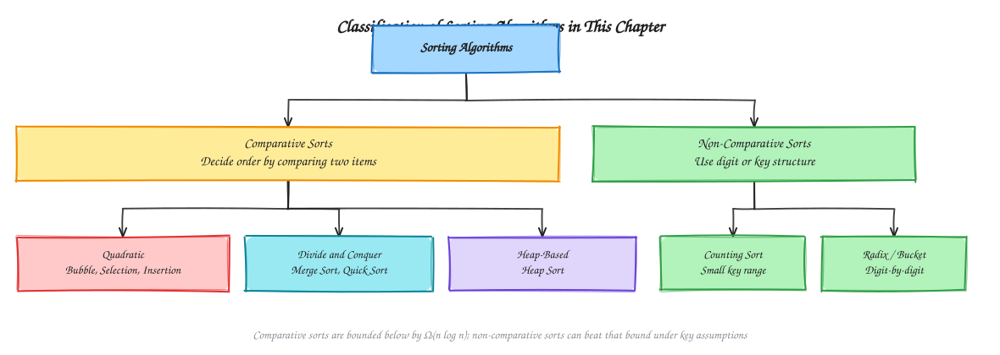
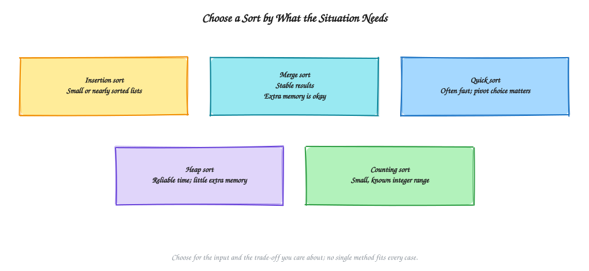
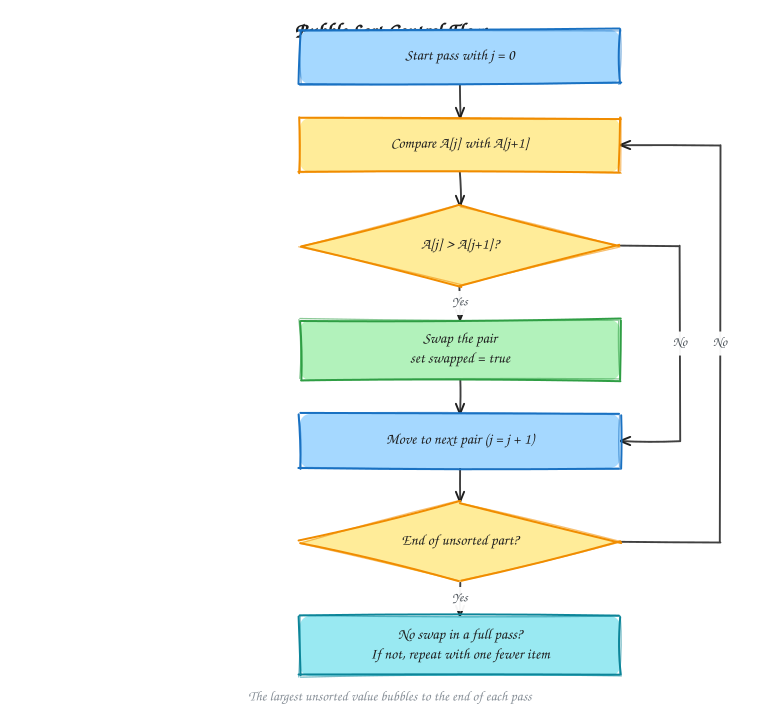
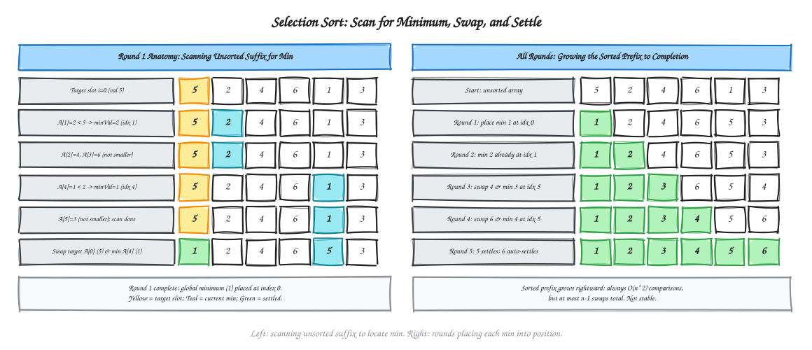
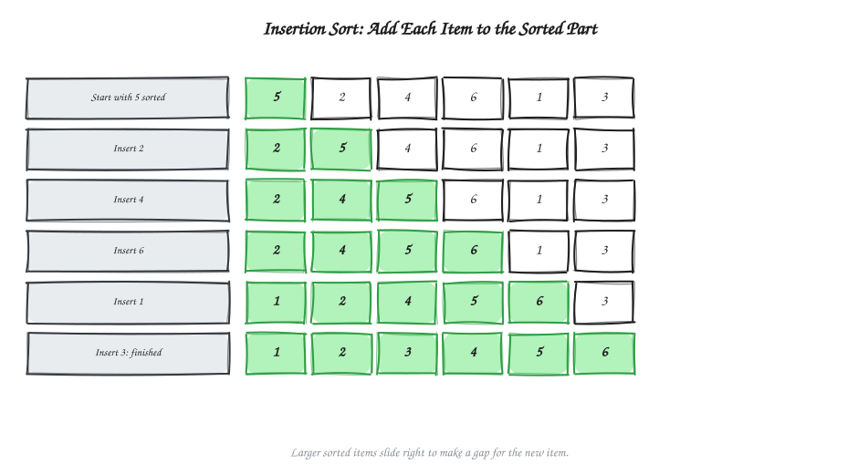
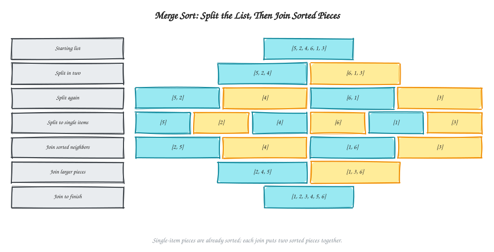
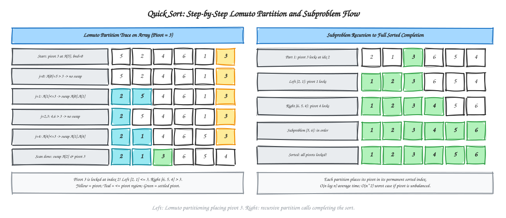
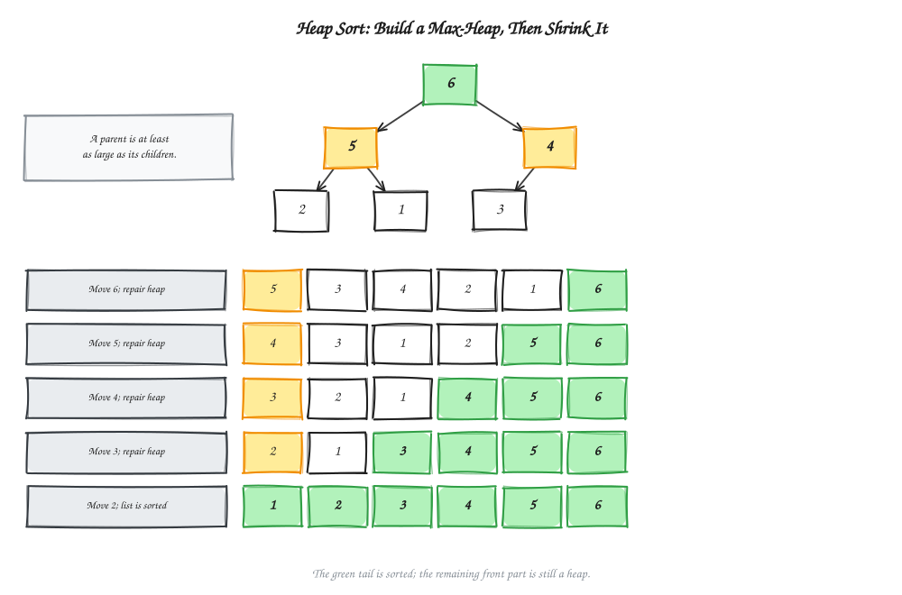
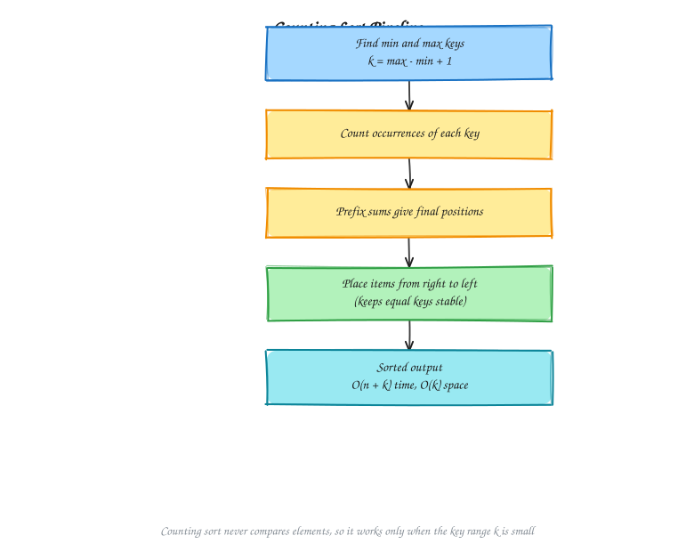

# Chapter 5 - Sorting Algorithms

[Previous: Chapter 4 - Searching and Basic Traversal](../Chapter%204%20-%20Searching%20and%20Basic%20Traversal/README.md) | [Home](../README.md) | [Next: Chapter 6 - Divide and Conquer](../Chapter%206%20-%20Divide%20and%20Conquer/README.md)

Sorting puts the items of a collection into order. It is one of the most studied problems in computing because many other algorithms, such as binary search, duplicate detection, and interval scheduling, become simpler once the data is sorted.

This chapter covers the main comparison-based sorts and one non-comparative sort:

1. Sorting Overview and Classification
2. Sorting Reach Escalator
3. Bubble Sort
4. Selection Sort
5. Insertion Sort
6. Merge Sort
7. Quick Sort
8. Heap Sort
9. Counting Sort
10. Complexity Comparison
11. Problems

---

## 1. Sorting Overview and Classification

A sorting algorithm takes a sequence $A[0..n-1]$ and rearranges it so that $A[0] \le A[1] \le \cdots \le A[n-1]$ under a chosen order. Algorithms are compared along a few properties:

- **Time complexity:** how the number of operations grows with $n$.
- **Space complexity:** how much extra memory is needed beyond the input.
- **Stability:** whether items with equal keys keep their original relative order.
- **In-place behaviour:** whether the algorithm rearranges the input using only $O(1)$ or $O(\log n)$ extra space.

### Visual Map: Classification of Sorting Algorithms



A **comparative sort** decides order only by comparing two items. A classical result shows that any comparative sort needs $\Omega(n\log n)$ comparisons in the worst case. A **non-comparative sort** such as counting sort reads the digits or key values directly, so it can avoid that bound when the key range is known and small.

---

## 2. Sorting Reach Escalator

The sorts in this chapter form a progression. Each step up the escalator gives a stronger performance guarantee, usually at the cost of more code or extra memory.

### Visual Map: Sorting Reach Escalator



- **Bottom step:** bubble, selection, and insertion sort are simple, but they need $O(n^2)$ time in the worst case.
- **Second step:** merge sort guarantees $O(n\log n)$ time on every input, at the cost of $O(n)$ extra space.
- **Third step:** quick sort is $O(n\log n)$ on average and sorts in place, but its worst case is $O(n^2)$.
- **Top step:** heap sort guarantees $O(n\log n)$ time and sorts in place, but it is not stable.

---

## 3. Bubble Sort

Bubble sort repeatedly walks through the array and swaps adjacent items that are out of order. After each full pass, the largest unsorted value has moved to its final place at the end, like a bubble rising to the surface.

### Visual Map: Bubble Sort Control Flow



#### Algorithm

```text
BUBBLE-SORT(A, n)
1. for pass = 0 to n - 2:
2.     swapped = false
3.     for j = 0 to n - 2 - pass:
4.         if A[j] > A[j + 1]:
5.             swap A[j] and A[j + 1]
6.             swapped = true
7.     if swapped is false:
8.         break
```

The `swapped` flag lets the algorithm stop early when a full pass makes no changes, which gives $O(n)$ time on an already sorted array.

#### Complexity Analysis

- Best case: $\Theta(n)$ with the early-exit flag
- Average and worst case: $\Theta(n^2)$
- Space: $\Theta(1)$
- Stable: yes, because equal items are never swapped

---

## 4. Selection Sort

Selection sort splits the array into a sorted prefix and an unsorted suffix. On each step it finds the minimum of the suffix and swaps it into the next position of the prefix.

### Visual Map: Selection Sort Control Flow



#### Algorithm

```text
SELECTION-SORT(A, n)
1. for i = 0 to n - 2:
2.     min_index = i
3.     for j = i + 1 to n - 1:
4.         if A[j] < A[min_index]:
5.             min_index = j
6.     swap A[i] and A[min_index]
```

#### Complexity Analysis

- Best, average, and worst case: $\Theta(n^2)$ comparisons, since the scan always runs to the end of the suffix
- Swaps: at most $n - 1$, which makes selection sort useful when writes are expensive
- Space: $\Theta(1)$
- Stable: no. The long-distance swap can move an item past an equal item

---

## 5. Insertion Sort

Insertion sort builds the sorted result one item at a time. It takes the next item and shifts larger items in the sorted prefix one place to the right, then drops the item into the gap. This is the same way many people sort a hand of cards.

### Visual Map: Insertion Sort Control Flow



#### Algorithm

```text
INSERTION-SORT(A, n)
1. for i = 1 to n - 1:
2.     key = A[i]
3.     j = i - 1
4.     while j >= 0 and A[j] > key:
5.         A[j + 1] = A[j]
6.         j = j - 1
7.     A[j + 1] = key
```

#### Complexity Analysis

- Best case: $\Theta(n)$, when the array is already sorted and the inner loop never runs
- Average and worst case: $\Theta(n^2)$
- Space: $\Theta(1)$
- Stable: yes, because an item moves only past strictly larger items
- Practical note: insertion sort is the fastest choice for very small or nearly sorted inputs, so many production sorts switch to it for small subarrays

---

## 6. Merge Sort

Merge sort follows the divide-and-conquer pattern. It splits the array into two halves, sorts each half recursively, and then merges the two sorted halves into one sorted array.

### Visual Map: Merge Sort Divide and Conquer



#### Algorithm

```text
MERGE-SORT(A, low, high)
1. if low >= high:
2.     return
3. mid = floor((low + high) / 2)
4. MERGE-SORT(A, low, mid)
5. MERGE-SORT(A, mid + 1, high)
6. MERGE(A, low, mid, high)
```

The `MERGE` step uses two pointers, one on each sorted half, and copies the smaller front item into a temporary buffer until both halves are used up.

#### Complexity Analysis

- Recurrence: $T(n) = 2T(n/2) + \Theta(n)$
- Total time: $\Theta(n\log n)$ in the best, average, and worst cases
- Space: $\Theta(n)$ for the temporary buffer
- Stable: yes, if the merge takes from the left half when keys are equal

---

## 7. Quick Sort

Quick sort also uses divide and conquer, but the work happens before the recursion. It picks a pivot value, partitions the array so that smaller values lie to the left and larger values to the right, and then sorts each side.

### Visual Map: Quick Sort Partition Flow



#### Algorithm

```text
QUICK-SORT(A, low, high)
1. if low < high:
2.     p = PARTITION(A, low, high)
3.     QUICK-SORT(A, low, p - 1)
4.     QUICK-SORT(A, p + 1, high)

PARTITION(A, low, high)
1. pivot = A[high]
2. i = low - 1
3. for j = low to high - 1:
4.     if A[j] <= pivot:
5.         i = i + 1
6.         swap A[i] and A[j]
7. swap A[i + 1] and A[high]
8. return i + 1
```

#### Pivot Selection

The pivot choice decides how balanced the partitions are:

- **First or last item:** simple, but slow on sorted or reverse-sorted input.
- **Median of three:** reduces the chance of an unbalanced split.
- **Random pivot:** gives $O(n\log n)$ expected time on every input.

#### Complexity Analysis

- Best and average case: $\Theta(n\log n)$
- Worst case: $\Theta(n^2)$, when every partition is maximally unbalanced
- Space: $\Theta(\log n)$ expected for the recursion stack, plus $\Theta(1)$ extra space for in-place partitioning
- Stable: no

---

## 8. Heap Sort

Heap sort uses a binary heap. It first builds a max-heap, so the largest value sits at the root. It then repeatedly swaps the root with the last unsorted item, shrinks the heap by one, and restores the heap property by sifting the new root down.

### Visual Map: Heap Sort Control Flow



#### Algorithm

```text
HEAP-SORT(A, n)
1. for i = floor(n / 2) - 1 down to 0:
2.     HEAPIFY-DOWN(A, n, i)
3. for end = n - 1 down to 1:
4.     swap A[0] and A[end]
5.     HEAPIFY-DOWN(A, end, 0)

HEAPIFY-DOWN(A, size, i)
1. largest = i
2. if 2i + 1 < size and A[2i + 1] > A[largest]: largest = 2i + 1
3. if 2i + 2 < size and A[2i + 2] > A[largest]: largest = 2i + 2
4. if largest != i:
5.     swap A[i] and A[largest]
6.     HEAPIFY-DOWN(A, size, largest)
```

#### Complexity Analysis

- Building the heap: $\Theta(n)$
- Extraction phase: $n - 1$ calls to `HEAPIFY-DOWN`, each $O(\log n)$
- Total time: $\Theta(n\log n)$ in the best, average, and worst cases
- Space: $\Theta(1)$
- Stable: no

---

## 9. Counting Sort

Counting sort is non-comparative. It counts how many times each key appears, turns those counts into starting positions, and places each item directly into its output slot. It works only when the keys are integers in a small known range $0..k$.

### Visual Map: Counting Sort Pipeline



#### Algorithm

```text
COUNTING-SORT(A, n, k)
1. count[0..k] = 0
2. for i = 0 to n - 1:
3.     count[A[i]] = count[A[i]] + 1
4. for v = 1 to k:
5.     count[v] = count[v] + count[v - 1]
6. for i = n - 1 down to 0:
7.     output[count[A[i]] - 1] = A[i]
8.     count[A[i]] = count[A[i]] - 1
9. return output
```

Scanning the input from right to left in step 6 keeps equal keys in their original order, which is what makes counting sort stable. Radix sort depends on this property.

#### Complexity Analysis

- Time: $\Theta(n + k)$
- Space: $\Theta(n + k)$ for the output and count arrays
- Stable: yes
- When to use: the key range $k$ is not much larger than $n$. If $k$ is huge, the count array becomes the bottleneck.

---

## 10. Complexity Comparison

| Algorithm | Best | Average | Worst | Extra Space | Stable | In-place |
| :--- | :---: | :---: | :---: | :---: | :---: | :---: |
| Bubble Sort | $n$ | $n^2$ | $n^2$ | $1$ | Yes | Yes |
| Selection Sort | $n^2$ | $n^2$ | $n^2$ | $1$ | No | Yes |
| Insertion Sort | $n$ | $n^2$ | $n^2$ | $1$ | Yes | Yes |
| Merge Sort | $n\log n$ | $n\log n$ | $n\log n$ | $n$ | Yes | No |
| Quick Sort | $n\log n$ | $n\log n$ | $n^2$ | $\log n$ | No | Yes |
| Heap Sort | $n\log n$ | $n\log n$ | $n\log n$ | $1$ | No | Yes |
| Counting Sort | $n+k$ | $n+k$ | $n+k$ | $n+k$ | Yes | No |

Choosing a sort in practice:

- Use **insertion sort** for tiny or nearly sorted inputs.
- Use **merge sort** when stability and a guaranteed $O(n\log n)$ bound matter, and extra memory is affordable.
- Use **heap sort** when the bound must hold and memory is tight, and stability is not needed.
- Use **quick sort** for a fast general-purpose sort with good pivot choices.
- Use **counting sort** when keys are small integers.

---

## 11. Problems

### Sorting Colors (Dutch National Flag)

#### Problem Statement

Given an array containing only the values $0$, $1$, and $2$, sort it in place so that all $0$s come first, then all $1$s, then all $2$s. Do not use a library sort, and do one pass over the array.

#### Inputs and Output

- **Input:** array $A$ of length $n$, where each $A[i] \in \{0,1,2\}$.
- **Output:** the same array, rearranged in non-decreasing order.

#### Approach

Maintain three regions with three pointers:

- $A[0..low-1]$ holds $0$s.
- $A[low..mid-1]$ holds $1$s.
- $A[high+1..n-1]$ holds $2$s.
- $A[mid..high]$ is unknown.

Look at $A[mid]$:

- If it is $0$, swap it to the $0$ region and advance both `low` and `mid`.
- If it is $1$, it is already in the right place, so advance `mid`.
- If it is $2$, swap it to the $2$ region and decrease `high`. Do not advance `mid`, because the swapped-in value is unknown.

#### Worked Example

Input:

$$
[2,0,2,1,1,0]
$$

| Step | `low` | `mid` | `high` | Array after step | Action on $A[mid]$ |
| :---: | :---: | :---: | :---: | :--- | :--- |
| 0 | 0 | 0 | 5 | $[2,0,2,1,1,0]$ | Start |
| 1 | 0 | 0 | 4 | $[0,0,2,1,1,2]$ | $A[mid]=2$, swap with $A[high]$, shrink `high` |
| 2 | 1 | 1 | 4 | $[0,0,2,1,1,2]$ | $A[mid]=0$, advance `low` and `mid` |
| 3 | 2 | 2 | 4 | $[0,0,2,1,1,2]$ | $A[mid]=0$, advance `low` and `mid` |
| 4 | 2 | 2 | 3 | $[0,0,1,1,2,2]$ | $A[mid]=2$, swap with $A[high]$, shrink `high` |
| 5 | 2 | 3 | 3 | $[0,0,1,1,2,2]$ | $A[mid]=1$, advance `mid` |
| 6 | 2 | 4 | 3 | $[0,0,1,1,2,2]$ | $mid > high$, loop stops |

Result:

$$
[0,0,1,1,2,2]
$$

#### Algorithm

```text
SORT-COLORS(A)
1. low = 0, mid = 0, high = n - 1
2. while mid <= high:
3.     if A[mid] == 0:
4.         swap A[low] and A[mid]
5.         low = low + 1
6.         mid = mid + 1
7.     else if A[mid] == 1:
8.         mid = mid + 1
9.     else:
10.        swap A[mid] and A[high]
11.        high = high - 1
```

#### Complexity Analysis

- Time: $\Theta(n)$, since each step moves `mid` forward or shrinks the unknown region
- Space: $\Theta(1)$
- Stable: no, because values are swapped across regions

---

## Summary

- Comparative sorts cannot beat $\Omega(n\log n)$ in the worst case.
- Simple quadratic sorts are useful for teaching and for very small or nearly sorted inputs.
- Merge sort and heap sort guarantee $O(n\log n)$ time. Merge sort is stable, and heap sort is in-place.
- Quick sort is usually fastest in practice, but its worst case depends on pivot choice.
- Counting sort beats the comparison bound when the key range is small.
