# Chapter 8: Dynamic Programming

[Previous: Chapter 7 - Greedy Algorithms](../Chapter%207%20-%20Greedy%20Algorithms/README.md) | [Home](../README.md) | [Next: Chapter 9 - Backtracking](../Chapter%209%20-%20Backtracking/README.md)

---

Dynamic Programming (DP) is an algorithm design technique for solving problems by breaking them into smaller related subproblems, storing their answers, and using those stored answers to build the final solution.

This chapter keeps only the requested Dynamic Programming topics and the requested problem list. Each problem includes a descriptive statement, subproblem design, tabulation method, worked example, algorithm sketch, and complexity analysis.

---

## Table of Contents

1. [Dynamic Programming](#dynamic-programming)
2. [Why Do We Need Dynamic Programming?](#1-why-do-we-need-dynamic-programming)
3. [Greedy Method vs Dynamic Programming](#2-greedy-method-vs-dynamic-programming)
4. [Principle of Optimality](#3-principle-of-optimality)
5. [Elements of Dynamic Programming](#4-elements-of-dynamic-programming)
   - [Optimal Substructure](#optimal-substructure)
   - [Overlapping Subproblems](#overlapping-subproblems)
6. [Memoization vs Tabulation (Top-Down vs Bottom-Up)](#5-memoization-vs-tabulation-top-down-vs-bottom-up)
7. [Problems](#problems)
   - [Climbing Stairs](#climbing-stairs)
   - [Coin-Row Problem](#coin-row-problem)
   - [Coin-Collecting Problem](#coin-collecting-problem)
   - [0/1 Knapsack](#01-knapsack)
   - [Rod Cutting](#rod-cutting)
   - [Longest Common Subsequence (LCS)](#longest-common-subsequence-lcs)
   - [Longest Increasing Subsequence (LIS)](#longest-increasing-subsequence-lis)
   - [Matrix Chain Multiplication](#matrix-chain-multiplication)
   - [Optimal Binary Search Tree (Optimal BST)](#optimal-binary-search-tree-optimal-bst)
   - [Multistage Graph](#multistage-graph)
   - [Travelling Salesman Problem (TSP)](#travelling-salesman-problem-tsp)
   - [Reliability Design](#reliability-design)
8. [Analyze Time Complexity of Above Problems](#analyze-time-complexity-of-above-problems)

---

## Dynamic Programming

Dynamic Programming solves each distinct subproblem once and stores the answer. When the same subproblem is needed again, the stored answer is reused instead of recomputed.

A DP solution normally has five parts:

- **State:** the information that uniquely describes a subproblem.
- **Recurrence:** the formula that computes a state from smaller states.
- **Base case:** the smallest known answer.
- **Table order:** the order in which states must be filled.
- **Final answer:** the table cell or state that solves the original problem.

DP is commonly used for optimization, counting, and decision problems where many choices must be compared systematically.

### Simple Example: Fibonacci Numbers

Find the fifth Fibonacci number, where $F(0)=0$, $F(1)=1$, and $F(n)=F(n-1)+F(n-2)$.

| $n$ | 0 | 1 | 2 | 3 | 4 | 5 |
| :---: | :---: | :---: | :---: | :---: | :---: | :---: |
| $F(n)$ | 0 | 1 | 1 | 2 | 3 | **5** |

Here, the state is $F(n)$, the base cases are $F(0)$ and $F(1)$, and each later value is stored after being computed from the two previous values. The final answer is $F(5)=5$.

### Visual Map: DP Design Flow

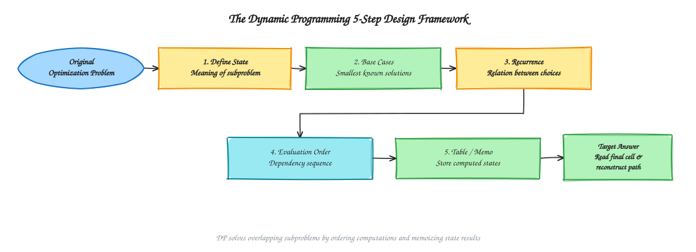

---

## 1. Why Do We Need Dynamic Programming?

Many recursive solutions repeatedly solve the same smaller problem. For small inputs this may look harmless, but for larger inputs it often causes exponential time.

Dynamic Programming is needed when:

- The problem can be divided into smaller subproblems.
- The same subproblems appear more than once.
- The answer to the full problem can be built from answers to smaller problems.
- Directly checking all possible solutions is too slow.

The main idea is simple: compute once, store once, reuse whenever needed.

| Approach | Main idea | Typical result |
| :--- | :--- | :--- |
| Brute force | Try every possible solution | Often exponential |
| Plain recursion | Break the problem down but recompute states | Often exponential |
| Dynamic Programming | Store each distinct state | Usually polynomial for suitable problems |

### Simple Example: Repeated Fibonacci Calls

To calculate $F(5)$ with plain recursion, the program needs $F(4)$ and $F(3)$. While calculating $F(4)$, it also needs $F(3)$, so $F(3)$ is calculated twice.

```text
F(5)
|- F(4)
|  |- F(3)
|  `- F(2)
`- F(3)  <- repeated calculation
```

With DP, store $F(3)=2$ the first time it is found. The second request reuses 2 instead of expanding another recursion tree.

### Visual Map: Repeated Work Removed by DP

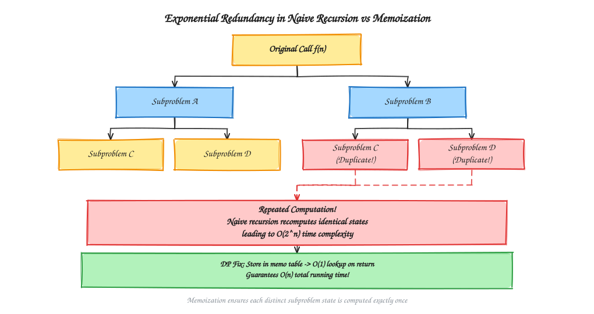

---

## 2. Greedy Method vs Dynamic Programming

Both Greedy Method and Dynamic Programming are used to solve optimization problems, but their decision-making styles are different.

| Feature               | Greedy Method                             | Dynamic Programming                            |
| --------------------- | ----------------------------------------- | ---------------------------------------------- |
| **Idea**              | Make the best choice **right now**        | Solve all smaller subproblems and combine them |
| **Decision**          | Never changes previous decisions          | Can compare many possible decisions            |
| **Optimal Solution?** | Only if the greedy-choice property exists | Yes, if optimal substructure exists            |
| **Speed**             | Usually faster                            | Usually slower                                 |
| **Memory**            | Very little                               | More memory (stores results)                   |
| **Implementation**    | Simpler                                   | More complex                                   |


Greedy is usually faster, but DP is more appropriate when taking one choice can block a better combination of later choices. For example, 0/1 Knapsack needs DP because an item cannot be partially taken and every selected item changes the remaining capacity.

### Simple Example: Coin Change

Make amount 6 using coin values $1$, $3$, and $4$ while using as few coins as possible.

- **Greedy:** choose the largest coin first: $4+1+1$. This uses 3 coins.
- **Dynamic Programming:** compare every valid previous amount and find $3+3$. This uses **2 coins**.

Greedy makes a locally attractive choice (4), but it misses the globally optimal solution. DP is appropriate because the best choice for one remaining amount can depend on choices made earlier.

### Visual Map: Greedy Choice vs DP Choice

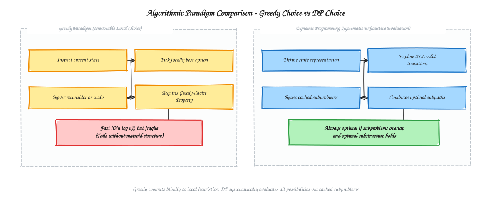

---

## 3. Principle of Optimality

The **Principle of Optimality** states that an optimal solution to a problem must contain optimal solutions to its subproblems.

In simple words:
If the final answer is the best possible, then every smaller decision used to build that answer must also be the best possible.

If a chosen first decision leaves a smaller remaining problem, then the remaining part must also be solved optimally. Otherwise, replacing it with a better remaining solution would improve the full solution, contradicting the claim that the full solution was optimal.

For a shortest path problem, if the shortest path from $A$ to $D$ passes through $B$, then the portion from $B$ to $D$ must also be a shortest path from $B$ to $D$.

DP relies on this principle because it builds large optimal answers from smaller optimal answers.

### Simple Example: Shortest Path

Suppose the shortest route from $A$ to $D$ is $A \rightarrow B \rightarrow D$, with edge costs $A \rightarrow B=2$ and $B \rightarrow D=3$. Its total cost is $5$.

The subpath $B \rightarrow D$ must itself be shortest. If another route from $B$ to $D$ cost 2, then $A \rightarrow B$ followed by that route would cost $2+2=4$, contradicting the claim that the original route of cost 5 was shortest.

### Visual Map: Optimal Path Contains Optimal Subpaths

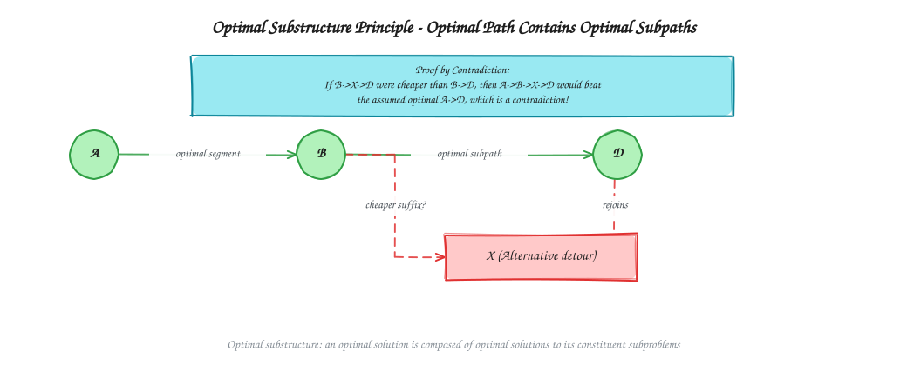

---

## 4. Elements of Dynamic Programming

### Simple Example: Minimum Coin Change

For coin values $1$, $3$, and $4$, find the minimum number of coins needed to make amount 6.

| DP part | Choice for this example |
| :--- | :--- |
| State | $dp[x]$: minimum coins needed to make amount $x$ |
| Base case | $dp[0]=0$ |
| Recurrence | $dp[x]=1+\min(dp[x-1],dp[x-3],dp[x-4])$ for valid previous amounts |
| Table order | Fill amounts from 1 through 6 |
| Final answer | $dp[6]=2$, using $3+3$ |

### Optimal Substructure

A problem has **optimal substructure** if an optimal answer can be constructed from optimal answers to smaller subproblems.

To identify optimal substructure:

- Define the decision made at the current state.
- Determine what smaller problem remains after that decision.
- Express the answer as the best value among all valid decisions.

Generic recurrence form:

$$
DP[state] = \mathrm{best}_{choice}\{\text{value of choice} + DP[\text{next state}]\}
$$

Here, **best** may mean minimum cost, maximum profit, number of ways, or shortest distance depending on the problem.

#### Simple Example: Best Coin Choice Uses a Best Remainder

For amount 6 with coins $1$, $3$, and $4$, try using coin 3 first. The remaining amount is 3, whose optimal answer is one more coin 3. Therefore, the candidate solution is $1+dp[3]=2$ coins.

If $dp[3]$ were not optimal, replacing it with a better solution would improve the answer for 6. This is optimal substructure: an optimal solution to the larger problem contains an optimal solution to its remainder.

### Overlapping Subproblems

A problem has **overlapping subproblems** if the same smaller states are needed multiple times.

DP is useful when the number of distinct states is much smaller than the number of recursive calls made by a naive solution. Instead of expanding a repeated recursion tree, DP stores every distinct state in a table.

#### Simple Example: Fibonacci Overlap

Both $F(5)=F(4)+F(3)$ and $F(4)=F(3)+F(2)$ require $F(3)$. The subproblem $F(3)$ overlaps, so calculate and store it once rather than calculating it separately for each branch.

### Visual Map: DP Elements Working Together

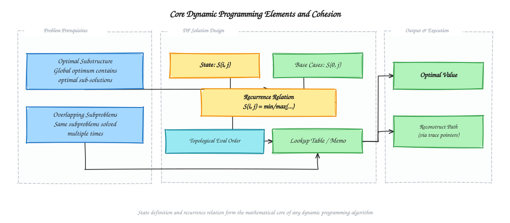

---

## 5. Memoization vs Tabulation (Top-Down vs Bottom-Up)

Dynamic Programming can be implemented using memoization or tabulation.

| Feature             | Memoization (Top-Down)     | Tabulation (Bottom-Up)          |
| ------------------- | -------------------------- | ------------------------------- |
| Approach            | Start from the big problem | Start from the smallest problem |
| Technique           | Recursion + cache          | Iteration + table               |
| Solves              | Only needed subproblems    | All subproblems                 |
| Uses recursion      | ✅ Yes                      | ❌ No                            |
| Stack overflow risk | Yes                        | No                              |
| Easier to write     | Usually                    | Sometimes harder                |
| Faster in practice  | Sometimes                  | Usually slightly faster         |


**Memoization pattern:**

```text
Solve(state):
    if state is a base case:
        return base value
    if state is already stored:
        return stored value
    compute answer from smaller states
    store answer
    return answer
```

**Tabulation pattern:**

```text
Create the DP table
Fill base cases
For each state in dependency order:
    compute table[state] from already-filled states
Return the required final state
```

### Simple Example: Two Ways to Find $F(5)$

For $F(5)$, memoization starts with $F(5)$ and recursively requests smaller values. Once it computes $F(3)=2$, later requests for $F(3)$ return the cached value.

Tabulation starts from the base cases and fills upward:

| $n$ | 0 | 1 | 2 | 3 | 4 | 5 |
| :---: | :---: | :---: | :---: | :---: | :---: | :---: |
| $F(n)$ | 0 | 1 | 1 | 2 | 3 | **5** |

Both methods compute the same answer. Memoization follows the needed calls from the top, while tabulation fills known small answers from the bottom.

### Visual Map: Top-Down vs Bottom-Up

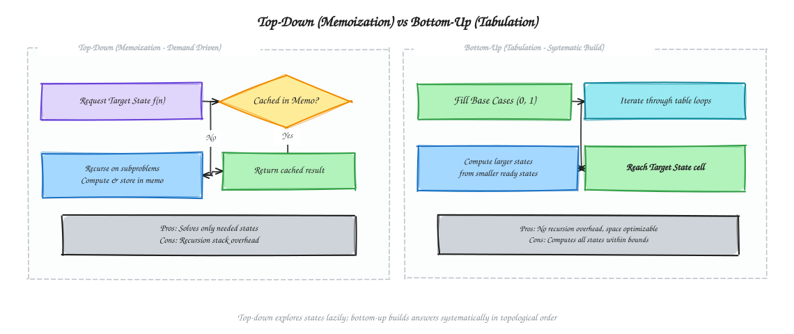

---

## Problems

The following sections include only the requested Dynamic Programming problems.

Use this reusable tabulation pattern across DP problems: define the state and value to store, initialize base states, fill in dependency order, store the optimal decision (in the value table or a parallel decision table), then trace those decisions to recover a solution. Table axes depend on the state: item and capacity for Knapsack, interval endpoints for Matrix Chain Multiplication and Optimal BST, nodes for Multistage Graph, current city and subset for TSP, and stages and budget for Reliability Design. In 0/1 Knapsack, taking an item uses the previous row; in Rod Cutting, reusing a piece stays in the same row.

---

### Climbing Stairs

#### Problem Statement

Imagine you are climbing a staircase with $n$ steps. You can take either **1 step**, **2 steps**, or **3 steps** at a time. In how many distinct ways can you climb to the top?

#### Inputs and Output

- **Input:** an integer $n$, the number of stairs.
- **Output:** the number of unique ways to reach the $n$-th step.

#### Subproblem Decomposition

To reach step $n$, the last move can come from:

1. Step $n-1$ by taking a 1-step jump.
2. Step $n-2$ by taking a 2-step jump.
3. Step $n-3$ by taking a 3-step jump.

So the recurrence is:

$$
Ways(n) = Ways(n-1) + Ways(n-2) + Ways(n-3), \quad n \ge 3
$$

Base cases:

$$
Ways(0)=1, \qquad Ways(1)=1, \qquad Ways(2)=2
$$

#### Tabulation Walkthrough

Find the number of ways to climb $n=5$ steps.

| Step $i$ | Formula | $Ways(i)$ |
| :---: | :--- | :---: |
| 0 | Base case | 1 |
| 1 | Base case | 1 |
| 2 | Base case | 2 |
| 3 | $Ways(2)+Ways(1)+Ways(0)=2+1+1$ | 4 |
| 4 | $Ways(3)+Ways(2)+Ways(1)=4+2+1$ | 7 |
| 5 | $Ways(4)+Ways(3)+Ways(2)=7+4+2$ | 13 |

Arrow-guided fill order:

| Current state | Incoming arrows from previous states | Stored value |
| :---: | :--- | :---: |
| $Ways(3)$ | $Ways(2) \rightarrow Ways(3)$, $Ways(1) \rightarrow Ways(3)$, $Ways(0) \rightarrow Ways(3)$ | 4 |
| $Ways(4)$ | $Ways(3) \rightarrow Ways(4)$, $Ways(2) \rightarrow Ways(4)$, $Ways(1) \rightarrow Ways(4)$ | 7 |
| $Ways(5)$ | $Ways(4) \rightarrow Ways(5)$, $Ways(3) \rightarrow Ways(5)$, $Ways(2) \rightarrow Ways(5)$ | **13** |

Therefore, there are **13** distinct ways to climb 5 stairs.

#### Visual Map: Climbing Stairs State Dependencies

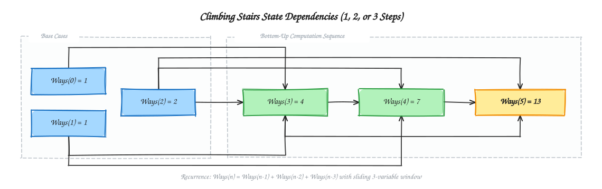

#### Algorithm

```text
CLIMBING-STAIRS(n)
1. if n == 0: return 1
2. if n == 1: return 1
3. if n == 2: return 2
4. create array dp[0...n]
5. dp[0] = 1, dp[1] = 1, dp[2] = 2
6. for i = 3 to n:
7.     dp[i] = dp[i - 1] + dp[i - 2] + dp[i - 3]
8. return dp[n]
```

#### Complexity Analysis

| Approach | Time Complexity | Space Complexity | Notes |
| :--- | :--- | :--- | :--- |
| Recursion | $O(3^n)$ | $O(n)$ | Recomputes overlapping states |
| Memoization | $\Theta(n)$ | $\Theta(n)$ | Each state is computed once |
| Tabulation | $\Theta(n)$ | $\Theta(n)$ | Fills one table from bottom to top |
| Space optimized | $\Theta(n)$ | $\Theta(1)$ | Keeps only the last three values |

---

#### Classroom Problem: Climbing Stairs (1 or 2 Steps)

**Problem.** A staircase has $n$ steps. On each move, a person may climb either 1 step or 2 steps. Find the number of distinct ways to reach exactly step $n$.

##### Theoretical Solution

Let $C(n)$ be the number of ways to reach step $n$.

Every valid way to reach step $n$ ends in exactly one of two disjoint cases:

1. A 1-step move from step $n-1$, giving $C(n-1)$ ways.
2. A 2-step move from step $n-2$, giving $C(n-2)$ ways.

Therefore,

$$
C(n) = C(n-1) + C(n-2), \qquad n \ge 2
$$

with base cases:

$$
C(0)=1, \qquad C(1)=1
$$

The two cases cover every possible final move and cannot overlap, so the recurrence counts every valid climbing sequence exactly once. It has overlapping subproblems because, for example, both $C(n-1)$ and $C(n-2)$ eventually need $C(n-3)$.

For $n=5$:

| Step $i$ | $C(i)$ | Calculation |
| :---: | :---: | :--- |
| 0 | 1 | Base case |
| 1 | 1 | Base case |
| 2 | 2 | $1+1$ |
| 3 | 3 | $2+1$ |
| 4 | 5 | $3+2$ |
| 5 | **8** | $5+3$ |

Thus, there are **8** ways to climb 5 steps when only 1-step and 2-step moves are allowed.

```text
CLIMBING-STAIRS-ONE-OR-TWO(n)
1. if n <= 1: return 1
2. previous = 1
3. current = 1
4. for step = 2 to n:
5.     next = previous + current
6.     previous = current
7.     current = next
8. return current
```

- Time Complexity: $\Theta(n)$
- Space Complexity: $\Theta(1)$

##### Why the Naive Recursion Is Exponential

Directly translating the recurrence $C(n) = C(n-1) + C(n-2)$ into recursive calls, without memoization or tabulation, recomputes the same smaller subproblems many times:

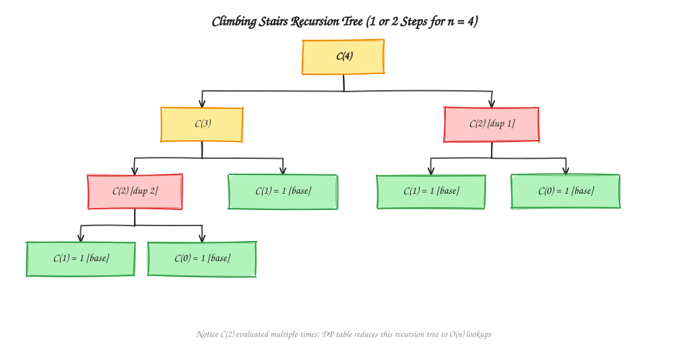

Notice $C(2)$ is computed twice and $C(1)$ three times — the same overlapping-subproblems pattern seen in Fibonacci. Each call spawns two more calls until a base case is hit, so the call tree has roughly $2^n$ nodes in the worst case:

$$
T_{\text{naive}}(n) = O(2^n)
$$

Tabulation removes the repeated work by solving each subproblem exactly once, bringing the time down to $\Theta(n)$ as shown above.

For $n=4$, the $C(4) = 5$ valid climbing sequences (using only 1-step and 2-step moves) are:

$$
1{+}1{+}1{+}1, \quad 1{+}1{+}2, \quad 1{+}2{+}1, \quad 2{+}1{+}1, \quad 2{+}2
$$

---

### Coin-Row Problem

#### Problem Statement

Given a row of $n$ coins with positive integer values $c_1, c_2, \dots, c_n$, select a subset of coins to maximize their total value, subject to the constraint that **no two selected coins can be adjacent** in the row.

#### Inputs and Output

- **Input:** an array of coin values $C[1 \dots n]$.
- **Output:** the maximum sum of non-adjacent coins.

#### Subproblem Decomposition

Let $F(i)$ be the maximum value that can be picked from the first $i$ coins ($c_1, \dots, c_i$). For the $i$-th coin, there are two mutually exclusive choices:
1. **Include coin $i$:** The coin contributes $c_i$. Since adjacent coins are forbidden, coin $i - 1$ cannot be picked, leaving the subproblem on the first $i - 2$ coins: $c_i + F(i - 2)$.
2. **Exclude coin $i$:** The maximum value is simply the optimal value from the first $i - 1$ coins: $F(i - 1)$.

#### Recurrence Relation

$$
F(i) = \begin{cases} 0 & \text{if } i = 0 \\ c_1 & \text{if } i = 1 \\ \max\big(c_i + F(i - 2), F(i - 1)\big) & \text{if } i \ge 2 \end{cases}
$$

#### Worked Example: Coins $[5, 1, 2, 10, 6, 2]$

| $i$ | Coin $c_i$ | Include (cᵢ + F(i − 2)) | Exclude (F(i − 1)) | $F(i)$ | Selected coins so far |
| :---: | :---: | :---: | :---: | :---: | :--- |
| 0 | — | — | — | 0 | none |
| 1 | 5 | $5 + 0 = 5$ | 0 | **5** | $\{c_1\}$ |
| 2 | 1 | $1 + 0 = 1$ | 5 | **5** | $\{c_1\}$ |
| 3 | 2 | $2 + 5 = 7$ | 5 | **7** | $\{c_1, c_3\}$ |
| 4 | 10 | $10 + 5 = 15$ | 7 | **15** | $\{c_1, c_4\}$ |
| 5 | 6 | $6 + 7 = 13$ | 15 | **15** | $\{c_1, c_4\}$ |
| 6 | 2 | $2 + 15 = 17$ | 15 | **17** | $\{c_1, c_4, c_6\}$ |

Maximum total value: **17** (from coins with values $5, 10, 2$).

#### Algorithm

```text
COIN-ROW(C, n)
1. if n == 0: return 0
2. if n == 1: return C[1]
3. create array F[0...n]
4. F[0] = 0
5. F[1] = C[1]
6. for i = 2 to n:
7.     F[i] = max(C[i] + F[i - 2], F[i - 1])
8. return F[n]
```

#### Complexity Analysis
- **Time Complexity:** $\Theta(n)$ — a single loop fills $n$ states with $O(1)$ work per state.
- **Space Complexity:** $\Theta(n)$ for the table, reducible to $\Theta(1)$ by keeping only the two most recent values.

---

### Coin-Collecting Problem

#### Problem Statement

Several coins are placed on an $n \times m$ grid, where each cell $(i, j)$ holds either a coin of value $C[i, j]$ (or $0$ if empty). A robot starts at top-left cell $(1, 1)$ and must reach bottom-right cell $(n, m)$, moving only **one cell to the right** or **one cell downward** at each step. Find the maximum total coin value the robot can collect along any valid path.

#### Inputs and Output

- **Input:** an $n \times m$ grid of coin values $C[1 \dots n, 1 \dots m]$.
- **Output:** the maximum coins collected from $(1, 1)$ to $(n, m)$.

#### Subproblem Decomposition

Let $F(i, j)$ be the maximum number of coins collected upon reaching cell $(i, j)$. To arrive at $(i, j)$, the robot must come from either:
1. The cell directly above: $(i - 1, j)$.
2. The cell directly to the left: $(i, j - 1)$.

#### Recurrence Relation

$$
F(i, j) = \begin{cases}
C[1, 1] & \text{if } i = 1, j = 1 \\
F(1, j - 1) + C[1, j] & \text{if } i = 1, j > 1 \\
F(i - 1, 1) + C[i, 1] & \text{if } i > 1, j = 1 \\
\max\big(F(i - 1, j), F(i, j - 1)\big) + C[i, j] & \text{if } i > 1, j > 1
\end{cases}
$$

#### Worked Example: $3 \times 4$ Grid

Given grid $C$:
```text
0  0  0  1
0  1  0  0
1  0  1  0
```

Computed DP table $F$:
| $i \backslash j$ | 1 | 2 | 3 | 4 |
| :---: | :---: | :---: | :---: | :---: |
| **1** | 0 | 0 | 0 | 1 |
| **2** | 0 | 1 | 1 | 2 |
| **3** | 1 | 1 | 2 | **2** |

Path: $(1,1) \to (1,2) \to (2,2) \to (2,3) \to (2,4) \to (3,4)$ (or $(1,1) \to (1,2) \to (2,2) \to (3,2) \to (3,3) \to (3,4)$), yielding **2 coins**.

#### Algorithm

```text
COIN-COLLECTING(C, n, m)
1. F[1, 1] = C[1, 1]
2. for j = 2 to m:
3.     F[1, j] = F[1, j - 1] + C[1, j]
4. for i = 2 to n:
5.     F[i, 1] = F[i - 1, 1] + C[i, 1]
6.     for j = 2 to m:
7.         F[i, j] = max(F[i - 1, j], F[i, j - 1]) + C[i, j]
8. return F[n, m]
```

#### Complexity Analysis
- **Time Complexity:** $\Theta(nm)$ — every cell in the $n \times m$ table is computed in $\Theta(1)$ time.
- **Space Complexity:** $\Theta(nm)$ for full table (traceback), or $\Theta(m)$ auxiliary space if only the maximum value is required.

---

### 0/1 Knapsack

#### Problem Statement

Imagine a thief has a knapsack that can hold at most $W$ kg. There are $n$ items, each with a weight and value. For every item, the thief must either take it completely or leave it. No fractional part is allowed. The goal is to maximize total value without exceeding the capacity.

#### Inputs and Output

- **Input:** capacity $W$, weights $w_1,w_2,\dots,w_n$, values $v_1,v_2,\dots,v_n$, and number of items $n$.
- **Output:** the maximum total value that fits inside the knapsack.

#### Subproblem Decomposition

Let $V[i,j]$ be the maximum value obtainable using the first $i$ items and capacity $j$.

For item $i$:

- **Skip item $i$:** value is $V[i-1,j]$.
- **Take item $i$:** if $w_i \le j$, value is $v_i + V[i-1,j-w_i]$.

The recurrence is:

$$
V[i,j] =
\begin{cases}
V[i-1,j], & \text{if } w_i > j \\
\max(V[i-1,j],\ v_i + V[i-1,j-w_i]), & \text{if } w_i \le j
\end{cases}
$$

Base cases:

$$
V[0,j]=0, \qquad V[i,0]=0
$$

#### Tabulation Walkthrough

Find the maximum value for capacity $W=5$ with 4 items.

| Item | Weight | Value |
| :---: | :---: | :---: |
| 1 | 2 | 12 |
| 2 | 1 | 10 |
| 3 | 3 | 20 |
| 4 | 2 | 15 |

Table rows represent items considered. Columns represent capacity.

Arrow legend for 0/1 Knapsack tables:

- $\uparrow$ means the item is skipped and the value is copied from the upper row.
- $\nwarrow$ means the item is taken and the value comes from the previous row at reduced capacity.
- Base row and base column have no arrows because their values are fixed at 0.

| Item $i$ | Weight $w_i$ | Value $v_i$ | $W=0$ | $W=1$ | $W=2$ | $W=3$ | $W=4$ | $W=5$ |
| :---: | :---: | :---: | :---: | :---: | :---: | :---: | :---: | :---: |
| 0 | - | - | 0 | 0 | 0 | 0 | 0 | 0 |
| 1 | 2 | 12 | 0 | 0 ($\uparrow$) | 12 ($\nwarrow$) | 12 ($\nwarrow$) | 12 ($\nwarrow$) | 12 ($\nwarrow$) |
| 2 | 1 | 10 | 0 | 10 ($\nwarrow$) | 12 ($\uparrow$) | 22 ($\nwarrow$) | 22 ($\nwarrow$) | 22 ($\nwarrow$) |
| 3 | 3 | 20 | 0 | 10 ($\uparrow$) | 12 ($\uparrow$) | 22 ($\uparrow$) | 30 ($\nwarrow$) | 32 ($\nwarrow$) |
| 4 | 2 | 15 | 0 | 10 ($\uparrow$) | 15 ($\nwarrow$) | 25 ($\nwarrow$) | 30 ($\uparrow$) | **37** ($\nwarrow$) |

Key calculations:

- $V[2,3] = \max(V[1,3], 10 + V[1,2]) = \max(12,22)=22$.
- $V[3,5] = \max(V[2,5], 20 + V[2,2]) = \max(22,32)=32$.
- $V[4,5] = \max(V[3,5], 15 + V[3,3]) = \max(32,37)=37$.

The maximum value is **37**, obtained by selecting items 1, 2, and 4.

#### Classroom Problem A: Matrix Tabular Format

Given:

- Weights: $10,20,30$
- Values: $60,100,120$
- Capacity: $50$

| Item | Weight | Value | $W=0$ | $W=10$ | $W=20$ | $W=30$ | $W=40$ | $W=50$ |
| :---: | :---: | :---: | :---: | :---: | :---: | :---: | :---: | :---: |
| 0 | - | - | 0 | 0 | 0 | 0 | 0 | 0 |
| 1 | 10 | 60 | 0 | 60 ($\nwarrow$) | 60 ($\nwarrow$) | 60 ($\nwarrow$) | 60 ($\nwarrow$) | 60 ($\nwarrow$) |
| 2 | 20 | 100 | 0 | 60 ($\uparrow$) | 100 ($\nwarrow$) | 160 ($\nwarrow$) | 160 ($\nwarrow$) | 160 ($\nwarrow$) |
| 3 | 30 | 120 | 0 | 60 ($\uparrow$) | 100 ($\uparrow$) | 160 ($\uparrow$) | 180 ($\nwarrow$) | **220** ($\nwarrow$) |

Key calculations:

$$
V[2,30] = \max(V[1,30], 100 + V[1,10]) = \max(60,160)=160
$$

$$
V[3,50] = \max(V[2,50], 120 + V[2,20]) = \max(160,220)=220
$$

Traceback:

1. Start at $V[3,50]=220$. Since $V[3,50] \ne V[2,50]$, item 3 is selected.
2. Remaining capacity is $50-30=20$.
3. At $V[2,20]=100$. Since $V[2,20] \ne V[1,20]$, item 2 is selected.
4. Remaining capacity is $0$.

Optimal subset: **item 2 and item 3**. Maximum value: **220**.

#### Classroom Problem B: Matrix Tabular Format

Given:

- Weights: $1,3,5,7$
- Values: $2,4,7,10$
- Capacity: $8$

| Item | Weight | Value | $W=0$ | $W=1$ | $W=2$ | $W=3$ | $W=4$ | $W=5$ | $W=6$ | $W=7$ | $W=8$ |
| :---: | :---: | :---: | :---: | :---: | :---: | :---: | :---: | :---: | :---: | :---: | :---: |
| 0 | - | - | 0 | 0 | 0 | 0 | 0 | 0 | 0 | 0 | 0 |
| 1 | 1 | 2 | 0 | 2 ($\nwarrow$) | 2 ($\nwarrow$) | 2 ($\nwarrow$) | 2 ($\nwarrow$) | 2 ($\nwarrow$) | 2 ($\nwarrow$) | 2 ($\nwarrow$) | 2 ($\nwarrow$) |
| 2 | 3 | 4 | 0 | 2 ($\uparrow$) | 2 ($\uparrow$) | 4 ($\nwarrow$) | 6 ($\nwarrow$) | 6 ($\nwarrow$) | 6 ($\nwarrow$) | 6 ($\nwarrow$) | 6 ($\nwarrow$) |
| 3 | 5 | 7 | 0 | 2 ($\uparrow$) | 2 ($\uparrow$) | 4 ($\uparrow$) | 6 ($\uparrow$) | 7 ($\nwarrow$) | 9 ($\nwarrow$) | 9 ($\nwarrow$) | 11 ($\nwarrow$) |
| 4 | 7 | 10 | 0 | 2 ($\uparrow$) | 2 ($\uparrow$) | 4 ($\uparrow$) | 6 ($\uparrow$) | 7 ($\uparrow$) | 9 ($\uparrow$) | 10 ($\nwarrow$) | **12** ($\nwarrow$) |

Key calculations:

$$
V[2,4] = \max(V[1,4], 4 + V[1,1]) = \max(2,6)=6
$$

$$
V[4,8] = \max(V[3,8], 10 + V[3,1]) = \max(11,12)=12
$$

Traceback gives item 4 and item 1. Maximum value: **12**.

#### Visual Map: 0/1 Knapsack Decision and Traceback

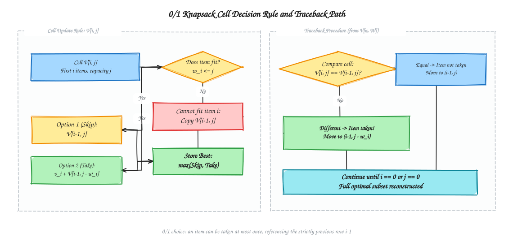

#### Algorithm

```text
KNAPSACK-01(w, v, n, W)
1. create table V[0...n][0...W]
2. for i = 0 to n:
3.     V[i][0] = 0
4. for j = 0 to W:
5.     V[0][j] = 0
6. for i = 1 to n:
7.     for j = 1 to W:
8.         if w[i] <= j:
9.             V[i][j] = max(V[i - 1][j], v[i] + V[i - 1][j - w[i]])
10.        else:
11.            V[i][j] = V[i - 1][j]
12. return V[n][W]
```

#### Complexity Analysis

- Time Complexity: $\Theta(nW)$
- Space Complexity: $\Theta(nW)$
- Space-optimized version: $\Theta(W)$ using one row updated from right to left

---

### Rod Cutting

#### Problem Statement

Imagine a steel mill has a rod of length $n$. Customers pay different prices for rods of different lengths. The mill may cut the rod into smaller pieces. The goal is to cut the rod so that the total selling price is maximum.

#### Inputs and Output

- **Input:** rod length $n$ and price table $p_i$ for each piece length $i$.
- **Output:** maximum obtainable revenue and the corresponding cuts.

#### Subproblem Decomposition

Rod Cutting can be solved like an unbounded selection problem because the same cut length can be used multiple times.

Let $T[i,j]$ be the maximum revenue using cut lengths up to $i$ for a rod of length $j$.

- **Exclude length $i$:** revenue is $T[i-1,j]$.
- **Include length $i$:** revenue is $p_i + T[i,j-i]$ if $j \ge i$.

$$
T[i,j] =
\begin{cases}
0, & i=0 \text{ or } j=0 \\
T[i-1,j], & 0 < j < i \\
\max(T[i-1,j],\ p_i + T[i,j-i]), & j \ge i
\end{cases}
$$

Base cases:

$$
T[0,j]=0, \qquad T[i,0]=0
$$

#### Tabulation Walkthrough

### Given:

* **Lengths ($L_i$):** 1, 2, 3, 4, 5

* **Prices ($P_i$):** 1, 5, 8, 9, 10

* **Total Rod Length ($N$):** 5

Rows identify the cut lengths currently allowed and show that length's price; columns are target rod lengths. Ties are assigned to skipping the current length, so traceback is consistent.

---

### Tabulation Matrix (Unbounded Knapsack Format)

- $\uparrow$ means the current cut length is skipped and the value comes from the row above.
- $\leftarrow_i$ means cut length $i$ is used and the value comes from the same row at remaining length $L-i$; this permits reusing that length.
- The base row and length-zero column have no arrows because their values are fixed at 0.

| Cut $i$ | Length $i$ | Price $p_i$ | $L=0$ | $L=1$ | $L=2$ | $L=3$ | $L=4$ | $L=5$ |
| :---: | :---: | :---: | :---: | :---: | :---: | :---: | :---: | :---: |
| 0 | - | - | 0 | 0 | 0 | 0 | 0 | 0 |
| 1 | 1 | 1 | 0 | 1 ($\leftarrow_1$) | 2 ($\leftarrow_1$) | 3 ($\leftarrow_1$) | 4 ($\leftarrow_1$) | 5 ($\leftarrow_1$) |
| 2 | 2 | 5 | 0 | 1 ($\uparrow$) | 5 ($\leftarrow_2$) | 6 ($\leftarrow_2$) | 10 ($\leftarrow_2$) | 11 ($\leftarrow_2$) |
| 3 | 3 | 8 | 0 | 1 ($\uparrow$) | 5 ($\uparrow$) | 8 ($\leftarrow_3$) | 10 ($\uparrow$) | **13** ($\leftarrow_3$) |
| 4 | 4 | 9 | 0 | 1 ($\uparrow$) | 5 ($\uparrow$) | 8 ($\uparrow$) | 10 ($\uparrow$) | 13 ($\uparrow$) |
| 5 | 5 | 10 | 0 | 1 ($\uparrow$) | 5 ($\uparrow$) | 8 ($\uparrow$) | 10 ($\uparrow$) | 13 ($\uparrow$) |

Key calculations:

- $T[2,4] = \max(T[1,4], p_2 + T[2,2]) = \max(4,5+5)=10$.
- $T[3,5] = \max(T[2,5], p_3 + T[3,2]) = \max(11,8+5)=13$.
- $T[5,5] = \max(T[4,5], p_5 + T[5,0]) = \max(13,10)=13$.

Traceback:

1. Start at $T[5,5]=13$.
2. Since $T[5,5]=T[4,5]$, length 5 is not used.
3. Since $T[4,5]=T[3,5]$, length 4 is not used.
4. Since $T[3,5] \ne T[2,5]$, length 3 is used. Remaining length is 2.
5. At $T[3,2]$, move up to $T[2,2]$.
6. Since $T[2,2] \ne T[1,2]$, length 2 is used.

Optimal cuts: **2 and 3**. Maximum revenue: **13**.

#### Visual Map: Rod Cutting as Unbounded Choices

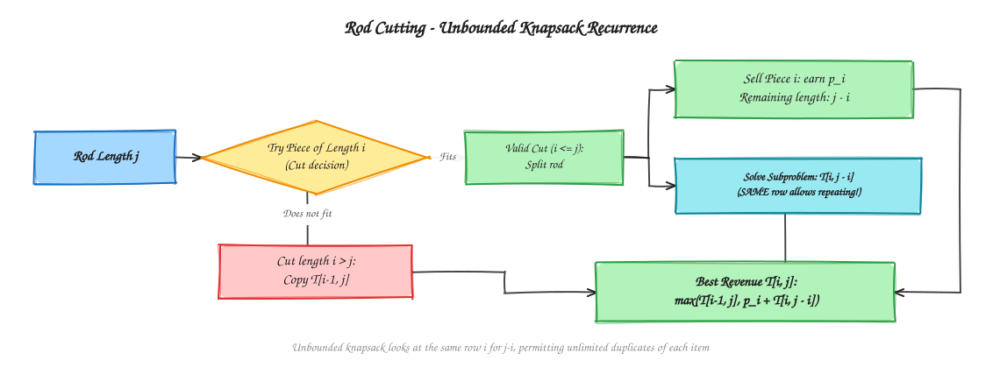

#### Algorithm

```text
ROD-CUTTING(price, n)
1. create table T[0...n][0...n]
2. for i = 0 to n:
3.     T[i][0] = 0
4. for j = 0 to n:
5.     T[0][j] = 0
6. for i = 1 to n:
7.     for j = 1 to n:
8.         if i <= j:
9.             T[i][j] = max(T[i - 1][j], price[i] + T[i][j - i])
10.        else:
11.            T[i][j] = T[i - 1][j]
12. return T[n][n]
```

#### Complexity Analysis

- Time Complexity: $\Theta(n^2)$
- Space Complexity: $\Theta(n^2)$ for the 2D table
- One-dimensional version: $\Theta(n)$ space

---

#### Classroom Problem: Maximum Revenue from a Rod

**Problem.** A rod of length 8 can be cut into integer lengths. Its selling prices are shown below. Find the maximum obtainable revenue and one optimal set of cuts.

| Length $i$ | 1 | 2 | 3 | 4 | 5 | 6 | 7 | 8 |
| :---: | :---: | :---: | :---: | :---: | :---: | :---: | :---: | :---: |
| Price $p_i$ | 1 | 5 | 8 | 9 | 10 | 17 | 17 | 20 |

##### Theoretical Solution

Let $R(j)$ be the maximum revenue obtainable from a rod of length $j$. Consider the first piece cut from the rod. If that piece has length $i$, it earns $p_i$ and leaves a rod of length $j-i$. The best revenue for the remainder is $R(j-i)$, so:

$$
R(0)=0
$$

$$
R(j) = \max_{1 \le i \le j}\{p_i + R(j-i)\}, \qquad 1 \le j \le 8
$$

This considers every possible first-cut length. By optimal substructure, the remaining rod must be cut for maximum revenue; otherwise replacing its cuts with a better solution would improve the whole solution.

For tabulation, use the same matrix layout as 0/1 Knapsack: each row adds one allowed cut length, each column is a target rod length, and each cell stores the maximum revenue. The matrix recurrence is the $T[i,j]$ recurrence defined above. As in the previous table, ties are assigned to skipping the current length.

Arrow legend:

- $\uparrow$ means skip length $i$ and copy the value from the row above.
- $\leftarrow_i$ means use a piece of length $i$ and continue in the same row at length $j-i$, allowing that piece length to be reused.
- The base row and length-zero column contain fixed zeros and have no arrows.

| Cut $i$ | Length $i$ | Price $p_i$ | $L=0$ | $L=1$ | $L=2$ | $L=3$ | $L=4$ | $L=5$ | $L=6$ | $L=7$ | $L=8$ |
| :---: | :---: | :---: | :---: | :---: | :---: | :---: | :---: | :---: | :---: | :---: | :---: |
| 0 | - | - | 0 | 0 | 0 | 0 | 0 | 0 | 0 | 0 | 0 |
| 1 | 1 | 1 | 0 | 1 ($\leftarrow_1$) | 2 ($\leftarrow_1$) | 3 ($\leftarrow_1$) | 4 ($\leftarrow_1$) | 5 ($\leftarrow_1$) | 6 ($\leftarrow_1$) | 7 ($\leftarrow_1$) | 8 ($\leftarrow_1$) |
| 2 | 2 | 5 | 0 | 1 ($\uparrow$) | 5 ($\leftarrow_2$) | 6 ($\leftarrow_2$) | 10 ($\leftarrow_2$) | 11 ($\leftarrow_2$) | 15 ($\leftarrow_2$) | 16 ($\leftarrow_2$) | 20 ($\leftarrow_2$) |
| 3 | 3 | 8 | 0 | 1 ($\uparrow$) | 5 ($\uparrow$) | 8 ($\leftarrow_3$) | 10 ($\uparrow$) | 13 ($\leftarrow_3$) | 16 ($\leftarrow_3$) | 18 ($\leftarrow_3$) | 21 ($\leftarrow_3$) |
| 4 | 4 | 9 | 0 | 1 ($\uparrow$) | 5 ($\uparrow$) | 8 ($\uparrow$) | 10 ($\uparrow$) | 13 ($\uparrow$) | 16 ($\uparrow$) | 18 ($\uparrow$) | 21 ($\uparrow$) |
| 5 | 5 | 10 | 0 | 1 ($\uparrow$) | 5 ($\uparrow$) | 8 ($\uparrow$) | 10 ($\uparrow$) | 13 ($\uparrow$) | 16 ($\uparrow$) | 18 ($\uparrow$) | 21 ($\uparrow$) |
| 6 | 6 | 17 | 0 | 1 ($\uparrow$) | 5 ($\uparrow$) | 8 ($\uparrow$) | 10 ($\uparrow$) | 13 ($\uparrow$) | 17 ($\leftarrow_6$) | 18 ($\uparrow$) | **22** ($\leftarrow_6$) |
| 7 | 7 | 17 | 0 | 1 ($\uparrow$) | 5 ($\uparrow$) | 8 ($\uparrow$) | 10 ($\uparrow$) | 13 ($\uparrow$) | 17 ($\uparrow$) | 18 ($\uparrow$) | 22 ($\uparrow$) |
| 8 | 8 | 20 | 0 | 1 ($\uparrow$) | 5 ($\uparrow$) | 8 ($\uparrow$) | 10 ($\uparrow$) | 13 ($\uparrow$) | 17 ($\uparrow$) | 18 ($\uparrow$) | 22 ($\uparrow$) |

For the final cell, the first-piece recurrence gives the same check:

$$
R(8) = \max(1+R(7),\ 5+R(6),\ 8+R(5),\ldots,\ 20+R(0)) = \max(19,22,21,\ldots,20)=22
$$

**Traceback:** Start at $T[8,8]=22$. The arrows move up through rows 8 and 7, so lengths 8 and 7 are skipped. At $T[6,8]$, take a length-6 piece and move to $T[6,2]$. Continue upward at length 2 until $T[2,2]$, where a length-2 piece is taken. Thus one optimal cutting is **6 and 2**, with maximum revenue **22**.

```text
ROD-CUTTING-TABLE(price, n)
1. create table T[0...n][0...n]
2. set T[i][0] = 0 for i = 0 to n
3. set T[0][L] = 0 for L = 0 to n
4. for i = 1 to n:
5.     for L = 1 to n:
6.         if i <= L:
7.             T[i][L] = max(T[i - 1][L], price[i] + T[i][L - i])
8.         else:
9.             T[i][L] = T[i - 1][L]
10. return T[n][n]
```

- Time Complexity: $\Theta(n^2)$
- Space Complexity: $\Theta(n^2)$ for this matrix tabulation
- One-dimensional version: $\Theta(n)$ space

#### Classroom Problem: Matrix Tabular Format (Unbounded Pieces)

**Problem.** Using the tabular $T[i][j]$ form (row $i$ = pieces of length $1$ through $i$ allowed, column $j$ = target rod length), find the maximum revenue for rod lengths $0$ through $5$ with prices:

| Length $i$ | 1 | 2 | 3 | 4 |
| :---: | :---: | :---: | :---: | :---: |
| Price $p_i$ | 2 | 3 | 5 | 9 |

Since a piece length may be reused any number of times, the recurrence differs from 0/1 Knapsack by reusing the *same* row when a piece is taken (matching the `ROD-CUTTING` algorithm above):

$$
T[i,j] = \max(T[i-1,j],\ p_i + T[i,j-i]), \qquad j \ge i
$$

Rows identify the allowed cut lengths and include each length and price; columns are target rod lengths. $\uparrow$ means skip the current length and copy from the row above. $\leftarrow_i$ means use length $i$ and continue in the same row at length $j-i$. Ties are assigned to skipping the current length; the base row and length-zero column have no arrows.

| Cut $i$ | Length $i$ | Price $p_i$ | $L=0$ | $L=1$ | $L=2$ | $L=3$ | $L=4$ | $L=5$ |
| :---: | :---: | :---: | :---: | :---: | :---: | :---: | :---: | :---: |
| 0 | - | - | 0 | 0 | 0 | 0 | 0 | 0 |
| 1 | 1 | 2 | 0 | 2 ($\leftarrow_1$) | 4 ($\leftarrow_1$) | 6 ($\leftarrow_1$) | 8 ($\leftarrow_1$) | 10 ($\leftarrow_1$) |
| 2 | 2 | 3 | 0 | 2 ($\uparrow$) | 4 ($\uparrow$) | 6 ($\uparrow$) | 8 ($\uparrow$) | 10 ($\uparrow$) |
| 3 | 3 | 5 | 0 | 2 ($\uparrow$) | 4 ($\uparrow$) | 6 ($\uparrow$) | 8 ($\uparrow$) | 10 ($\uparrow$) |
| 4 | 4 | 9 | 0 | 2 ($\uparrow$) | 4 ($\uparrow$) | 6 ($\uparrow$) | **9** ($\leftarrow_4$) | **11** ($\leftarrow_4$) |

Rows 1 through 3 stay identical to row 1: pieces of length 2 (value-per-length $1.5$) and length 3 (value-per-length $\approx 1.67$) are both worse than reusing length-1 pieces (value-per-length $2.0$), so they are never chosen. Only length 4 (value-per-length $2.25$) beats length 1, and it only has room to help once $j \ge 4$:

$$
T[4,4] = \max(T[3,4],\ 9+T[4,0]) = \max(8,\ 9) = 9
$$

$$
T[4,5] = \max(T[3,5],\ 9+T[4,1]) = \max(10,\ 9+2) = 11
$$

**Traceback for $j=5$:** $T[4,5] \ne T[3,5]$, so one piece of length $4$ is used (value $9$), leaving length $5-4=1$. Then $T[4,1]=T[3,1]=2$ comes from one piece of length $1$ (value $2$). Optimal cut: **one length-4 piece + one length-1 piece**, total revenue **11**.

- Time Complexity: $\Theta(n \cdot L)$ where $n$ is the number of allowed piece lengths and $L$ is the target length
- Space Complexity: $\Theta(n \cdot L)$ for the full matrix, or $\Theta(L)$ if only the previous row is kept

---

### Longest Common Subsequence (LCS)

#### Problem Statement

Given two sequences, find the longest sequence that appears in both of them in the same relative order. The characters do not need to be contiguous.

For example, in comparing biological sequences or text versions, we may want to know the longest ordered pattern shared by both strings.

#### Inputs and Output

- **Input:** two sequences $X=\langle x_1,\dots,x_m \rangle$ and $Y=\langle y_1,\dots,y_n \rangle$.
- **Output:** the length of the longest common subsequence and optionally the subsequence itself.

#### Subproblem Decomposition

Let $c[i,j]$ be the LCS length of prefixes $X[1...i]$ and $Y[1...j]$.

If the last characters match, they extend the LCS:

$$
c[i,j] = c[i-1,j-1] + 1
$$

If they do not match, remove one last character and take the better option:

$$
c[i,j] = \max(c[i-1,j], c[i,j-1])
$$

Complete recurrence:

$$
c[i,j] =
\begin{cases}
0, & i=0 \text{ or } j=0 \\
c[i-1,j-1]+1, & x_i = y_j \\
\max(c[i-1,j],c[i,j-1]), & x_i \ne y_j
\end{cases}
$$

#### Tabulation Walkthrough

Find the LCS of $X=\text{ABC}$ and $Y=\text{BDC}$.

Arrow legend for LCS tables:

- $\nwarrow$ means the characters match, so the value comes from the diagonal cell plus 1.
- $\uparrow$ means the characters do not match and the upper cell is chosen.
- $\leftarrow$ means the characters do not match and the left cell is chosen.

| $i \backslash j$ | - | B | D | C |
| :---: | :---: | :---: | :---: | :---: |
| - | 0 | 0 | 0 | 0 |
| A | 0 | 0 ($\uparrow$) | 0 ($\uparrow$) | 0 ($\uparrow$) |
| B | 0 | 1 ($\nwarrow$) | 1 ($\leftarrow$) | 1 ($\leftarrow$) |
| C | 0 | 1 ($\uparrow$) | 1 ($\uparrow$) | **2** ($\nwarrow$) |

Traceback starts at $c[3,3]=2$:

1. $C=C$, so include `C` and move diagonally to $c[2,2]$.
2. $B \ne D$, move to the larger neighboring cell $c[2,1]$.
3. $B=B$, so include `B` and move diagonally to $c[1,0]$.

The LCS is **BC**, with length **2**.

#### Classroom Problem: Matrix Tabular Format

Given:

- $X = \text{ab ac deb}$
- $Y = \text{a ab db}$

Spaces may be counted or ignored depending on the exam instruction. Both versions are shown.

##### Case A: Spaces Counted as Characters

$X = \langle a,b,\text{space},a,c,\text{space},d,e,b \rangle$, length 9.

$Y = \langle a,\text{space},a,b,\text{space},d,b \rangle$, length 7.

| $i \backslash j$ | - | a | space | a | b | space | d | b |
| :---: | :---: | :---: | :---: | :---: | :---: | :---: | :---: | :---: |
| - | 0 | 0 | 0 | 0 | 0 | 0 | 0 | 0 |
| a | 0 | 1 ($\nwarrow$) | 1 ($\leftarrow$) | 1 ($\nwarrow$) | 1 ($\leftarrow$) | 1 ($\leftarrow$) | 1 ($\leftarrow$) | 1 ($\leftarrow$) |
| b | 0 | 1 ($\uparrow$) | 1 ($\uparrow$) | 1 ($\uparrow$) | 2 ($\nwarrow$) | 2 ($\leftarrow$) | 2 ($\leftarrow$) | 2 ($\nwarrow$) |
| space | 0 | 1 ($\uparrow$) | 2 ($\nwarrow$) | 2 ($\leftarrow$) | 2 ($\uparrow$) | 3 ($\nwarrow$) | 3 ($\leftarrow$) | 3 ($\leftarrow$) |
| a | 0 | 1 ($\nwarrow$) | 2 ($\uparrow$) | 3 ($\nwarrow$) | 3 ($\leftarrow$) | 3 ($\uparrow$) | 3 ($\uparrow$) | 3 ($\uparrow$) |
| c | 0 | 1 ($\uparrow$) | 2 ($\uparrow$) | 3 ($\uparrow$) | 3 ($\uparrow$) | 3 ($\uparrow$) | 3 ($\uparrow$) | 3 ($\uparrow$) |
| space | 0 | 1 ($\uparrow$) | 2 ($\nwarrow$) | 3 ($\uparrow$) | 3 ($\uparrow$) | 4 ($\nwarrow$) | 4 ($\leftarrow$) | 4 ($\leftarrow$) |
| d | 0 | 1 ($\uparrow$) | 2 ($\uparrow$) | 3 ($\uparrow$) | 3 ($\uparrow$) | 4 ($\uparrow$) | 5 ($\nwarrow$) | 5 ($\leftarrow$) |
| e | 0 | 1 ($\uparrow$) | 2 ($\uparrow$) | 3 ($\uparrow$) | 3 ($\uparrow$) | 4 ($\uparrow$) | 5 ($\uparrow$) | 5 ($\uparrow$) |
| b | 0 | 1 ($\uparrow$) | 2 ($\uparrow$) | 3 ($\uparrow$) | 4 ($\nwarrow$) | 4 ($\uparrow$) | 5 ($\uparrow$) | **6** ($\nwarrow$) |

Traceback gives the LCS **"a a db"** (with spaces counted) with length **6**.

##### Case B: Spaces Ignored

$X = \text{abacdeb}$ and $Y = \text{aabdb}$.

| $i \backslash j$ | - | a | a | b | d | b |
| :---: | :---: | :---: | :---: | :---: | :---: | :---: |
| - | 0 | 0 | 0 | 0 | 0 | 0 |
| a | 0 | 1 ($\nwarrow$) | 1 ($\nwarrow$) | 1 ($\leftarrow$) | 1 ($\leftarrow$) | 1 ($\leftarrow$) |
| b | 0 | 1 ($\uparrow$) | 1 ($\uparrow$) | 2 ($\nwarrow$) | 2 ($\leftarrow$) | 2 ($\nwarrow$) |
| a | 0 | 1 ($\nwarrow$) | 2 ($\nwarrow$) | 2 ($\uparrow$) | 2 ($\uparrow$) | 2 ($\uparrow$) |
| c | 0 | 1 ($\uparrow$) | 2 ($\uparrow$) | 2 ($\uparrow$) | 2 ($\uparrow$) | 2 ($\uparrow$) |
| d | 0 | 1 ($\uparrow$) | 2 ($\uparrow$) | 2 ($\uparrow$) | 3 ($\nwarrow$) | 3 ($\leftarrow$) |
| e | 0 | 1 ($\uparrow$) | 2 ($\uparrow$) | 2 ($\uparrow$) | 3 ($\uparrow$) | 3 ($\uparrow$) |
| b | 0 | 1 ($\uparrow$) | 2 ($\uparrow$) | 3 ($\nwarrow$) | 3 ($\uparrow$) | **4** ($\nwarrow$) |

Traceback gives the LCS **"abdb"** with length **4**.

#### Visual Map: LCS Match, Mismatch, and Traceback

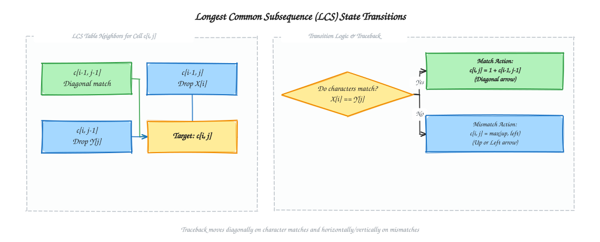

#### Algorithm

```text
LCS-LENGTH(X, Y, m, n)
1. create table c[0...m][0...n]
2. create table direction[1...m][1...n]
3. for i = 0 to m: c[i][0] = 0
4. for j = 0 to n: c[0][j] = 0
5. for i = 1 to m:
6.     for j = 1 to n:
7.         if X[i] == Y[j]:
8.             c[i][j] = c[i - 1][j - 1] + 1
9.             direction[i][j] = "diagonal"
10.        else if c[i - 1][j] >= c[i][j - 1]:
11.            c[i][j] = c[i - 1][j]
12.            direction[i][j] = "up"
13.        else:
14.            c[i][j] = c[i][j - 1]
15.            direction[i][j] = "left"
16. return c and direction
```

#### Complexity Analysis

- Time Complexity: $\Theta(mn)$
- Space Complexity: $\Theta(mn)$
- Space-optimized length-only version: $\Theta(\min(m,n))$ auxiliary space

---

### Longest Increasing Subsequence (LIS)

#### Problem Statement

Given a sequence of numbers, find the length of its longest **strictly increasing subsequence**. A subsequence keeps the original relative order of its elements, but those elements do not have to be adjacent. For example, $\langle 3,10,20\rangle$ is a subsequence of $\langle 3,10,2,1,20,4\rangle$.

#### Inputs and Output

- **Input:** a sequence $A=\langle a_1,\dots,a_n\rangle$ of $n$ numbers.
- **Output:** the length of a longest strictly increasing subsequence.
- **Empty input:** the answer is $0$.

#### Why LIS Is a Dynamic Programming Problem

The endpoint-based recurrence below is a bottom-up dynamic-programming solution. It has **optimal substructure**: if a longest increasing subsequence ends at $a_i$ and its previous element is $a_j$, the part ending at $a_j$ must itself be a longest subsequence ending there; otherwise, replacing that part would give a longer subsequence ending at $a_i$. It also reuses states: the value for an earlier position $j$ can be considered by many later positions, so it is computed once and then reused.

This is not a greedy method that commits to one locally attractive next value. It checks every valid earlier endpoint. Unlike LCS, whose state uses two sequence-prefix lengths, LIS has one state per input position, so this version uses a **one-dimensional table**, not an LCS-style matrix.

#### Subproblem Decomposition

Let $dp[i]$ be the length of the longest strictly increasing subsequence that **ends exactly at position $i$**. The element $a_i$ by itself is always a subsequence, so the initial value for every state is $1$. A previous position can extend that subsequence only when it is earlier and its value is strictly smaller:

$$
dp[i] = \max\left(\{1\} \cup \{dp[j]+1 \mid 1 \le j < i \text{ and } a_j < a_i\}\right), \quad 1 \le i \le n
$$

The strict comparison means equal values do not extend one another. The overall answer may end at any position, not necessarily at $n$:

$$
\operatorname{LIS}(A) =
\begin{cases}
0, & n=0 \\
\max_{1 \le i \le n} dp[i], & n>0
\end{cases}
$$

#### Tabulation Walkthrough

For $A=\langle 3,10,2,1,20,4\rangle$, fill states from left to right. For each position, consider only earlier positions $j$ for which $a_j<a_i$; each such predecessor offers the candidate length $dp[j]+1$.

| Position $i$ | Value $a_i$ | Candidate lengths from valid earlier positions | $dp[i]$ |
| :---: | :---: | :--- | :---: |
| 1 | 3 | No valid predecessor; keep the base value | 1 |
| 2 | 10 | $dp[1]+1=2$ | 2 |
| 3 | 2 | No valid predecessor; keep the base value | 1 |
| 4 | 1 | No valid predecessor; keep the base value | 1 |
| 5 | 20 | $dp[1]+1=2$, $dp[2]+1=3$, $dp[3]+1=2$, $dp[4]+1=2$ | 3 |
| 6 | 4 | $dp[1]+1=2$, $dp[3]+1=2$, $dp[4]+1=2$ | 2 |

The one-dimensional table is $[1,2,1,1,3,2]$, so the LIS length is **$\max_i dp[i]=3$**. One subsequence witnessing this length is $\langle 3,10,20\rangle$, at positions 1, 2, and 5. Since $dp[6]=2$, the answer is not always the last table entry $dp[n]$. The recurrence stores lengths only; reconstructing a subsequence would require also storing a predecessor position for each state.

#### Visual Map: LIS Endpoint States and Transitions

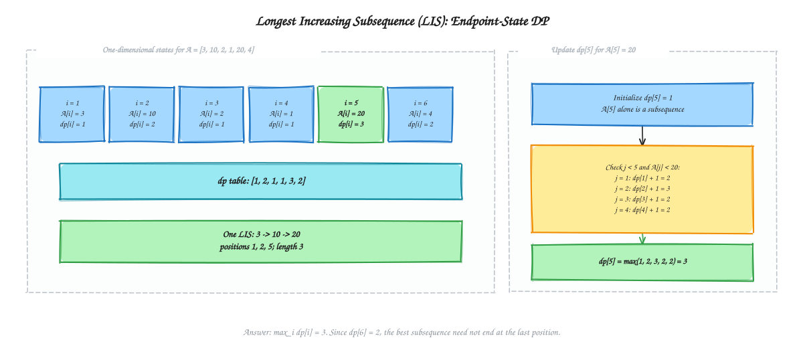

#### Algorithm

1. If the sequence is empty, report length $0$.
2. Give every input position an initial table value of $1$, representing the subsequence containing only that element.
3. Process positions from left to right. For each position $i$, inspect every earlier position $j$; when $a_j<a_i$, compare the current value at $i$ with $dp[j]+1$ and keep the larger value.
4. After all states are filled, report the largest table value.

#### Complexity Analysis

- **Time:** $\Theta(n^2)$, because each position checks all earlier positions.
- **Auxiliary space:** $\Theta(n)$ for the one-dimensional table.
- This is the quadratic endpoint-state DP shown here; faster LIS methods use a different formulation.

---

### Matrix Chain Multiplication

#### Problem Statement

Given a sequence of matrices, find the parenthesization that minimizes the number of scalar multiplications. The order of matrices cannot be changed, but the multiplication grouping can be changed.

For matrices $A_1,A_2,\dots,A_n$, if $A_i$ has dimension $p_{i-1} \times p_i$, the dimension array is $p_0,p_1,\dots,p_n$.

#### Inputs and Output

- **Input:** dimension array $p[0...n]$.
- **Output:** minimum number of scalar multiplications and the optimal split positions.

#### Subproblem Decomposition

Let $M[i,j]$ be the minimum multiplication cost for matrices $A_i \dots A_j$, and let $S[i,j]$ store the split point that achieves that minimum.

If the final split is after $A_k$, the two subchains are $A_i\dots A_k$ and $A_{k+1}\dots A_j$. Their results have dimensions $p_{i-1}\times p_k$ and $p_k\times p_j$, so combining them costs $p_{i-1}p_kp_j$ scalar multiplications.

For every interval with $i<j$:

$$
M[i,j] = \min_{i \le k < j}\{M[i,k] + M[k+1,j] + p_{i-1}p_kp_j\}
$$

$$
S[i,j] = \underset{i \le k < j}{\arg\min}\{M[i,k] + M[k+1,j] + p_{i-1}p_kp_j\}
$$

Base case:

$$
M[i,i]=0
$$

#### Tabulation Walkthrough

Given four matrices:

| Matrix | $A_1$ | $A_2$ | $A_3$ | $A_4$ |
| :---: | :---: | :---: | :---: | :---: |
| Dimension | $5\times10$ | $10\times3$ | $3\times12$ | $12\times5$ |

Therefore, $p=[5,10,3,12,5]$.

**How this tabulation is structured:** a matrix-chain state is an interval, not a prefix of items. Rows identify the starting matrix $i$, columns identify the ending matrix $j$, and only cells with $i\le j$ are valid. Fill the table by increasing chain length $\ell=j-i+1$: each candidate for $M[i,j]$ refers only to shorter intervals that have already been filled. Record the winning split in $S[i,j]$ alongside the cost in $M[i,j]$.

| Chain length $\ell$ | Interval filled | Candidate costs by split $k$ | Stored cost $M[i,j]$ | Split $S[i,j]$ |
| :---: | :---: | :--- | :---: | :---: |
| 1 | $[1,1],[2,2],[3,3],[4,4]$ | Base cases | 0 for each | - |
| 2 | $[1,2]$ | $k=1: 5\cdot10\cdot3=150$ | 150 | 1 |
| 2 | $[2,3]$ | $k=2: 10\cdot3\cdot12=360$ | 360 | 2 |
| 2 | $[3,4]$ | $k=3: 3\cdot12\cdot5=180$ | 180 | 3 |
| 3 | $[1,3]$ | $k=1: 960;\ k=2: 330$ | 330 | 2 |
| 3 | $[2,4]$ | $k=2: 330;\ k=3: 960$ | 330 | 2 |
| 4 | $[1,4]$ | $k=1: 580;\ k=2: 405;\ k=3: 630$ | **405** | **2** |

When filling $M[1,3]$, the two candidates are:

$$
\begin{aligned}
k=1 &: M[1,1]+M[2,3]+5\cdot10\cdot12 = 0+360+600=960,\\
k=2 &: M[1,2]+M[3,3]+5\cdot3\cdot12 = 150+0+180=330.
\end{aligned}
$$

The smaller candidate is stored, so $M[1,3]=330$ and $S[1,3]=2$.

When filling $M[2,4]$, the two candidates are:

$$
\begin{aligned}
k=2 &: M[2,2]+M[3,4]+10\cdot3\cdot5 = 0+180+150=330,\\
k=3 &: M[2,3]+M[4,4]+10\cdot12\cdot5 = 360+0+600=960.
\end{aligned}
$$

The smaller candidate is stored, so $M[2,4]=330$ and $S[2,4]=2$.

When filling $M[1,4]$, the three candidates are:

$$
\begin{aligned}
k=1 &: M[1,1]+M[2,4]+5\cdot10\cdot5 = 0+330+250=580,\\
k=2 &: M[1,2]+M[3,4]+5\cdot3\cdot5 = 150+180+75=405,\\
k=3 &: M[1,3]+M[4,4]+5\cdot12\cdot5 = 330+0+300=630.
\end{aligned}
$$

The smaller candidate is stored, so $M[1,4]=405$ and $S[1,4]=2$.

**Minimum-cost table** (each off-diagonal entry is `cost (chosen split k)`):

| $M[i,j]$ | End $j=1$ | End $j=2$ | End $j=3$ | End $j=4$ |
| :---: | :---: | :---: | :---: | :---: |
| Start $i=1$ | 0 | 150 ($k=1$) | 330 ($k=2$) | **405** ($k=2$) |
| Start $i=2$ | - | 0 | 360 ($k=2$) | 330 ($k=2$) |
| Start $i=3$ | - | - | 0 | 180 ($k=3$) |
| Start $i=4$ | - | - | - | 0 |

The cost matrix stores the optimum; the selected $k$ values form the split table $S$. To reconstruct the parenthesization, follow the recorded split recursively:

| Current interval | Cost | Split | Smaller intervals |
| :---: | :---: | :---: | :--- |
| $[1,4]$ | 405 | $k=2$ | $[1,2]$ and $[3,4]$ |
| $[1,2]$ | 150 | $k=1$ | $A_1$ and $A_2$ |
| $[3,4]$ | 180 | $k=3$ | $A_3$ and $A_4$ |

The minimum cost is **405** scalar multiplications, with optimal parenthesization **$(A_1A_2)(A_3A_4)$**.

#### Visual Map: Matrix Chain Interval Splits

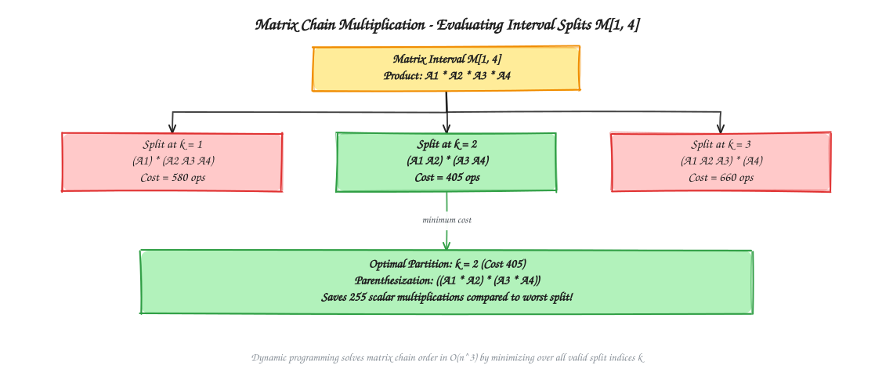

#### Algorithm

```text
MATRIX-CHAIN-ORDER(p, n)
1. create tables M[1...n][1...n] and split[1...n][1...n]
2. for i = 1 to n:
3.     M[i][i] = 0
4. for length = 2 to n:
5.     for i = 1 to n - length + 1:
6.         j = i + length - 1
7.         M[i][j] = infinity
8.         for k = i to j - 1:
9.             cost = M[i][k] + M[k + 1][j] + p[i - 1] * p[k] * p[j]
10.            if cost < M[i][j]:
11.                M[i][j] = cost
12.                split[i][j] = k
13. return M and split
```

#### Complexity Analysis

- Time Complexity: $\Theta(n^3)$
- Space Complexity: $\Theta(n^2)$

---

### Optimal Binary Search Tree (Optimal BST)

#### Problem Statement

Given sorted keys and their search probabilities, construct a binary search tree with the minimum expected search cost. Frequently searched keys should usually appear closer to the root, but the binary-search ordering must still be preserved.

#### Inputs and Output

- **Input:** sorted keys $k_1,\dots,k_n$, successful search probabilities $p_1,\dots,p_n$, and unsuccessful search probabilities $q_0,\dots,q_n$.
- **Output:** minimum expected search cost and the root choices for the optimal tree.

#### Subproblem Decomposition

Let $E[i,j]$ be the minimum expected cost for keys $i$ through $j$, $W[i,j]$ the total probability weight in that interval, and $Root[i,j]$ the selected root index.

The interval weight is

$$
\begin{aligned}
W[i,j] &= \sum_{t=i}^{j}p_t+\sum_{t=i-1}^{j}q_t,\\
W[i,j] &= W[i,j-1]+p_j+q_j \quad (j\ge i)
\end{aligned}
$$

If key $k_r$ is chosen as root, keys $i$ through $r-1$ form the left subtree and keys $r+1$ through $j$ form the right subtree. Try each possible root and store the minimum and its root:

$$
E[i,j] = \min_{i \le r \le j}\{E[i,r-1] + E[r+1,j] + W[i,j]\},
\qquad
Root[i,j] = \underset{i \le r \le j}{\arg\min}\{E[i,r-1] + E[r+1,j] + W[i,j]\}
$$

Base case for an empty key interval:

$$
E[i,i-1] = W[i,i-1] = q_{i-1}
$$

#### Tabulation Walkthrough

Given three sorted keys with relative successful-search weights:

| Key | $k_1$ | $k_2$ | $k_3$ |
| :---: | :---: | :---: | :---: |
| $p_i$ | 0.15 | 0.10 | 0.05 |

Relative unsuccessful-search weights:

| Gap | $q_0$ | $q_1$ | $q_2$ | $q_3$ |
| :---: | :---: | :---: | :---: | :---: |
| Probability | 0.05 | 0.10 | 0.05 | 0.05 |

**Probability check:** the listed $p_i$ and $q_i$ sum to $0.55$, not $1$. Treat them as relative weights for the tabulation below; dividing them all by $0.55$ gives normalized probabilities. This scales every cost by $1/0.55$ without changing any root choice, so the final normalized expected cost is $1.25/0.55\approx2.2727$.

The table is filled by increasing interval length $\ell=j-i+1$. First initialize the empty intervals from the unsuccessful-search probabilities, then compute length-1 intervals, length-2 intervals, and so on. Each candidate uses only shorter intervals that are already available.

Initialization:

$$
E[1,0]=0.05,\ E[2,1]=0.10,\ E[3,2]=0.05,\ E[4,3]=0.05
$$

The interval weights for this example are:

| Interval | $W[i,j]$ |
| :---: | :---: |
| $[1,1]$, $[2,2]$, $[3,3]$ | 0.30, 0.25, 0.15 |
| $[1,2]$, $[2,3]$ | 0.45, 0.35 |
| $[1,3]$ | 0.55 |

**Fill by interval length:**

- Length 1: $E[1,1]=0.05+0.10+0.30=0.45$ (root $k_1$); $E[2,2]=0.10+0.05+0.25=0.40$ (root $k_2$); $E[3,3]=0.05+0.05+0.15=0.25$ (root $k_3$).
- Length 2:

$$
E[1,2]=\min(0.05+0.40+0.45,\ 0.45+0.05+0.45)=\min(0.90,0.95)=0.90
$$

The minimizing root is $k_1$. Similarly,

$$
E[2,3]=\min(0.10+0.25+0.35,\ 0.40+0.05+0.35)=\min(0.70,0.80)=0.70
$$

with minimizing root $k_2$.

- Length 3:

$$
E[1,3]=\min(0.05+0.70+0.55,\ 0.45+0.25+0.55,\ 0.90+0.05+0.55)
=\min(1.30,1.25,1.50)=1.25
$$

The minimizing root is $k_2$.

**Weighted-cost table** (before probability normalization; rows are starting key $i$, columns are ending key $j$; base-gap cells use $j=i-1$):

| $E[i,j]$ | End $j=0$ | End $j=1$ | End $j=2$ | End $j=3$ |
| :---: | :---: | :---: | :---: | :---: |
| Start $i=1$ | 0.05 | 0.45 | 0.90 | **1.25** |
| Start $i=2$ | - | 0.10 | 0.40 | 0.70 |
| Start $i=3$ | - | - | 0.05 | 0.25 |
| Start $i=4$ | - | - | - | 0.05 |

The separate root table records the decision stored for each nonempty interval:

| $Root[i,j]$ | End $j=1$ | End $j=2$ | End $j=3$ |
| :---: | :---: | :---: | :---: |
| Start $i=1$ | 1 | 1 | **2** |
| Start $i=2$ | - | 2 | 2 |
| Start $i=3$ | - | - | 3 |

**Traceback:** $Root[1,3]=2$ makes $k_2$ the root. The remaining intervals are $[1,1]$ and $[3,3]$, whose roots are $k_1$ and $k_3$. Thus the optimal root for keys 1 through 3 is **$k_2$**. Its weighted cost is **1.25**, corresponding to normalized expected cost approximately **2.2727**.

#### Visual Map: Optimal BST Root Choices

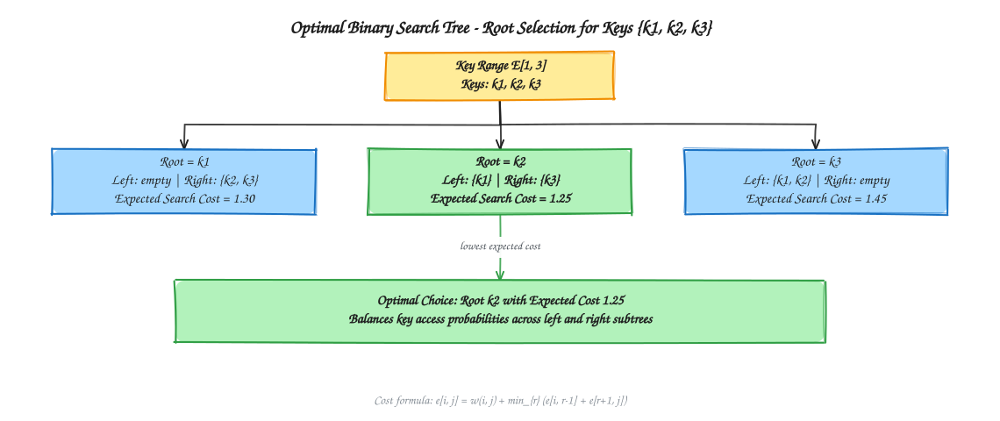

#### Algorithm

```text
OPTIMAL-BST(p, q, n)
1. create tables E[1...n+1][0...n], W[1...n+1][0...n], root[1...n][1...n]
2. for i = 1 to n + 1:
3.     E[i][i - 1] = q[i - 1]
4.     W[i][i - 1] = q[i - 1]
5. for length = 1 to n:
6.     for i = 1 to n - length + 1:
7.         j = i + length - 1
8.         E[i][j] = infinity
9.         W[i][j] = W[i][j - 1] + p[j] + q[j]
10.        for r = i to j:
11.            cost = E[i][r - 1] + E[r + 1][j] + W[i][j]
12.            if cost < E[i][j]:
13.                E[i][j] = cost
14.                root[i][j] = r
15. return E and root
```

#### Complexity Analysis

- Time Complexity: $\Theta(n^3)$
- Space Complexity: $\Theta(n^2)$

---

### Multistage Graph

#### Problem Statement

Given a directed weighted graph divided into stages, find the minimum-cost path from a source in the first stage to a sink in the last stage. Edges go only from one stage to a later stage, so the graph is acyclic.

#### Inputs and Output

- **Input:** staged directed graph, source $A$, sink $K$, and edge weights.
- **Output:** shortest path from $A$ to $K$ and its total cost.

#### Worked Graph

Use this 5-stage graph:

| From | To with costs |
| :---: | :--- |
| A | B:9, C:7, D:3 |
| B | E:4, F:2, G:1 |
| C | E:2, F:7, G:11 |
| D | E:5, F:11, G:8 |
| E | H:11, I:8, J:5 |
| F | H:4, I:3, J:7 |
| G | H:5, I:6, J:2 |
| H | K:4 |
| I | K:2 |
| J | K:5 |

#### Visual Map: Multistage Graph Layout

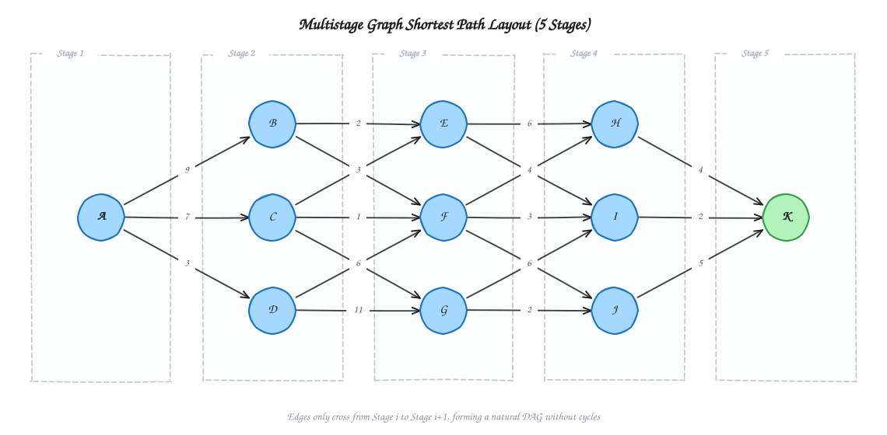

#### Subproblem Decomposition

Let $Cost(X)$ be the minimum cost from node $X$ to destination $K$, and let $Next(X)$ store a successor that achieves that cost.

$$
Cost(X) = \min_{(X,Y) \in E}\{w(X,Y) + Cost(Y)\},
\qquad
Next(X)=\underset{(X,Y)\in E}{\arg\min}\{w(X,Y)+Cost(Y)\}
$$

Base case:

$$
Cost(K)=0
$$

#### Tabulation Walkthrough: Backward Solution

A graph does not have a rectangular capacity axis, so use one row per node state, grouped by stage. Fill the table from the destination stage backward: each row's candidates use costs already stored for the next stage. Store both the minimum cost and its successor.

| Stage | Node $X$ | Candidate costs $w(X,Y)+Cost(Y)$ | Stored $Cost(X)$ | Chosen $Next(X)$ |
| :---: | :---: | :--- | :---: | :---: |
| 5 | $K$ | Destination base case | 0 | - |
| 4 | $H$ | $K: 4+0=4$ | 4 | $K$ |
| 4 | $I$ | $K: 2+0=2$ | 2 | $K$ |
| 4 | $J$ | $K: 5+0=5$ | 5 | $K$ |
| 3 | $E$ | $H: 11+4=15$; $I: 8+2=10$; $J: 5+5=10$ | 10 | $I$ or $J$ |
| 3 | $F$ | $H: 4+4=8$; $I: 3+2=5$; $J: 7+5=12$ | 5 | $I$ |
| 3 | $G$ | $H: 5+4=9$; $I: 6+2=8$; $J: 2+5=7$ | 7 | $J$ |
| 2 | $B$ | $E: 4+10=14$; $F: 2+5=7$; $G: 1+7=8$ | 7 | $F$ |
| 2 | $C$ | $E: 2+10=12$; $F: 7+5=12$; $G: 11+7=18$ | 12 | $E$ or $F$ |
| 2 | $D$ | $E: 5+10=15$; $F: 11+5=16$; $G: 8+7=15$ | 15 | $E$ or $G$ |
| 1 | $A$ | $B: 9+7=16$; $C: 7+12=19$; $D: 3+15=18$ | **16** | $B$ |

When candidates tie, all listed successors are optimal; any one can be stored for traceback. The source state's minimum cost is $Cost(A)=16$.

Path reconstruction:

- From $A$, choose $B$.
- From $B$, choose $F$.
- From $F$, choose $I$.
- From $I$, choose $K$.

Optimal path: **$A \to B \to F \to I \to K$**. Minimum cost: **16**.

#### Forward Tabulation Check

Let $Dist(X)$ be the minimum cost from source $A$ to node $X$.

- Stage 1: $Dist(A)=0$
- Stage 2: $Dist(B)=9$, $Dist(C)=7$, $Dist(D)=3$
- Stage 3: $Dist(E)=8$, $Dist(F)=11$, $Dist(G)=10$
- Stage 4: $Dist(H)=15$, $Dist(I)=14$, $Dist(J)=12$
- Stage 5: $Dist(K)=\min(15+4,14+2,12+5)=16$

This confirms the same minimum cost: **16**.

#### Visual Map: Backward DP Cost Flow

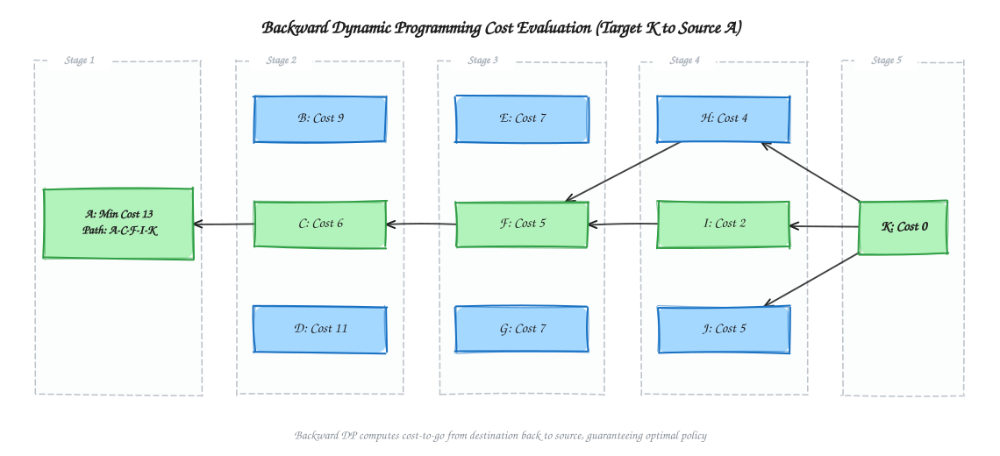

#### Algorithm

```text
MULTISTAGE-GRAPH(G, source, sink)
1. Cost[sink] = 0
2. for each vertex v in reverse stage order, excluding sink:
3.     Cost[v] = infinity
4.     for each outgoing edge (v, u):
5.         candidate = weight(v, u) + Cost[u]
6.         if candidate < Cost[v]:
7.             Cost[v] = candidate
8.             next[v] = u
9. return Cost[source] and next
```

#### Complexity Analysis

- Time Complexity: $\Theta(V+E)$ when vertices are already grouped by stage
- Space Complexity: $\Theta(V)$

---

### Travelling Salesman Problem (TSP)

#### Problem Statement

A salesperson starts from city 1, visits every other city exactly once, and returns to city 1. Given the travel cost between each pair of cities, find the minimum-cost tour.

#### Inputs and Output

- **Input:** distance matrix $C$ of size $n \times n$.
- **Output:** minimum tour cost and the tour order.

#### Subproblem Decomposition

Let $U=\{2,3,\dots,n\}$ be the non-starting cities. Let $g(i,S)$ be the minimum cost of starting at city $i$, visiting every city in subset $S\subseteq U$ exactly once, and then returning to city 1. Let $Next[i,S]$ record the next city on an optimal route.

Base case:

$$
g(i,\emptyset)=C_{i1}, \qquad Next[i,\emptyset]=1
$$

For nonempty $S$ (with $i\notin S$):

$$
g(i,S)=\min_{j \in S}\{C_{ij}+g(j,S-\{j\})\},
\qquad
Next[i,S]=\underset{j\in S}{\arg\min}\{C_{ij}+g(j,S-\{j\})\}
$$

The first city after the start is selected by:

$$
FirstCity=\underset{j\in U}{\arg\min}\{C_{1j}+g(j,U-\{j\})\}
$$

The minimum tour cost is the corresponding minimum candidate.

#### Tabulation Walkthrough

For four cities, use:

$$
C =
\begin{pmatrix}
0 & 2 & 9 & 10 \\
1 & 0 & 6 & 4 \\
15 & 7 & 0 & 8 \\
6 & 3 & 12 & 0
\end{pmatrix}
$$

Let $U=\{2,3,4\}$. This subset DP has one table row per current city and one column per remaining-city subset. Fill columns in increasing $|S|$: the empty-subset base cases first, then subsets of size 1, then size 2. A state is valid only when the current city $i$ is not in $S$; invalid combinations are marked `-`.

**Cost table** (cell values are $g(i,S)$):

| $g(i,S)$ | $\emptyset$ | $\{2\}$ | $\{3\}$ | $\{4\}$ | $\{2,3\}$ | $\{2,4\}$ | $\{3,4\}$ |
| :---: | :---: | :---: | :---: | :---: | :---: | :---: | :---: |
| Current city $i=2$ | 1 | - | 21 | 10 | - | - | 20 |
| Current city $i=3$ | 15 | 8 | - | 14 | - | 12 | - |
| Current city $i=4$ | 6 | 4 | 27 | - | 20 | - | - |

**Decision table** (cell values are $Next[i,S]$):

| $Next[i,S]$ | $\emptyset$ | $\{2\}$ | $\{3\}$ | $\{4\}$ | $\{2,3\}$ | $\{2,4\}$ | $\{3,4\}$ |
| :---: | :---: | :---: | :---: | :---: | :---: | :---: | :---: |
| Current city $i=2$ | Return to 1 | - | 3 | 4 | - | - | 3 |
| Current city $i=3$ | Return to 1 | 2 | - | 4 | - | 4 | - |
| Current city $i=4$ | Return to 1 | 2 | 3 | - | 3 | - | - |

For a size-1 state, $g(2,\{3\})=C_{23}+g(3,\emptyset)=6+15=21$, so $Next[2,\{3\}]=3$. The size-2 states compare all possible next cities:

$$
\begin{aligned}
g(2,\{3,4\}) &= \min(6+14,\ 4+27)=\min(20,31)=20, & Next[2,\{3,4\}]&=3,\\
g(3,\{2,4\}) &= \min(7+10,\ 8+4)=\min(17,12)=12, & Next[3,\{2,4\}]&=4,\\
g(4,\{2,3\}) &= \min(3+21,\ 12+8)=\min(24,20)=20, & Next[4,\{2,3\}]&=3.
\end{aligned}
$$

The final choice from city 1 is:

| First city $j$ | Candidate tour cost $C_{1j}+g(j,U-\{j\})$ |
| :---: | :---: |
| 2 | $2+20=22$ |
| 3 | $9+12=21$ |
| 4 | $10+20=30$ |

The minimum is **21**, so $FirstCity=3$. Trace decisions: $1\to3$, then $Next[3,\{2,4\}]=4$, then $Next[4,\{2\}]=2$, then return to 1. One optimal tour is **$1 \to 3 \to 4 \to 2 \to 1$**, with cost **21**.

#### Visual Map: TSP Subset DP Expansion

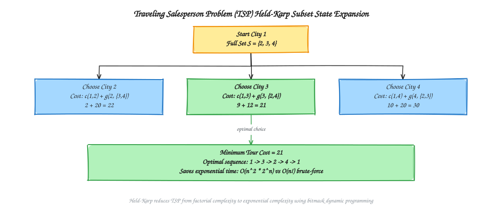

#### Algorithm

```text
TSP-HELD-KARP(C, n)
1. U = {2, 3, ..., n}
2. for i = 2 to n:
3.     g[i][empty set] = C[i][1]
4.     Next[i][empty set] = 1
5. for subset_size = 1 to n - 2:
6.     for each subset S of U with size subset_size:
7.         for each city i in U not in S:
8.             g[i][S] = infinity
9.             for each city j in S:
10.                candidate = C[i][j] + g[j][S - {j}]
11.                if candidate < g[i][S]:
12.                    g[i][S] = candidate
13.                    Next[i][S] = j
14. answer = infinity
15. for j = 2 to n:
16.     candidate = C[1][j] + g[j][U - {j}]
17.     if candidate < answer:
18.         answer = candidate
19.         FirstCity = j
20. tour = [1, FirstCity]
21. current = FirstCity
22. S = U - {current}
23. while S is not empty:
24.     j = Next[current][S]
25.     append j to tour
26.     S = S - {j}
27.     current = j
28. append 1 to tour
29. return answer and tour
```

#### Complexity Analysis

- Time Complexity: $\Theta(n^2 2^n)$
- Space Complexity: $\Theta(n2^n)$

---

### Reliability Design

#### Problem Statement

A system has multiple stages connected in series. Each stage can be made more reliable by placing parallel copies of the same component. Given a limited budget, choose how many copies to use in each stage so that total system reliability is maximized.

For one component with reliability $r_i$, using $x_i$ parallel copies gives stage reliability:

$$
R_i(x_i) = 1 - (1-r_i)^{x_i}
$$

For stages in series, total reliability is the product of stage reliabilities.

#### Inputs and Output

- **Input:** number of stages $m$, budget $B$, component cost $c_i$, component reliability $r_i$, and valid copy choices $x_i$.
- **Output:** maximum system reliability under the budget.

#### Subproblem Decomposition

Let $DP[i,b]$ be the maximum reliability using the first $i$ stages with budget at most $b$, and let $Copies[i,b]$ store the number of copies chosen for stage $i$ in that optimum. If one copy costs $c_i$, then $cost_i(x)=x c_i$.

For each valid copy count $x\in X_i$ such that $cost_i(x)=x c_i\le b$:

$$
DP[i,b] = \max_x\{DP[i-1,b-cost_i(x)] \times R_i(x)\}
$$

$$
Copies[i,b] = \underset{x}{\arg\max}\{DP[i-1,b-cost_i(x)] \times R_i(x)\}
$$

Base case:

$$
DP[0,b]=1
$$

The empty system has reliability 1 because it does not reduce the product. If no valid allocation exists for a nonempty prefix of stages, its table value is 0.

#### Tabulation Walkthrough

Suppose there are 3 stages and total budget $B=5$.

| Stage | Cost per copy | Single-copy reliability |
| :---: | :---: | :---: |
| 1 | 1 | 0.80 |
| 2 | 2 | 0.70 |
| 3 | 1 | 0.60 |

At least one copy is required for each stage. Parallel reliability values:

- Stage 1: $R_1(1)=0.80$, $R_1(2)=0.96$, $R_1(3)=0.992$, $R_1(4)=0.9984$, $R_1(5)=0.99968$.
- Stage 2: $R_2(1)=0.70$, $R_2(2)=0.91$.
- Stage 3: $R_3(1)=0.60$, $R_3(2)=0.84$.

Fill the table by increasing number of stages considered; each state uses only values from the previous-stage row. A value of 0 for a nonempty prefix means no feasible allocation fits the budget.

**Reliability table** (state values $DP[i,b]$):

| Stages $i$ | $B=0$ | $B=1$ | $B=2$ | $B=3$ | $B=4$ | $B=5$ |
| :---: | :---: | :---: | :---: | :---: | :---: | :---: |
| 0 | 1 | 1 | 1 | 1 | 1 | 1 |
| 1 | 0 | 0.8000 | 0.9600 | 0.9920 | 0.9984 | 0.9997 |
| 2 | 0 | 0 | 0 | 0.5600 | 0.6720 | 0.7280 |
| 3 | 0 | 0 | 0 | 0 | 0.3360 | **0.4704** |

**Decision table** (state values $Copies[i,b]$; `-` means infeasible or base case):

| Stages $i$ | $B=0$ | $B=1$ | $B=2$ | $B=3$ | $B=4$ | $B=5$ |
| :---: | :---: | :---: | :---: | :---: | :---: | :---: |
| 0 | - | - | - | - | - | - |
| 1 | - | 1 | 2 | 3 | 4 | 5 |
| 2 | - | - | - | 1 | 1 | 2 |
| 3 | - | - | - | - | 1 | 2 |

Key calculation for the final cell:

$$
DP[3,5] = \max(DP[2,4]\times R_3(1),\ DP[2,3]\times R_3(2))
$$

$$
DP[3,5] = \max(0.6720\times 0.60,\ 0.5600\times 0.84)=\max(0.4032,0.4704)=0.4704
$$

**Traceback:** $Copies[3,5]=2$, so stage 3 uses 2 copies and leaves budget $5-2(1)=3$. Then $Copies[2,3]=1$, so stage 2 uses 1 copy and leaves budget $3-1(2)=1$. Finally, $Copies[1,1]=1$. The best design uses 1, 1, and 2 copies for stages 1, 2, and 3, respectively. Maximum reliability: **0.4704**.

#### Visual Map: Reliability Design Budget Choices

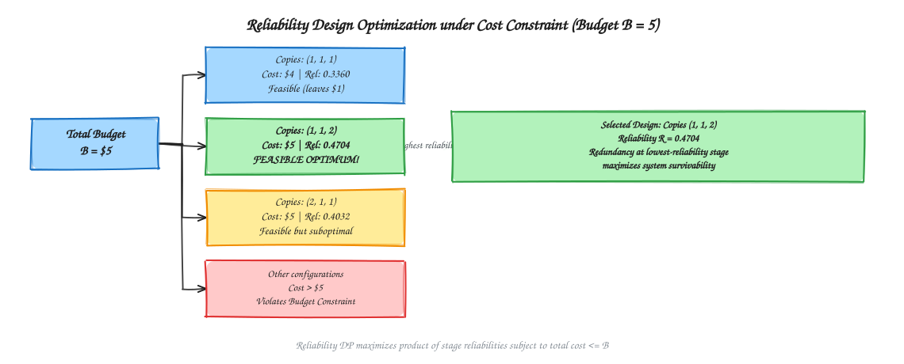

#### Algorithm

```text
RELIABILITY-DESIGN(stages, budget)
1. create tables DP[0...m][0...budget] and Copies[1...m][0...budget]
2. for b = 0 to budget:
3.     DP[0][b] = 1
4. for i = 1 to m:
5.     for b = 0 to budget:
6.         DP[i][b] = 0
7.         Copies[i][b] = -
8.         for each valid copy count x for stage i:
9.             if x * cost_per_copy[i] <= b:
10.                candidate = DP[i - 1][b - x * cost_per_copy[i]] * reliability_i(x)
11.                if candidate > DP[i][b]:
12.                    DP[i][b] = candidate
13.                    Copies[i][b] = x
14. return DP[m][budget] and Copies
```

#### Complexity Analysis

- Let $m$ be the number of stages, $B$ be the budget, and $X$ be the maximum number of choices per stage.
- Time Complexity: $\Theta(mBX)$
- Space Complexity: $\Theta(mB)$
- Space-optimized version: $\Theta(B)$ if previous-stage values are preserved correctly

---

## Analyze Time Complexity of Above Problems

| Problem | Main state count | Work per state | Time Complexity | Space Complexity |
| :--- | :--- | :--- | :--- | :--- |
| Climbing Stairs | $n$ | $\Theta(1)$ | $\Theta(n)$ | $\Theta(n)$, optimized to $\Theta(1)$ |
| Coin-Row Problem | $n$ | $\Theta(1)$ | $\Theta(n)$ | $\Theta(n)$, optimized to $\Theta(1)$ |
| Coin-Collecting Problem | $nm$ | $\Theta(1)$ | $\Theta(nm)$ | $\Theta(nm)$, optimized to $\Theta(m)$ |
| 0/1 Knapsack | $nW$ | $\Theta(1)$ | $\Theta(nW)$ | $\Theta(nW)$, optimized to $\Theta(W)$ |
| Rod Cutting | $n^2$ in 2D form | $\Theta(1)$ | $\Theta(n^2)$ | $\Theta(n^2)$, optimized to $\Theta(n)$ |
| Longest Common Subsequence (LCS) | $mn$ | $\Theta(1)$ | $\Theta(mn)$ | $\Theta(mn)$ |
| Longest Increasing Subsequence (LIS) | $n$ endpoint states | Up to $n$ earlier positions | $\Theta(n^2)$ | $\Theta(n)$ |
| Matrix Chain Multiplication | $n^2$ intervals | Up to $n$ split points | $\Theta(n^3)$ | $\Theta(n^2)$ |
| Optimal Binary Search Tree (Optimal BST) | $n^2$ intervals | Up to $n$ root choices | $\Theta(n^3)$ | $\Theta(n^2)$ |
| Multistage Graph | $V$ vertices | Outgoing edges scanned once overall | $\Theta(V+E)$ | $\Theta(V)$ |
| Travelling Salesman Problem (TSP) | $n2^n$ subset states | Up to $n$ choices | $\Theta(n^2 2^n)$ | $\Theta(n2^n)$ |
| Reliability Design | $mB$ states | Up to $X$ choices | $\Theta(mBX)$ | $\Theta(mB)$, optimized to $\Theta(B)$ |

Important notes:

- $W$ and $B$ are numeric limits, so 0/1 Knapsack and Reliability Design are pseudo-polynomial in those values.
- TSP remains exponential even with DP because it stores subset states.
- The all-pairs shortest path (Floyd-Warshall) and single-source shortest path (Bellman-Ford) algorithms are covered in [Chapter 11 - Graph Algorithms](../Chapter%2011%20-%20Graph%20Algorithms/README.md), since they are graph algorithms rather than problems decomposed by array/interval/subset state the way the rest of this chapter is.

---

[Previous: Chapter 7 - Greedy Algorithms](../Chapter%207%20-%20Greedy%20Algorithms/README.md) | [Home](../README.md) | [Next: Chapter 9 - Backtracking](../Chapter%209%20-%20Backtracking/README.md)
