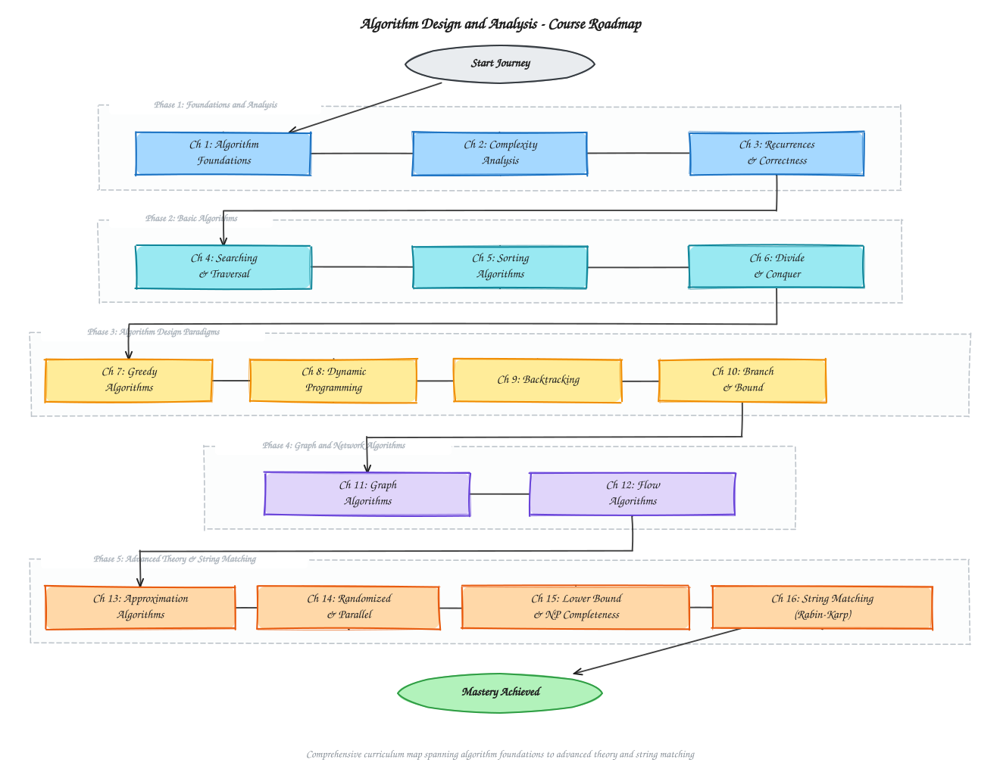

# CSE 2201, 2202 — Algorithm Design and Analysis (Sessional)

<p align="center">
  <a href="https://github.com/M-F-Tushar/CSE-2201-2202-Algorithm-Design-and-Analysis-Sessional"></a>
  <a href="LICENSE"></a>
  
  
  
  
</p>

> **Comprehensive, exam-oriented repository for CSE 2201 (Theory) + CSE 2202 (Sessional) — Algorithm Design and Analysis.**  
> Chapter-wise notes · hand-drawn Excalidraw diagrams · worked examples · dry runs · complexity analysis · solved previous-year questions · lab-ready code.

---

## Table of Contents

- [Course Overview](#-course-overview)
- [Repository Goals](#-repository-goals)
- [At a Glance](#-at-a-glance)
- [Course Roadmap](#-course-roadmap)
- [Repository Structure](#-repository-structure)
- [Chapter Navigation](#-chapter-navigation)
- [Chapter Overview](#-chapter-overview)
- [Visualization & Diagrams](#-visualization--diagrams)
- [Book Reference Mapping](#-book-reference-mapping)
- [Getting Started](#-getting-started)
- [Usage](#-usage)
- [Previous-Year Questions Spotlight](#-previous-year-questions-spotlight)
- [Lab and Sessional Format](#-lab-and-sessional-format)
- [Learning Outcomes](#-learning-outcomes)
- [Tools — Diagram Generators](#-tools--diagram-generators)
- [Reference Materials](#-reference-materials)
- [Course Progress](#-course-progress)
- [Contributing](#-contributing)
- [Contact](#-contact)
- [License](#-license)
- [Acknowledgments](#-acknowledgments)

---

## 📘 Course Overview

| Field | Detail |
|---|---|
| **Course Code** | CSE 2201 (Theory) + CSE 2202 (Sessional) |
| **Course Title** | Algorithm Design and Analysis |
| **Credit Hours** | 3.00 (Theory) + 1.50 (Sessional) |
| **Weekly Hours** | 3 hrs theory + 3 hrs lab |
| **Primary Language** | **Python** (theory & sessional) + **C++17** (Divide & Conquer examples & Lab Practice) |
| **Primary Reference** | *Introduction to Algorithms*, 4th Edition — Cormen, Leiserson, Rivest, Stein (CLRS) |
| **Syllabus Source** | [`SYLLABUS.md`](SYLLABUS.md) — full chapter-wise breakdown |

**Official description:** Efficient algorithm design techniques — Divide and Conquer, Greedy, Dynamic Programming, Backtracking, Branch and Bound, Flow, Approximation, Parallel & Randomized algorithms; Search & traversal, shortest paths, topological sorting, connected components, spanning trees & graph algorithms; Complexity analysis, recurrences, correctness & loop invariants, algebraic simplification, lower bound theory, NP-completeness and NP-hard problems.

---

## 🎯 Repository Goals

- 📚 **Syllabus-faithful notes** — 16 content chapters (Ch 0 – Ch 15) ordered exactly as the CSE 2201 syllabus, not the textbook order.
- 🎨 **204 hand-drawn diagrams** — every diagram is an editable `.excalidraw` + exported `.svg` that renders directly in the READMEs.
- 📝 **Plain-words explanations** — definitions, step-by-step algorithms, pseudocode, dry-run tables, and a memory trick per answer.
- ⏱️ **Complexity done right** — best / average / worst case, Big-O / Ω / Θ, recurrence solving, and master-theorem walkthroughs.
- 🧪 **Solved previous-year papers** — 1st Batch (2023 final, 27 parts), 2nd Batch, 3rd Batch CT 1–4 (80 marks total) with source-faithful transcription.
- 💻 **Lab-ready code** — `Chapter 6/examples` + `Chapter 0/Lab Practice` (11 C++ programs) plus Python-oriented theory throughout.
- 🗺️ **CLRS mapping** — every repository chapter links to its exact CLRS chapter(s).

---

## 📊 At a Glance

| Metric | Count |
|---|---|
| Content chapters | **16** (Chapter 0 – Chapter 15) + References |
| Chapter READMEs | **16** — every chapter has a full README with TOC |
| Total Markdown files | **~40** (chapter READMEs + batch READMEs + diagram indexes) |
| Hand-drawn SVGs | **204** (each paired with an `.excalidraw` source → **408** diagram files) |
| Largest chapter | **Ch 11 — Graph Algorithms** (35 SVGs, 2 114-line README) |
| Code examples | **13** `.cpp` files (Ch 6 + Lab Practice) + Python pseudocode throughout |
| Batch question banks | **3 batches** + Lab Practice |
| Diagram generators | **20+** Python tools in [`tools/`](tools/audit_layout.py) |
| License | MIT |

---

## 🧭 Course Roadmap



*Phased journey: Foundations & Analysis → Basic Algorithms → Design Paradigms → Graph & Network Algorithms → Advanced Theory. Editable source: [`roadmap-01-course-overview.excalidraw`](diagrams/roadmap-01-course-overview.excalidraw) · Index: [`diagrams/README.md`](diagrams/README.md)*

<details>
<summary>Text version of the roadmap</summary>

- **Phase 1 — Foundations and Analysis:** Ch 1 Algorithm Foundations → Ch 2 Complexity & Asymptotic Notation → Ch 3 Recurrences & Correctness
- **Phase 2 — Basic Algorithms:** Ch 4 Searching & Traversal → Ch 5 Sorting → Ch 6 Divide & Conquer
- **Phase 3 — Design Paradigms:** Ch 7 Greedy → Ch 8 Dynamic Programming → Ch 9 Backtracking → Ch 10 Branch & Bound
- **Phase 4 — Graph & Network:** Ch 11 Graph Algorithms → Ch 12 Flow Algorithms
- **Phase 5 — Advanced Theory:** Ch 13 Approximation → Ch 14 Randomized & Parallel → Ch 15 Lower Bounds & NP-Completeness

</details>

---

## 📁 Repository Structure

```text
CSE-2201-2202-Algorithm-Design-and-Analysis-Sessional/
│
├── README.md                          # ← you are here
├── SYLLABUS.md                        # Official CSE 2201/2202 syllabus breakdown
├── CONTRIBUTING.md
├── LICENSE                            # MIT
├── .gitignore
│
├── diagrams/                          # Root roadmap diagram
│   ├── roadmap-01-course-overview.svg
│   ├── roadmap-01-course-overview.excalidraw
│   └── README.md                      # Diagram index (SVG + editable source)
│
├── tools/                             # Diagram generators & verifiers (Python)
│   ├── excalidraw_gen.py              # Core Excalidraw scene builder
│   ├── build_diagrams.py              # Batch builder
│   ├── root_diagrams.py               # Root roadmap spec
│   ├── ch1_diagrams.py … ch15_diagrams.py
│   ├── b1_theory_diagrams.py / b2_theory_diagrams.py
│   ├── ct_sequence_diagrams.py / ct3_diagrams.py / ct4_diagrams.py
│   ├── audit_layout.py / write_index.py
│   └── verify_*.py                    # Content-vs-diagram verifiers
│
├── Chapter 0 - Previous Year Questions/
│   ├── README.md
│   ├── 1st Batch/
│   │   ├── Theory/README.md           # 2023 final — 8 questions, 27 parts, 3 sections
│   │   │   └── diagrams/              # 24 SVGs (b1-theory-01 … b1-theory-24)
│   │   └── Lab Final/README.md
│   ├── 2nd Batch/
│   │   ├── Theory/README.md
│   │   │   └── diagrams/              # 25 SVGs (b2-theory-01 … b2-theory-25)
│   │   └── Lab Final/README.md
│   ├── 3rd Batch/
│   │   └── CT/
│   │       ├── README.md              # CT1–CT4 complete answers (80 marks)
│   │       └── diagrams/              # 15 SVGs (ct1-01 … ct4-04)
│   └── Lab Practice/                  # 11 C++ lab programs
│       ├── 0_1_knapsack.cpp / lcs.cpp / lis.cpp
│       ├── Fractional Knapsack.cpp / Floyd Warshall.cpp
│       ├── Connected Component.cpp / Disjoint Kruskal.cpp
│       ├── Maximum Sum Subarray.cpp / Segment Tree.cpp …
│
├── Chapter 1 - Introduction and Algorithm Foundations/
│   ├── README.md  (149 lines)
│   └── diagrams/  (2 SVGs) — algorithm vs program, 5 properties
├── Chapter 2 - Complexity Analysis and Asymptotic Notation/
│   ├── README.md  (596 lines)
│   └── diagrams/  (4 SVGs) — loop patterns, cases, bounds, complexity classes
├── Chapter 3 - Recurrences Correctness and Loop Invariants/
│   ├── README.md  (184 lines)
│   └── diagrams/  (2 SVGs) — recursion tree T(n)=T(n/2)+c, master-theorem flow
├── Chapter 4 - Searching and Basic Traversal/
│   ├── README.md  (635 lines)
│   └── diagrams/  (8 SVGs) — BFS/DFS graphs, queue/stack, walkthroughs
├── Chapter 5 - Sorting Algorithms/
│   ├── README.md  (647 lines)
│   └── diagrams/  (18 SVGs) — bubble, selection, insertion, merge, quick, heap, counting
├── Chapter 6 - Divide and Conquer/
│   ├── README.md  (412 lines)
│   ├── diagrams/  (4 SVGs)
│   └── examples/  (2 C++17 programs)
│       ├── maximum_sum_subarray.cpp   # brute force / D&C / Kadane
│       └── prefix_sum_segment_tree.cpp
├── Chapter 7 - Greedy Algorithms/
│   ├── README.md  (754 lines)
│   └── diagrams/  (9 SVGs) — fractional knapsack, coin change, Huffman, activity
├── Chapter 8 - Dynamic Programming/
│   ├── README.md  (1 620 lines)
│   └── diagrams/  (17 SVGs) — climbing stairs, knapsack, rod cutting, LCS, MCM, OBST, multistage, TSP, reliability
├── Chapter 9 - Backtracking/
│   ├── README.md  (261 lines)
│   └── diagrams/  (5 SVGs) — state-space tree, 4-Queens, safe check, graph colouring
├── Chapter 10 - Branch and Bound/
│   ├── README.md  (335 lines)
│   └── diagrams/  (5 SVGs) — LC-search, knapsack, job sequencing, TSP
├── Chapter 11 - Graph Algorithms/
│   ├── README.md  (2 114 lines)
│   └── diagrams/  (35 SVGs) — tree vs graph, representation, BFS, Dijkstra×2, Bellman-Ford×3, Floyd-Warshall×2, topo, SCC, MST/Kruskal/DSU …
├── Chapter 12 - Flow Algorithms/
│   ├── README.md  (492 lines)
│   └── diagrams/  (14 SVGs) — flow network, residual, Ford-Fulkerson foundations + 5-step trace + min cut + worst case, Edmonds-Karp, bipartite matching
├── Chapter 13 - Approximation Algorithms/
│   ├── README.md  (246 lines)
│   └── diagrams/  (4 SVGs) — vertex cover, TSP & set cover approximations
├── Chapter 14 - Randomized and Parallel Algorithms/
│   ├── README.md  (243 lines)
│   └── diagrams/  (5 SVGs) — randomized quicksort, selection, fork-join, parallel merge sort
├── Chapter 15 - Lower Bound Theory and NP Completeness/
│   ├── README.md  (350 lines)
│   └── diagrams/  (5 SVGs) — decision tree, sorting lower bound, P/NP/NP-hard/NP-complete Venn
│
└── References/
    └── README.md                      # Curated reading list & CLRS map
```

> **File conventions per topic:** each full topic page (where applicable) is self-contained with definition → diagram → worked table → algorithm sketch → correctness note → complexity → memory trick.

---

## 🗺️ Chapter Navigation

| # | Chapter | Previous | Next |
|---|---------|----------|------|
| 0 | [Previous Year Questions](Chapter%200%20-%20Previous%20Year%20Questions/README.md) | [Root README](README.md) | [Ch 1 — Foundations](Chapter%201%20-%20Introduction%20and%20Algorithm%20Foundations/README.md) |
| 1 | [Introduction and Algorithm Foundations](Chapter%201%20-%20Introduction%20and%20Algorithm%20Foundations/README.md) | [Ch 0](Chapter%200%20-%20Previous%20Year%20Questions/README.md) | [Ch 2 — Complexity](Chapter%202%20-%20Complexity%20Analysis%20and%20Asymptotic%20Notation/README.md) |
| 2 | [Complexity Analysis and Asymptotic Notation](Chapter%202%20-%20Complexity%20Analysis%20and%20Asymptotic%20Notation/README.md) | [Ch 1](Chapter%201%20-%20Introduction%20and%20Algorithm%20Foundations/README.md) | [Ch 3 — Recurrences](Chapter%203%20-%20Recurrences%20Correctness%20and%20Loop%20Invariants/README.md) |
| 3 | [Recurrences, Correctness & Loop Invariants](Chapter%203%20-%20Recurrences%20Correctness%20and%20Loop%20Invariants/README.md) | [Ch 2](Chapter%202%20-%20Complexity%20Analysis%20and%20Asymptotic%20Notation/README.md) | [Ch 4 — Searching](Chapter%204%20-%20Searching%20and%20Basic%20Traversal/README.md) |
| 4 | [Searching and Basic Traversal](Chapter%204%20-%20Searching%20and%20Basic%20Traversal/README.md) | [Ch 3](Chapter%203%20-%20Recurrences%20Correctness%20and%20Loop%20Invariants/README.md) | [Ch 5 — Sorting](Chapter%205%20-%20Sorting%20Algorithms/README.md) |
| 5 | [Sorting Algorithms](Chapter%205%20-%20Sorting%20Algorithms/README.md) | [Ch 4](Chapter%204%20-%20Searching%20and%20Basic%20Traversal/README.md) | [Ch 6 — Divide & Conquer](Chapter%206%20-%20Divide%20and%20Conquer/README.md) |
| 6 | [Divide and Conquer](Chapter%206%20-%20Divide%20and%20Conquer/README.md) | [Ch 5](Chapter%205%20-%20Sorting%20Algorithms/README.md) | [Ch 7 — Greedy](Chapter%207%20-%20Greedy%20Algorithms/README.md) |
| 7 | [Greedy Algorithms](Chapter%207%20-%20Greedy%20Algorithms/README.md) | [Ch 6](Chapter%206%20-%20Divide%20and%20Conquer/README.md) | [Ch 8 — DP](Chapter%208%20-%20Dynamic%20Programming/README.md) |
| 8 | [Dynamic Programming](Chapter%208%20-%20Dynamic%20Programming/README.md) | [Ch 7](Chapter%207%20-%20Greedy%20Algorithms/README.md) | [Ch 9 — Backtracking](Chapter%209%20-%20Backtracking/README.md) |
| 9 | [Backtracking](Chapter%209%20-%20Backtracking/README.md) | [Ch 8](Chapter%208%20-%20Dynamic%20Programming/README.md) | [Ch 10 — Branch & Bound](Chapter%2010%20-%20Branch%20and%20Bound/README.md) |
| 10 | [Branch and Bound](Chapter%2010%20-%20Branch%20and%20Bound/README.md) | [Ch 9](Chapter%209%20-%20Backtracking/README.md) | [Ch 11 — Graph](Chapter%2011%20-%20Graph%20Algorithms/README.md) |
| 11 | [Graph Algorithms](Chapter%2011%20-%20Graph%20Algorithms/README.md) | [Ch 10](Chapter%2010%20-%20Branch%20and%20Bound/README.md) | [Ch 12 — Flow](Chapter%2012%20-%20Flow%20Algorithms/README.md) |
| 12 | [Flow Algorithms](Chapter%2012%20-%20Flow%20Algorithms/README.md) | [Ch 11](Chapter%2011%20-%20Graph%20Algorithms/README.md) | [Ch 13 — Approximation](Chapter%2013%20-%20Approximation%20Algorithms/README.md) |
| 13 | [Approximation Algorithms](Chapter%2013%20-%20Approximation%20Algorithms/README.md) | [Ch 12](Chapter%2012%20-%20Flow%20Algorithms/README.md) | [Ch 14 — Randomized & Parallel](Chapter%2014%20-%20Randomized%20and%20Parallel%20Algorithms/README.md) |
| 14 | [Randomized and Parallel Algorithms](Chapter%2014%20-%20Randomized%20and%20Parallel%20Algorithms/README.md) | [Ch 13](Chapter%2013%20-%20Approximation%20Algorithms/README.md) | [Ch 15 — Lower Bounds & NP](Chapter%2015%20-%20Lower%20Bound%20Theory%20and%20NP%20Completeness/README.md) |
| 15 | [Lower Bound Theory and NP Completeness](Chapter%2015%20-%20Lower%20Bound%20Theory%20and%20NP%20Completeness/README.md) | [Ch 14](Chapter%2014%20-%20Randomized%20and%20Parallel%20Algorithms/README.md) | [References](References/README.md) |
| — | [References](References/README.md) | [Ch 15](Chapter%2015%20-%20Lower%20Bound%20Theory%20and%20NP%20Completeness/README.md) | [Root README](README.md) |

---

## 📖 Chapter Overview

### Chapter 0 — Previous Year Questions
> **Question bank & topic map.** Solved finals, sessionals, lab finals, and class tests with diagram-backed answers and chapter cross-links.
>
> - **1st Batch Theory** — 2023 final exam, 8 questions · 27 parts (Sections A & B) with marks and normalized transcription
> - **2nd Batch Theory & Lab Final** — second sitting with graph & DP focus
> - **3rd Batch CT 1–4** — four class tests × 20 marks = 80 marks (DP · Graph · Union-Find/Segment Tree/Maximum Subarray · Backtracking/N-Queens)
> - **Lab Practice** — 11 C++ programs covering knapsack, LCS/LIS, Floyd-Warshall, fractional knapsack, connected components, DSU/Kruskal, segment tree & more
> - **Bridge:** every solved question references its main repository chapter for revision.
>
> 📂 [`Chapter 0 - Previous Year Questions/README.md`](Chapter%200%20-%20Previous%20Year%20Questions/README.md)

### Chapter 1 — Introduction and Algorithm Foundations
> Defines what counts as an algorithm, separates *algorithm* from *program*, lists the five properties of a valid algorithm (input, output, definiteness, finiteness, effectiveness), distinguishes design from analysis, explains why algorithms matter, and maps the paradigms for the rest of the course. Includes Euclid's GCD as a running example.
>
> 📊 2 diagrams · 📄 149 lines · 📂 [`Chapter 1/README.md`](Chapter%201%20-%20Introduction%20and%20Algorithm%20Foundations/README.md)

### Chapter 2 — Complexity Analysis and Asymptotic Notation
> Reads time complexity straight from loop structure with 20 C++ exam loop patterns & recognition checklist → input size, running time & space → best / average / worst case → formal Big-O (upper), Big-Omega (lower), Big-Theta (tight) with comparison table → growth of functions & common classes → algebra & summation simplification.
>
> 📊 4 diagrams · 📄 596 lines · 📂 [`Chapter 2/README.md`](Chapter%202%20-%20Complexity%20Analysis%20and%20Asymptotic%20Notation/README.md)

### Chapter 3 — Recurrences, Correctness and Loop Invariants
> Builds recurrences from recursive code, solves **T(n) = T(n/2) + c** (binary search) by expansion / recursion-tree / substitution to **Θ(log n)**, introduces the general **T(n) = aT(n/b) + f(n)** form, states the **Master Theorem** with all three cases + watershed function, and works **T(n)=8T(n/2)+n² → Θ(n³)** and **T(n)=T(n/2)+c → Θ(log n)** end-to-end.
>
> 📊 2 diagrams · 📄 184 lines · 📂 [`Chapter 3/README.md`](Chapter%203%20-%20Recurrences%20Correctness%20and%20Loop%20Invariants/README.md)

### Chapter 4 — Searching and Basic Traversal
> Searching vs traversal → introductory graph traversal → **BFS** (idea, level-order, queue mechanics, walkthrough, complexity **O(V+E)**, applications) → **DFS** (recursive + explicit-stack versions, walkthrough, complexity, applications) → BFS vs DFS comparison table and recommended study sequence.
>
> 📊 8 diagrams · 📄 635 lines · 📂 [`Chapter 4/README.md`](Chapter%204%20-%20Searching%20and%20Basic%20Traversal/README.md)

### Chapter 5 — Sorting Algorithms
> Plain-words intro (two ways to sort, how to choose) → **Bubble · Selection · Insertion · Merge · Quick (pivot choice & partitions) · Heap · Counting** — each with visual walkthrough, instructions, pseudocode, and tight complexity analysis (best/avg/worst, stability, in-place, lower bound). Ends with a head-to-head comparison table.
>
> 📊 16 diagrams · 📄 711 lines · 📂 [`Chapter 5/README.md`](Chapter%205%20-%20Sorting%20Algorithms/README.md)

### Chapter 6 — Divide and Conquer
> Two applied threads: **(i)** Range sum & point update — Prefix Sums (O(1) query, O(n) update weakness) vs Segment Trees (O(log n) query & update, build/query/update dry runs); **(ii)** Maximum-sum subarray — Brute Force O(n²) → Divide & Conquer O(n log n) → Kadane's O(n) DP recurrence, full traces, edge cases & subarray recovery. Runnable **C++17** in [`examples/`](Chapter%206%20-%20Divide%20and%20Conquer/examples/).
>
> 📊 4 diagrams · 📄 412 lines · 💻 2 C++ programs · 📂 [`Chapter 6/README.md`](Chapter%206%20-%20Divide%20and%20Conquer/README.md)

### Chapter 7 — Greedy Algorithms
> Five-element greedy template (candidate, selection, feasibility, objective, solution) + correctness checklist (greedy-choice + optimal substructure) + MST pointer to Ch 11. **Problems:** Fractional Knapsack · Coin Change (with *when greedy fails* warning) · Fibonacci (iterative build, classification note) · Huffman Coding (5-symbol classroom merge → tree → codes → avg bit rate vs fixed-length) · Activity Selection (interval scheduling + correctness idea).
>
> 📊 9 diagrams · 📄 754 lines · 📂 [`Chapter 7/README.md`](Chapter%207%20-%20Greedy%20Algorithms/README.md)

### Chapter 8 — Dynamic Programming
> DP anatomy (state, recurrence, base case, table order, final answer) · optimal substructure & overlapping subproblems · memoization vs tabulation · greedy vs DP. **9 problems:** Climbing Stairs · 0/1 Knapsack · Rod Cutting · LCS · Matrix Chain Multiplication · Optimal BST · Multistage Graph · TSP (Held-Karp) · Reliability Design — each with statement, subproblem design, tabulation, worked table, algorithm sketch, and complexity.
>
> 📊 17 diagrams · 📄 1 620 lines · 📂 [`Chapter 8/README.md`](Chapter%208%20-%20Dynamic%20Programming/README.md)

### Chapter 9 — Backtracking
> State-space tree & promising function → N-Queens (board safety checks derived, full **4-Queens** walkthrough, one solution vs enumerating all) → correctness argument → complexity → Sudoku (three constraints) → related problems (graph coloring, subset-sum, Hamiltonian circuit) → exam notes. No implementation code — pure reasoning focus.
>
> 📊 4 diagrams · 📄 261 lines · 📂 [`Chapter 9/README.md`](Chapter%209%20-%20Backtracking/README.md)

### Chapter 10 — Branch and Bound
> Concept & contrast with backtracking → bounding & cost functions → FIFO / LIFO / LC-search → **0/1 Knapsack via LC-search** → Job Sequencing with Deadlines → TSP Branch & Bound — all with state-space trees and bound calculations.
>
> 📊 5 diagrams · 📄 335 lines · 📂 [`Chapter 10/README.md`](Chapter%2010%20-%20Branch%20and%20Bound/README.md)

### Chapter 11 — Graph Algorithms
> The largest chapter — a complete graph-algorithms studio: tree vs graph · categories (weighted/unweighted, directed/undirected, cyclic/acyclic) · adjacency **matrix vs list** & trade-offs · shortest-path decision map → **BFS** for unweighted **O(V+E)** → **Dijkstra** (relaxation, greedy finalization) on both undirected & directed worked graphs → **Bellman-Ford** (6-vertex graph, negative-cycle detection, relaxation flow) → **Floyd-Warshall** (detour idea, 4-vertex negative-edge classroom problem) → **Topological sort** (DAG, DFS finish-time + Kahn's optional) → **Connected Components** → **SCC** via Kosaraju (original → reversed → 3-step flow, Tarjan optional) → **Spanning trees & MST** (properties, shared worked graph, **Prim** & **Kruskal + DSU/Union-Find**).
>
> 📊 35 diagrams · 📄 2 114 lines · 📂 [`Chapter 11/README.md`](Chapter%2011%20-%20Graph%20Algorithms/README.md)

### Chapter 12 — Flow Algorithms
> Flow network (source/sink/capacity/flow) → residual graph & augmenting path → **Ford-Fulkerson** (plain-words foundations, a 5-step `f/c` trace of a 7-vertex network reaching max flow 22, final residual graph & min cut, **O(E · |f*|)** analysis with worst case) → **Edmonds-Karp (BFS augmentations)** → max-flow / min-cut → bipartite matching (reduction to max flow).
>
> 📊 14 diagrams · 📄 492 lines · 📂 [`Chapter 12/README.md`](Chapter%2012%20-%20Flow%20Algorithms/README.md)

### Chapter 13 — Approximation Algorithms
> Why exact algorithms fail for NP-hard problems → approximation ratio & performance guarantee → **Vertex Cover (2-approx)** → **TSP approximation (metric, MST-based)** → **Set Cover (greedy log-approx)** and their relation to NP-hardness.
>
> 📊 4 diagrams · 📄 246 lines · 📂 [`Chapter 13/README.md`](Chapter%2013%20-%20Approximation%20Algorithms/README.md)

### Chapter 14 — Randomized and Parallel Algorithms
> **Randomized:** concept & probabilistic analysis → randomized quicksort (expected **O(n log n)**) → randomized selection (expected linear). **Parallel:** parallelism basics, work & span, fork-join model → parallel merge sort → parallel matrix multiplication overview.
>
> 📊 5 diagrams · 📄 243 lines · 📂 [`Chapter 14/README.md`](Chapter%2014%20-%20Randomized%20and%20Parallel%20Algorithms/README.md)

### Chapter 15 — Lower Bound Theory and NP Completeness
> Lower-bound concept → **comparison-sorting lower bound Ω(n log n)** via decision-tree model & optimality → complexity classes: **P, NP, NP-hard, NP-complete**, decision vs optimization, polytime verification & reduction → catalog of classic NP-complete problems (SAT, clique, vertex cover, Hamiltonian cycle, TSP, subset-sum …) with relationships.
>
> 📊 5 diagrams · 📄 350 lines · 📂 [`Chapter 15/README.md`](Chapter%2015%20-%20Lower%20Bound%20Theory%20and%20NP%20Completeness/README.md)

---

## 🎨 Visualization & Diagrams

Every chapter has a `diagrams/` folder. Each diagram ships as **two files**:

| File | Purpose |
|---|---|
| `*.svg` | Static export rendered in the READMEs |
| `*.excalidraw` | Editable source — open at [excalidraw.com](https://excalidraw.com) or with the VS Code Excalidraw extension |

> [!IMPORTANT]
> The `.excalidraw` file is the source of truth. After editing it, re-export the matching `.svg` so the README stays in sync.

### Diagram count per chapter

| Chapter | SVGs | Highlights |
|---|---:|---|
| Root roadmap (`diagrams/`) | 1 | Course roadmap (5 phases, 15 chapters) |
| Ch 1 — Foundations | 2 | Algorithm vs program, 5 properties |
| Ch 2 — Complexity | 4 | Loop growth, cases, bounds, complexity classes |
| Ch 3 — Recurrences | 2 | Recursion tree, Master Theorem flow |
| Ch 4 — Searching & Traversal | 8 | BFS/DFS graphs, queue/stack, walkthroughs |
| Ch 5 — Sorting | **16** | All 7 sorts (2-stage traces: micro-steps + macro passes) + selection guides |
| Ch 6 — Divide & Conquer | 4 | Prefix sum, segment tree, max subarray |
| Ch 7 — Greedy | 9 | Knapsack, coin change, Huffman, activity |
| Ch 8 — Dynamic Programming | 17 | 9 DP problems with tables & traces |
| Ch 9 — Backtracking | 5 | State-space tree, 4-Queens, safe check, Sudoku |
| Ch 10 — Branch & Bound | 5 | LC-search, bounding, TSP |
| Ch 11 — Graph Algorithms | **35** | Full graph studio (largest chapter) |
| Ch 12 — Flow | 14 | Ford-Fulkerson step-by-step trace, min cut, Edmonds-Karp |
| Ch 13 — Approximation | 4 | Vertex cover, TSP, set cover |
| Ch 14 — Randomized & Parallel | 5 | Rand. quicksort, fork-join |
| Ch 15 — Lower Bounds & NP | 5 | Decision tree, P/NP Venn |
| Ch 0 — Batch papers | **64** | B1 (24) + B2 (25) + CT (15) + lab practice codes |
| **Total** | **200** | **400 files incl. `.excalidraw` sources** |

Regenerate or audit diagrams:

```bash
python tools/build_diagrams.py         # regenerate core chapter-diagram specs
python tools/ct_sequence_diagrams.py   # regenerate CT1/CT2 diagrams
python tools/ct3_diagrams.py           # regenerate CT3 diagrams
python tools/ct4_diagrams.py           # regenerate CT4 diagrams
python tools/audit_layout.py           # check core specs and CT4 layout
python tools/write_index.py            # refresh generated chapter indexes
```

---

## 📚 Book Reference Mapping

Chapter order follows the **CSE 2201 syllabus**; the table shows the corresponding CLRS chapters.

| Repository Chapter | CLRS Reference (4th Ed.) | Notes |
|---|---|----------------------|
| Ch 1 — Foundations | Ch 1, Ch 2 | Role of algorithms, getting started |
| Ch 2 — Complexity | Ch 3, App. A | Characterizing running times, summations |
| Ch 3 — Recurrences & Correctness | Ch 2, Ch 4 | Insertion sort & loop invariants, divide & conquer, summations |
| Ch 4 — Searching & Traversal | Ch 2, Ch 20 | Getting started; graph representations, BFS/DFS |
| Ch 5 — Sorting | Ch 2, Ch 6, Ch 7, Ch 8 | Insertion sort, heapsort, quicksort, linear-time sorting |
| Ch 6 — Divide & Conquer | Ch 4 (and Ch 2.3, Ch 7) | Divide & conquer, designing algorithms, quicksort |
| Ch 7 — Greedy | Ch 15, Ch 21, Ch 22.3 | Greedy algorithms, MSTs, Dijkstra |
| Ch 8 — Dynamic Programming | Ch 14, Ch 23.2, Ch 35.2/35.5 | DP, Floyd-Warshall, TSP, subset-sum |
| Ch 9 — Backtracking | *Course notes + prev. questions* | CLRS Ch 34/35, App. B as supporting refs |
| Ch 10 — Branch & Bound | *Course notes + prev. questions* | CLRS Ch 14/34/35 as supporting refs |
| Ch 11 — Graph Algorithms | Ch 19, Ch 20, Ch 21, Ch 22, Ch 23 | Disjoint sets, elementary graphs, MSTs, shortest paths, all-pairs |
| Ch 12 — Flow Algorithms | Ch 24, Ch 25 | Maximum flow, bipartite matching |
| Ch 13 — Approximation | Ch 35 (and Ch 34) | Approximation algorithms, NP-completeness |
| Ch 14 — Randomized & Parallel | Ch 5, Ch 7.3, Ch 9.2, Ch 26 | Probabilistic & randomized, quicksort, selection, parallel |
| Ch 15 — Lower Bounds & NP | Ch 8.1, Ch 34, Ch 35 | Sorting lower bounds, NP-completeness, approximation |

> Some topics (backtracking, branch & bound) have no dedicated CLRS chapter — they follow lecture notes and previous-year questions.

---

## 🚀 Getting Started

### Prerequisites

| Tool | Version | Purpose |
|---|---|---|
| **Python** | 3.10+ | Reading pseudocode, running `tools/` generators |
| **G++** (or any C++17 compiler) | 10+ | `Chapter 6/examples` & `Chapter 0/Lab Practice` programs |
| **Git** | any | Cloning the repository |
| **VS Code** (+ Excalidraw extension, optional) | any | Editing `.excalidraw` diagrams |
| Basic knowledge | — | Programming fundamentals & data structures |

### Clone the Repository

```bash
git clone https://github.com/M-F-Tushar/CSE-2201-2202-Algorithm-Design-and-Analysis-Sessional.git
cd CSE-2201-2202-Algorithm-Design-and-Analysis-Sessional
```

### Run the Examples

**C++ (Divide & Conquer and Lab Practice):**

```bash
# Prefix sum & segment tree
g++ -std=c++17 "Chapter 6 - Divide and Conquer/examples/prefix_sum_segment_tree.cpp" -o /tmp/prefix_seg && /tmp/prefix_seg

# Maximum sum subarray (brute force / D&C / Kadane)
g++ -std=c++17 "Chapter 6 - Divide and Conquer/examples/maximum_sum_subarray.cpp" -o /tmp/max_subarray && /tmp/max_subarray

# Any lab practice program (example: LCS)
g++ -std=c++17 "Chapter 0 - Previous Year Questions/Lab Practice/lcs.cpp" -o /tmp/lcs && /tmp/lcs
```

**Python tools (regenerate diagrams):**

```bash
python -m venv .venv && source .venv/bin/activate   # Windows: .venv\Scripts\activate
pip install --upgrade pip
python tools/build_diagrams.py
```

---

## 🧭 Usage

**To study a topic:** open its `README.md` — every chapter starts with a Table of Contents, then definition → diagram → worked example → algorithm/pseudocode → correctness → complexity → memory trick.

**To view or edit diagrams:** each `diagrams/README.md` is the index for that chapter. Preview the `.svg` in the README; edit the paired `.excalidraw` and re-export.

**To find an exam question:** start at [`Chapter 0/README.md`](Chapter%200%20-%20Previous%20Year%20Questions/README.md) → pick the Batch → open the Theory/CT/Lab README → each answer cross-links to its main chapter.

**Recommended study order** (mirrors the roadmap):

```
Ch 1  Foundations
 → Ch 2  Complexity & Asymptotic Notation
  → Ch 3  Recurrences & Loop Invariants
   → Ch 4  Searching & Basic Traversal
    → Ch 5  Sorting
     → Ch 6  Divide & Conquer
      → Ch 7  Greedy
       → Ch 8  Dynamic Programming
        → Ch 9  Backtracking
         → Ch 10 Branch & Bound
          → Ch 11 Graph Algorithms
           → Ch 12 Flow Algorithms
            → Ch 13 Approximation
             → Ch 14 Randomized & Parallel
              → Ch 15 Lower Bounds & NP Completeness
```

---

## 🗂️ Previous-Year Questions Spotlight

| Batch | Content | Marks / Parts | Diagram Set |
|---|---|---|---|
| **1st Batch — Theory** | 2023 final exam: Q1 Design & complexity, Q2 Recurrences & loops, Q3 D&C/Merge/Quick/Heap, Q4 Greedy/Memo/MST, Q5 Backtracking, Q6 DP (knapsack/grid/coin), Q7 Bellman-Ford/Optimality/Knapsack, Q8 P/NP/Decision/Dijkstra | 8 questions · 27 parts | 24 SVGs (`b1-theory-01 … b1-theory-24`) |
| **2nd Batch — Theory** | P/NP Venn, BFS, activity DAG, Strassen split, quicksort partition, mergesort tree, Kruskal MST, Floyd-Warshall, LCS table, graph-colouring tree, LC knapsack tree + extras | — | 25 SVGs (`b2-theory-01 …`) |
| **3rd Batch — CT 1–4** | CT1: Principle of optimality, Fibonacci DP, LCS (AGGTAB/GXTXAYB), 0/1 knapsack · CT2: Topological sort, Bellman-Ford, Floyd-Warshall · CT3: Union-by-rank, max subarray, segment tree · CT4: State-space tree, N-Queens constraints, backtracking applications & algorithm | 4 tests × 20 = **80 marks** | 15 SVGs (`ct1-01 … ct4-04`) |
| **Lab Practice** | Standalone C++ implementations for viva & sessional | 11 programs | — |

All solved answers state source notes, mark-aware length, plain-words explanation, and a closing memory trick.

---

## 🧪 Lab and Sessional Format

Each lab/sessional solution in this repository (or that you add) should include:

1. Problem statement
2. Theory (what the algorithm does & why it fits)
3. Algorithm / recurrence relation / pseudocode
4. Implementation (Python or C++17)
5. Sample input
6. Sample output
7. Dry run / walkthrough table
8. Time complexity
9. Space complexity
10. Result analysis or comparison table (where applicable)

Use the [`Chapter 6/examples/`](Chapter%206%20-%20Divide%20and%20Conquer/examples/) and [`Chapter 0/Lab Practice/`](Chapter%200%20-%20Previous%20Year%20Questions/Lab%20Practice/) programs as templates.

---

## 🎓 Learning Outcomes

After completing the material in this repository you should be able to:

- Explain what makes a procedure a valid algorithm and why algorithms matter.
- Analyse time and space complexity and use **O / Ω / Θ** correctly.
- Solve recurrence relations via expansion, recursion trees, and the **Master Theorem**.
- Prove correctness with loop invariants and induction.
- Apply **Divide & Conquer, Greedy, DP, Backtracking, Branch & Bound** to new problems.
- Implement searching, sorting, graph traversal, shortest-path, MST, and flow algorithms.
- Understand **randomized, parallel, and approximation** algorithms and when to use them.
- Explain **lower-bound theory** (e.g., Ω(n log n) for comparison sorting via decision trees).
- Distinguish **P, NP, NP-hard, NP-complete**, and perform polytime reductions.
- Solve previous-year exam questions with structured, mark-aware answers.

---

## 🛠️ Tools — Diagram Generators

All diagram generation lives in [`tools/`](tools/audit_layout.py). The design:

- [`excalidraw_gen.py`](tools/excalidraw_gen.py) — primitives (`D`, `E`, `N`) for declarative Excalidraw scenes.
- `root_diagrams.py`, `ch1_diagrams.py` … `ch15_diagrams.py`, `b1_theory_diagrams.py`, `b2_theory_diagrams.py`, `ct3_diagrams.py`, `ct4_diagrams.py` — one spec file per chapter/batch.
- [`build_diagrams.py`](tools/build_diagrams.py) — regenerates the core chapter-diagram specs; batch and class-test diagrams use dedicated scripts.
- [`audit_layout.py`](tools/audit_layout.py) / [`write_index.py`](tools/write_index.py) — verifies layout and regenerates `diagrams/README.md` indexes.
- `verify_*.py` — asserts that README content and diagram sets stay consistent.

---

## 📖 Reference Materials

### Primary Reference

> **Thomas H. Cormen, Charles E. Leiserson, Ronald L. Rivest, Clifford Stein — *Introduction to Algorithms*, 4th Edition (CLRS)**

The repository does **not** redistribute textbook content. It provides original notes, diagrams, and topic maps for educational use.

### Additional Resources

- Course lectures & class notes
- Previous-year questions (Chapter 0) and lab/sessional prompts
- [`SYLLABUS.md`](SYLLABUS.md) — detailed topic & CLRS mapping
- [`References/README.md`](References/README.md) — curated reading list
- Online algorithm visualizers & competitive-programming practice

---

## 📈 Course Progress

| # | Chapter | Status |
|---|---------|--------|
| 0 | Previous Year Questions (3 batches + Lab Practice) | ✅ Complete |
| 1 | Introduction and Algorithm Foundations | ✅ Complete |
| 2 | Complexity Analysis and Asymptotic Notation | ✅ Complete |
| 3 | Recurrences, Correctness and Loop Invariants | ✅ Complete |
| 4 | Searching and Basic Traversal | ✅ Complete |
| 5 | Sorting Algorithms | ✅ Complete |
| 6 | Divide and Conquer (+ runnable C++ examples) | ✅ Complete |
| 7 | Greedy Algorithms | ✅ Complete |
| 8 | Dynamic Programming | ✅ Complete |
| 9 | Backtracking | ✅ Complete |
| 10 | Branch and Bound | ✅ Complete |
| 11 | Graph Algorithms | ✅ Complete |
| 12 | Flow Algorithms | ✅ Complete |
| 13 | Approximation Algorithms | ✅ Complete |
| 14 | Randomized and Parallel Algorithms | ✅ Complete |
| 15 | Lower Bound Theory and NP Completeness | ✅ Complete |

> Progress reflects chapter READMEs + diagram sets present in the repository at the current commit. Update this table as new topics, solved questions, or lab programs are added.

---

## 🤝 Contributing

Contributions are welcome — fixing notes, adding diagrams, solving new previous-year questions, or adding lab programs.

See **[`CONTRIBUTING.md`](CONTRIBUTING.md)** for full guidelines. Quick rules:

- Follow the existing folder & naming structure (`Chapter N - Name/README.md` + `diagrams/`).
- Write clean, commented code (Python or C++17) with sample I/O.
- State time & space complexity and add references where needed.
- Every new diagram needs both `.excalidraw` (source) and `.svg` (export).
- Test code before submitting and keep PRs focused.

---

## 📬 Contact

**Mahir Faysal Tusher**

- GitHub: [@M-F-Tushar](https://github.com/M-F-Tushar)
- Location: Chandpur, Bangladesh

---

## 📄 License

This project is licensed under the **MIT License** — see [`LICENSE`](LICENSE) for details.

---

## 🙏 Acknowledgments

- Course instructors and teaching assistants for syllabus guidance and problem sets
- Fellow students for discussions, testing, and previous-year paper contributions
- The authors of *Introduction to Algorithms* (CLRS) for the foundational framework
- The open-source algorithm-learning and Excalidraw communities

---

<p align="center">If this repository helped you, consider giving it a ⭐ on GitHub — it helps others discover it.</p>
